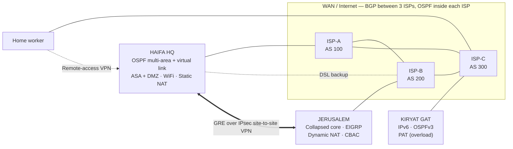

# Intel Israel — Enterprise Network Lab (Cisco Packet Tracer)

A **learn-by-building** final project for the Ministry of Education network-engineering
track (**שאלון 735918 — פרויקט גמר הנדסאים, רשתות תקשורת**).

You will build a 3-branch enterprise network for **Intel Israel** in Cisco Packet Tracer,
one small mini-project at a time. Every step explains the *why*, gives you the exact
devices, cables and commands, tells you how to **verify** it works, and ends with a
**challenge** you solve on your own.

> Rule of thumb: **type the commands, don't paste them** — at least the first time you
> meet a new command. Typing is how your fingers learn IOS. Paste only what you have
> already typed before.

---

## The company

| Site | City | Role | Design style |
|---|---|---|---|
| **HFA** | Haifa (MATAM) | **Main branch (HQ)** — DMZ, firewall, wireless | 3-tier: access / distribution / core, 3 buildings |
| **JLM** | Jerusalem | Branch | **Collapsed core** on Layer-3 switches, 3 floors |
| **KG**  | Kiryat Gat | Branch (fab) | **IPv6-only** LAN, compact 3-tier |



## Roadmap — 17 mini-projects

Do them **in order**. Each one ends with a working, saved `.pkt` checkpoint.

| # | Step | You learn | Time |
|---|---|---|---|
| 00 | [Getting started](steps/00-getting-started) | Packet Tracer, the CLI modes, how to use this repo | 30 min |
| 01 | [Plan the network](steps/01-plan-the-network) | IP planning, VLAN tables, naming — **on paper first** | 1–2 h |
| 02 | [First switch & VLANs](steps/02-first-switch-vlans) | Basic hardening, VLANs, access ports | 1 h |
| 03 | [Trunks & VTP](steps/03-trunks-and-vtp) | 802.1Q trunks, native VLAN, VTP | 1 h |
| 04 | [EtherChannel & STP](steps/04-etherchannel-and-stp) | LACP, Rapid-PVST+, root bridge, PortFast, BPDU/Root guard | 1.5 h |
| 05 | [Inter-VLAN, HSRP, DHCP](steps/05-intervlan-hsrp-dhcp) | SVIs, first-hop redundancy, DHCP on a router | 1.5 h |
| 06 | [Layer-2 security](steps/06-layer2-security) | Port-security, DHCP snooping, hardening | 1 h |
| 07 | [SSH management](steps/07-ssh-management) | Management VLAN, SSH, VTY ACL | 1 h |
| 08 | [Core, OSPF, servers](steps/08-core-ospf-servers) | Routed links, OSPF areas, MD5, AAA/TACACS+, Syslog | 2 h |
| 09 | [Buildings B & C + virtual link](steps/09-buildings-b-c-virtual-link) | **You** build 2 buildings; OSPF virtual link, summarization | 3 h |
| 10 | [Wireless](steps/10-wireless) | Employee + guest WiFi, guest isolation ACL | 1 h |
| 11 | [ASA firewall & DMZ](steps/11-asa-firewall-dmz) | inside/outside/DMZ, security levels, ACLs, 6 DMZ servers, NTP | 2 h |
| 12 | [WAN: ISPs, BGP, NAT](steps/12-wan-isp-bgp-nat) | eBGP, OSPF inside an AS, static NAT + PAT, DSL backup | 2.5 h |
| 13 | [Jerusalem — collapsed core](steps/13-jerusalem-collapsed-core) | EIGRP + summarization + auth, PAgP, DHCP server, dynamic NAT, CBAC | 3 h |
| 14 | [Kiryat Gat — IPv6](steps/14-kiryat-gat-ipv6) | IPv6 addressing, SLAAC + DHCPv6, OSPFv3, HSRPv6, PAT | 3 h |
| 15 | [VPN](steps/15-vpn) | GRE over IPsec site-to-site, remote-access VPN | 2 h |
| 16 | [Final integration](steps/16-final-integration) | Email accounts, scale to 8 PCs/dept, full test plan, project book | 3 h |

## Reference docs

- [docs/design.md](docs/design.md) — the full addressing / VLAN / naming plan (your "source of truth")
- [docs/requirements-matrix.md](docs/requirements-matrix.md) — every ministry requirement → where it is built
- [docs/passwords.md](docs/passwords.md) — password table (also needed in the project book)
- [docs/project-book-draft-he.md](docs/project-book-draft-he.md) — **Hebrew draft of the project book** (ספר הפרויקט), in the ministry's chapter order
- [docs/glossary.md](docs/glossary.md) — every networking term in simple English
- [docs/cheatsheet.md](docs/cheatsheet.md) — the `show` commands you will use 100 times
- [docs/pt-gotchas.md](docs/pt-gotchas.md) — Packet Tracer quirks and how to get past them

> **Status:** all 17 steps (00–16) are in the full *guided* format — every click and every
> command for every device, simple-English explanations, break/attack labs and teacher notes.
> A Hebrew draft of the project book is in [docs/project-book-draft-he.md](docs/project-book-draft-he.md).

## How each step is organised

```
steps/NN-name/README.md
  1. Goal                — what works at the end
  2. Concepts            — the theory you need, short
  3. Build               — devices to drag + cabling table
  4. Configure           — commands, explained line by line
  5. Verify              — show/ping commands and what "good" looks like
  6. Checkpoint          — save as my-work/stepNN.pkt and commit
  7. Common mistakes
  8. Challenge           — do it alone; answer hidden in a <details> block
```

## Saving your progress with git

```bash
git clone <this repo>
cd intel-israel-network-lab
# after each step:
git add my-work/step05.pkt
git commit -m "Step 05: inter-VLAN routing + HSRP working"
git push
```

Built for Packet Tracer **8.2.x**. Commands were written against IOS 15 / IOS-XE syntax as
Packet Tracer implements it; where Packet Tracer is known to be picky, the step says so and
[docs/pt-gotchas.md](docs/pt-gotchas.md) has the workaround.
