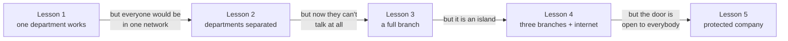

# Osem — build a full 3-branch project together in class

A complete final project (Osem: Sakhnin, Ashdod, Eilat), built **click by click** in **5 lessons of
90 minutes**, with the theory behind each step. It is based on a real project from a previous year,
with its mistakes fixed, and every mistake became a "find the bug" moment.
Each lesson ends with **"Your own project"**: do the same in your company's network.

**Osem is only an example.** Don't copy its names, addresses or passwords into your project.

## 📖 The story of the project
*This is a made-up story for class. The network is an example.*

**How we got here.** Osem makes food. It started with one small office in **Sakhnin**. Everybody sat in one room, shouted across it, and carried files on a USB stick. Then the company grew: departments, a server, a second branch in **Ashdod**, a third in **Eilat**. Nobody planned the network; it was just cables. One morning the salaries file was open on a computer in the assembly hall, and the same day one broken cable stopped the whole building.

**Where you come in.** The manager hired **you**, the new network team. You get an empty Packet Tracer file and one sentence: *"Build us a network that is organized, that doesn't stop when something breaks, that connects the three branches, and that doesn't let strangers in."*

**What we want in the end.** Those four wishes are the whole project. Everything we type belongs to one of them:

| The manager's wish | In network language | Where |
|---|---|---|
| "Organized" | names, VLANs, addresses, DHCP, DNS | lessons 1–3 |
| "Doesn't stop when something breaks" | backup switch + STP, two routers + HSRP, two lines to the edge router | lessons 2, 3, 4 |
| "Connects the branches" | serial lines, OSPF, EIGRP, BGP, NAT | lesson 4 |
| "Doesn't let strangers in" | passwords, port security, DHCP snooping, ACL, VPN, SSH + AAA, ASA | all lessons, mostly 5 |

**The road.** Each chapter solves one problem and **discovers the next one**. That's why the order can't be changed:

| Chapter | We start with | The problem | What we build, and why it solves it | We end with | The new problem |
|---|---|---|---|---|---|
| [1](lesson-01/) | an empty file | three people can't share one file | a **switch**: it connects many devices and sends each frame only to its owner | Salaries works | more departments = one big noisy network |
| [2](lesson-02/) | seven connected switches | everybody sees everybody | **VLANs** separate, **trunks** carry them, **STP** allows a backup road, **port security** guards the sockets | five separate departments | they can't talk at all, and addresses are typed by hand |
| [3](lesson-03/) | five islands in one building | no road between VLANs, no services | two **routers with HSRP** as the road, one **server** for addresses, names, web, files, mail | a complete branch | the branch can't reach the world |
| [4](lesson-04/) | three branches, three islands | red lines, no routes, private addresses | **serial lines**, **OSPF/EIGRP** inside, **BGP** to the provider, **NAT** at the exit | three branches on the internet | what can go out can also be attacked |
| [5](lesson-05/) | a working, open network | everything is allowed, everything is readable | **ACL** limits, **VPN** encrypts, **SSH + AAA** identify, **NTP + Syslog** remember, **ASA** blocks | the finished project | now build **your own** |

In every lesson you will find **📖 The story** at the beginning and **⏭ What comes next** at the end. In every mission three lines do the same: 📖 how we got here, 🎯 what we want now, ⏭ what comes next. At the end of a mission, **📘 the commands explained** tells you what each line does and why it is there.

📘 **Forgot what a command does?** [All the commands of the project](commands/), explained.

| Lesson | Topic | File to open |
|---|---|---|
| [01](lesson-01/) | First department: devices, cables, names, passwords | a new file |
| [02](lesson-02/) | Sakhnin switching: VLAN, VTP, trunks, STP, port security | [lesson02-start.pkt](lesson-02/lesson02-start.pkt) |
| [03](lesson-03/) | Sakhnin routing and services: HSRP, DHCP, DNS, web, FTP, mail | [lesson03-start.pkt](lesson-03/lesson03-start.pkt) |
| [04](lesson-04/) | Connecting the branches: WAN, OSPF, EIGRP, BGP, NAT | [lesson04-start.pkt](lesson-04/lesson04-start.pkt) |
| [05](lesson-05/) | Security: ACL, VPN, SSH, AAA, NTP, Syslog, ASA | [lesson05-start.pkt](lesson-05/lesson05-start.pkt) |

🧱 **Want to build everything alone, without start files?** [From an empty file to the whole project](from-zero/): every device, cable and command that the start files do for you, and 14 tests at the end.

📝 **Practise for the exam:** [questions, missions, faults and three mock exams (PDF)](exam/osem-exam-practice.pdf). The answer key is with the teacher.

The start file of each lesson is the result of the previous one, so a student who missed a lesson or
got stuck can join. **Packet Tracer 9.0.1** is recommended: that is the version we tested with.

## What you find in every lesson
| Sign | What it is | How to use it in class |
|---|---|---|
| 📖 🎯 ⏭ | how we got here, what we want now, what comes next | ask a student to tell the story before you read it |
| 🌐 | the network now, with a numbered map | say where we are. The numbers show which device to click |
| ❗ | the problem | show it on the screen **before** solving it |
| 💡 | the solution, in words | after it, ask a student to explain it back |
| 📋 | do it yourself in the project | 5 minutes alone, without looking down |
| 🖱 | the full solution: what to click, what to write, what you must see | compare screen to screenshot, step by step |
| 📘 | every command or field, explained | point at a line and ask "why is it here?" |
| 💬 | the idea in simple words | say it before the definition |
| **Example** | a worked example with our addresses | solve it on the board, one row at a time |
| ❓ | a question for the class | wait for answers before you open the answer |
| ✅ | a check | nobody continues before it is true on their screen |
| 👀 | see the packets move, in Simulation mode | 5–10 minutes on the projector: students guess, then you click |
| 🧯 | "It doesn't work?" | the student looks here first, then calls you |
| 🔎 | find the bug | in pairs, 3 minutes |
| 🏋 | exercises, with answers | for those who finish early, or homework |
| 🎓 | examiner questions, with model answers | one student asks, another answers |
| ✏️ | exit quiz | 3 minutes at the end, on paper |

Every lesson has more material than 90 minutes: the missions are the core, and 🏋, 🎓 and ✏️ can move to homework.

## The address plan
| Branch | VLAN | Name | Network | Gateway (VIP) |
|---|---|---|---|---|
| Sakhnin | 10 | MANAGEMENT | 192.168.10.0/24 | .252 |
| Sakhnin | 20 | DISPLAY-SALARIES | 192.168.20.0/24 | .252 |
| Sakhnin | 30 | ASSEMBLY-MEETING | 192.168.30.0/24 | .252 |
| Sakhnin | 40 | IT | 192.168.40.0/24 | .252 |
| Sakhnin | 50 | SERVERS | 192.168.50.0/24 | .252 |
| Ashdod | 60–63 | 63 = servers | 192.168.60–63.0/24 | .252 |
| Eilat | 80–83 | 83 = servers | 192.168.80–83.0/24 | .252 |

In every network .254 is the main router and .253 the backup. The WAN table is in lesson 4.

## Classroom passwords
| Where | Value |
|---|---|
| Console / enable | `Osem#Con` / `Osem#En1` |
| After lesson 5, console of the main and backup routers | `admin` / `Osem#Adm1` |

For class only. In your project choose passwords of your own.
