# From an empty file to the whole project

> 🧰 Packet Tracer 9.0.1 · 🏠 homework, or extra lessons · 💾 your own file: `osem-full.pkt`

The five lessons have **start files**, so in class nobody wastes time placing 60 devices. This page is for a student who wants to
build **everything alone**: it contains every step that the start files do for you. Together with the five lessons it is the
complete project.

| Do this | Then you have |
|---|---|
| Lesson 1 | 2 switches and 3 PCs |
| **[Part A](#part-a--the-rest-of-sakhnin)** | the same as `lesson02-start.pkt` |
| Lesson 2 | the switching of Sakhnin |
| **[Part B](#part-b--two-routers-for-sakhnin)** | the same as `lesson03-start.pkt` |
| Lesson 3 | a full branch |
| **[Part C](#part-c--the-provider-ashdod-and-eilat)** | the same as `lesson04-start.pkt` |
| Lesson 4 | three connected branches |
| **[Part D](#part-d--the-firewall-and-the-servers-of-ashdod-and-eilat)** | the same as `lesson05-start.pkt` |
| Lesson 5, and the **[final check](#final-check)** | the finished project |

**Three rules.** (1) Names exactly as written. (2) Ports exactly as in the tables: all the commands depend on them.
(3) After every mission: `copy running-config startup-config` on each device you touched, and **File → Save** (Ctrl+S). Packet Tracer sometimes closes by itself, so save often.

✔️ **Tested.** All the commands and the server forms on this page and in the five lessons were typed, one after the other, into factory-empty devices.
The result was identical to the finished project (30 of 30 configured devices, 3 servers), and the 14 tests of the [final check](#final-check) passed.

**How every mission is built:** 🌐 the network now → ❗ the problem → 💡 the solution → 📋 do it yourself → 🖱 the full solution.

The whole project, when it's finished:

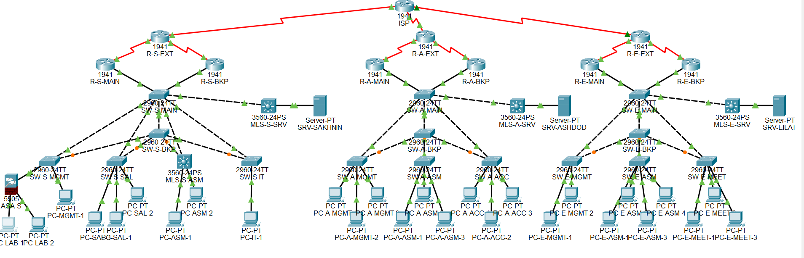

---

# Part A — the rest of Sakhnin

*After lesson 1, before lesson 2. Continue in the file you saved in lesson 1.*

## A1 — Place the devices
**🌐 The network now.** SW-S-MAIN, SW-S-SAL and three PCs, from lesson 1.

**❗ The problem.** The branch has five networks (four kinds of departments and the servers), and you have one department.

**💡 The solution.** A switch for each department, a backup switch, a switch for the server, and the server itself. Assembly and the servers get a **3560**: a multilayer switch.

**📋 Do it in the project.** Place the devices of the table and give them these names.

### 🖱 The solution: what to click and what to write
1. **Network Devices** (1) → **Switches** (2) → **2960** (3) or **3560-24PS** (4; not the 3650 next to it), and click on the workspace.

   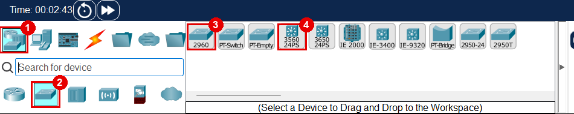
2. For the PCs and the server: **End Devices** (1) → **PC** (2) or **Server** (3).

   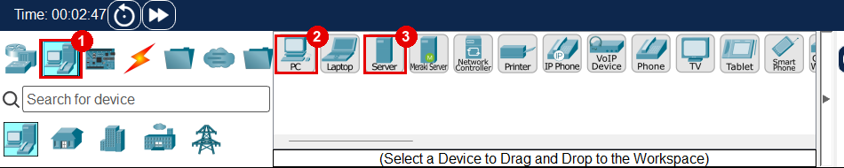
3. Rename every device like in lesson 1: click it → **Config** → **Display Name**.

| Name | Model |
|---|---|
| SW-S-BKP | 2960 |
| SW-S-IT | 2960 |
| SW-S-MGMT | 2960 |
| MLS-S-ASM | 3560-24PS |
| MLS-S-SRV | 3560-24PS |
| SRV-SAKHNIN | Server |
| PC-ASM-1 | PC |
| PC-ASM-2 | PC |
| PC-IT-1 | PC |
| PC-MGMT-1 | PC |

Arrange them like this. The label at each end of a cable is the port (for the next mission). A dashed line is a cross-over cable:

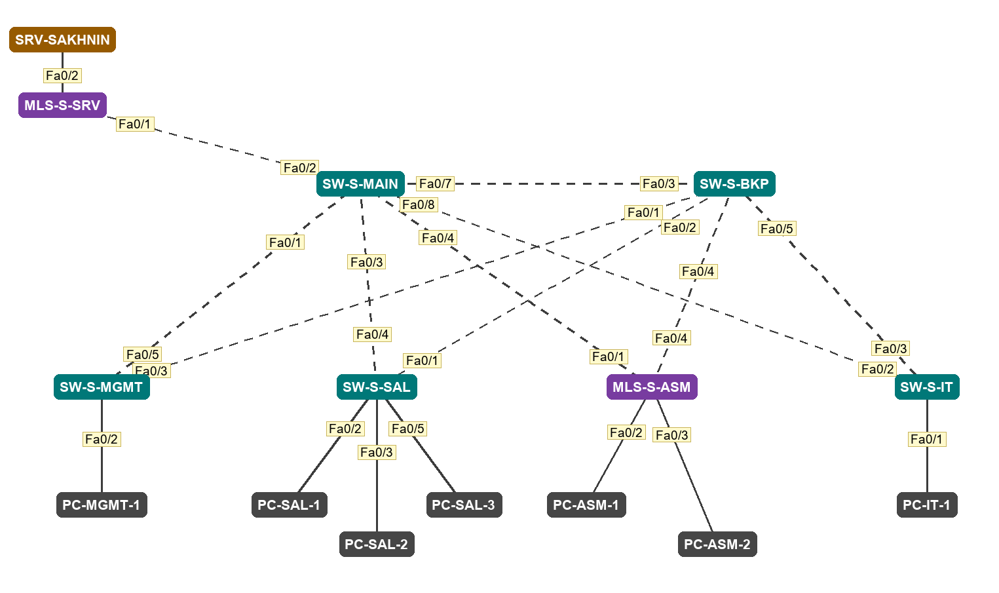

## A2 — The cables
**🌐 The network now.** Devices without cables.

**❗ The problem.** In lesson 2 every command names a port. A cable in another port = a VLAN on the wrong device.

**💡 The solution.** A port table. Every department switch has **two** uplinks: one to the main switch and one to the backup.

**📋 Do it in the project.** Connect by the table. Say aloud for each row: straight-through or cross-over, and why?

### 🖱 The solution: what to click and what to write
**Connections** (1) → **Copper Straight-Through** (2) or **Copper Cross-Over** (3) → click the first device and choose its port → click the second device and choose its port.

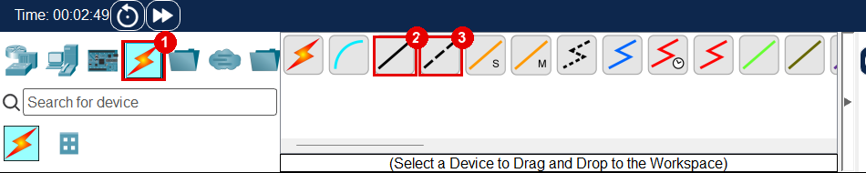

| # | Cable | First device | Port | Second device | Port |
|---|---|---|---|---|---|
| 1 | Cross-Over | SW-S-MAIN | Fa0/1 | SW-S-MGMT | Fa0/5 |
| 2 | Cross-Over | SW-S-MAIN | Fa0/2 | MLS-S-SRV | Fa0/1 |
| 3 | Cross-Over | SW-S-MAIN | Fa0/4 | MLS-S-ASM | Fa0/1 |
| 4 | Cross-Over | SW-S-MAIN | Fa0/7 | SW-S-BKP | Fa0/3 |
| 5 | Cross-Over | SW-S-MAIN | Fa0/8 | SW-S-IT | Fa0/2 |
| 6 | Cross-Over | SW-S-BKP | Fa0/1 | SW-S-MGMT | Fa0/3 |
| 7 | Cross-Over | SW-S-BKP | Fa0/2 | SW-S-SAL | Fa0/1 |
| 8 | Cross-Over | SW-S-BKP | Fa0/4 | MLS-S-ASM | Fa0/4 |
| 9 | Cross-Over | SW-S-BKP | Fa0/5 | SW-S-IT | Fa0/3 |
| 10 | Straight-Through | SW-S-IT | Fa0/1 | PC-IT-1 | Fa0 |
| 11 | Straight-Through | SW-S-MGMT | Fa0/2 | PC-MGMT-1 | Fa0 |
| 12 | Straight-Through | MLS-S-ASM | Fa0/2 | PC-ASM-1 | Fa0 |
| 13 | Straight-Through | MLS-S-ASM | Fa0/3 | PC-ASM-2 | Fa0 |
| 14 | Straight-Through | MLS-S-SRV | Fa0/2 | SRV-SAKHNIN | Fa0 |

✅ After about a minute: green, and some links orange on one side. That is STP blocking a loop, and it's correct.

## A3 — Base configuration of five switches
**🌐 The network now.** SW-S-MAIN and SW-S-SAL were configured in lesson 1. Five new switches are still called `Switch` and have no password.

**❗ The problem.** Anyone with a console cable enters, and you can't see which switch you're on.

**💡 The solution.** The block of lesson 1, with one line changed: `hostname`.

**📋 Do it in the project.** Configure SW-S-BKP, SW-S-MGMT, SW-S-IT, MLS-S-ASM, MLS-S-SRV. Try the first one from memory.

### 🖱 The solution: what to click and what to write
Click the switch → **CLI** → **Enter** until `Switch>` appears. Write the block of **SW-S-BKP** (at `Destination filename` press Enter):

```
enable
configure terminal
hostname SW-S-BKP
no ip domain-lookup
enable secret Osem#En1
service password-encryption
banner motd # Osem - Authorized access only #
line console 0
password Osem#Con
login
logging synchronous
exec-timeout 10 0
end
copy running-config startup-config
```

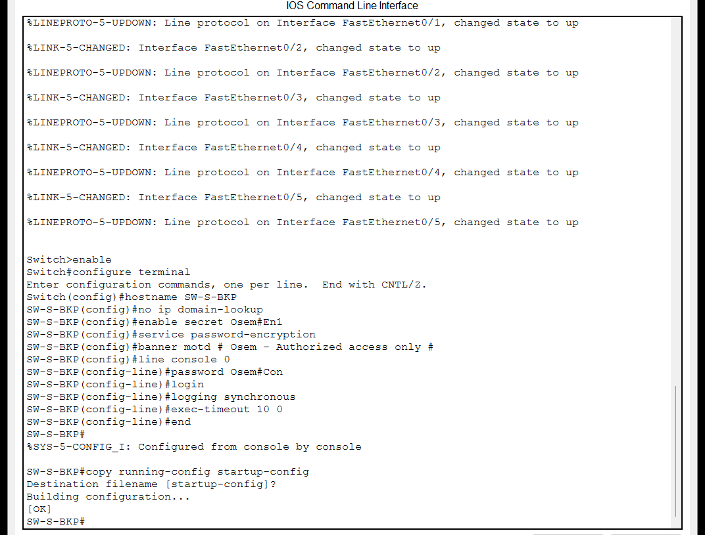

For the other four, the same block. Only one line changes:

| Device | The line that changes |
|---|---|
| SW-S-MGMT | `hostname SW-S-MGMT` |
| SW-S-IT | `hostname SW-S-IT` |
| MLS-S-ASM | `hostname MLS-S-ASM` |
| MLS-S-SRV | `hostname MLS-S-SRV` |

⚠️ The **3560** (MLS-…) starts with a question, like a router: `Would you like to enter the initial configuration dialog? [yes/no]:`. Write `no`, press Enter, and Enter again until `Switch>`. After that it takes exactly the same commands:

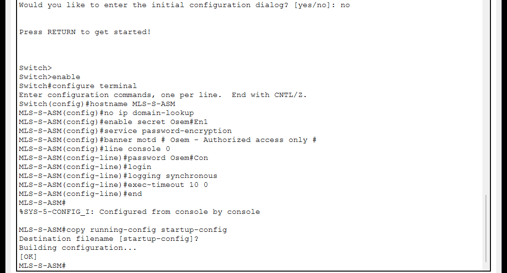

## A4 — Addresses of the PCs
**🌐 The network now.** Only the Salaries PCs have addresses (lesson 1).

**❗ The problem.** In lesson 2 we show which PCs can talk and which can't. A PC without an address proves nothing.

**💡 The solution.** A fixed address for every PC, in the network of its future VLAN. In lesson 3 they change to DHCP.

**📋 Do it in the project.** Give the four new PCs an address. Which PCs can ping each other now? Why?

### 🖱 The solution: what to click and what to write
PC → **Desktop** → **IP Configuration** → **Static**, like in lesson 1. The gateway stays empty.

| PC | IPv4 Address | Subnet Mask |
|---|---|---|
| PC-MGMT-1 | 192.168.10.21 | 255.255.255.0 |
| PC-ASM-1 | 192.168.30.21 | 255.255.255.0 |
| PC-ASM-2 | 192.168.30.22 | 255.255.255.0 |
| PC-IT-1 | 192.168.40.21 | 255.255.255.0 |

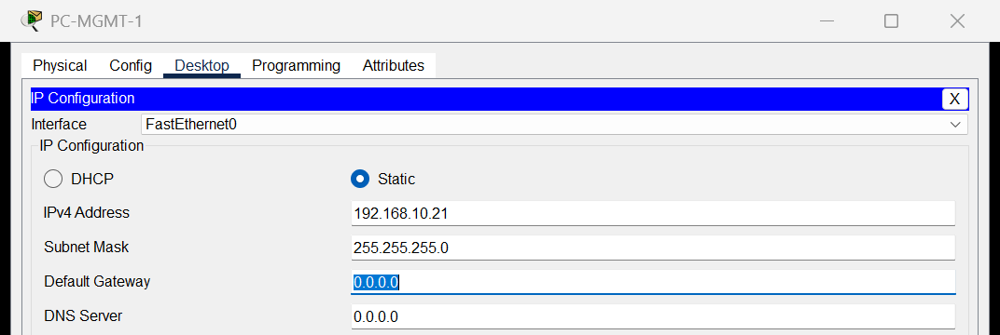

✅ From PC-ASM-1: `ping 192.168.30.22` works, and `ping 192.168.40.21` fails (another network, and there is no router yet).

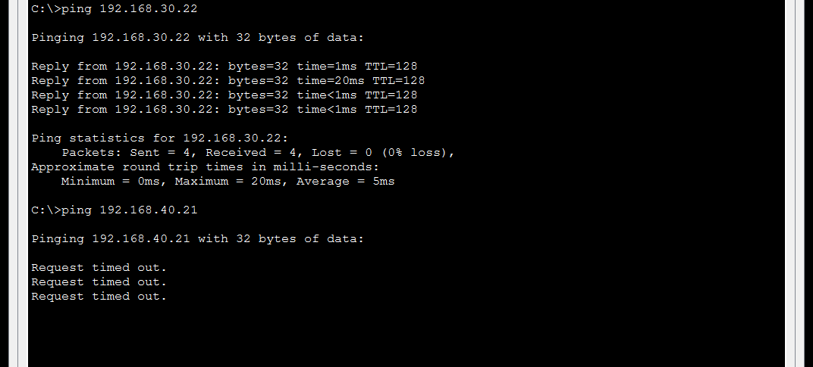

➡ Now do **[lesson 2](../lesson-02/)** in your file.

---

# Part B — two routers for Sakhnin

*After lesson 2, before lesson 3.*

## B1 — Place two routers and add a serial card
**🌐 The network now.** Five VLANs, switched and protected. Nothing routes between them.

**❗ The problem.** We need two routers, and later a serial line to the internet. A new 1941 has two Ethernet ports and **no serial port**.

**💡 The solution.** Two **1941** routers, each with an **HWIC-2T** card: two serial ports. A card goes in only when the power is **off**.

**📋 Do it in the project.** Place R-S-MAIN and R-S-BKP, and put one HWIC-2T in the **right** slot of each.

### 🖱 The solution: what to click and what to write
1. **Network Devices** (1) → **Routers** (2) → **1941** (3). Names: `R-S-MAIN`, `R-S-BKP`.

   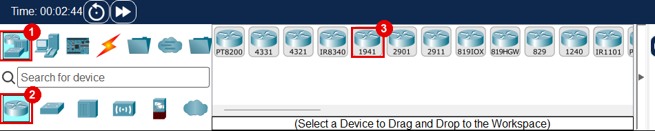
2. Click the router → **Physical** tab. Click the **power switch** (1): its green light goes off.
3. Drag **HWIC-2T** (2) from the list to the **right** slot (3).
4. Click the power switch (1) again: the light is green.

   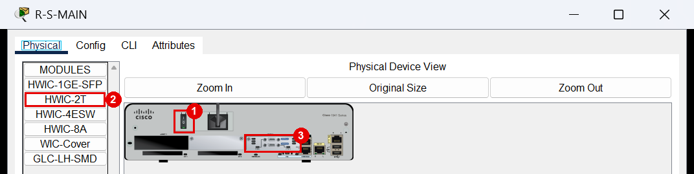

⚠️ The **right** slot is slot 0: its ports are `S0/0/0` and `S0/0/1`. The left slot is slot 1: `S0/1/0` and `S0/1/1`. A card in the
wrong slot = the serial commands of lesson 4 are rejected.

## B2 — Cables and base configuration
**🌐 The network now.** Two routers that are connected to nothing.

**❗ The problem.** A new router doesn't start with `Router>` but with a **question**. Answer `yes` and you're in a long questionnaire.

**💡 The solution.** Answer `no`, and write the base block.

**📋 Do it in the project.** Connect both routers to SW-S-MAIN and configure. Which cable goes between a router and a switch?

### 🖱 The solution: what to click and what to write
| # | Cable | First device | Port | Second device | Port |
|---|---|---|---|---|---|
| 1 | Straight-Through | R-S-BKP | G0/0 | SW-S-MAIN | Fa0/5 |
| 2 | Straight-Through | R-S-MAIN | G0/0 | SW-S-MAIN | Fa0/6 |

The triangles stay **red**: router ports are off until `no shutdown` (lesson 3).

Click **R-S-MAIN** → **CLI**. At `Would you like to enter the initial configuration dialog? [yes/no]:` write `no` and press Enter. Press Enter again until `Router>`:

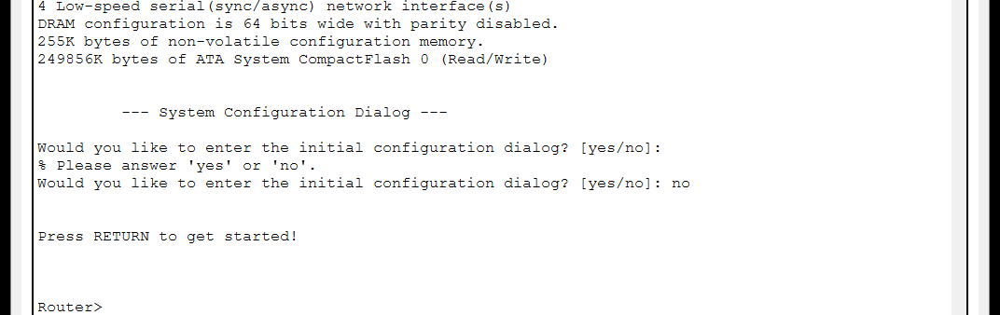

**R-S-MAIN**:

```
enable
configure terminal
hostname R-S-MAIN
no ip domain-lookup
enable secret Osem#En1
service password-encryption
banner motd # Osem - Authorized access only #
line console 0
password Osem#Con
login
logging synchronous
exec-timeout 10 0
end
copy running-config startup-config
```

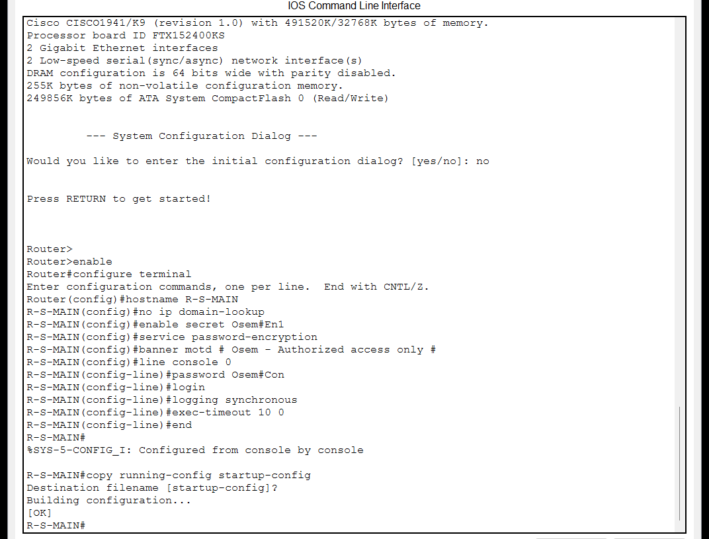

**R-S-BKP**: first `no`, and then the same block. Only one line changes: `hostname R-S-BKP`.

➡ Now do **[lesson 3](../lesson-03/)**.

---

# Part C — the provider, Ashdod and Eilat

*After lesson 3, before lesson 4. The longest part.*

## C1 — The edge routers, the provider and the serial lines
**🌐 The network now.** Sakhnin works, but it's an island.

**❗ The problem.** There is no router towards the internet, no provider, and no other branch.

**💡 The solution.** In each branch one **edge router** (EXT), and one **ISP** router for all. These routers are connected by **serial** cables.

**📋 Do it in the project.** Place the eight routers with the right cards, and connect the nine serial lines.

### 🖱 The solution: what to click and what to write
1. Place the **1941** routers and insert the cards like in B1 (power off → drag → power on):

   | Router | Cards | Where |
   |---|---|---|
   | ISP, R-S-EXT, R-A-EXT, R-E-EXT | **two** HWIC-2T | right slot **and** left slot |
   | R-A-MAIN, R-A-BKP, R-E-MAIN, R-E-BKP | one HWIC-2T | right slot |

   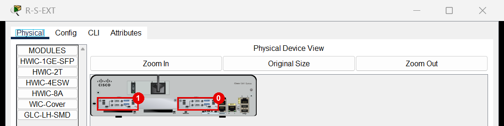
2. **Connections** (1) → **Serial DCE** (2) → click **first** the DCE device of the table, and then the second one.

   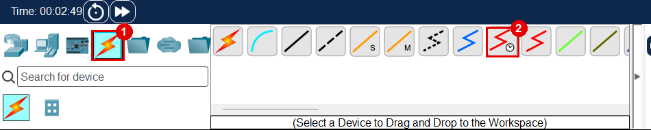

   | # | First (DCE) | Port | Second | Port |
   |---|---|---|---|---|
   | 1 | R-S-EXT | S0/0/0 | R-S-MAIN | S0/0/0 |
   | 2 | R-S-EXT | S0/1/0 | R-S-BKP | S0/0/0 |
   | 3 | ISP | S0/0/0 | R-S-EXT | S0/0/1 |
   | 4 | R-A-EXT | S0/0/1 | R-A-MAIN | S0/0/0 |
   | 5 | R-A-EXT | S0/1/0 | R-A-BKP | S0/0/0 |
   | 6 | ISP | S0/0/1 | R-A-EXT | S0/0/0 |
   | 7 | R-E-EXT | S0/0/1 | R-E-MAIN | S0/0/0 |
   | 8 | R-E-EXT | S0/1/0 | R-E-BKP | S0/0/0 |
   | 9 | ISP | S0/1/0 | R-E-EXT | S0/0/0 |

   ⚠️ The **first** device you click is the DCE: it gives the clock. In lesson 4 `clock rate` is written on that side.
3. Base configuration: on each new router answer `no`, and write the block of B2 with its own name:

| Device | The line that changes |
|---|---|
| R-S-EXT | `hostname R-S-EXT` |
| ISP | `hostname ISP` |
| R-A-EXT | `hostname R-A-EXT` |
| R-A-MAIN | `hostname R-A-MAIN` |
| R-A-BKP | `hostname R-A-BKP` |
| R-E-EXT | `hostname R-E-EXT` |
| R-E-MAIN | `hostname R-E-MAIN` |
| R-E-BKP | `hostname R-E-BKP` |

All the serial lines stay **red** until lesson 4. That's correct.

## C2 — Ashdod: devices, cables, base
**🌐 The network now.** The routers of Ashdod stand alone.

**❗ The problem.** A whole branch is missing: management, assembly, accounting and servers.

**💡 The solution.** Exactly the same design as Sakhnin. **This is the test of what you learned**: nothing here is new.

**📋 Do it in the project.** Place, name, connect, and give every switch its base configuration.

### 🖱 The solution: what to click and what to write
| Name | Model |
|---|---|
| SW-A-MAIN | 2960 |
| SW-A-BKP | 2960 |
| SW-A-ACC | 2960 |
| SW-A-ASM | 2960 |
| SW-A-MGMT | 2960 |
| MLS-A-SRV | 3560-24PS |
| SRV-ASHDOD | Server |
| PC-A-ACC-1 | PC |
| PC-A-ACC-2 | PC |
| PC-A-ACC-3 | PC |
| PC-A-ASM-1 | PC |
| PC-A-ASM-2 | PC |
| PC-A-ASM-3 | PC |
| PC-A-MGMT-1 | PC |
| PC-A-MGMT-2 | PC |
| PC-A-MGMT-3 | PC |

| # | Cable | First device | Port | Second device | Port |
|---|---|---|---|---|---|
| 1 | Straight-Through | R-A-BKP | G0/0 | SW-A-MAIN | Fa0/6 |
| 2 | Straight-Through | R-A-MAIN | G0/0 | SW-A-MAIN | Fa0/2 |
| 3 | Cross-Over | SW-A-MAIN | Fa0/1 | SW-A-MGMT | Fa0/4 |
| 4 | Cross-Over | SW-A-MAIN | Fa0/3 | SW-A-ASM | Fa0/4 |
| 5 | Cross-Over | SW-A-MAIN | Fa0/4 | MLS-A-SRV | Fa0/1 |
| 6 | Cross-Over | SW-A-MAIN | Fa0/5 | SW-A-ACC | Fa0/4 |
| 7 | Cross-Over | SW-A-MAIN | Fa0/7 | SW-A-BKP | Fa0/4 |
| 8 | Cross-Over | SW-A-BKP | Fa0/1 | SW-A-MGMT | Fa0/5 |
| 9 | Cross-Over | SW-A-BKP | Fa0/2 | SW-A-ASM | Fa0/5 |
| 10 | Cross-Over | SW-A-BKP | Fa0/3 | SW-A-ACC | Fa0/5 |
| 11 | Straight-Through | SW-A-ACC | Fa0/1 | PC-A-ACC-1 | Fa0 |
| 12 | Straight-Through | SW-A-ACC | Fa0/2 | PC-A-ACC-2 | Fa0 |
| 13 | Straight-Through | SW-A-ACC | Fa0/3 | PC-A-ACC-3 | Fa0 |
| 14 | Straight-Through | SW-A-ASM | Fa0/1 | PC-A-ASM-1 | Fa0 |
| 15 | Straight-Through | SW-A-ASM | Fa0/2 | PC-A-ASM-2 | Fa0 |
| 16 | Straight-Through | SW-A-ASM | Fa0/3 | PC-A-ASM-3 | Fa0 |
| 17 | Straight-Through | SW-A-MGMT | Fa0/1 | PC-A-MGMT-1 | Fa0 |
| 18 | Straight-Through | SW-A-MGMT | Fa0/2 | PC-A-MGMT-2 | Fa0 |
| 19 | Straight-Through | SW-A-MGMT | Fa0/3 | PC-A-MGMT-3 | Fa0 |
| 20 | Straight-Through | MLS-A-SRV | Fa0/2 | SRV-ASHDOD | Fa0 |

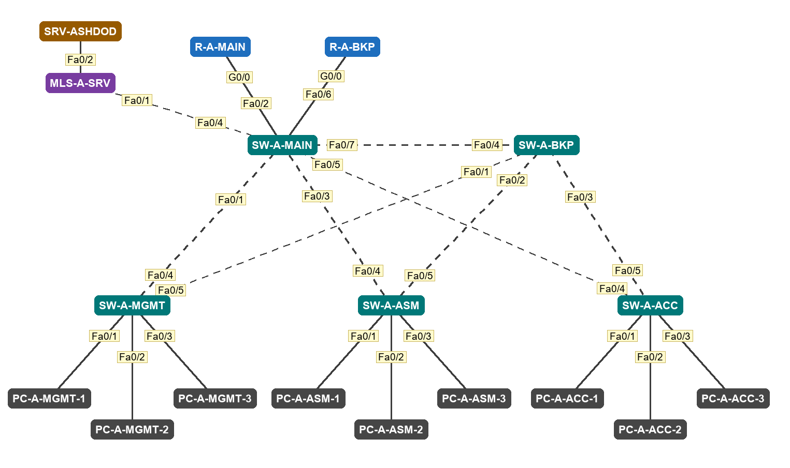

The base block of A3 on every switch, with its own name (on the MLS: first answer `no`):

| Device | The line that changes |
|---|---|
| SW-A-MAIN | `hostname SW-A-MAIN` |
| SW-A-BKP | `hostname SW-A-BKP` |
| SW-A-MGMT | `hostname SW-A-MGMT` |
| SW-A-ASM | `hostname SW-A-ASM` |
| SW-A-ACC | `hostname SW-A-ACC` |
| MLS-A-SRV | `hostname MLS-A-SRV` |

## C3 — Ashdod: switching
**🌐 The network now.** Everything connected, everything in VLAN 1.

**❗ The problem.** The same as in lesson 2: one big network, loops, and open ports.

**💡 The solution.** Everything of lesson 2 and the DHCP snooping of lesson 3, in one block per switch.

**📋 Do it in the project.** Write the block of SW-A-ACC alone, from the plan. Then compare.

| VLAN | Name | Network | Switch |
|---|---|---|---|
| 60 | MANAGEMENT | 192.168.60.0/24 | SW-A-MGMT |
| 61 | ASSEMBLY | 192.168.61.0/24 | SW-A-ASM |
| 62 | ACCOUNTING | 192.168.62.0/24 | SW-A-ACC |
| 63 | SERVERS | 192.168.63.0/24 | MLS-A-SRV |

### 🖱 The solution: what to click and what to write
On each switch: log in, `enable`, and write the block. Messages about ports that go down, and `PVID` messages, are normal here.

**SW-A-MAIN:**
```
configure terminal
vtp domain ASHDOD
vtp password Osem#Vtp
vtp mode server
vlan 60
name MANAGEMENT
vlan 61
name ASSEMBLY
vlan 62
name ACCOUNTING
vlan 63
name SERVERS
exit
spanning-tree vlan 1,60,61,62,63 root primary
ip dhcp snooping
ip dhcp snooping vlan 60,61,62
no ip dhcp snooping information option
interface range fa0/1 - 3 , fa0/5 - 7
switchport mode trunk
exit
interface range fa0/1 , fa0/3 , fa0/5
spanning-tree guard root
exit
interface fa0/4
switchport mode access
switchport access vlan 63
switchport port-security
switchport port-security maximum 2
switchport port-security mac-address sticky
switchport port-security violation shutdown
exit
interface range fa0/2 , fa0/4 , fa0/6 - 7
ip dhcp snooping trust
exit
interface range fa0/8 - 24 , g0/1 - 2
shutdown
end
copy running-config startup-config
```
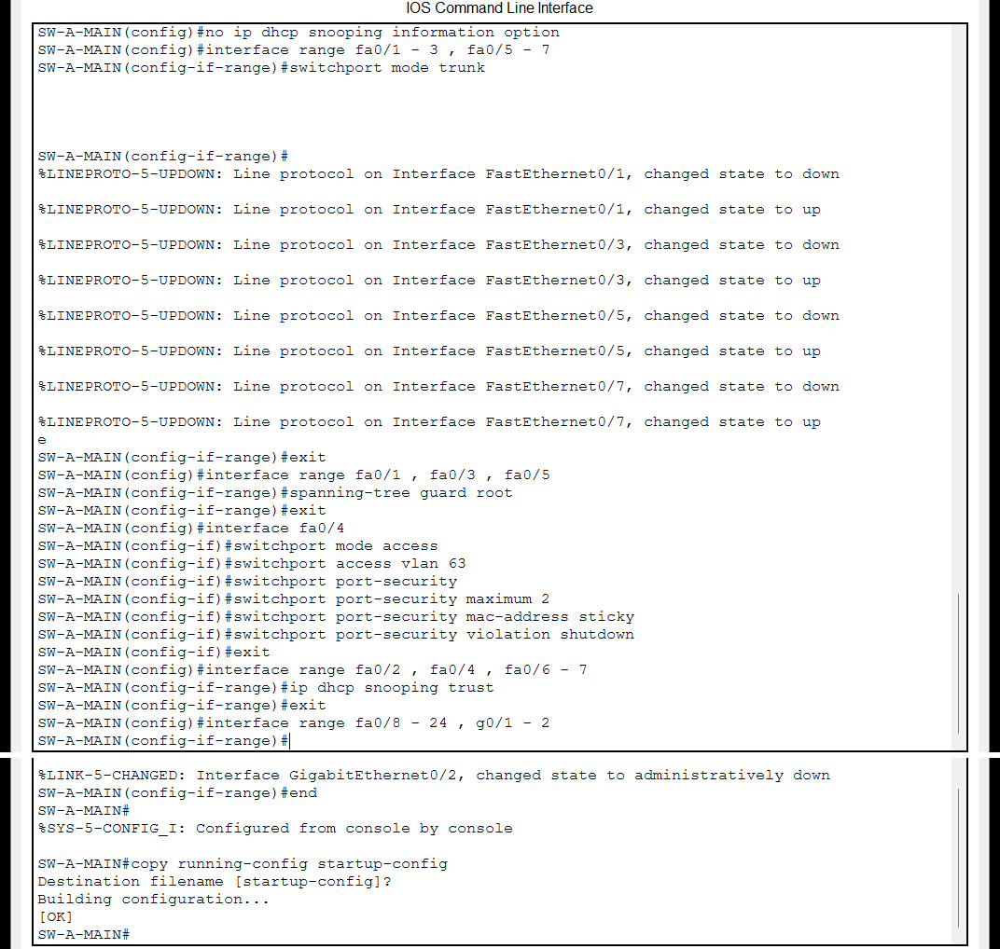

**SW-A-BKP:**
```
configure terminal
vtp domain ASHDOD
vtp password Osem#Vtp
vtp mode client
spanning-tree vlan 1,60,61,62,63 root secondary
interface range fa0/1 - 4
switchport mode trunk
exit
interface range fa0/5 - 24 , g0/1 - 2
shutdown
end
copy running-config startup-config
```
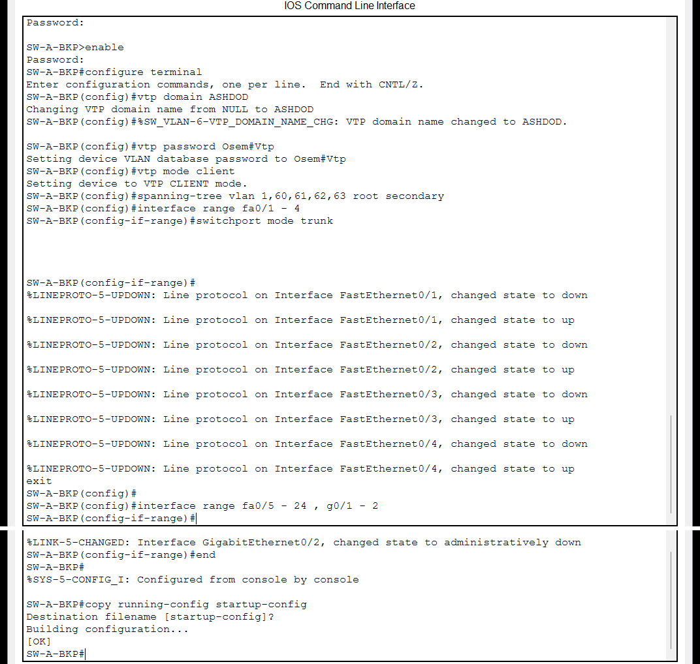

**SW-A-MGMT:**
```
configure terminal
vtp domain ASHDOD
vtp password Osem#Vtp
vtp mode client
interface range fa0/4 - 5
switchport mode trunk
exit
interface range fa0/1 - 3
switchport mode access
switchport access vlan 60
spanning-tree portfast
spanning-tree bpduguard enable
switchport port-security
switchport port-security maximum 1
switchport port-security mac-address sticky
switchport port-security violation shutdown
exit
interface range fa0/6 - 24 , g0/1 - 2
shutdown
end
copy running-config startup-config
```
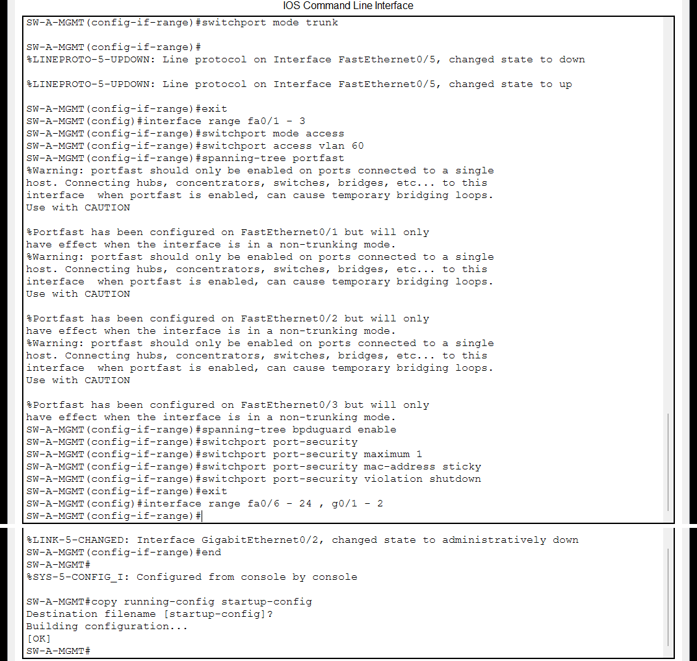

**SW-A-ASM:**
```
configure terminal
vtp domain ASHDOD
vtp password Osem#Vtp
vtp mode client
interface range fa0/4 - 5
switchport mode trunk
exit
interface range fa0/1 - 3
switchport mode access
switchport access vlan 61
spanning-tree portfast
spanning-tree bpduguard enable
switchport port-security
switchport port-security maximum 1
switchport port-security mac-address sticky
switchport port-security violation shutdown
exit
interface range fa0/6 - 24 , g0/1 - 2
shutdown
end
copy running-config startup-config
```
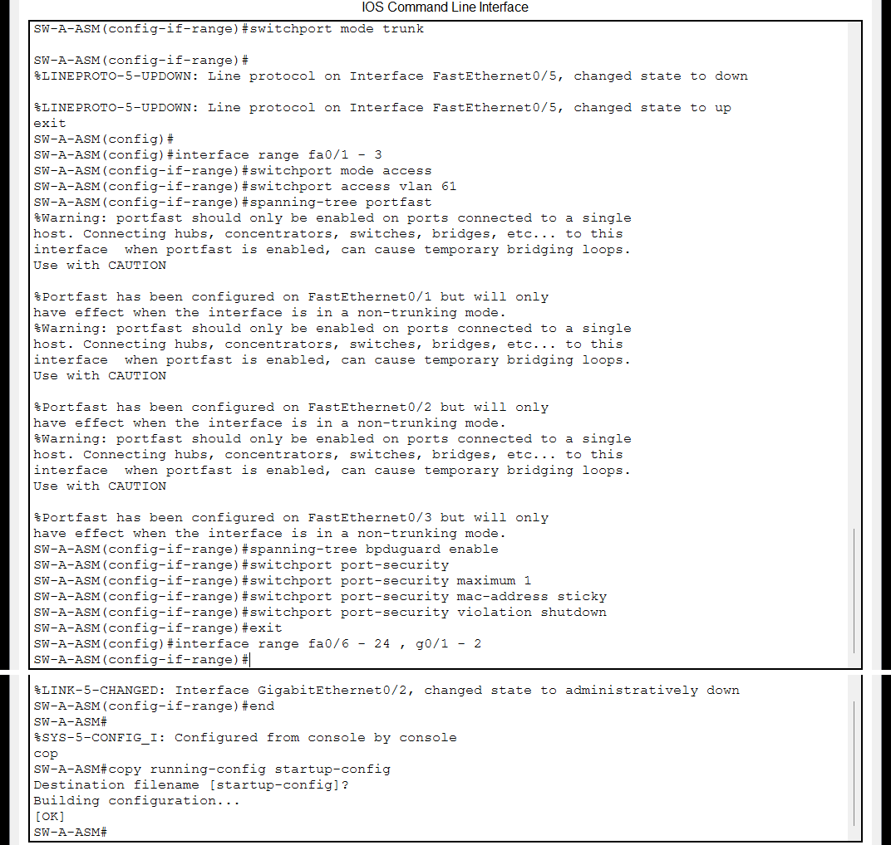

**SW-A-ACC:**
```
configure terminal
vtp domain ASHDOD
vtp password Osem#Vtp
vtp mode client
interface range fa0/4 - 5
switchport mode trunk
exit
interface range fa0/1 - 3
switchport mode access
switchport access vlan 62
spanning-tree portfast
spanning-tree bpduguard enable
switchport port-security
switchport port-security maximum 1
switchport port-security mac-address sticky
switchport port-security violation shutdown
exit
interface range fa0/6 - 24 , g0/1 - 2
shutdown
end
copy running-config startup-config
```
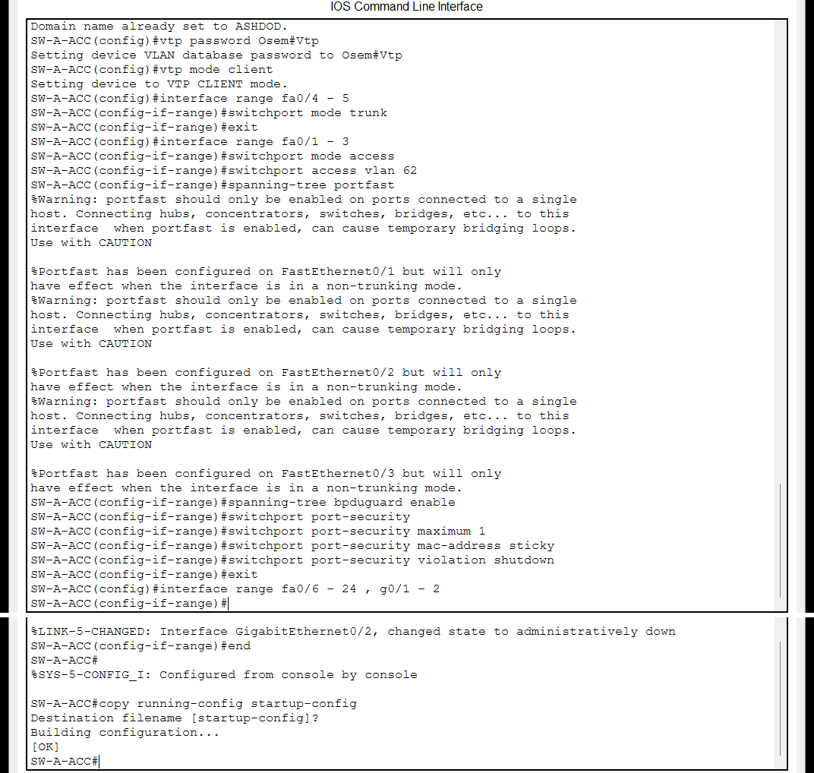

**MLS-A-SRV:**
```
configure terminal
vtp mode transparent
vlan 63
name SERVERS
exit
interface range fa0/1 - 2
switchport mode access
switchport access vlan 63
exit
interface range fa0/3 - 24 , g0/1 - 2
shutdown
exit
interface fa0/2
spanning-tree portfast
spanning-tree bpduguard enable
switchport port-security
switchport port-security maximum 1
switchport port-security mac-address sticky
switchport port-security violation shutdown
end
copy running-config startup-config
```
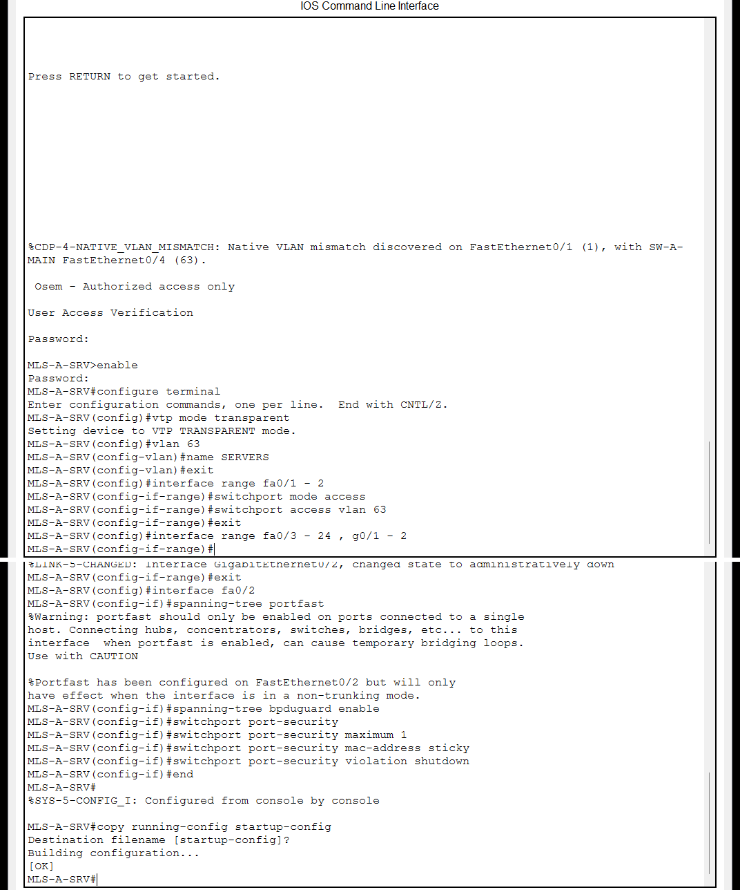

✅ On SW-A-ACC: `show vtp status` (client, domain ASHDOD) and `show vlan brief`: VLANs 60–63, and Fa0/1–3 in VLAN 62.

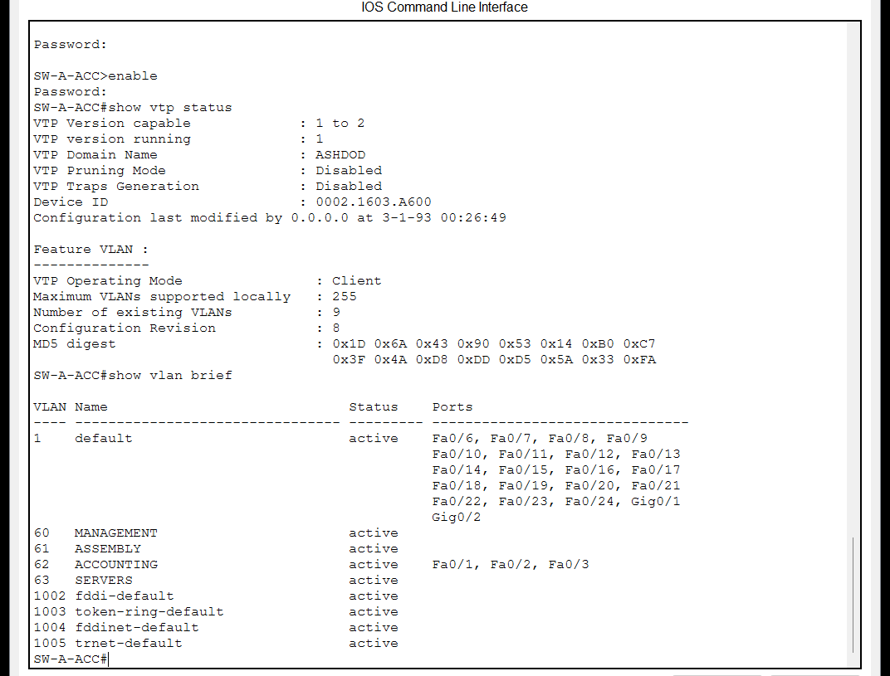

## C4 — Ashdod: routers
**🌐 The network now.** Four VLANs, and no gateway.

**❗ The problem.** No way between the departments, and no way to the DHCP server.

**💡 The solution.** Sub-interfaces, HSRP and helper, like in lesson 3.

**📋 Do it in the project.** Copy your own block of R-S-MAIN and change the VLANs, the addresses and the helper. In which VLAN is there no helper?

### 🖱 The solution: what to click and what to write
**R-A-MAIN:**
```
configure terminal
interface g0/0
no shutdown
exit
interface g0/0.60
encapsulation dot1Q 60
ip address 192.168.60.254 255.255.255.0
standby 60 ip 192.168.60.252
standby 60 priority 110
standby 60 preempt
ip helper-address 192.168.63.1
exit
interface g0/0.61
encapsulation dot1Q 61
ip address 192.168.61.254 255.255.255.0
standby 61 ip 192.168.61.252
standby 61 priority 110
standby 61 preempt
ip helper-address 192.168.63.1
exit
interface g0/0.62
encapsulation dot1Q 62
ip address 192.168.62.254 255.255.255.0
standby 62 ip 192.168.62.252
standby 62 priority 110
standby 62 preempt
ip helper-address 192.168.63.1
exit
interface g0/0.63
encapsulation dot1Q 63
ip address 192.168.63.254 255.255.255.0
standby 63 ip 192.168.63.252
standby 63 priority 110
standby 63 preempt
exit
end
copy running-config startup-config
```
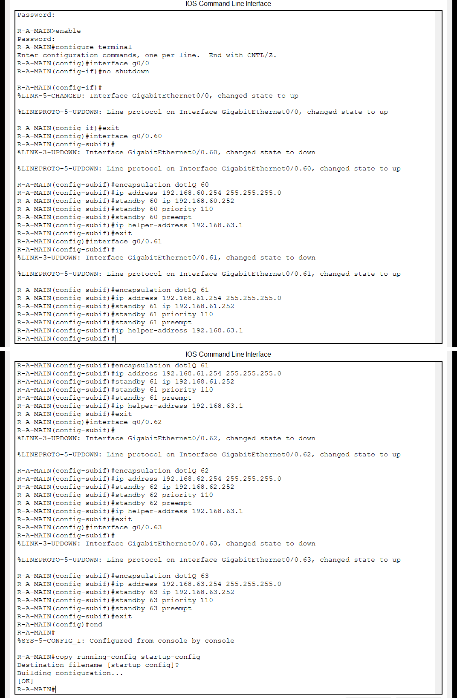

**R-A-BKP:**
```
configure terminal
interface g0/0
no shutdown
exit
interface g0/0.60
encapsulation dot1Q 60
ip address 192.168.60.253 255.255.255.0
standby 60 ip 192.168.60.252
standby 60 priority 105
standby 60 preempt
ip helper-address 192.168.63.1
exit
interface g0/0.61
encapsulation dot1Q 61
ip address 192.168.61.253 255.255.255.0
standby 61 ip 192.168.61.252
standby 61 priority 105
standby 61 preempt
ip helper-address 192.168.63.1
exit
interface g0/0.62
encapsulation dot1Q 62
ip address 192.168.62.253 255.255.255.0
standby 62 ip 192.168.62.252
standby 62 priority 105
standby 62 preempt
ip helper-address 192.168.63.1
exit
interface g0/0.63
encapsulation dot1Q 63
ip address 192.168.63.253 255.255.255.0
standby 63 ip 192.168.63.252
standby 63 priority 105
standby 63 preempt
exit
end
copy running-config startup-config
```
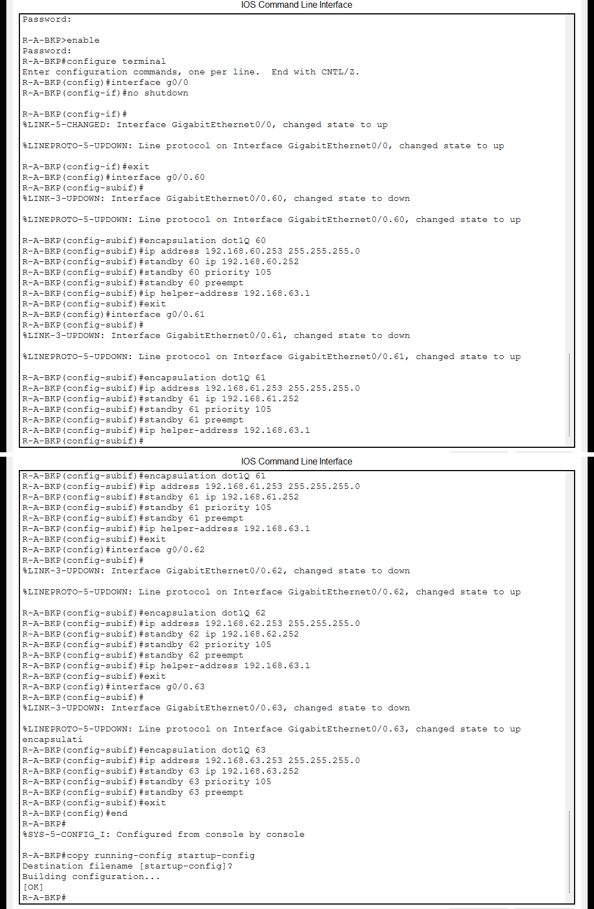

✅ After 20 seconds, `show standby brief` on R-A-MAIN: **Active** in four groups.


## C5 — Ashdod: server and PCs
**🌐 The network now.** Routers and switches work, and nobody has an address.

**❗ The problem.** An empty server.

**💡 The solution.** The same services as in lesson 3, with Ashdod's values. (The website stays the default page: in lesson 4 that is how you recognise Ashdod's server.)

**📋 Do it in the project.** Fill in from the tables. Fixed address first!

### 🖱 The solution: what to click and what to write
Every form is explained with pictures in [lesson 3, Mission 3](../lesson-03/). Only the values change.

**SRV-ASHDOD** → **Desktop** → **IP Configuration** → Static:

| Address | Mask | Gateway | DNS |
|---|---|---|---|
| 192.168.63.1 | 255.255.255.0 | 192.168.63.252 | 192.168.63.1 |

**Services** → **DHCP**: for each row fill in and click **Add**. At the end **Service: On** → **Save**.

| Pool Name | Default Gateway | DNS Server | Start IP | Mask | Max users |
|---|---|---|---|---|---|
| MANAGEMENT | 192.168.60.252 | 192.168.63.1 | 192.168.60.20 | 255.255.255.0 | 50 |
| ASSEMBLY | 192.168.61.252 | 192.168.63.1 | 192.168.61.20 | 255.255.255.0 | 50 |
| ACCOUNTING | 192.168.62.252 | 192.168.63.1 | 192.168.62.20 | 255.255.255.0 | 50 |


**DNS** → On → Name `www.osem.com`, Address `192.168.63.1` → **Add**.

**FTP** → Username `ashdod`, Password `Osem#Ftp`, all five permissions → **Add**.

**EMAIL** → Domain `osem.com` → **Set**. Users `ashdod1` and `ashdod2`, password `Osem#Mail` → **+**.

Then **every PC** of Ashdod: Desktop → IP Configuration → **DHCP**.

✅ From PC-A-ACC-1: an address 192.168.62.x, gateway .252, and `ping 192.168.63.1` works.


## C6 — Eilat: devices, cables, base
**🌐 The network now.** Sakhnin and Ashdod are ready.

**❗ The problem.** The third branch. The names, the numbers and **the ports** are not the same as in Ashdod.

**💡 The solution.** The same design for the third time.

**📋 Do it in the project.** Build it from the tables only, without looking at Ashdod.

### 🖱 The solution: what to click and what to write
| Name | Model |
|---|---|
| SW-E-MAIN | 2960 |
| SW-E-BKP | 2960 |
| SW-E-ASM | 2960 |
| SW-E-MEET | 2960 |
| SW-E-MGMT | 2960 |
| MLS-E-SRV | 3560-24PS |
| SRV-EILAT | Server |
| PC-E-ASM-1 | PC |
| PC-E-ASM-2 | PC |
| PC-E-ASM-3 | PC |
| PC-E-ASM-4 | PC |
| PC-E-MEET-1 | PC |
| PC-E-MEET-2 | PC |
| PC-E-MEET-3 | PC |
| PC-E-MGMT-1 | PC |
| PC-E-MGMT-2 | PC |

| # | Cable | First device | Port | Second device | Port |
|---|---|---|---|---|---|
| 1 | Straight-Through | R-E-BKP | G0/0 | SW-E-MAIN | Fa0/6 |
| 2 | Straight-Through | R-E-MAIN | G0/0 | SW-E-MAIN | Fa0/4 |
| 3 | Cross-Over | SW-E-MAIN | Fa0/1 | SW-E-MGMT | Fa0/3 |
| 4 | Cross-Over | SW-E-MAIN | Fa0/2 | MLS-E-SRV | Fa0/1 |
| 5 | Cross-Over | SW-E-MAIN | Fa0/3 | SW-E-ASM | Fa0/5 |
| 6 | Cross-Over | SW-E-MAIN | Fa0/5 | SW-E-MEET | Fa0/4 |
| 7 | Cross-Over | SW-E-MAIN | Fa0/7 | SW-E-BKP | Fa0/3 |
| 8 | Cross-Over | SW-E-BKP | Fa0/1 | SW-E-MGMT | Fa0/4 |
| 9 | Cross-Over | SW-E-BKP | Fa0/2 | SW-E-ASM | Fa0/6 |
| 10 | Cross-Over | SW-E-BKP | Fa0/4 | SW-E-MEET | Fa0/5 |
| 11 | Straight-Through | SW-E-ASM | Fa0/1 | PC-E-ASM-1 | Fa0 |
| 12 | Straight-Through | SW-E-ASM | Fa0/2 | PC-E-ASM-2 | Fa0 |
| 13 | Straight-Through | SW-E-ASM | Fa0/3 | PC-E-ASM-3 | Fa0 |
| 14 | Straight-Through | SW-E-ASM | Fa0/4 | PC-E-ASM-4 | Fa0 |
| 15 | Straight-Through | SW-E-MEET | Fa0/1 | PC-E-MEET-1 | Fa0 |
| 16 | Straight-Through | SW-E-MEET | Fa0/2 | PC-E-MEET-2 | Fa0 |
| 17 | Straight-Through | SW-E-MEET | Fa0/3 | PC-E-MEET-3 | Fa0 |
| 18 | Straight-Through | SW-E-MGMT | Fa0/1 | PC-E-MGMT-1 | Fa0 |
| 19 | Straight-Through | SW-E-MGMT | Fa0/2 | PC-E-MGMT-2 | Fa0 |
| 20 | Straight-Through | MLS-E-SRV | Fa0/2 | SRV-EILAT | Fa0 |

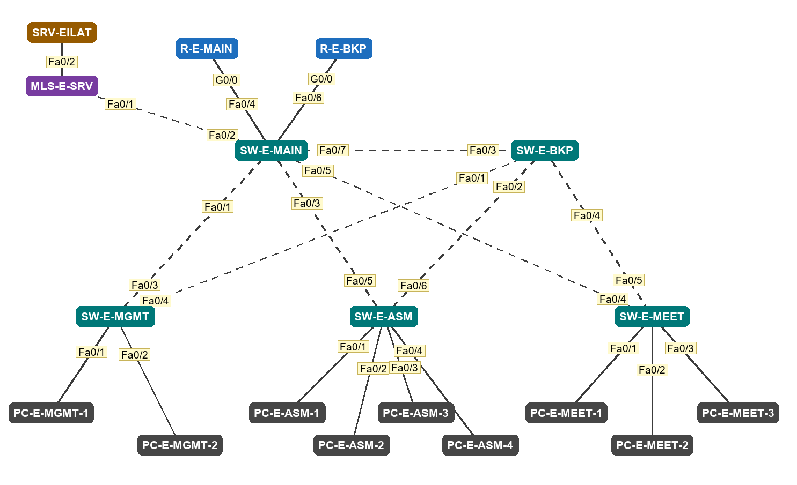

The base block of A3 on every switch, with its own name (on the MLS: first answer `no`):

| Device | The line that changes |
|---|---|
| SW-E-MAIN | `hostname SW-E-MAIN` |
| SW-E-BKP | `hostname SW-E-BKP` |
| SW-E-MGMT | `hostname SW-E-MGMT` |
| SW-E-ASM | `hostname SW-E-ASM` |
| SW-E-MEET | `hostname SW-E-MEET` |
| MLS-E-SRV | `hostname MLS-E-SRV` |

## C7 — Eilat: switching
**🌐 The network now.** Connected, and everything in VLAN 1.

**❗ The problem.** The same as C3. In Eilat the server switch is on **Fa0/2** of the main switch and R-E-MAIN on **Fa0/4**. Copying from Ashdod without thinking cuts the branch.

**💡 The solution.** The same blocks, by Eilat's plan.

**📋 Do it in the project.** Write the block of SW-E-ASM alone. How many PC ports does it have?

| VLAN | Name | Network | Switch |
|---|---|---|---|
| 80 | MANAGEMENT | 192.168.80.0/24 | SW-E-MGMT |
| 81 | DEVICES-ASSEMBLY | 192.168.81.0/24 | SW-E-ASM |
| 82 | MEETING | 192.168.82.0/24 | SW-E-MEET |
| 83 | SERVERS | 192.168.83.0/24 | MLS-E-SRV |

### 🖱 The solution: what to click and what to write
**SW-E-MAIN:**
```
configure terminal
vtp domain EILAT
vtp password Osem#Vtp
vtp mode server
vlan 80
name MANAGEMENT
vlan 81
name DEVICES-ASSEMBLY
vlan 82
name MEETING
vlan 83
name SERVERS
exit
spanning-tree vlan 1,80,81,82,83 root primary
ip dhcp snooping
ip dhcp snooping vlan 80,81,82
no ip dhcp snooping information option
interface range fa0/1 , fa0/3 - 7
switchport mode trunk
exit
interface range fa0/1 , fa0/3 , fa0/5
spanning-tree guard root
exit
interface fa0/2
switchport mode access
switchport access vlan 83
switchport port-security
switchport port-security maximum 2
switchport port-security mac-address sticky
switchport port-security violation shutdown
exit
interface range fa0/2 , fa0/4 , fa0/6 - 7
ip dhcp snooping trust
exit
interface range fa0/8 - 24 , g0/1 - 2
shutdown
end
copy running-config startup-config
```
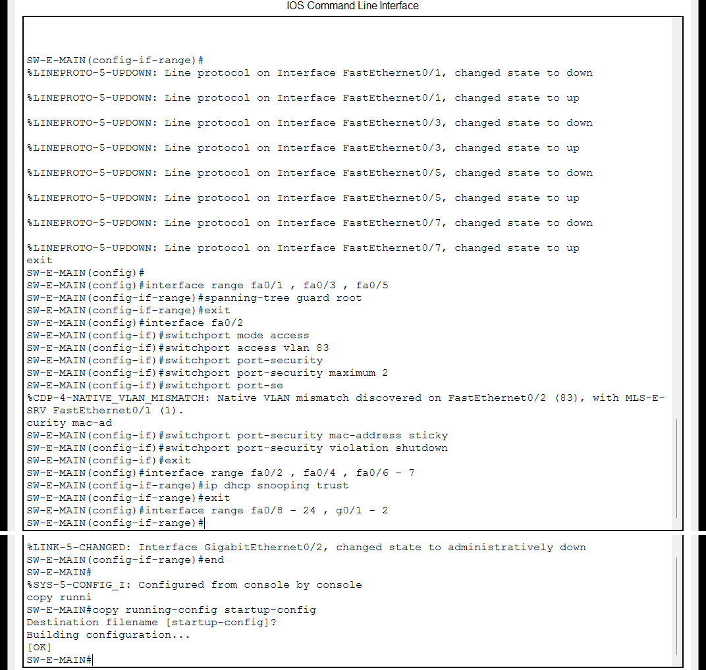

**SW-E-BKP:**
```
configure terminal
vtp domain EILAT
vtp password Osem#Vtp
vtp mode client
spanning-tree vlan 1,80,81,82,83 root secondary
interface range fa0/1 - 4
switchport mode trunk
exit
interface range fa0/5 - 24 , g0/1 - 2
shutdown
end
copy running-config startup-config
```


**SW-E-MGMT:**
```
configure terminal
vtp domain EILAT
vtp password Osem#Vtp
vtp mode client
interface range fa0/3 - 4
switchport mode trunk
exit
interface range fa0/1 - 2
switchport mode access
switchport access vlan 80
spanning-tree portfast
spanning-tree bpduguard enable
switchport port-security
switchport port-security maximum 1
switchport port-security mac-address sticky
switchport port-security violation shutdown
exit
interface range fa0/5 - 24 , g0/1 - 2
shutdown
end
copy running-config startup-config
```
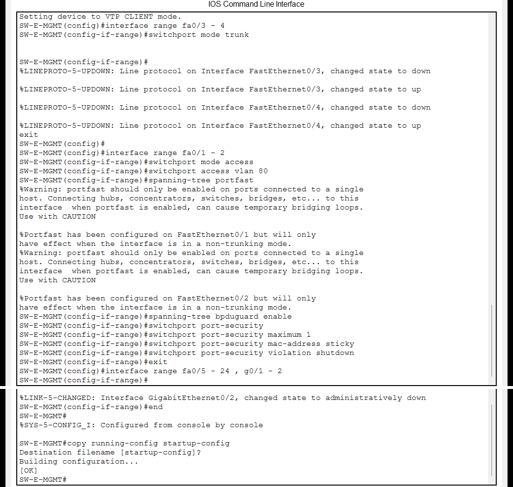

**SW-E-ASM:**
```
configure terminal
vtp domain EILAT
vtp password Osem#Vtp
vtp mode client
interface range fa0/5 - 6
switchport mode trunk
exit
interface range fa0/1 - 4
switchport mode access
switchport access vlan 81
spanning-tree portfast
spanning-tree bpduguard enable
switchport port-security
switchport port-security maximum 1
switchport port-security mac-address sticky
switchport port-security violation shutdown
exit
interface range fa0/7 - 24 , g0/1 - 2
shutdown
end
copy running-config startup-config
```
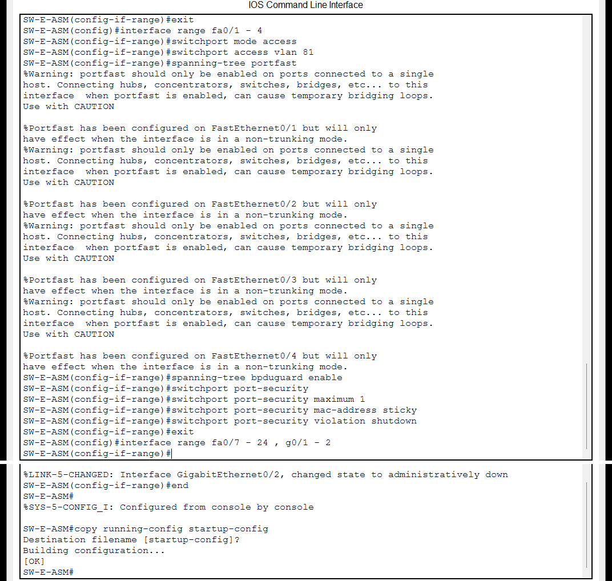

**SW-E-MEET:**
```
configure terminal
vtp domain EILAT
vtp password Osem#Vtp
vtp mode client
interface range fa0/4 - 5
switchport mode trunk
exit
interface range fa0/1 - 3
switchport mode access
switchport access vlan 82
spanning-tree portfast
spanning-tree bpduguard enable
switchport port-security
switchport port-security maximum 1
switchport port-security mac-address sticky
switchport port-security violation shutdown
exit
interface range fa0/6 - 24 , g0/1 - 2
shutdown
end
copy running-config startup-config
```
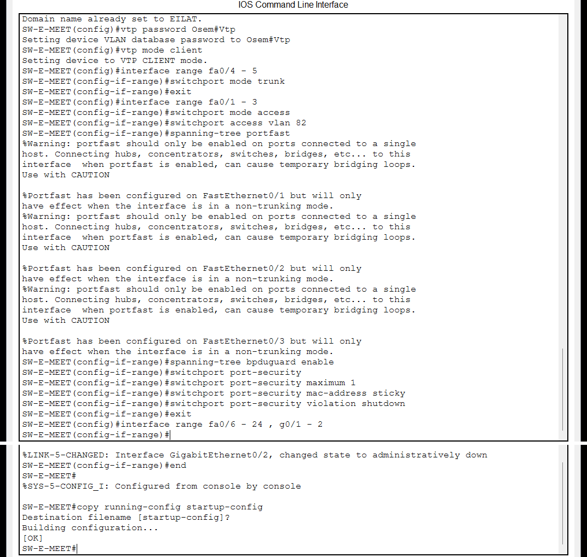

**MLS-E-SRV:**
```
configure terminal
vtp mode transparent
vlan 83
name SERVERS
exit
interface range fa0/1 - 2
switchport mode access
switchport access vlan 83
exit
interface range fa0/3 - 24 , g0/1 - 2
shutdown
exit
interface fa0/2
spanning-tree portfast
spanning-tree bpduguard enable
switchport port-security
switchport port-security maximum 1
switchport port-security mac-address sticky
switchport port-security violation shutdown
end
copy running-config startup-config
```


✅ On SW-E-MEET: `show vtp status` and `show vlan brief`: VLANs 80–83, and Fa0/1–3 in VLAN 82.

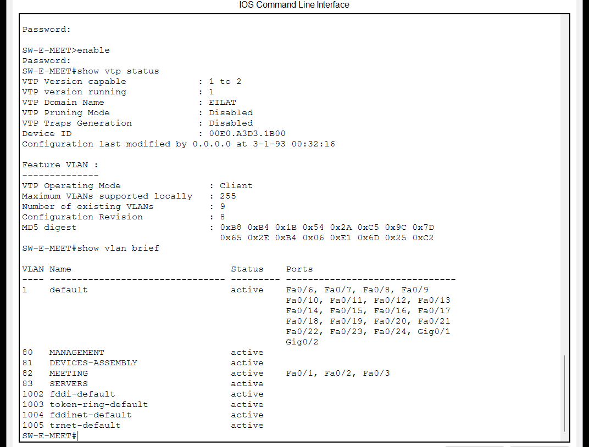

## C8 — Eilat: routers
**🌐 The network now.** Four VLANs without a gateway.

**❗ The problem.** The same as C4.

**💡 The solution.** Sub-interfaces 80–83, HSRP, and helper 192.168.83.1.

**📋 Do it in the project.** Write R-E-MAIN from memory, and check.

### 🖱 The solution: what to click and what to write
**R-E-MAIN:**
```
configure terminal
interface g0/0
no shutdown
exit
interface g0/0.80
encapsulation dot1Q 80
ip address 192.168.80.254 255.255.255.0
standby 80 ip 192.168.80.252
standby 80 priority 110
standby 80 preempt
ip helper-address 192.168.83.1
exit
interface g0/0.81
encapsulation dot1Q 81
ip address 192.168.81.254 255.255.255.0
standby 81 ip 192.168.81.252
standby 81 priority 110
standby 81 preempt
ip helper-address 192.168.83.1
exit
interface g0/0.82
encapsulation dot1Q 82
ip address 192.168.82.254 255.255.255.0
standby 82 ip 192.168.82.252
standby 82 priority 110
standby 82 preempt
ip helper-address 192.168.83.1
exit
interface g0/0.83
encapsulation dot1Q 83
ip address 192.168.83.254 255.255.255.0
standby 83 ip 192.168.83.252
standby 83 priority 110
standby 83 preempt
exit
end
copy running-config startup-config
```
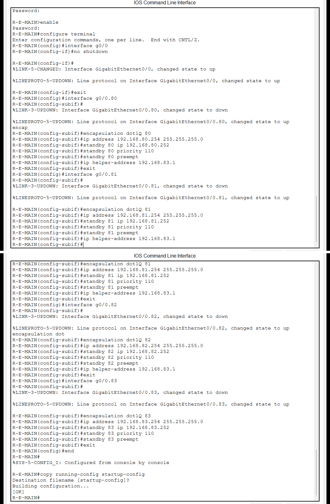

**R-E-BKP:**
```
configure terminal
interface g0/0
no shutdown
exit
interface g0/0.80
encapsulation dot1Q 80
ip address 192.168.80.253 255.255.255.0
standby 80 ip 192.168.80.252
standby 80 priority 105
standby 80 preempt
ip helper-address 192.168.83.1
exit
interface g0/0.81
encapsulation dot1Q 81
ip address 192.168.81.253 255.255.255.0
standby 81 ip 192.168.81.252
standby 81 priority 105
standby 81 preempt
ip helper-address 192.168.83.1
exit
interface g0/0.82
encapsulation dot1Q 82
ip address 192.168.82.253 255.255.255.0
standby 82 ip 192.168.82.252
standby 82 priority 105
standby 82 preempt
ip helper-address 192.168.83.1
exit
interface g0/0.83
encapsulation dot1Q 83
ip address 192.168.83.253 255.255.255.0
standby 83 ip 192.168.83.252
standby 83 priority 105
standby 83 preempt
exit
end
copy running-config startup-config
```
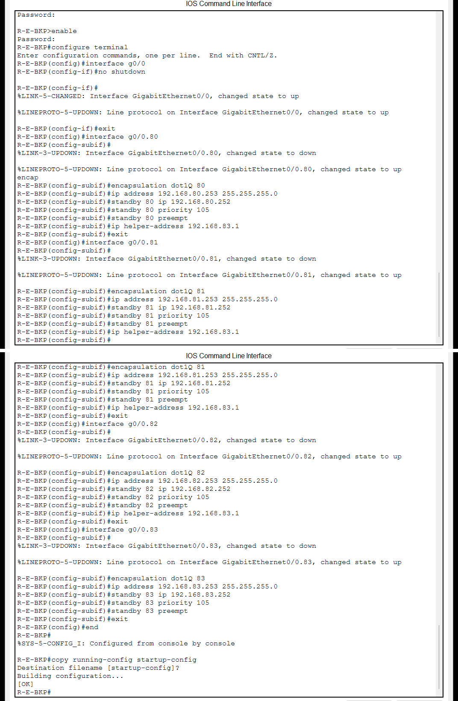

✅ After 20 seconds, `show standby brief` on R-E-MAIN: **Active** in four groups.

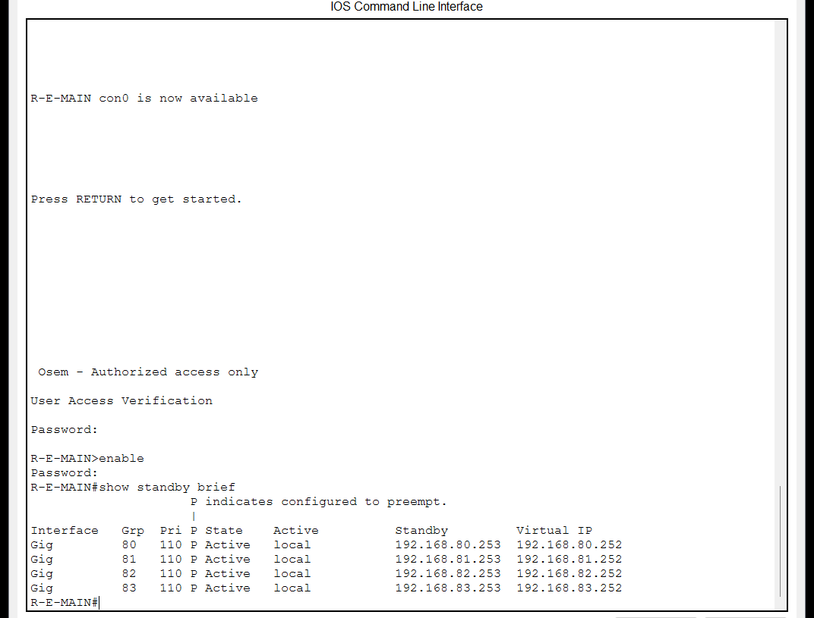

## C9 — Eilat: server and PCs
**🌐 The network now.** An empty server, and PCs without addresses.

**❗ The problem.** The same as C5.

**💡 The solution.** The same services, with Eilat's values.

**📋 Do it in the project.** Fill in the forms.

### 🖱 The solution: what to click and what to write
**SRV-EILAT** → **Desktop** → **IP Configuration** → Static:

| Address | Mask | Gateway | DNS |
|---|---|---|---|
| 192.168.83.1 | 255.255.255.0 | 192.168.83.252 | 192.168.83.1 |

**Services** → **DHCP**: for each row fill in and click **Add**. At the end **Service: On** → **Save**.

| Pool Name | Default Gateway | DNS Server | Start IP | Mask | Max users |
|---|---|---|---|---|---|
| MANAGEMENT | 192.168.80.252 | 192.168.83.1 | 192.168.80.20 | 255.255.255.0 | 50 |
| DEVICES-ASSEMBLY | 192.168.81.252 | 192.168.83.1 | 192.168.81.20 | 255.255.255.0 | 50 |
| MEETING | 192.168.82.252 | 192.168.83.1 | 192.168.82.20 | 255.255.255.0 | 50 |

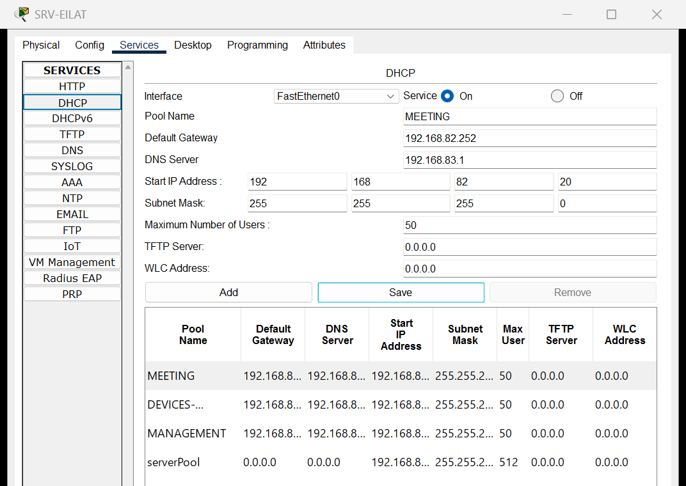

**DNS** → On → Name `www.osem.com`, Address `192.168.83.1` → **Add**.

**FTP** → Username `eilat`, Password `Osem#Ftp`, all five permissions → **Add**.

**EMAIL** → Domain `osem.com` → **Set**. Users `eilat1` and `eilat2`, password `Osem#Mail` → **+**.

Then **every PC** of Eilat: Desktop → IP Configuration → **DHCP**.

✅ From PC-E-MEET-1: an address 192.168.82.x, gateway .252, and `ping 192.168.83.1` works.

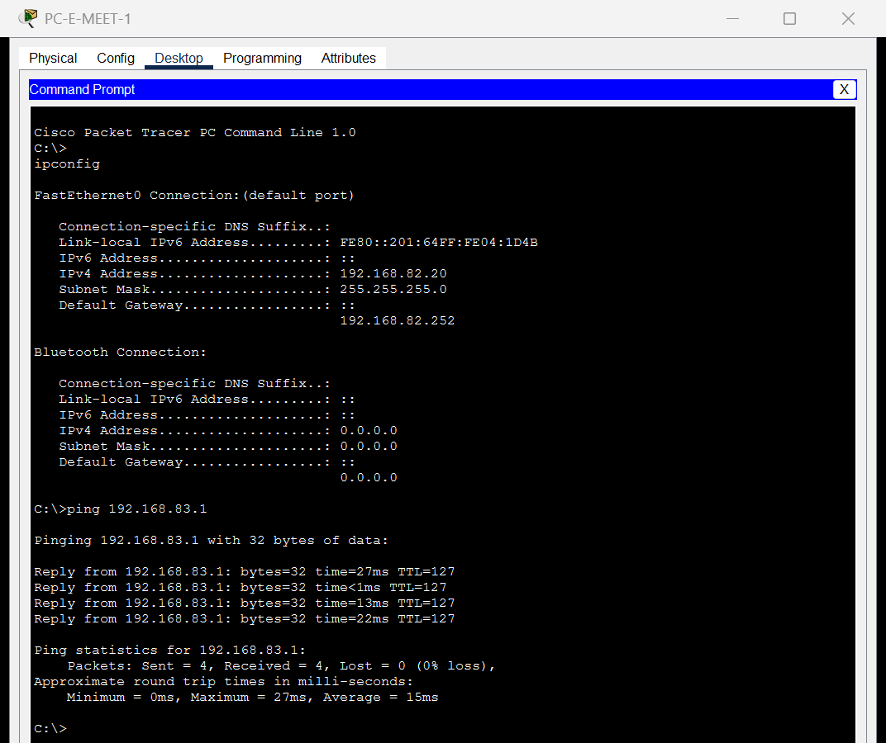

➡ Save everything, and do **[lesson 4](../lesson-04/)**.

---

# Part D — the firewall, and the servers of Ashdod and Eilat

*After lesson 4, before lesson 5.*

## D1 — The lab and the firewall
**🌐 The network now.** Three branches on the internet.

**❗ The problem.** Lesson 5 builds a test lab behind a firewall. There is no firewall and no lab.

**💡 The solution.** An **ASA 5505** and two PCs. No configuration: lesson 5 does it.

**📋 Do it in the project.** Place, name and connect.

### 🖱 The solution: what to click and what to write
**Network Devices** (1) → **Security** (2) → **5505** (3), name `ASA-S`. And two PCs: `PC-LAB-1`, `PC-LAB-2`.

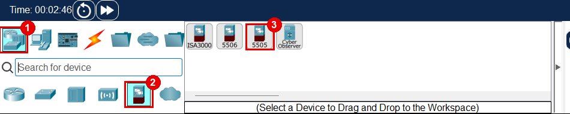

| # | Cable | First device | Port | Second device | Port |
|---|---|---|---|---|---|
| 1 | Straight-Through | ASA-S | E0/0 | SW-S-MGMT | Fa0/1 |
| 2 | Straight-Through | ASA-S | E0/1 | PC-LAB-1 | Fa0 |
| 3 | Straight-Through | ASA-S | E0/2 | PC-LAB-2 | Fa0 |

Write down in the switch what is connected there. **SW-S-MGMT**:

```
configure terminal
interface fa0/1
description to ASA-S
end
copy running-config startup-config
```

## D2 — AAA, NTP and Syslog on the servers of Ashdod and Eilat
**🌐 The network now.** In lesson 5, Mission 1, you configure this on the server of Sakhnin.

**❗ The problem.** The routers of Ashdod and Eilat will ask **their own** servers, and there is nobody to answer.

**💡 The solution.** The same forms with other values. Ashdod = **Radius**, Eilat = **Tacacs**.

**📋 Do it in the project.** Read lesson 5, Mission 1 (the forms have pictures there), and fill in the two servers.

### 🖱 The solution: what to click and what to write
**Services** → **AAA** → **On**. For each row fill in and click **Add**:

| Server | Client Name | Client IP | Secret | ServerType |
|---|---|---|---|---|
| SRV-ASHDOD | R-A-MAIN | 192.168.63.254 | Osem#Aaa | **Radius** |
| SRV-ASHDOD | R-A-BKP | 192.168.63.253 | Osem#Aaa | **Radius** |
| SRV-EILAT | R-E-MAIN | 192.168.83.254 | Osem#Aaa | **Tacacs** |
| SRV-EILAT | R-E-BKP | 192.168.83.253 | Osem#Aaa | **Tacacs** |

On both servers, below: Username `osemuser`, Password `Osem#User` → **Add**.

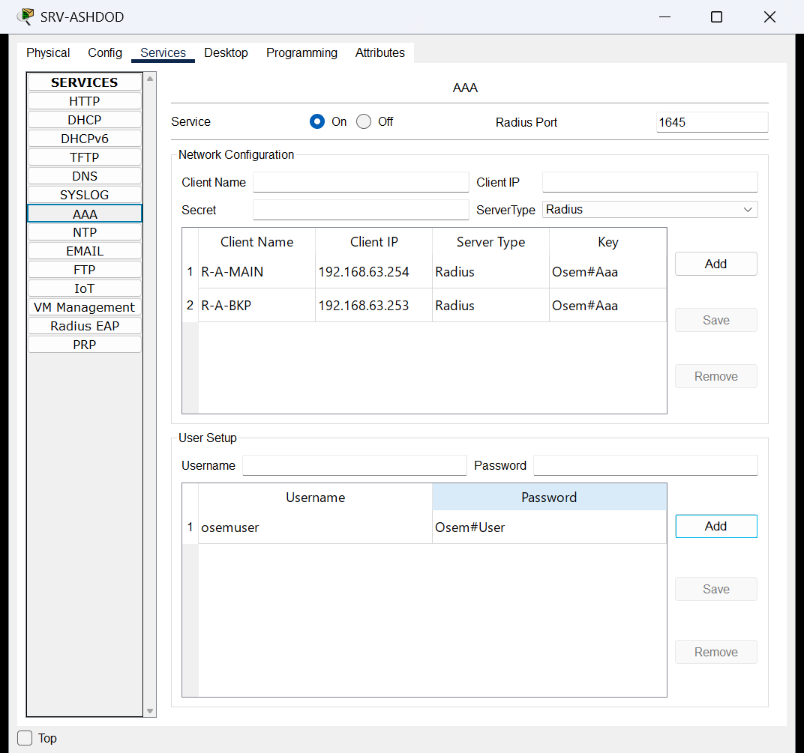

**NTP** → Authentication **Enable**, Password `Osem#Ntp`, Key: **2** in Ashdod, **3** in Eilat.

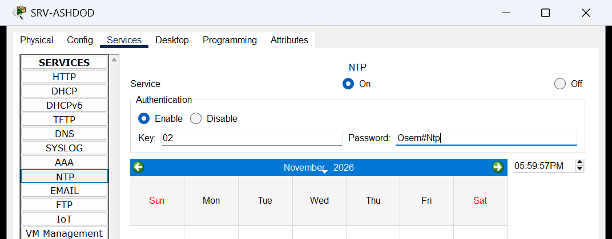

**SYSLOG** → check that it's On.

➡ Now do **[lesson 5](../lesson-05/)**.

---

# Final check

Do these tests in order. The first ping to a new place may be lost (`Request timed out`): that is normal. If one fails, the column on the right says where to look.

| # | From | Write | You must see | If not |
|---|---|---|---|---|
| 1 | PC-SAL-1 | `ipconfig /renew` | 192.168.20.x, gateway .252 | lesson 3, Missions 1–4 |
| 2 | PC-SAL-1 | `ping` to the address of PC-IT-1 | replies | lesson 3, Missions 1–2 |
| 3 | PC-SAL-1 | browser: `http://www.osem.com` | Welcome to Osem - Sakhnin branch | lesson 3, Mission 3 |
| 4 | PC-A-MGMT-1 | `ping 192.168.63.1` | replies | C3–C5 |
| 5 | PC-E-MGMT-1 | `ping 192.168.83.1` | replies | C7–C9 |
| 6 | PC-SAL-1 | `ping 200.200.0.2` | replies | lesson 4, Missions 1–5 |
| 7 | PC-E-MEET-1 | `ping 200.200.0.10` | replies (static NAT) | lesson 4, block of R-A-EXT |
| 8 | PC-E-MEET-1 | `ping 192.168.50.1` | replies (VPN, the first may be lost) | lesson 5, Mission 3 |
| 9 | PC-A-ACC-1 | `ping 192.168.63.1` | **fails** (ACL) | lesson 5, Mission 2 |
| 10 | PC-MGMT-1 | `ssh -l osemuser 192.168.10.254` | a password, and then `R-S-MAIN` | lesson 5, Missions 1 and 4 |
| 11 | PC-A-MGMT-1 | `ssh -l osemuser 192.168.60.254` | a password, and then `R-A-MAIN` | D2, and lesson 5 Mission 4.3 |
| 12 | PC-E-MGMT-1 | `ssh -l osemuser 192.168.80.254` | a password, and then `R-E-MAIN` | D2, and lesson 5 Mission 4.3 |
| 13 | PC-LAB-1 | `ping 192.168.50.1` | replies, through the ASA | lesson 5, Mission 5 |
| 14 | PC-MGMT-1 | `ping 192.168.1.10` | **fails** (nobody outside reaches into the lab) | lesson 5, Mission 5 |

The password of `osemuser` is `Osem#User`. The passwords of the consoles are on the [main page](../README.md).
