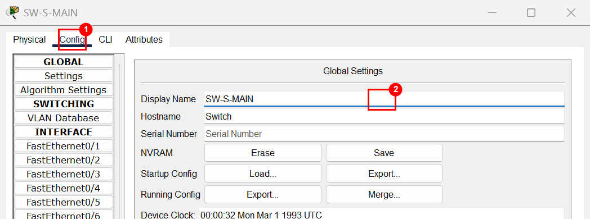
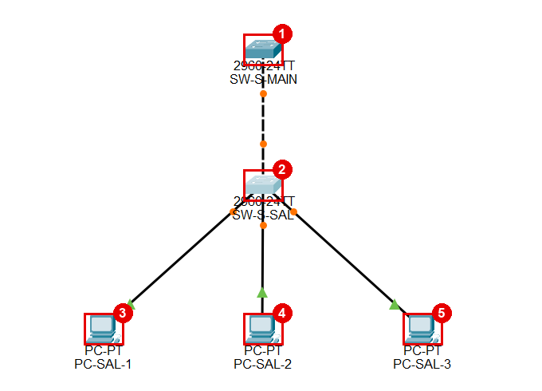
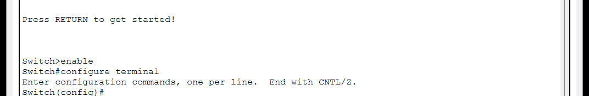
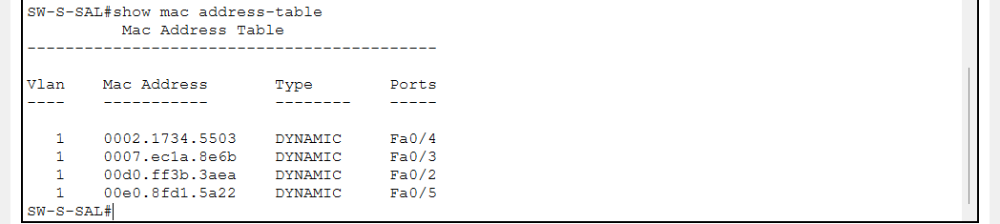
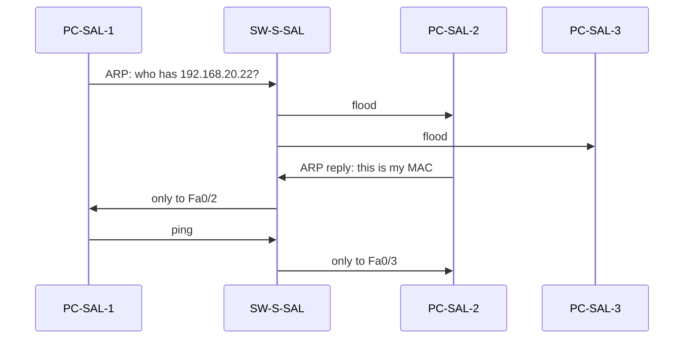
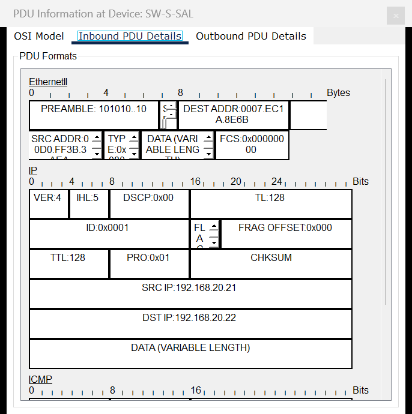

# Lesson 01 — First department: devices, cables, names and passwords

> ⏱ 90 minutes · 🧰 Packet Tracer 9.x · 💾 result: `lesson01-end.pkt` (in this folder)

## What you will have at the end
The **Salaries** department of the Osem branch in Sakhnin: 3 PCs, a department switch, and a
link up to the branch's main switch. Both switches are named and password-protected, and the
PCs can ping each other.


## 📖 The story — chapter 1: one department
**How we got here.** Today is our first day. The manager takes us to the **Salaries** department: three people, three computers, no network. A file moves between them on a USB stick.

**Where we are now.** We have an empty file. Nothing exists: no device, no cable, no address.

**What we want today.** Three PCs that can talk to each other, through a switch that has a name and a password. It is small on purpose: **every network in the world is this, repeated**.

**The road of today.** Each mission needs the one before it:

| Mission | The question it answers | Why exactly now |
|---|---|---|
| 1 Switches | what connects them? | without a meeting point there is nowhere to plug in |
| 2 PCs | who uses the network? | a switch with no users does nothing |
| 3 Cables | how do the signals travel? | we can only connect devices that exist |
| 4 Configuration | who is allowed to change it? | a device that works must be locked **before** it is used |
| 5 Addresses | how do the PCs find each other? | a cable carries a signal, but not a name of a receiver |
| 6 Test | does it really work? | only a ping uses everything together |

## Lesson plan (for the teacher)
| Minutes | Part |
|---|---|
| 0–20 | Part 1 — theory on the board |
| 20–35 | Missions 1–2 — place and name the devices |
| 35–50 | Mission 3 — cables |
| 50–65 | Mission 4 — switch configuration |
| 65–78 | Missions 5–6 — addresses and tests |
| 78–90 | Find the bug, questions, "your own project" |

---

## Part 1 — Theory: understand it first

### 1.1 What does a switch do?
A switch joins devices in one local network (LAN). It works at **layer 2** of the OSI model,
so it decides using **MAC addresses**, not IP addresses.

1. **Learn:** a frame arrives on a port. The switch notes "this source MAC lives on this port".
2. **Forward:** if it knows the destination MAC, it sends the frame **only** to that port.
3. **Flood:** if it doesn't know the MAC, or the frame is a broadcast, it sends it to every
   port in the VLAN except the one it came from.

💬 **In simple words:** a switch is like a mail sorter who learns which room each person sits in. The first
letter is shouted to everybody; after the answer, letters go only to the right room.

**Example.** The MAC table is empty. PC-SAL-1 (port Fa0/2) pings PC-SAL-2 (port Fa0/3):

| # | Frame | The switch learns | The switch sends it to |
|---|---|---|---|
| 1 | ARP request, PC-SAL-1 → everybody | PC-SAL-1 is on Fa0/2 | **all** ports except Fa0/2 (flood) |
| 2 | ARP reply, PC-SAL-2 → PC-SAL-1 | PC-SAL-2 is on Fa0/3 | only Fa0/2 |
| 3 | ping, PC-SAL-1 → PC-SAL-2 | nothing new | only Fa0/3 |

❓ **Ask the class:** did PC-SAL-3 see frame 1? Frame 3?

<details><summary>Answer</summary>

Frame 1 yes, it is a broadcast. Frame 3 no: the switch already knows where PC-SAL-2 is.

</details>

### 1.2 MAC, IP and ARP
| | MAC address | IP address |
|---|---|---|
| Layer | 2 | 3 |
| Example | `0007.ec1a.8e6b` | `192.168.20.22` |
| Who sets it | the manufacturer | you, or DHCP |
| Used for | delivery **inside** the LAN | finding the destination **network** |

PC-SAL-1 knows the IP of PC-SAL-2 but needs its MAC. It **broadcasts an ARP request**: "who has
192.168.20.22?" PC-SAL-2 replies with its MAC, and PC-SAL-1 keeps it in its ARP table.

💬 **In simple words:** the IP is like a home address: it changes when you move to another network. The MAC is
like a serial number stamped on the network card: it stays the same.

### 1.3 Subnet mask
`192.168.20.21` with mask `255.255.255.0` (`/24`): the first three numbers are the **network**
(192.168.20), the last is the **device**. Same network → talk directly. Different network → you
need a router, which we add in a later lesson.

**Example — same network or not?** (mask 255.255.255.0)

| First device | Second device | Same network? | What happens |
|---|---|---|---|
| 192.168.20.21 | 192.168.20.23 | yes, 192.168.20 | they talk directly |
| 192.168.20.21 | 192.168.30.23 | no, 20 against 30 | a router is needed |
| 192.168.20.21 | 192.168.20.254 | yes | directly (.254 will be our router) |

❓ **Ask the class:** how many devices fit in a /24 network?

<details><summary>Answer</summary>

**254**: there are 256 numbers, but .0 is the name of the network and .255 is its broadcast address.

</details>

### 1.4 Which cable?
| Between | Cable | Why |
|---|---|---|
| PC ↔ switch | Copper **Straight-Through** (solid line) | different types: one side's transmit pins already face the other's receive pins |
| switch ↔ switch | Copper **Cross-Over** (dashed line) | same type: transmit and receive must be crossed |

Modern switches can fix a wrong cable themselves (Auto-MDIX), but at the exam you must explain
the correct choice.

### 1.5 Why are the dots orange first?
When a port comes up, **Spanning Tree (STP)** checks that it doesn't create a loop. It takes
about 30 seconds: 15 listening + 15 learning. Orange = checking, green = forwarding.

### 1.6 Two kinds of passwords
| Command | Protects | Stored as |
|---|---|---|
| `line console 0` + `password` + `login` | connecting with the console cable | type 7 after `service password-encryption` (weak) |
| `enable secret` | entering `#` mode | type 5 hash (cannot simply be turned back) |

---

## Mission 1 — Place and name the switches
**📖 How we got here.** We were given an empty file and one department.

**🌐 The network now.** An empty workspace. In this mission two devices appear: the main switch of the branch and the switch of the Salaries department.

**❗ The problem.** People in one department want to share files and a printer, but a PC has only **one** network port. You can connect two PCs with a cable, not three. And a device called `Switch0` tells nobody what it does: imagine 30 of them.

**🎯 What we want now.** A meeting point: a device that all the PCs can plug into, with a name that says what it is.

**💡 The solution.** A **switch** has 24 ports and passes each frame to the right one (theory 1.1). A naming rule, `type-branch-job`, tells who each device is.

**📋 Do it in the project.** Place two 2960 switches, one above the other. Name the top one `SW-S-MAIN` and the bottom one `SW-S-SAL`. Try alone, then check with the steps below.

### 🖱 The solution: what to click and what to write
1. Bottom left: **Network Devices** (1) → **Switches** (2) → **2960** (3).

   
2. Click on the empty workspace. The switch appears as `Switch0`.

   
3. Click the switch → **Config** tab (1) → **Display Name** (2) → delete `Switch0`, type `SW-S-MAIN`.

   
4. Close the window. Place a second 2960 under it and name it `SW-S-SAL`.

🧠 **Why these names?** `SW` = switch, `S` = Sakhnin, `MAIN`/`SAL` = its job. Anyone who reads the
name knows what and where the device is.

<details open><summary><b>📘 The form, field by field</b></summary>

| Field or click | What it is, and why |
|---|---|
| **Network Devices → Switches → 2960** | A 24-port layer-2 switch. It is enough for one department, and all the port numbers in the project are its numbers. |
| **Config → Display Name** | The label on the screen, for people. The name inside the device (`hostname`) comes in Mission 4. |

</details>

**⏭ What comes next.** A switch without users is useless, so next we bring the users.

## Mission 2 — Place and name the PCs
**📖 How we got here.** The two switches stand on the desk, named and empty.

**🌐 The network now.** Two named switches, nobody uses them yet.

**❗ The problem.** A network with no users does nothing. And if all the PCs are called `PC0`, `PC1`..., in lesson 2 you won't know which department a PC belongs to.

**🎯 What we want now.** Three PCs of Salaries, with names that tell us **who** and **where**.

**💡 The solution.** Three PCs, named by department and number. `PC-SAL-2` = the second PC of Salaries.

**📋 Do it in the project.** Place three PCs under SW-S-SAL and name them from left to right `PC-SAL-1`, `PC-SAL-2`, `PC-SAL-3`.

### 🖱 The solution: what to click and what to write
1. **End Devices** (1) → **PC** (2) → click under the switch. Repeat for 3 PCs.

   

   
2. Click each PC → **Config** → **Display Name**. From left to right: `PC-SAL-1`, `PC-SAL-2`, `PC-SAL-3`.

<details open><summary><b>📘 The form, field by field</b></summary>

| Field or click | What it is, and why |
|---|---|
| **End Devices → PC** | The user's computer. It has one network port, **FastEthernet0**. |
| **PC-SAL-1** | What it is (PC), which department (SAL = salaries), which one (1). Reading the name is enough to find it. |

</details>

**⏭ What comes next.** They stand next to each other but nothing joins them, so next come the cables.

## Mission 3 — Cables
**📖 How we got here.** Five devices exist, and none of them knows about the others.

**🌐 The network now.** Five devices, no connection between them. At the end of the mission it looks like this (numbers = the devices we connect):



**❗ The problem.** Without a cable no signal passes. With the **wrong** cable or the **wrong port**, the drawing looks right but the configuration of the next lessons (VLAN on Fa0/2, trunk on Fa0/4) falls on the wrong device.

**🎯 What we want now.** The right cable, in the right port. The port numbers are our agreement for all the next lessons.

**💡 The solution.** Cross-over between switches, straight-through to PCs (theory 1.4), and a **port table** that everybody follows.

**📋 Do it in the project.** Make the four connections of the table. Before each one, say aloud which cable and why.

### 🖱 The solution: what to click and what to write


For each row: **Connections** (1) → choose the cable → click the first device → choose its port →
click the second device → choose its port.

| # | Cable | From | Port | To | Port |
|---|---|---|---|---|---|
| 1 | Cross-Over (2) | SW-S-MAIN | FastEthernet0/3 | SW-S-SAL | FastEthernet0/4 |
| 2 | Straight-Through (3) | PC-SAL-1 | FastEthernet0 | SW-S-SAL | FastEthernet0/2 |
| 3 | Straight-Through (3) | PC-SAL-2 | FastEthernet0 | SW-S-SAL | FastEthernet0/3 |
| 4 | Straight-Through (3) | PC-SAL-3 | FastEthernet0 | SW-S-SAL | FastEthernet0/5 |

⚠️ Choose exactly the port of the table. The menu of a PC begins with `RS 232`, `USB0`, `USB1`, and the menu of a switch begins with `Console`. They are **not** the network: go down to **FastEthernet**.


💡 Ports already in use **disappear** from the list. Here Fa0/2 and Fa0/3 are taken:


✅ Right after connecting, the dot on the switch is orange (STP). After about 30 seconds everything is green:


<details open><summary><b>📘 The form, field by field</b></summary>

| Field or click | What it is, and why |
|---|---|
| **Connections** | The cables. We choose the cable ourselves and not the automatic one, because the port matters. |
| **Copper Straight-Through** | Between different kinds of devices: PC ↔ switch, switch ↔ router. |
| **Copper Cross-Over** | Between two of the same kind: switch ↔ switch. |
| The port in the list | The agreement for all the next lessons: the VLAN of Fa0/2 is written for Fa0/2. |

</details>

**⏭ What comes next.** Once everything is green it is tempting to start working, but the switch is open to anyone. First we lock it.

## Mission 4 — Configure the switches
**📖 How we got here.** The signals pass, but anyone with a console cable can change everything.

**🌐 The network now.** Everything is connected and green. We configure two devices:


**❗ The problem.** A new switch has **no password at all**. Click SW-S-SAL → **CLI** → Enter → write `enable`:


(If you see `(config)#`, write `end` first. Why? It is explained in the solution below.)

The prompt became `#`: whoever reaches the switch can erase everything. It is also still called `Switch`.

**🎯 What we want now.** A name on every switch, a password at every door, and a saved configuration.

**💡 The solution.** Three things: a name (`hostname`), two passwords (console and `enable secret`, theory 1.6) and a warning (`banner`). Then save, otherwise it all disappears when the power goes off.

**📋 Do it in the project.** On both switches: name, no domain lookup, enable secret `Osem#En1`, encrypted passwords, a banner, console password `Osem#Con` with login, and save.

### 🖱 The solution: what to click and what to write
Click **SW-S-MAIN** → **CLI** → press **Enter** until you see `Switch>`. Type line by line:

⚠️ Do you see `Switch(config)#`? When you opened the **Config** tab to change the name, Packet Tracer wrote `enable` and `configure terminal` by itself. Write `end` and press Enter, then start with the first line.



```
enable
configure terminal
hostname SW-S-MAIN
no ip domain-lookup
enable secret Osem#En1
service password-encryption
banner motd # Osem - Authorized access only #
line console 0
password Osem#Con
login
logging synchronous
exec-timeout 10 0
end
copy running-config startup-config
```
At `Destination filename [startup-config]?` press **Enter**. You must see `[OK]`.


| Command | What it does | Why |
|---|---|---|
| `enable` | moves from `>` to `#` | `>` only lets you look, `#` lets you manage |
| `configure terminal` | opens configuration mode | changes are made only here |
| `hostname` | the name in the prompt | the label on the screen (Mission 1) does not change it |
| `no ip domain-lookup` | a typo is not looked up in DNS | saves a long wait after every typo |
| `enable secret` | password for `#` | stored as a hash |
| `service password-encryption` | hides the other passwords | otherwise `show run` shows them as plain text |
| `banner motd` | a message before login | legal warning to outsiders |
| `line console 0` | enters the console port settings | this is where the password is set |
| `password` + `login` | sets the password **and asks for it** | without `login` nobody is asked |
| `logging synchronous` | messages don't break your line | comfort |
| `exec-timeout 10 0` | logs out after 10 idle minutes | a forgotten open screen is a security hole. 10 minutes is the default, so `show running-config` does not list it |
| `copy running-config startup-config` | saves to NVRAM | running-config is lost when the power goes off |

Repeat on **SW-S-SAL** with `hostname SW-S-SAL`.


✅ `show running-config` shows `enable secret 5 $1$...` and not the password itself:


✅ On SW-S-SAL, `show interfaces status` shows Fa0/2–Fa0/5 as `connected` (press **Space** at `--More--`):


<details open><summary><b>📘 The other commands of this mission, explained</b></summary>

| Command | What it does, and why it is here |
|---|---|
| `end` | Straight out to `#`, from any depth. |
| `show run` | All the configuration that works now. |
| `show interfaces status` | Each port: connected or not, and its VLAN. |

</details>

**⏭ What comes next.** The road is ready and locked. The PCs still have no address on it.

## Mission 5 — PC addresses
**📖 How we got here.** The road exists: switches, cables, passwords.

**🌐 The network now.** The switches are ready. The PCs have cables but no addresses:


**❗ The problem.** A PC without an IP address can't send a ping, and nobody can ask for it. Two PCs with the **same** address are just as bad.

**🎯 What we want now.** An IP address for every PC, all in the same network, so that they can find each other.

**💡 The solution.** A plan: all the department in the network 192.168.20.0/24, each PC with a different last number (theory 1.3).

**📋 Do it in the project.** Give the three PCs the addresses in the table, mask 255.255.255.0, with no gateway.

### 🖱 The solution: what to click and what to write
Click PC-SAL-1 → **Desktop** (1) → **IP Configuration** (2):


**Static** (1) → IPv4 Address (2) → click Subnet Mask (3), it fills itself in. Leave the gateway
empty: there is no router yet.


| PC | IPv4 Address | Subnet Mask |
|---|---|---|
| PC-SAL-1 | 192.168.20.21 | 255.255.255.0 |
| PC-SAL-2 | 192.168.20.22 | 255.255.255.0 |
| PC-SAL-3 | 192.168.20.23 | 255.255.255.0 |

PC-SAL-2 and PC-SAL-3 the same way. When finished they look like this:


<details open><summary><b>📘 The form, field by field</b></summary>

| Field or click | What it is, and why |
|---|---|
| **Static** | We type the address ourselves, because there is no DHCP server yet (lesson 3). |
| **IPv4 Address** | The personal address of this PC. Two PCs can't have the same one. |
| **Subnet Mask** | Which part is the network: 255.255.255.0 = the first three numbers must be the same for everybody in the department. |
| **Default Gateway** | The exit from the network. Empty for now: there is no router. |
| **DNS Server** | Who translates names. Empty until lesson 3. |

</details>

**⏭ What comes next.** We think it works. An engineer doesn't think, an engineer tests.

## Mission 6 — Test
**📖 How we got here.** Everything is built: names, cables, passwords, addresses.

**🌐 The network now.** Complete: names, cables, passwords and addresses.


**❗ The problem.** "Everything is green" does not prove that it works. Green means only that the cable is fine; the address, the mask or the password may still be wrong.

**🎯 What we want now.** Proof. One ping uses the cable, the switch, the MAC table, ARP and the addresses together.

**💡 The solution.** Test every layer: `ping` (IP), `arp -a` (IP → MAC), `show mac address-table` (what the switch learned), and a login test (the passwords).

**📋 Do it in the project.** Prove four things: PC-SAL-1 reaches the two others, you can find the MAC of PC-SAL-2 on the switch, the console asks for a password, the file is saved.

### 🖱 The solution: what to click and what to write
1. PC-SAL-1 → **Desktop** → **Command Prompt** (3 in the desktop picture):
   ```
   ping 192.168.20.22
   ping 192.168.20.23
   arp -a
   ```
   

   `Lost = 0` means success. `arp -a` shows the MACs the PC learned.
2. On SW-S-SAL: `show mac address-table`

   

   Compare with `arp -a`: `0007.ec1a.8e6b` (PC-SAL-2) is on Fa0/3. The MAC on Fa0/4 belongs to the
   port of SW-S-MAIN. **Your MAC addresses will be different.**
3. On SW-S-SAL type `exit`, press **Enter** and log in again. You must see the banner, the console
   password prompt and, after `enable`, a second prompt. Nothing appears while you type a password.

   
4. Save: **File** → **Save As** → `lesson01.pkt`.

   

<details open><summary><b>📘 The commands of this mission, explained</b></summary>

| Command | What it does, and why it is here |
|---|---|
| `arp -a` | The PC's list: which IP belongs to which MAC. |
| `show mac address-table` | What the switch learned: which MAC is on which port. |
| `ping 192.168.20.22` | Sends 4 test messages. Replies = the road works in **both** directions. |

</details>

**⏭ What comes next.** Salaries works, and that raises the next question: what happens when the other departments join the same switch?

## 👀 See it happen — the ping, step by step
Until now everything was invisible. **Simulation** mode stops time, and you see every packet.

**How to use it (the same in every lesson):**


1. Bottom right: **Simulation** (1). Time stops.
2. **Show All/None** (2) until it says *None*. Then **Edit Filters** (3) → tick only what you need.
3. Do the action (a ping, for example) and close the PC window.
4. Click the **next step** button (4), one click at a time.
5. Click an **envelope**, or the colored square in the **Type** column, to open the packet.
   *In Layers* = how it came in, *Out Layers* = how it goes out. **Next Layer** explains every decision.
6. **Finished? Click Realtime.** Otherwise nothing in the network moves.

💡 A *Buffer Full* window? Click **View Previous Events**. Don't see the Type column? Drag the left edge of the panel.

**Now in our network.** Filters: **ARP** and **ICMP** (tab IPv4). PC-SAL-1 → Command Prompt:
```
arp -d
ping 192.168.20.22
```
`arp -d` erases what the PC learned, so it has to ask again.



**Frame 1: the question goes to everybody.** ❓ Guess before you click: how many envelopes will there be?


The envelope is on PC-SAL-2, PC-SAL-3 **and** SW-S-MAIN. That is a **flood**.

**Frame 3: the ping goes to one port.** Open the ping on SW-S-SAL:


| Look at | What it proves |
|---|---|
| layers 3 to 7 are gray | the switch doesn't look at the IP at all |
| the MACs are the same on both sides | a switch does not change the frame |
| in Fa0/2, out **only** Fa0/3 | it has learned, no more flood |

Tab **Inbound PDU Details**: the whole packet. Find both MACs and both IPs, and compare with `arp -a`:



✏️ **Try:** ping again **without** `arp -d`. Is there an ARP? Why?

<details><summary>Answer</summary>

No. The PC kept the MAC in its ARP table, so the ping goes out at once.

</details>

## 🧯 It doesn't work?
| What you see | Probably | What to do |
|---|---|---|
| orange dot for more than a minute | the link is still in STP, or the window was paused | wait, check that Realtime is selected at the bottom right |
| red triangles | wrong port or a port that is off | hover over the cable and compare with the port table |
| `Request timed out` | wrong IP or mask | `ipconfig` on both PCs |
| `% Invalid input detected at '^'` | typing mistake, or the wrong mode | look under the `^`, check the prompt: `>`, `#` or `(config)#` |
| the CLI shows nothing | the console is waiting | click inside the window and press Enter |
| the password is refused | upper/lower case, or Hebrew keyboard | Alt+Shift, `Osem#Con` and then `Osem#En1` |

---

## 🔎 Find the bug — from a real project
In the original project this lesson is based on, we found the following. Ask the class **what is
wrong and how to fix it** before opening the answer.

1. Most switches and routers were still called `Switch` and `Router`, and one was called `123`.
2. The banner welcomed people to a **different company**.

<details><summary>Answer</summary>

1. In an outage nobody can tell which device they are on. Fix: `hostname` **and** Display Name on every device.
2. Text was left over from another project. Fix: a new banner. The examiner notices, and it suggests copied work.

</details>

## 🏋 Exercises
1. Change the IP of PC-SAL-3 to `192.168.30.23` (same mask). From PC-SAL-1: `ping 192.168.30.23`. Does it work? Why, even though the cable and the switch did not change? Put `192.168.20.23` back.
2. Disconnect PC-SAL-2 and ping it. Which message do you get?
3. Remove `login` from the console of SW-S-SAL, `exit`, and go in again. What changed? Put it back.

<details><summary>Answers (we tested them)</summary>

1. **Request timed out.** The PCs are now in different networks (20 and 30). Without a gateway PC-SAL-1 has no way to another network. Cables and switches know nothing about IP.
2. **Request timed out**: PC-SAL-2 does not answer.
3. After Enter you get the banner and `SW-S-SAL>` **without a password**. `password` alone is not enough: `login` is what asks for it.

</details>

## 🎓 Explain it to the examiner
- How does a switch know where to send a frame?
- Why do we need ARP if we already know the IP?
- What is the difference between `enable secret` and the console password?
- Why cross-over between switches and straight-through to a PC?
- What is the difference between running-config and startup-config?

<details><summary>Model answers</summary>

1. It learns the source MAC of every frame into the MAC table, and looks up the destination MAC there. Unknown or broadcast: it floods.
2. The IP finds the destination, but a frame in the LAN is delivered by MAC. ARP translates IP → MAC.
3. The console password lets you connect with the cable (you reach `>`). `enable secret` lets you manage (`#`) and is stored as a hash.
4. Between devices of the same type transmit and receive must be crossed. PC and switch are already opposite.
5. running-config is in RAM and works now. startup-config is in NVRAM and is loaded at boot. `copy running-config startup-config` saves.

</details>

## ✏️ Exit quiz (3 minutes)
1. At which OSI layer does a 2960 switch work?
2. Which command saves the configuration?
3. Is `192.168.10.5/24` in the same network as `192.168.20.5/24`?
4. What does the switch do with a broadcast?
5. What is wrong: `line console 0` → `password 1234` → `end`?

<details><summary>Answers</summary>

1. Layer 2.
2. `copy running-config startup-config`.
3. No.
4. Sends it to all ports of the VLAN except the one it came from.
5. `login` is missing, so nobody is asked.

</details>

## ⏭ What we did, and what comes next
**What we did.** We turned three lonely computers into a network: a switch, cables, a password and addresses. Salaries works.

**What is still missing.** The company has more departments: Management, Assembly, IT, and a server. If we connect all of them to the same switch, everybody is in **one** network: Assembly hears every broadcast of Salaries, and can try to open its files.

**What comes next.** In [lesson 2](../lesson-02/) we connect the whole building and build **walls inside the switches**: VLANs.

## 🛠 Your own project
In **your** company's file, with **your** names, addresses and passwords:
- [ ] Choose a naming rule and write it down.
- [ ] Place a main switch, one department switch and the department's PCs.
- [ ] Cable them and write a port table like the one in Mission 3.
- [ ] Configure name, banner with **your** company, and passwords on both switches.
- [ ] Take screenshots: green links, ping, `show mac address-table`, login with banner.

➡ The next lesson opens `lesson02-start.pkt`. Want to build everything alone, in your own file? [From an empty file to the whole project](../from-zero/README.md).
