# Lesson 01 — First department: devices, cables, names and passwords

> ⏱ 90 minutes · 🧰 Packet Tracer 9.x · 💾 result: `lesson01-end.pkt` (in this folder)

## What you will have at the end
The **Salaries** department of the Osem branch in Sakhnin: 3 PCs, a department switch, and a
link up to the branch's main switch. Both switches are named and password-protected, and the
PCs can ping each other.

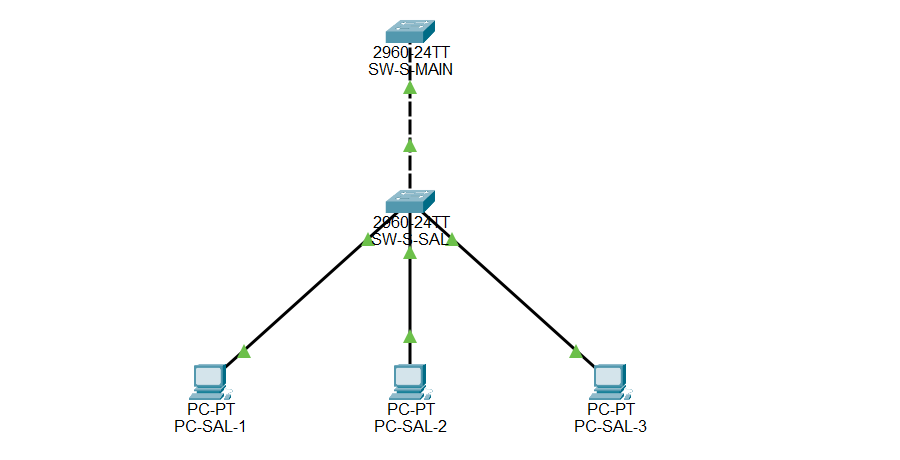

## Lesson plan (for the teacher)
| Minutes | Part |
|---|---|
| 0–20 | Part 1 — theory on the board |
| 20–35 | Missions 1–2 — place and name the devices |
| 35–50 | Mission 3 — cables |
| 50–65 | Mission 4 — switch configuration |
| 65–78 | Missions 5–6 — addresses and tests |
| 78–90 | Find the bug, questions, "your own project" |

---

## Part 1 — Theory: understand it first

### 1.1 What does a switch do?
A switch joins devices in one local network (LAN). It works at **layer 2** of the OSI model,
so it decides using **MAC addresses**, not IP addresses.

1. **Learn:** a frame arrives on a port. The switch notes "this source MAC lives on this port".
2. **Forward:** if it knows the destination MAC, it sends the frame **only** to that port.
3. **Flood:** if it doesn't know the MAC, or the frame is a broadcast, it sends it to every
   port in the VLAN except the one it came from.

### 1.2 MAC, IP and ARP
| | MAC address | IP address |
|---|---|---|
| Layer | 2 | 3 |
| Example | `0007.ec1a.8e6b` | `192.168.20.22` |
| Who sets it | the manufacturer | you, or DHCP |
| Used for | delivery **inside** the LAN | finding the destination **network** |

PC-SAL-1 knows the IP of PC-SAL-2 but needs its MAC. It **broadcasts an ARP request**: "who has
192.168.20.22?" PC-SAL-2 replies with its MAC, and PC-SAL-1 keeps it in its ARP table.

### 1.3 Subnet mask
`192.168.20.21` with mask `255.255.255.0` (`/24`): the first three numbers are the **network**
(192.168.20), the last is the **device**. Same network → talk directly. Different network → you
need a router, which we add in a later lesson.

### 1.4 Which cable?
| Between | Cable | Why |
|---|---|---|
| PC ↔ switch | Copper **Straight-Through** (solid line) | different types: one side's transmit pins already face the other's receive pins |
| switch ↔ switch | Copper **Cross-Over** (dashed line) | same type: transmit and receive must be crossed |

Modern switches can fix a wrong cable themselves (Auto-MDIX), but at the exam you must explain
the correct choice.

### 1.5 Why are the dots orange first?
When a port comes up, **Spanning Tree (STP)** checks that it doesn't create a loop. It takes
about 30 seconds: 15 listening + 15 learning. Orange = checking, green = forwarding.

### 1.6 Two kinds of passwords
| Command | Protects | Stored as |
|---|---|---|
| `line console 0` + `password` + `login` | connecting with the console cable | type 7 after `service password-encryption` (weak) |
| `enable secret` | entering `#` mode | type 5 hash (cannot simply be turned back) |

---

## Mission 1 — Place and name the switches
1. Bottom left: **Network Devices** (1) → **Switches** (2) → **2960** (3).

   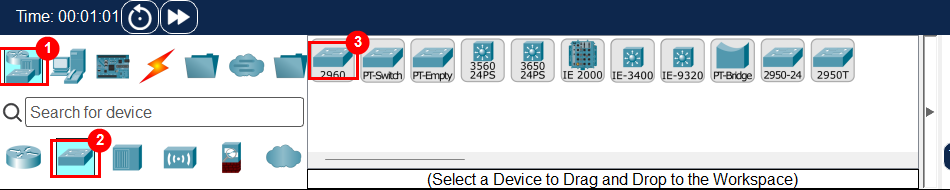
2. Click on the empty workspace. The switch appears as `Switch0`.

   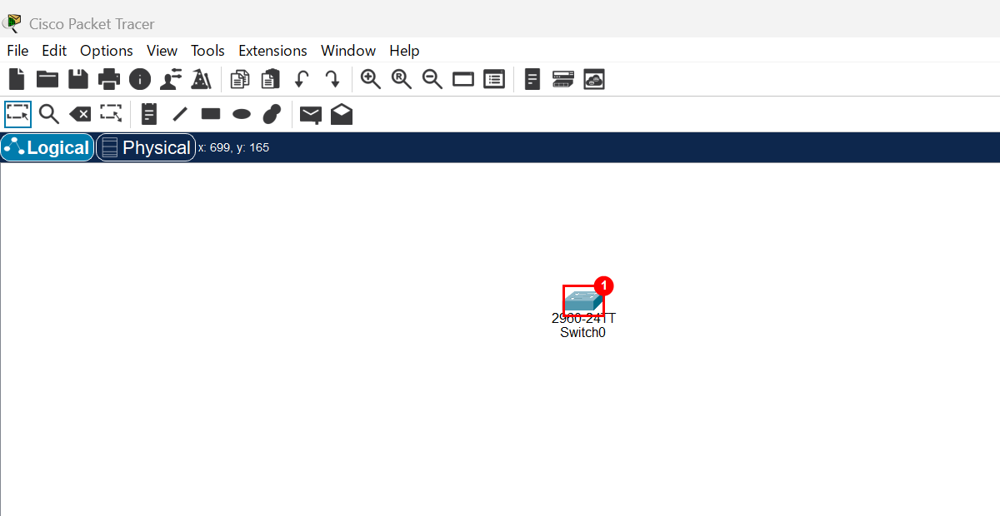
3. Click the switch → **Config** tab (1) → **Display Name** (2) → delete `Switch0`, type `SW-S-MAIN`.

   
4. Close the window. Place a second 2960 under it and name it `SW-S-SAL`.

🧠 **Why these names?** `SW` = switch, `S` = Sakhnin, `MAIN`/`SAL` = its job. Anyone who reads the
name knows what and where the device is.

## Mission 2 — Place and name the PCs
1. **End Devices** (1) → **PC** (2) → click under the switch. Repeat for 3 PCs.

   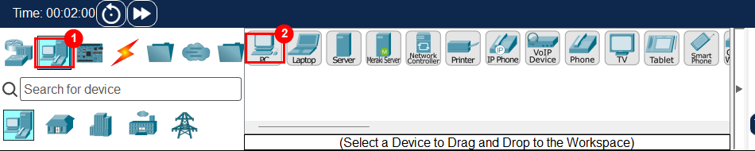

   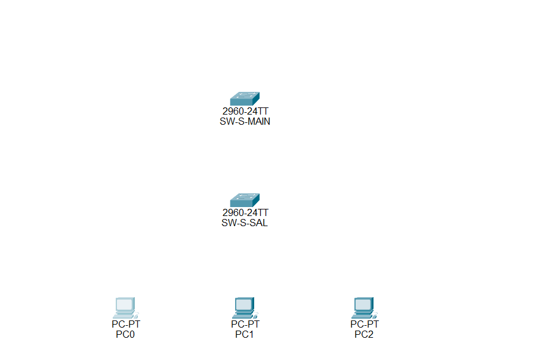
2. Click each PC → **Config** → **Display Name**. From left to right: `PC-SAL-1`, `PC-SAL-2`, `PC-SAL-3`.

## Mission 3 — Cables
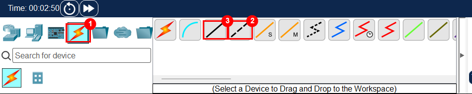

For each row: **Connections** (1) → choose the cable → click the first device → choose its port →
click the second device → choose its port.

| # | Cable | From | Port | To | Port |
|---|---|---|---|---|---|
| 1 | Cross-Over (2) | SW-S-MAIN | FastEthernet0/3 | SW-S-SAL | FastEthernet0/4 |
| 2 | Straight-Through (3) | PC-SAL-1 | FastEthernet0 | SW-S-SAL | FastEthernet0/2 |
| 3 | Straight-Through (3) | PC-SAL-2 | FastEthernet0 | SW-S-SAL | FastEthernet0/3 |
| 4 | Straight-Through (3) | PC-SAL-3 | FastEthernet0 | SW-S-SAL | FastEthernet0/5 |

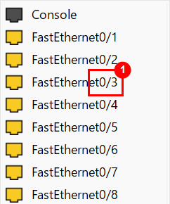

💡 Ports already in use **disappear** from the list. Here Fa0/2 and Fa0/3 are taken:

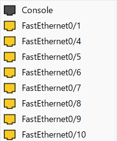

✅ Right after connecting, the dot on the switch is orange (STP). After about 30 seconds everything is green:

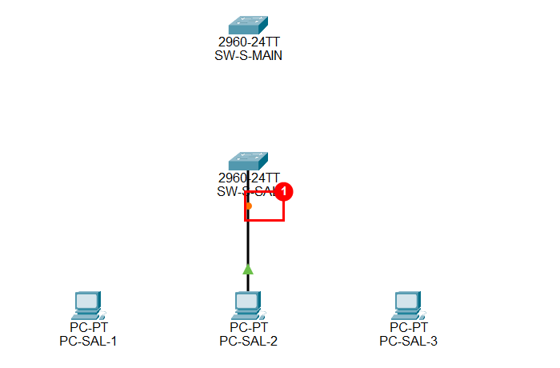

## Mission 4 — Configure the switches
Click **SW-S-MAIN** → **CLI** → press **Enter** until you see `Switch>`. Type line by line:

```
enable
configure terminal
hostname SW-S-MAIN
no ip domain-lookup
enable secret Osem#En1
service password-encryption
banner motd # Osem - Authorized access only #
line console 0
password Osem#Con
login
logging synchronous
exec-timeout 10 0
end
copy running-config startup-config
```
At `Destination filename [startup-config]?` press **Enter**. You must see `[OK]`.

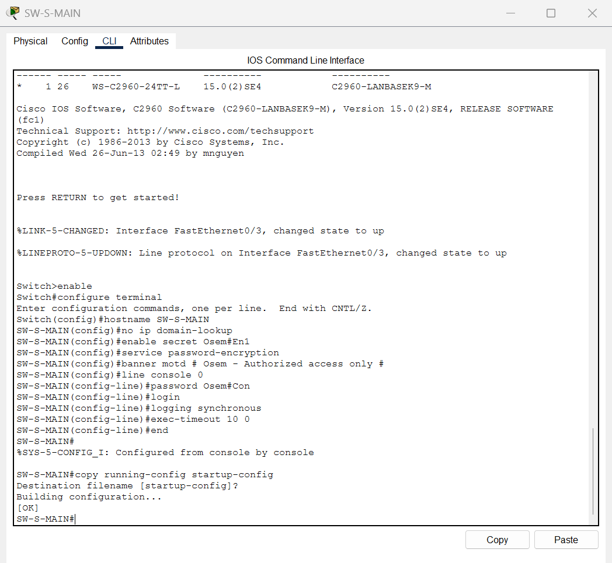

| Command | What it does | Why |
|---|---|---|
| `enable` | moves from `>` to `#` | `>` only lets you look, `#` lets you manage |
| `configure terminal` | opens configuration mode | changes are made only here |
| `hostname` | the name in the prompt | the label on the screen (Mission 1) does not change it |
| `no ip domain-lookup` | a typo is not looked up in DNS | saves a long wait after every typo |
| `enable secret` | password for `#` | stored as a hash |
| `service password-encryption` | hides the other passwords | otherwise `show run` shows them as plain text |
| `banner motd` | a message before login | legal warning to outsiders |
| `line console 0` | enters the console port settings | this is where the password is set |
| `password` + `login` | sets the password **and asks for it** | without `login` nobody is asked |
| `logging synchronous` | messages don't break your line | comfort |
| `exec-timeout 10 0` | logs out after 10 idle minutes | a forgotten open screen is a security hole. 10 minutes is the default, so `show running-config` does not list it |
| `copy running-config startup-config` | saves to NVRAM | running-config is lost when the power goes off |

Repeat on **SW-S-SAL** with `hostname SW-S-SAL`.

✅ `show running-config` shows `enable secret 5 $1$...` and not the password itself:

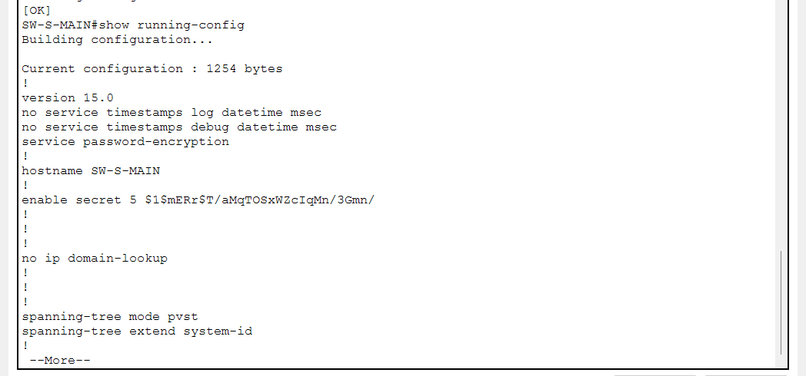

✅ On SW-S-SAL, `show interfaces status` shows Fa0/2–Fa0/5 as `connected` (press **Space** at `--More--`):

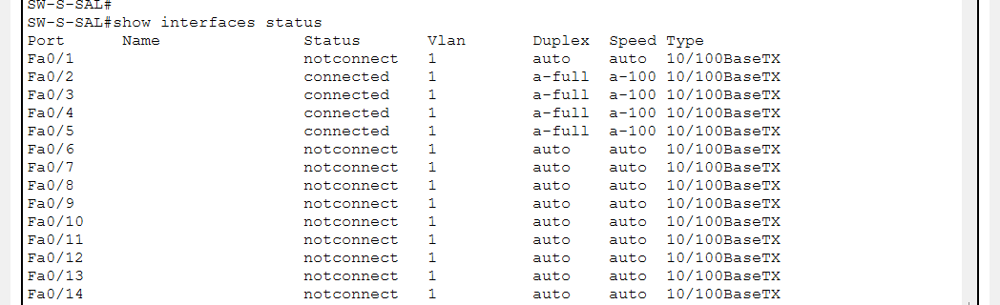

## Mission 5 — PC addresses
Click PC-SAL-1 → **Desktop** (1) → **IP Configuration** (2):

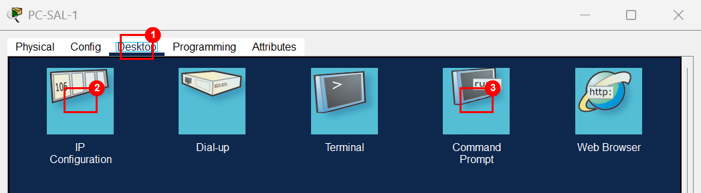

**Static** (1) → IPv4 Address (2) → click Subnet Mask (3), it fills itself in. Leave the gateway
empty: there is no router yet.

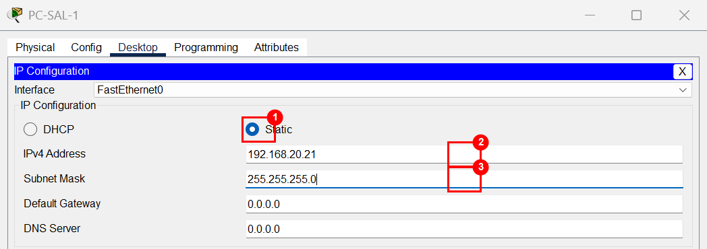

| PC | IPv4 Address | Subnet Mask |
|---|---|---|
| PC-SAL-1 | 192.168.20.21 | 255.255.255.0 |
| PC-SAL-2 | 192.168.20.22 | 255.255.255.0 |
| PC-SAL-3 | 192.168.20.23 | 255.255.255.0 |

## Mission 6 — Test
1. PC-SAL-1 → **Desktop** → **Command Prompt** (3 in the desktop picture):
   ```
   ping 192.168.20.22
   ping 192.168.20.23
   arp -a
   ```
   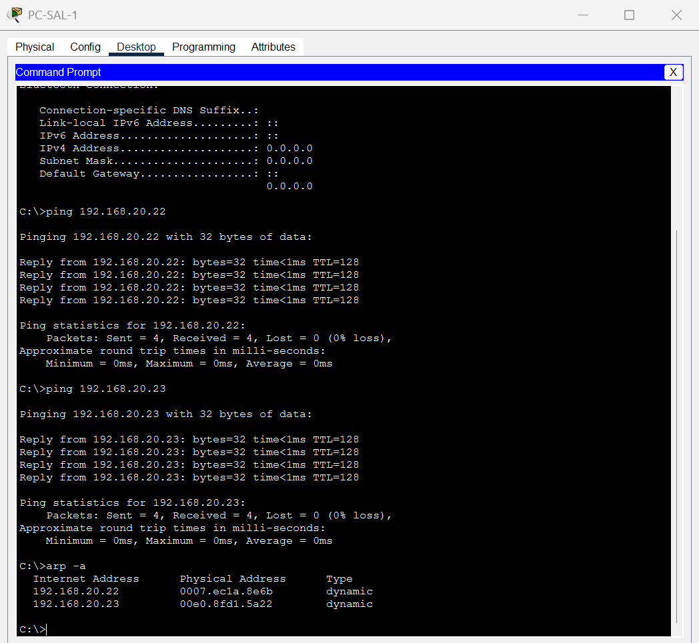

   `Lost = 0` means success. `arp -a` shows the MACs the PC learned.
2. On SW-S-SAL: `show mac address-table`

   

   Compare with `arp -a`: `0007.ec1a.8e6b` (PC-SAL-2) is on Fa0/3. The MAC on Fa0/4 belongs to the
   port of SW-S-MAIN. **Your MAC addresses will be different.**
3. On SW-S-SAL type `exit`, press **Enter** and log in again. You must see the banner, the console
   password prompt and, after `enable`, a second prompt. Nothing appears while you type a password.

   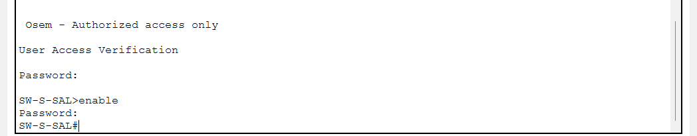
4. Save: **File** → **Save As** → `lesson01.pkt`.

   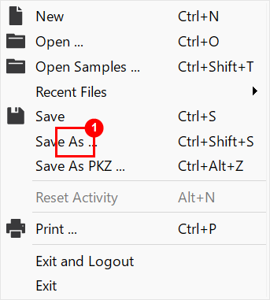

---

## 🔎 Find the bug — from a real project
In the original project this lesson is based on, we found the following. Ask the class **what is
wrong and how to fix it** before opening the answer.

1. Most switches and routers were still called `Switch` and `Router`, and one was called `123`.
2. The banner welcomed people to a **different company**.

<details><summary>Answer</summary>

1. In an outage nobody can tell which device they are on. Fix: `hostname` **and** Display Name on every device.
2. Text was left over from another project. Fix: a new banner. The examiner notices, and it suggests copied work.

</details>

## 🏋 Exercises
1. Change the IP of PC-SAL-3 to `192.168.30.23` (same mask). From PC-SAL-1: `ping 192.168.30.23`. Does it work? Why, even though the cable and the switch did not change? Put `192.168.20.23` back.
2. Disconnect PC-SAL-2 and ping it. Which message do you get?
3. Remove `login` from the console of SW-S-SAL, `exit`, and go in again. What changed? Put it back.

## 🎓 Explain it to the examiner
- How does a switch know where to send a frame?
- Why do we need ARP if we already know the IP?
- What is the difference between `enable secret` and the console password?
- Why cross-over between switches and straight-through to a PC?
- What is the difference between running-config and startup-config?

## 🛠 Your own project
In **your** company's file, with **your** names, addresses and passwords:
- [ ] Choose a naming rule and write it down.
- [ ] Place a main switch, one department switch and the department's PCs.
- [ ] Cable them and write a port table like the one in Mission 3.
- [ ] Configure name, banner with **your** company, and passwords on both switches.
- [ ] Take screenshots: green links, ping, `show mac address-table`, login with banner.
