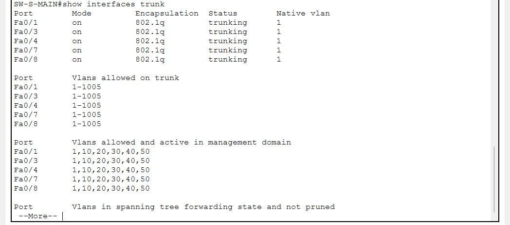
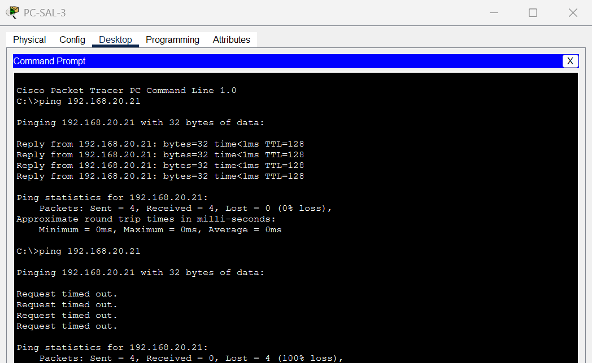
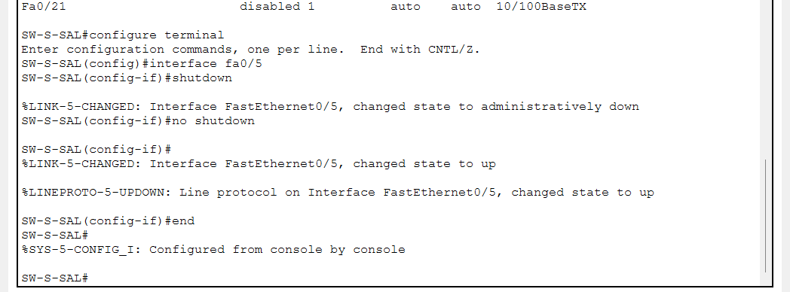
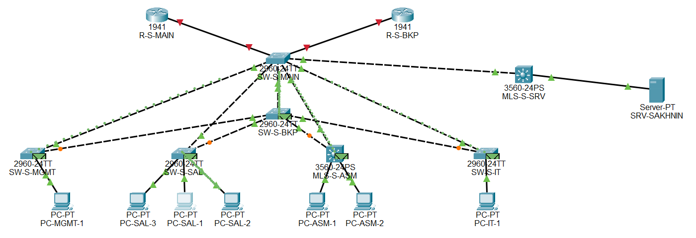
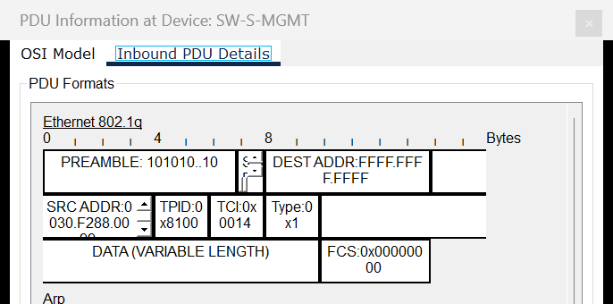
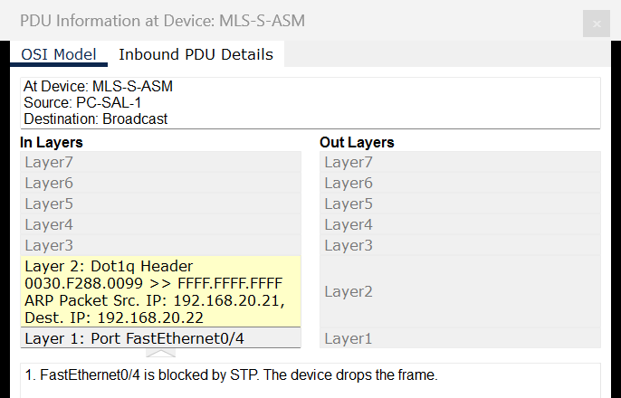
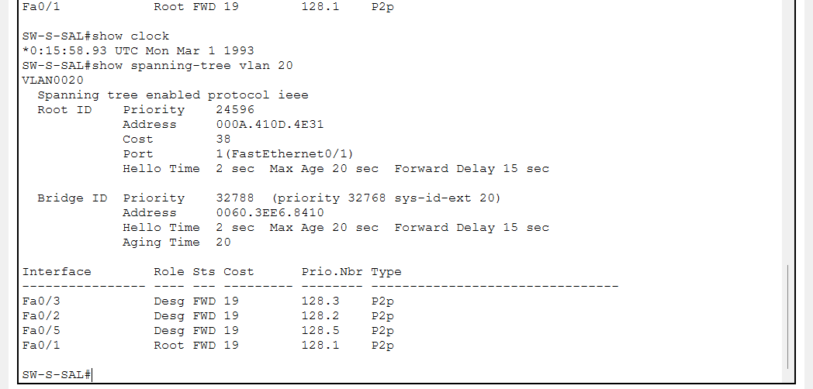
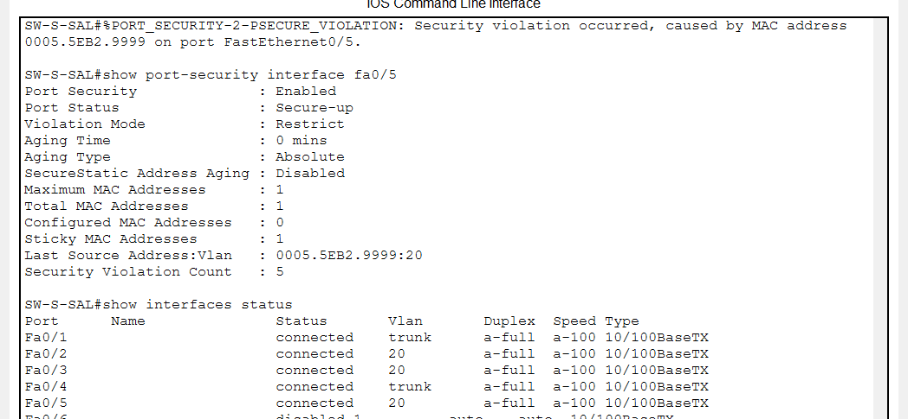

# Lesson 02 — Sakhnin switching: VLAN, VTP, trunks, STP and port security

> ⏱ 90 minutes · 🧰 Packet Tracer 9.x · 📂 start: [`lesson02-start.pkt`](lesson02-start.pkt) · 💾 save as `lesson02.pkt`

## What you will have at the end
The whole Sakhnin branch: every department in its own VLAN, a backup switch with no loops, and
ports that shut down when a stranger connects.


## Lesson plan (for the teacher)
| Minutes | Part |
|---|---|
| 0–20 | Part 1 — theory on the board |
| 20–32 | Missions 1–2 — VLAN and VTP |
| 32–52 | Missions 3–4 — trunk and access ports (split the switches between groups) |
| 52–62 | Mission 5 — STP |
| 62–78 | Missions 6–7 — tests and the port security attack |
| 78–90 | Find the bug, questions, "your own project" |

In the start file all switches are already cabled and have the base configuration of lesson 1
(console `Osem#Con`, enable `Osem#En1`). The PCs already have addresses.


---

## Part 1 — Theory: understand it first

### 1.1 VLAN
A VLAN cuts one physical switch into several separate networks. A broadcast from the salaries
department does not reach IT. Fewer broadcasts, more security, and a person can move desks and
stay in the same network.

💬 **In simple words:** one school building with several classes. Everybody is under the same roof, but a
teacher who speaks in class 20 is not heard in class 40. A VLAN is a class with closed doors.

**Example.** SW-S-SAL has 3 PCs in VLAN 20. If one PC is moved to VLAN 40 (same cable, same switch), it can
no longer ping the two others.

### 1.2 Access and trunk
| | Access | Trunk |
|---|---|---|
| Carries | one VLAN | many VLANs |
| Connects | PC, server, printer | switch ↔ switch, switch ↔ router |
| 802.1Q tag | no | yes: 4 bytes that say "this frame is VLAN 20" |

**Example — a frame from PC-SAL-1 to the backup switch:**

| Place | Tag | Why |
|---|---|---|
| PC-SAL-1 → SW-S-SAL (access) | none | a PC doesn't know what a VLAN is |
| SW-S-SAL → SW-S-MAIN (trunk) | **VLAN 20** | many VLANs share this cable |
| SW-S-MAIN → server switch (access 50) | not sent | this link carries only VLAN 50 |

The VLAN number has 12 bits in the tag, so there are VLANs 1–4094. A frame of the **native VLAN** (1 by
default) travels on the trunk without a tag.

### 1.3 VTP
VTP copies the VLAN list between switches over trunks, so we create each VLAN once.

| Mode | Creates VLANs? | Learns from others? |
|---|---|---|
| Server | yes | yes |
| Client | no | yes |
| Transparent | yes, only for itself | no |

Domain and password must be **identical** on all switches. ⚠️ A switch with a higher **revision**
number overwrites everybody's list, so connect a used switch to the network carefully.

### 1.4 STP — why a backup switch is dangerous
Two paths = a **loop**: a broadcast goes round forever and the network collapses in seconds.
**Spanning Tree** elects one **root bridge** (the lowest priority) and blocks the extra ports. When a
link falls, the blocked port wakes up.

| Addition | Where | What it does |
|---|---|---|
| PortFast | PC ports | skips the 30-second wait |
| BPDU Guard | PC ports | shuts the port if somebody connects a **switch** |
| Root Guard | main switch, towards the departments | no department switch can become root |

💬 **In simple words:** a loop is like a rumor in a group chat in which everybody forwards every message to
everybody, forever. STP is the rule "this person doesn't forward, unless somebody else is missing".

**Example — who is root in VLAN 20?** (the lowest number wins)

| Switch | Priority | + VLAN | Total |
|---|---|---|---|
| SW-S-MAIN | 24576 | 20 | **24596 → root** |
| SW-S-BKP | 28672 | 20 | 28692 |
| SW-S-SAL | 32768 (default) | 20 | 32788 |

**And which way does SW-S-SAL choose?** A 100 Mb/s link costs 19. Directly to the root: 19. Through the backup
switch: 19 + 19 = **38**. The cheaper way forwards, the other one is blocked. Equal priorities → the lowest MAC wins.

### 1.5 Port security
The port learns the MAC of the first PC (`sticky`) and allows only it. A different MAC → the port
goes to **err-disabled**.

| Violation mode | Stranger's frames | Counts and logs | Port |
|---|---|---|---|
| `protect` | dropped | no | stays up |
| `restrict` | dropped | yes | stays up |
| `shutdown` (default) | dropped | yes | **err-disabled** |

### 1.6 The plan
| VLAN | Name | Network | Department switch |
|---|---|---|---|
| 10 | MANAGEMENT | 192.168.10.0/24 | SW-S-MGMT |
| 20 | DISPLAY-SALARIES | 192.168.20.0/24 | SW-S-SAL |
| 30 | ASSEMBLY-MEETING | 192.168.30.0/24 | MLS-S-ASM |
| 40 | IT | 192.168.40.0/24 | SW-S-IT |
| 50 | SERVERS | 192.168.50.0/24 | MLS-S-SRV |

| From | Port | To | Port |
|---|---|---|---|
| SW-S-MAIN | Fa0/1 | SW-S-MGMT | Fa0/5 |
| SW-S-MAIN | Fa0/2 | MLS-S-SRV | Fa0/1 |
| SW-S-MAIN | Fa0/3 | SW-S-SAL | Fa0/4 |
| SW-S-MAIN | Fa0/4 | MLS-S-ASM | Fa0/1 |
| SW-S-MAIN | Fa0/5, Fa0/6 | R-S-BKP, R-S-MAIN | lesson 3 |
| SW-S-MAIN | Fa0/7 | SW-S-BKP | Fa0/3 |
| SW-S-MAIN | Fa0/8 | SW-S-IT | Fa0/2 |
| SW-S-BKP | Fa0/1 | SW-S-MGMT | Fa0/3 |
| SW-S-BKP | Fa0/2 | SW-S-SAL | Fa0/1 |
| SW-S-BKP | Fa0/4 | MLS-S-ASM | Fa0/4 |
| SW-S-BKP | Fa0/5 | SW-S-IT | Fa0/3 |

---

## Mission 1 — VLANs on the main switch
Click **SW-S-MAIN** → **CLI** → log in → `enable`:
```
configure terminal
vtp domain SAKHNIN
vtp password Osem#Vtp
vtp mode server
vlan 10
name MANAGEMENT
vlan 20
name DISPLAY-SALARIES
vlan 30
name ASSEMBLY-MEETING
vlan 40
name IT
vlan 50
name SERVERS
end
show vlan brief
```


| Command | What it does | Why |
|---|---|---|
| `vtp domain SAKHNIN` | the name of the VTP group | only switches with the same name talk |
| `vtp password` | a shared secret | a strange switch cannot change our VLANs |
| `vtp mode server` | this switch manages the list | one place to create VLANs |
| `vlan 20` + `name` | creates a VLAN and names it | the name is documentation; the number is what counts |

## Mission 2 — VTP client on the others
On **SW-S-BKP, SW-S-MGMT, SW-S-SAL, SW-S-IT and MLS-S-ASM** (not MLS-S-SRV):
```
configure terminal
vtp domain SAKHNIN
vtp password Osem#Vtp
vtp mode client
end
```
❓ Ask the class: run `show vlan brief` on SW-S-SAL. The VLANs did **not** arrive. Why?


<details><summary>Answer</summary>

VTP travels only over **trunks**, and we haven't made any yet. That is the next mission.

</details>

## Mission 3 — Trunk and access on the main and backup switch
**SW-S-MAIN:**
```
configure terminal
interface range fa0/1 , fa0/3 - 8
switchport mode trunk
exit
interface fa0/2
switchport mode access
switchport access vlan 50
switchport port-security
switchport port-security maximum 2
switchport port-security mac-address sticky
switchport port-security violation shutdown
exit
interface range fa0/9 - 24 , g0/1 - 2
shutdown
end
```
**SW-S-BKP:**
```
configure terminal
interface range fa0/1 - 5
switchport mode trunk
exit
interface range fa0/6 - 24 , g0/1 - 2
shutdown
end
```
| Command | What it does | Why |
|---|---|---|
| `interface range fa0/1 , fa0/3 - 8` | configures several ports together | note the **spaces** around the comma and the dash |
| `switchport mode trunk` | carries all VLANs | between switches and to routers |
| `switchport port-security maximum 2` | two MACs on Fa0/2 | the server **and** the switch MLS-S-SRV itself |
| `shutdown` on unused ports | turns them off | nobody can connect to a free socket |

## Mission 4 — The department switches
Give one switch to each group.

**SW-S-MGMT:**
```
configure terminal
interface range fa0/3 , fa0/5
switchport mode trunk
exit
interface fa0/1
switchport mode access
switchport access vlan 10
spanning-tree portfast
exit
interface fa0/2
switchport mode access
switchport access vlan 10
spanning-tree portfast
spanning-tree bpduguard enable
switchport port-security
switchport port-security maximum 1
switchport port-security mac-address sticky
switchport port-security violation shutdown
exit
interface range fa0/4 , fa0/6 - 24 , g0/1 - 2
shutdown
end
```
Fa0/1 is reserved for the ASA firewall (lesson 5), without port security: several MACs will pass there.

**SW-S-SAL:**
```
configure terminal
interface range fa0/1 , fa0/4
switchport mode trunk
exit
interface range fa0/2 - 3 , fa0/5
switchport mode access
switchport access vlan 20
spanning-tree portfast
spanning-tree bpduguard enable
switchport port-security
switchport port-security maximum 1
switchport port-security mac-address sticky
switchport port-security violation shutdown
exit
interface range fa0/6 - 24 , g0/1 - 2
shutdown
end
```
**MLS-S-ASM** (3560 — one extra command!):
```
configure terminal
interface range fa0/1 , fa0/4
switchport trunk encapsulation dot1q
switchport mode trunk
exit
interface range fa0/2 - 3
switchport mode access
switchport access vlan 30
spanning-tree portfast
spanning-tree bpduguard enable
switchport port-security
switchport port-security maximum 1
switchport port-security mac-address sticky
switchport port-security violation shutdown
exit
interface range fa0/5 - 24 , g0/1 - 2
shutdown
end
```
**SW-S-IT:**
```
configure terminal
interface range fa0/2 - 3
switchport mode trunk
exit
interface fa0/1
switchport mode access
switchport access vlan 40
spanning-tree portfast
spanning-tree bpduguard enable
switchport port-security
switchport port-security maximum 1
switchport port-security mac-address sticky
switchport port-security violation shutdown
exit
interface range fa0/4 - 24 , g0/1 - 2
shutdown
end
```
**MLS-S-SRV** (3560):
```
configure terminal
vtp mode transparent
vlan 50
name SERVERS
exit
interface range fa0/1 - 2
switchport mode access
switchport access vlan 50
exit
interface range fa0/3 - 24 , g0/1 - 2
shutdown
exit
interface fa0/2
spanning-tree portfast
spanning-tree bpduguard enable
switchport port-security
switchport port-security maximum 1
switchport port-security mac-address sticky
switchport port-security violation shutdown
end
```


🧠 The link SW-S-MAIN ↔ MLS-S-SRV is **access VLAN 50**: only the servers are there, so VTP does not
pass and VLAN 50 is created by hand in transparent mode.

✅ On SW-S-SAL: `show vtp status` and `show vlan brief`. The VLANs arrived, and Fa0/2, Fa0/3, Fa0/5 are in VLAN 20.


✅ On SW-S-MAIN: `show interfaces trunk`. (Fa0/5 and Fa0/6 appear only after the routers are connected.)



| Command | What it does | Why |
|---|---|---|
| `switchport mode access` | a port for one device | a PC must not open a trunk |
| `switchport access vlan 20` | puts the port in VLAN 20 | this is the department |
| `spanning-tree portfast` | green immediately | a PC cannot create a loop |
| `spanning-tree bpduguard enable` | shuts the port if a switch is connected | protects PortFast |
| `switchport port-security` | turns it on | **without this line the lines below do nothing** |
| `maximum 1` + `sticky` | one MAC, learned by itself | no need to type MAC addresses |
| `switchport trunk encapsulation dot1q` | chooses the tag kind (3560 only) | a 3560 also knows ISL; a 2960 knows only dot1q |

## Mission 5 — STP: we choose who is root
**SW-S-MAIN:**
```
configure terminal
spanning-tree mode pvst
spanning-tree vlan 1,10,20,30,40,50 root primary
interface range fa0/1 , fa0/3 , fa0/4 , fa0/8
spanning-tree guard root
end
```
**SW-S-BKP:**
```
configure terminal
spanning-tree vlan 1,10,20,30,40,50 root secondary
end
```
| Command | What it does | Why |
|---|---|---|
| `root primary` | priority 24576 | the main switch is the strongest, and the shortest path goes through it |
| `root secondary` | priority 28672 | takes over if the main switch falls |
| `spanning-tree guard root` | Root Guard | not on Fa0/7: the backup switch is **allowed** to become root |

⚠️ Include **VLAN 1**. We forgot it when we tested, and Root Guard blocked the ports with
`root-inconsistent`, because some other switch was root of VLAN 1.

✅ After about 50 seconds, `show spanning-tree vlan 20` on SW-S-MAIN: **This bridge is the root**.
Priority 24596 = 24576 + 20 (the VLAN number).


✅ On SW-S-SAL: Fa0/1 (to the backup) is **Altn BLK** — it waits — and Fa0/4 is **Root FWD**.


## Mission 6 — Test
**PC-SAL-1** → Command Prompt:
```
ping 192.168.20.22
ping 192.168.10.21
```


🧠 The second ping **must** fail: between VLANs you need a router. That is lesson 3.

## Mission 7 — Attack: a stranger connects
1. On SW-S-SAL: `show port-security interface fa0/2`. Status **Secure-up**, one sticky MAC.

   
2. From **PC-SAL-3** ping 192.168.20.21, so the switch learns its MAC.
3. PC-SAL-3 → **Config** (1) → **FastEthernet0** (2) → MAC Address (3): write down the address, then change the last four digits to `9999` and press Tab. Now it's a "stranger".

   
4. Ping again: it fails.

   
5. On SW-S-SAL: `show port-security interface fa0/5`, then `show interfaces status`. **Secure-shutdown**, violation count 1, port **err-disabled**.

   
6. Recover: first return the **original MAC** to the PC, then on SW-S-SAL:
   ```
   configure terminal
   interface fa0/5
   shutdown
   no shutdown
   end
   ```
   

   
7. Save on every switch: `copy running-config startup-config`. Then File → Save.

## 👀 See it happen — the VLAN border, the tag and STP
Simulation was explained in [lesson 1](../lesson-01/). Filters: **ARP** and **ICMP**. PC-SAL-1:
```
arp -d
ping 192.168.20.22
```
**1. Where does the broadcast stop?** Three steps forward:



❓ The envelope reached SW-S-MGMT and SW-S-IT. Why didn't it continue to PC-MGMT-1 and PC-IT-1? And why didn't it reach MLS-S-SRV?

<details><summary>Answer</summary>

The trunk carries VLAN 20 to every switch, but PC-MGMT-1 is on an access port of VLAN 10 and PC-IT-1 on one of VLAN 40, so the
frame doesn't go out there. The link to MLS-S-SRV is access VLAN 50, so VLAN 20 never enters it.

</details>

**2. The tag.** Open the envelope on SW-S-MGMT → **Inbound PDU Details**:



| Field | Value | Meaning |
|---|---|---|
| TPID | 0x8100 | "I have a VLAN tag" (802.1Q) |
| TCI | 0x0014 | hex 14 = 1 × 16 + 4 = **20**, so VLAN 20 |

Now open the first frame on SW-S-SAL, the one that came from PC-SAL-1: no tag. The PC knows nothing about VLANs.

**3. STP at work.** One more step: copies arrive from SW-S-BKP too. Open the envelope that came to MLS-S-ASM from SW-S-BKP
→ **Next Layer**:



Packet Tracer says it: **blocked by STP, the device drops the frame**. Without the block the frame would go around forever.

✏️ **Try:** `ping 192.168.10.21`. On which PCs does an envelope appear?

<details><summary>Answer</summary>

Only on PC-SAL-1, where it dies. The address is in another network and the PC has no gateway yet, so nothing goes out.

</details>

## 🧯 It doesn't work?
| What you see | Probably | What to do |
|---|---|---|
| no VLANs on a client | no trunk, or a different domain/password | `show interfaces trunk`, `show vtp status`, `show vtp password` |
| `Command rejected: ... trunk encapsulation is "Auto"` | a 3560 | first `switchport trunk encapsulation dot1q` |
| port in VLAN 1 | you forgot `switchport access vlan` | `show vlan brief` |
| `BKN*` / `root-inconsistent` | VLAN 1 missing in `root primary` | add it, wait 50 seconds |
| err-disabled comes back | the stranger is still connected | return the original MAC **before** `shutdown` / `no shutdown` |

---

## 🔎 Find the bug — from a real project
1. The links main switch ↔ departments were in **access** mode.
2. The backup switch was never configured: everything in VLAN 1.
3. Ports 9–24 of the main switch were left as **trunk**, although nothing is connected.
4. The **IT** VLAN (40) was named "servers".

<details><summary>Answer</summary>

1. An access link carries one VLAN, and VTP does not pass over it. Fix: trunk.
2. When the main switch fails the departments have no path: it's a backup only in the drawing. Fix: trunks, VTP client, root secondary.
3. Whoever connects there gets **all** the VLANs. Fix: `shutdown`.
4. Wrong documentation causes mistakes. The name must match the job.

</details>

## 🏋 Exercises
1. Fail the main path: on SW-S-MAIN `interface fa0/3` → `shutdown`. On SW-S-SAL run `show spanning-tree vlan 20` every 10 seconds. How long until Fa0/1 is FWD? What is the new cost? Draw the new path and do `no shutdown`.
2. Try to create `vlan 60` on SW-S-SAL. Which message do you get, and why?
3. Set `switchport port-security violation restrict` on Fa0/5 and attack again. What is different from `shutdown`? Put `shutdown` back.

<details><summary>Answers (we tested them)</summary>

1. About 30–35 seconds: LIS (15) → LRN (15) → FWD. Fa0/1 is now the Root port and the cost is **38** (19 + 19). The path: SW-S-SAL → SW-S-BKP → SW-S-MAIN.

   
2. `VTP VLAN configuration not allowed when device is in CLIENT mode.` Only the server creates VLANs.
3. The stranger's ping fails, but the port stays **connected** (Secure-up), the counter rises and a message appears. With `shutdown` the port goes down and the administrator must open it. Don't forget to return the PC's MAC.

   

</details>

## 🎓 Explain it to the examiner
- What is the difference between access and trunk? What is in the 802.1Q tag?
- What happens in a loop without STP? How is the root bridge elected?
- What is the difference between PortFast, BPDU Guard and Root Guard?
- Why is VTP dangerous, and why did MLS-S-SRV get transparent mode?
- What are sticky MAC and err-disabled, and how do you recover?

<details><summary>Model answers</summary>

1. Access = one VLAN, without a tag, to an end device. Trunk = many VLANs, with an 802.1Q tag of 4 bytes that contains the VLAN number (12 bits).
2. Broadcasts multiply, the MAC table jumps between ports and the network collapses. Root = the lowest bridge ID (priority, then MAC).
3. PortFast skips the wait on PC ports. BPDU Guard shuts a PC port that hears a switch. Root Guard blocks a port from which somebody tries to become root.
4. A switch with a higher revision overwrites the VLAN list. MLS-S-SRV is connected by an access link, VTP doesn't reach it, so it keeps its own list.
5. Sticky = the switch learns the MAC and writes it in the configuration. err-disabled = a port shut by a protection. Recovery: fix the cause, `shutdown`, `no shutdown`.

</details>

## ✏️ Exit quiz (3 minutes)
1. Which VTP mode can create VLANs and pass them on?
2. Which switch becomes root: priority 28672 or 24576?
3. A PC was connected to a port with BPDU Guard, and then a switch instead. What happens?
4. Which command is missing: `switchport port-security maximum 1`, `mac-address sticky` — and nothing is protected?
5. Why does a ping from VLAN 20 to VLAN 10 fail now?

<details><summary>Answers</summary>

1. Server.
2. 24576.
3. The port goes to err-disabled.
4. `switchport port-security` itself.
5. There is no router yet.

</details>

## 🛠 Your own project
- [ ] A VLAN table: number, name, network, switch. One VLAN per department + servers.
- [ ] A port table for every switch.
- [ ] VTP domain and password of **your** company, main = server, departments = client.
- [ ] Trunks between switches, access to PCs, `shutdown` on free ports.
- [ ] Root primary on the main switch and secondary on the backup (with VLAN 1!).
- [ ] Port security and BPDU Guard on every PC port.
- [ ] Screenshots: `show vlan brief`, `show vtp status`, `show interfaces trunk`, `show spanning-tree`, the attack.
