# Lesson 02 — Sakhnin switching: VLAN, VTP, trunks, STP and port security

> ⏱ 90 minutes · 🧰 Packet Tracer 9.x · 📂 start: [`lesson02-start.pkt`](lesson02-start.pkt) · 💾 save as `lesson02.pkt`

## What you will have at the end
The whole Sakhnin branch: every department in its own VLAN, a backup switch with no loops, and
ports that shut down when a stranger connects.

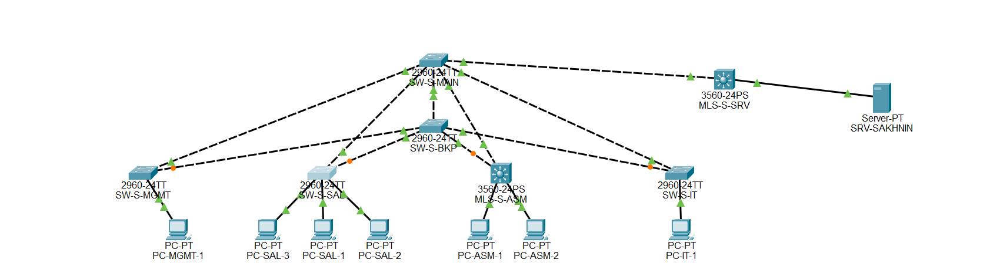

## Lesson plan (for the teacher)
| Minutes | Part |
|---|---|
| 0–20 | Part 1 — theory on the board |
| 20–32 | Missions 1–2 — VLAN and VTP |
| 32–52 | Missions 3–4 — trunk and access ports (split the switches between groups) |
| 52–62 | Mission 5 — STP |
| 62–78 | Missions 6–7 — tests and the port security attack |
| 78–90 | Find the bug, questions, "your own project" |

In the start file all switches are already cabled and have the base configuration of lesson 1
(console `Osem#Con`, enable `Osem#En1`). The PCs already have addresses.

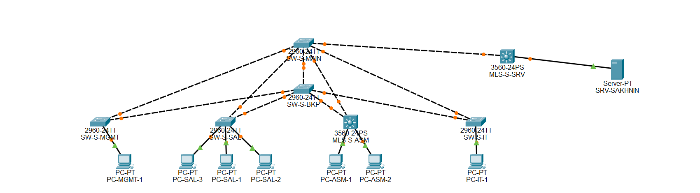

---

## Part 1 — Theory: understand it first

### 1.1 VLAN
A VLAN cuts one physical switch into several separate networks. A broadcast from the salaries
department does not reach IT. Fewer broadcasts, more security, and a person can move desks and
stay in the same network.

### 1.2 Access and trunk
| | Access | Trunk |
|---|---|---|
| Carries | one VLAN | many VLANs |
| Connects | PC, server, printer | switch ↔ switch, switch ↔ router |
| 802.1Q tag | no | yes: 4 bytes that say "this frame is VLAN 20" |

### 1.3 VTP
VTP copies the VLAN list between switches over trunks, so we create each VLAN once.

| Mode | Creates VLANs? | Learns from others? |
|---|---|---|
| Server | yes | yes |
| Client | no | yes |
| Transparent | yes, only for itself | no |

Domain and password must be **identical** on all switches. ⚠️ A switch with a higher **revision**
number overwrites everybody's list, so connect a used switch to the network carefully.

### 1.4 STP — why a backup switch is dangerous
Two paths = a **loop**: a broadcast goes round forever and the network collapses in seconds.
**Spanning Tree** elects one **root bridge** (the lowest priority) and blocks the extra ports. When a
link falls, the blocked port wakes up.

| Addition | Where | What it does |
|---|---|---|
| PortFast | PC ports | skips the 30-second wait |
| BPDU Guard | PC ports | shuts the port if somebody connects a **switch** |
| Root Guard | main switch, towards the departments | no department switch can become root |

### 1.5 Port security
The port learns the MAC of the first PC (`sticky`) and allows only it. A different MAC → the port
goes to **err-disabled**.

### 1.6 The plan
| VLAN | Name | Network | Department switch |
|---|---|---|---|
| 10 | MANAGEMENT | 192.168.10.0/24 | SW-S-MGMT |
| 20 | DISPLAY-SALARIES | 192.168.20.0/24 | SW-S-SAL |
| 30 | ASSEMBLY-MEETING | 192.168.30.0/24 | MLS-S-ASM |
| 40 | IT | 192.168.40.0/24 | SW-S-IT |
| 50 | SERVERS | 192.168.50.0/24 | MLS-S-SRV |

| From | Port | To | Port |
|---|---|---|---|
| SW-S-MAIN | Fa0/1 | SW-S-MGMT | Fa0/5 |
| SW-S-MAIN | Fa0/2 | MLS-S-SRV | Fa0/1 |
| SW-S-MAIN | Fa0/3 | SW-S-SAL | Fa0/4 |
| SW-S-MAIN | Fa0/4 | MLS-S-ASM | Fa0/1 |
| SW-S-MAIN | Fa0/5, Fa0/6 | R-S-BKP, R-S-MAIN | lesson 3 |
| SW-S-MAIN | Fa0/7 | SW-S-BKP | Fa0/3 |
| SW-S-MAIN | Fa0/8 | SW-S-IT | Fa0/2 |
| SW-S-BKP | Fa0/1 | SW-S-MGMT | Fa0/3 |
| SW-S-BKP | Fa0/2 | SW-S-SAL | Fa0/1 |
| SW-S-BKP | Fa0/4 | MLS-S-ASM | Fa0/4 |
| SW-S-BKP | Fa0/5 | SW-S-IT | Fa0/3 |

---

## Mission 1 — VLANs on the main switch
Click **SW-S-MAIN** → **CLI** → log in → `enable`:
```
configure terminal
vtp domain SAKHNIN
vtp password Osem#Vtp
vtp mode server
vlan 10
name MANAGEMENT
vlan 20
name DISPLAY-SALARIES
vlan 30
name ASSEMBLY-MEETING
vlan 40
name IT
vlan 50
name SERVERS
end
show vlan brief
```
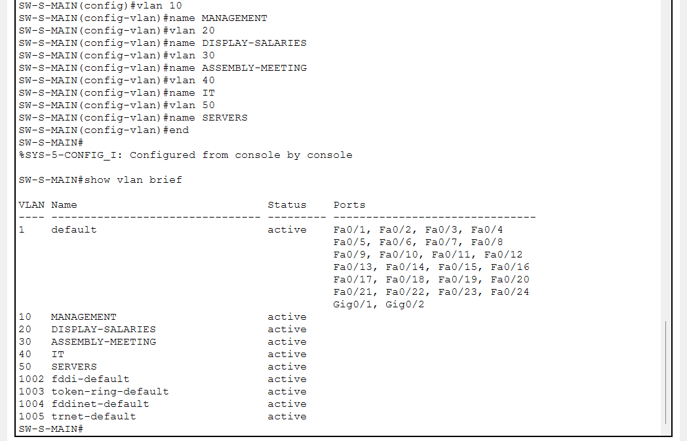

## Mission 2 — VTP client on the others
On **SW-S-BKP, SW-S-MGMT, SW-S-SAL, SW-S-IT and MLS-S-ASM** (not MLS-S-SRV):
```
configure terminal
vtp domain SAKHNIN
vtp password Osem#Vtp
vtp mode client
end
```
❓ Ask the class: run `show vlan brief` on SW-S-SAL. The VLANs did **not** arrive. Why?

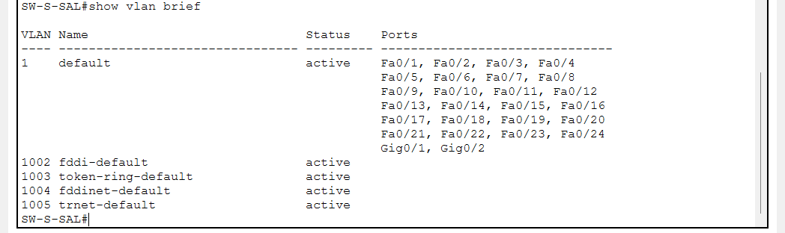

<details><summary>Answer</summary>

VTP travels only over **trunks**, and we haven't made any yet. That is the next mission.

</details>

## Mission 3 — Trunk and access on the main and backup switch
**SW-S-MAIN:**
```
configure terminal
interface range fa0/1 , fa0/3 - 8
switchport mode trunk
exit
interface fa0/2
switchport mode access
switchport access vlan 50
switchport port-security
switchport port-security maximum 2
switchport port-security mac-address sticky
switchport port-security violation shutdown
exit
interface range fa0/9 - 24 , g0/1 - 2
shutdown
end
```
**SW-S-BKP:**
```
configure terminal
interface range fa0/1 - 5
switchport mode trunk
exit
interface range fa0/6 - 24 , g0/1 - 2
shutdown
end
```
| Command | What it does | Why |
|---|---|---|
| `interface range fa0/1 , fa0/3 - 8` | configures several ports together | note the **spaces** around the comma and the dash |
| `switchport mode trunk` | carries all VLANs | between switches and to routers |
| `switchport port-security maximum 2` | two MACs on Fa0/2 | the server **and** the switch MLS-S-SRV itself |
| `shutdown` on unused ports | turns them off | nobody can connect to a free socket |

## Mission 4 — The department switches
Give one switch to each group.

**SW-S-MGMT:**
```
configure terminal
interface range fa0/3 , fa0/5
switchport mode trunk
exit
interface fa0/1
switchport mode access
switchport access vlan 10
spanning-tree portfast
exit
interface fa0/2
switchport mode access
switchport access vlan 10
spanning-tree portfast
spanning-tree bpduguard enable
switchport port-security
switchport port-security maximum 1
switchport port-security mac-address sticky
switchport port-security violation shutdown
exit
interface range fa0/4 , fa0/6 - 24 , g0/1 - 2
shutdown
end
```
Fa0/1 is reserved for the ASA firewall (lesson 5), without port security: several MACs will pass there.

**SW-S-SAL:**
```
configure terminal
interface range fa0/1 , fa0/4
switchport mode trunk
exit
interface range fa0/2 - 3 , fa0/5
switchport mode access
switchport access vlan 20
spanning-tree portfast
spanning-tree bpduguard enable
switchport port-security
switchport port-security maximum 1
switchport port-security mac-address sticky
switchport port-security violation shutdown
exit
interface range fa0/6 - 24 , g0/1 - 2
shutdown
end
```
**MLS-S-ASM** (3560 — one extra command!):
```
configure terminal
interface range fa0/1 , fa0/4
switchport trunk encapsulation dot1q
switchport mode trunk
exit
interface range fa0/2 - 3
switchport mode access
switchport access vlan 30
spanning-tree portfast
spanning-tree bpduguard enable
switchport port-security
switchport port-security maximum 1
switchport port-security mac-address sticky
switchport port-security violation shutdown
exit
interface range fa0/5 - 24 , g0/1 - 2
shutdown
end
```
**SW-S-IT:**
```
configure terminal
interface range fa0/2 - 3
switchport mode trunk
exit
interface fa0/1
switchport mode access
switchport access vlan 40
spanning-tree portfast
spanning-tree bpduguard enable
switchport port-security
switchport port-security maximum 1
switchport port-security mac-address sticky
switchport port-security violation shutdown
exit
interface range fa0/4 - 24 , g0/1 - 2
shutdown
end
```
**MLS-S-SRV** (3560):
```
configure terminal
vtp mode transparent
vlan 50
name SERVERS
exit
interface range fa0/1 - 2
switchport mode access
switchport access vlan 50
exit
interface range fa0/3 - 24 , g0/1 - 2
shutdown
exit
interface fa0/2
spanning-tree portfast
spanning-tree bpduguard enable
switchport port-security
switchport port-security maximum 1
switchport port-security mac-address sticky
switchport port-security violation shutdown
end
```
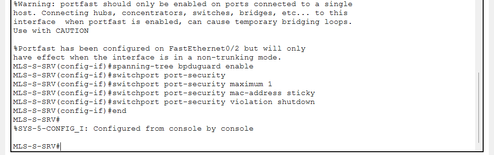

🧠 The link SW-S-MAIN ↔ MLS-S-SRV is **access VLAN 50**: only the servers are there, so VTP does not
pass and VLAN 50 is created by hand in transparent mode.

✅ On SW-S-SAL: `show vtp status` and `show vlan brief`. The VLANs arrived, and Fa0/2, Fa0/3, Fa0/5 are in VLAN 20.

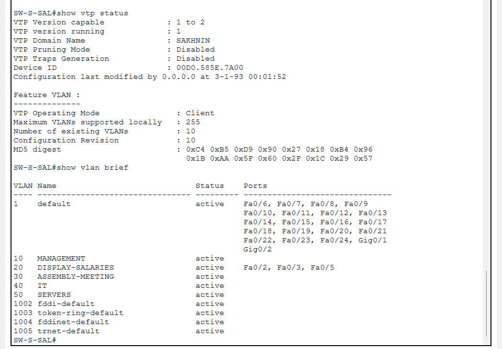

✅ On SW-S-MAIN: `show interfaces trunk`. (Fa0/5 and Fa0/6 appear only after the routers are connected.)


## Mission 5 — STP: we choose who is root
**SW-S-MAIN:**
```
configure terminal
spanning-tree mode pvst
spanning-tree vlan 1,10,20,30,40,50 root primary
interface range fa0/1 , fa0/3 , fa0/4 , fa0/8
spanning-tree guard root
end
```
**SW-S-BKP:**
```
configure terminal
spanning-tree vlan 1,10,20,30,40,50 root secondary
end
```
| Command | What it does | Why |
|---|---|---|
| `root primary` | priority 24576 | the main switch is the strongest, and the shortest path goes through it |
| `root secondary` | priority 28672 | takes over if the main switch falls |
| `spanning-tree guard root` | Root Guard | not on Fa0/7: the backup switch is **allowed** to become root |

⚠️ Include **VLAN 1**. We forgot it when we tested, and Root Guard blocked the ports with
`root-inconsistent`, because some other switch was root of VLAN 1.

✅ After about 50 seconds, `show spanning-tree vlan 20` on SW-S-MAIN: **This bridge is the root**.
Priority 24596 = 24576 + 20 (the VLAN number).

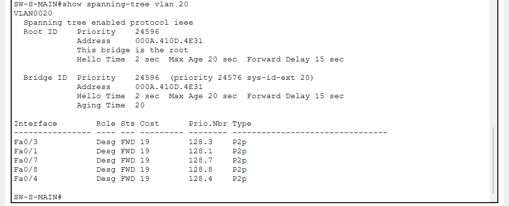

✅ On SW-S-SAL: Fa0/1 (to the backup) is **Altn BLK** — it waits — and Fa0/4 is **Root FWD**.

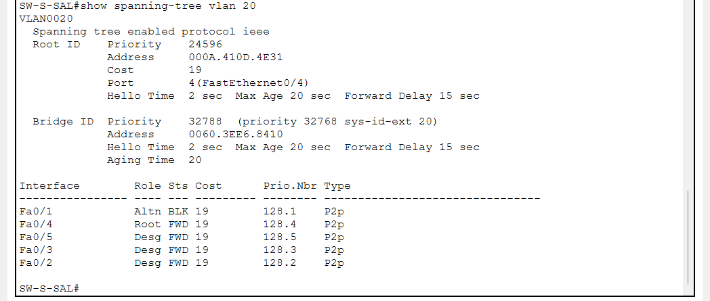

## Mission 6 — Test
**PC-SAL-1** → Command Prompt:
```
ping 192.168.20.22
ping 192.168.10.21
```
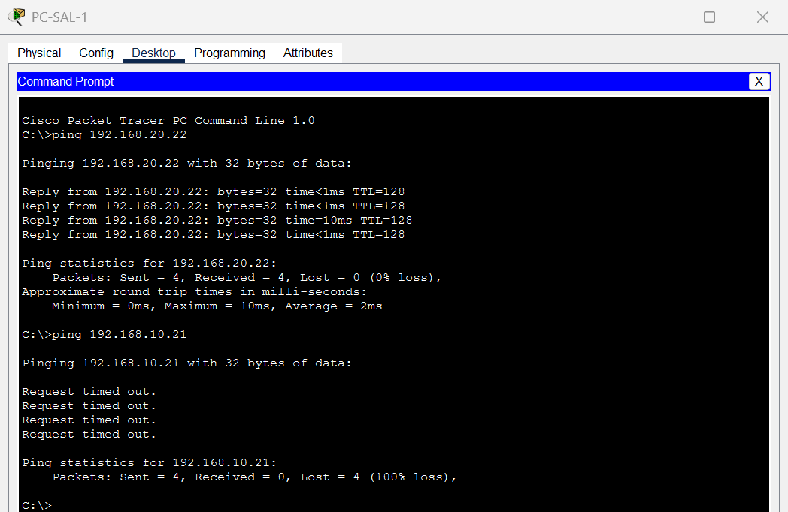

🧠 The second ping **must** fail: between VLANs you need a router. That is lesson 3.

## Mission 7 — Attack: a stranger connects
1. On SW-S-SAL: `show port-security interface fa0/2`. Status **Secure-up**, one sticky MAC.

   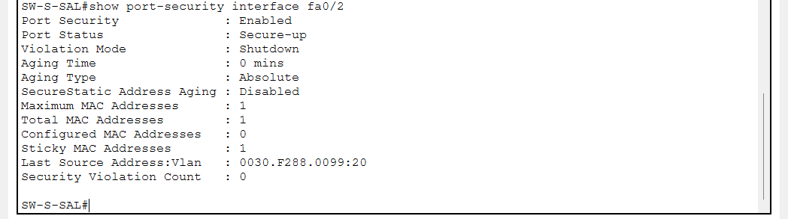
2. From **PC-SAL-3** ping 192.168.20.21, so the switch learns its MAC.
3. PC-SAL-3 → **Config** (1) → **FastEthernet0** (2) → MAC Address (3): write down the address, then change the last four digits to `9999` and press Tab. Now it's a "stranger".

   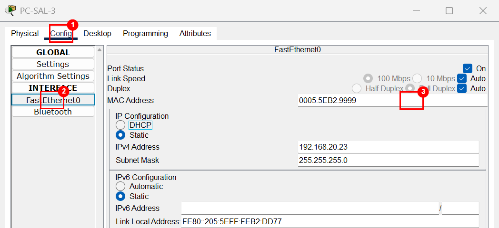
4. Ping again: it fails.

   
5. On SW-S-SAL: `show port-security interface fa0/5`, then `show interfaces status`. **Secure-shutdown**, violation count 1, port **err-disabled**.

   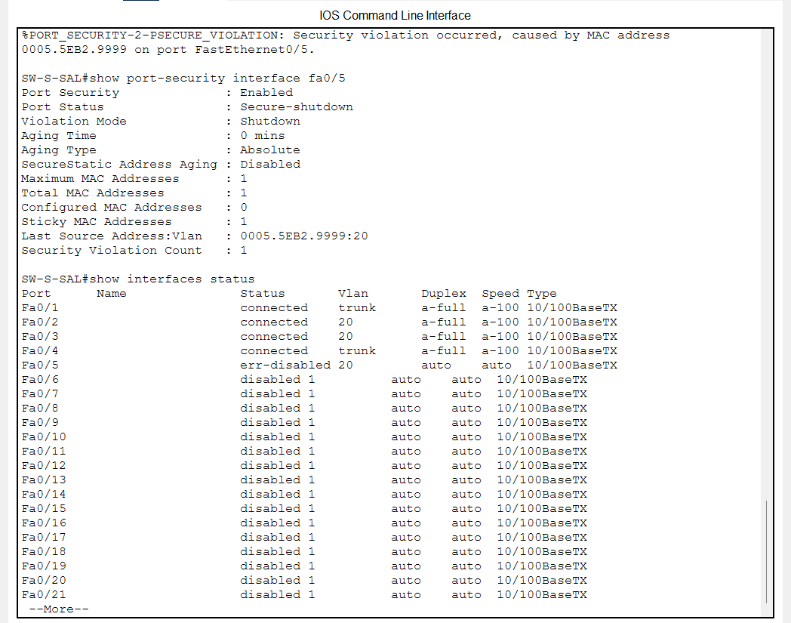
6. Recover: first return the **original MAC** to the PC, then on SW-S-SAL:
   ```
   configure terminal
   interface fa0/5
   shutdown
   no shutdown
   end
   ```
   

   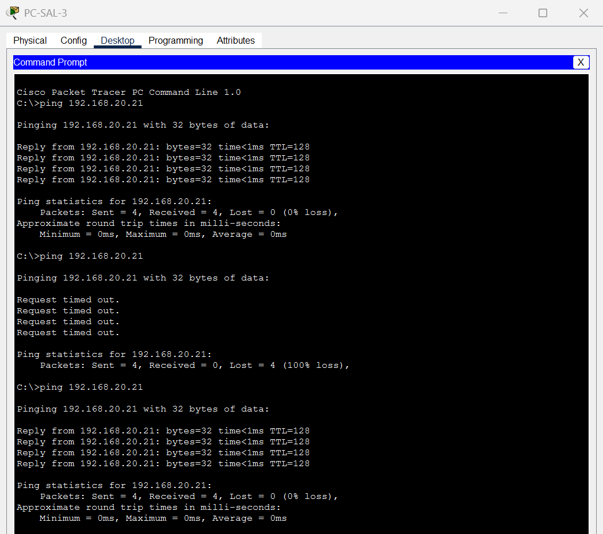
7. Save on every switch: `copy running-config startup-config`. Then File → Save.

---

## 🔎 Find the bug — from a real project
1. The links main switch ↔ departments were in **access** mode.
2. The backup switch was never configured: everything in VLAN 1.
3. Ports 9–24 of the main switch were left as **trunk**, although nothing is connected.
4. The **IT** VLAN (40) was named "servers".

<details><summary>Answer</summary>

1. An access link carries one VLAN, and VTP does not pass over it. Fix: trunk.
2. When the main switch fails the departments have no path: it's a backup only in the drawing. Fix: trunks, VTP client, root secondary.
3. Whoever connects there gets **all** the VLANs. Fix: `shutdown`.
4. Wrong documentation causes mistakes. The name must match the job.

</details>

## 🏋 Exercises
1. Delete the cable SW-S-MAIN ↔ SW-S-SAL. How long until Fa0/1 turns green? Draw the new path and reconnect.
2. Try to create `vlan 60` on SW-S-SAL. Which message do you get, and why?
3. Set `switchport port-security violation restrict` on Fa0/5 and attack again. What is different from `shutdown`? Put `shutdown` back.

## 🎓 Explain it to the examiner
- What is the difference between access and trunk? What is in the 802.1Q tag?
- What happens in a loop without STP? How is the root bridge elected?
- What is the difference between PortFast, BPDU Guard and Root Guard?
- Why is VTP dangerous, and why did MLS-S-SRV get transparent mode?
- What are sticky MAC and err-disabled, and how do you recover?

## 🛠 Your own project
- [ ] A VLAN table: number, name, network, switch. One VLAN per department + servers.
- [ ] A port table for every switch.
- [ ] VTP domain and password of **your** company, main = server, departments = client.
- [ ] Trunks between switches, access to PCs, `shutdown` on free ports.
- [ ] Root primary on the main switch and secondary on the backup (with VLAN 1!).
- [ ] Port security and BPDU Guard on every PC port.
- [ ] Screenshots: `show vlan brief`, `show vtp status`, `show interfaces trunk`, `show spanning-tree`, the attack.
