# Lesson 03 — Sakhnin routing and services: HSRP, DHCP, DNS, Web, FTP, Mail

> ⏱ 90 minutes · 🧰 Packet Tracer 9.x · 📂 start: [`lesson03-start.pkt`](lesson03-start.pkt) or your own file after [Part B](../from-zero/README.md#part-b--two-routers-for-sakhnin) · 💾 save as `lesson03.pkt`

## What you will have at the end
The departments can talk to each other through **two routers that back each other up**, and one
server gives the whole branch addresses, names, a website, files and mail.


## Lesson plan (for the teacher)
| Minutes | Part |
|---|---|
| 0–20 | Part 1 — theory on the board |
| 20–40 | Missions 1–2 — sub-interfaces and HSRP |
| 40–60 | Mission 3 — the server (one student per service) |
| 60–72 | Missions 4–5 — clients, tests and mail |
| 72–82 | Missions 6–7 — DHCP snooping and the failure test |
| 82–90 | Find the bug, questions, "your own project" |

The start file is the end of lesson 2, plus the routers R-S-MAIN and R-S-BKP, cabled and with base configuration.

---

## Part 1 — Theory: understand it first

### 1.1 Router-on-a-stick
One cable (trunk) from the switch to the router carries all the VLANs. We cut the physical port
into **sub-interfaces**: g0/0.10 for VLAN 10, g0/0.20 for VLAN 20... Each has an IP and is the
**gateway** of its VLAN. The physical port itself has **no IP**.

💬 **In simple words:** the router is a corridor between the classes (VLANs). One physical door (g0/0), with
several signs on it: .10, .20, .30...

**Example — PC-SAL-1 (VLAN 20) pings PC-IT-1 (VLAN 40):**

| # | Where | VLAN tag | What happens |
|---|---|---|---|
| 1 | PC-SAL-1 | — | 192.168.40.x is not my network → I send it to my gateway .252 |
| 2 | trunk up to the router | 20 | arrives at g0/0.20 |
| 3 | inside the router | — | routing table: 192.168.40.0 is on g0/0.40 |
| 4 | trunk down to the switch | **40** | the same cable, a different tag |
| 5 | PC-IT-1 | — | arrived |

### 1.2 HSRP — two routers, one gateway
A PC can have only **one** default gateway. If that router dies, the department is cut off.
**HSRP**: two routers share a **virtual IP** (VIP). The PCs use the VIP and don't know which router answers.

| Address | Device |
|---|---|
| .254 | R-S-MAIN, priority 110 → **Active** |
| .253 | R-S-BKP, priority 105 → **Standby** |
| **.252** | the **VIP**: the gateway of all PCs and of the server |

`preempt` = when the main router returns, it takes the Active role back.

💬 **In simple words:** a store has one phone number. Two employees can answer it. The customers dial the same
number and don't notice that the employee changed.

**Example — what each router "says":**

| Situation | R-S-MAIN | R-S-BKP | Active |
|---|---|---|---|
| normal | 110 | 105 | R-S-MAIN |
| g0/0 of the main falls | silent | 105 | R-S-BKP (after about 10 seconds without hello) |
| the main returns, with `preempt` | 110 | 105 | R-S-MAIN again |
| the main returns, **without** `preempt` | 110 | 105 | R-S-BKP stays |

### 1.3 DHCP and relay
DHCP gives a PC its address in four steps, **DORA**: **D**iscover → **O**ffer → **R**equest → **A**ck.
Discover is a **broadcast**, and a router does not forward broadcasts. `ip helper-address` on the
router turns it into a direct message to the server: this is the **relay**.

**Example — PC-SAL-1 asks for an address:**

| Step | From → to | Content |
|---|---|---|
| Discover | 0.0.0.0 → 255.255.255.255 | "is there a DHCP server?" |
| relay | 192.168.20.254 → 192.168.50.1 | the router passes it on and notes "I received it on **192.168.20.254**" |
| Offer | server → PC, through the router | "take 192.168.20.20" |
| Request | PC → everybody | "I accept" |
| Ack | server → PC | "it's yours" + gateway .252 + DNS |

❓ **Ask the class:** the server has four pools. How does it know to give an address from 192.168.20?

<details><summary>Answer</summary>

From the router's note (the field is called *giaddr*): the request came through 192.168.20.254, so the pool of 192.168.20.0.

</details>

### 1.4 The services
| Service | Port | What for |
|---|---|---|
| DNS | UDP 53 | name → IP (`www.osem.com` → 192.168.50.1) |
| HTTP | TCP 80 | website |
| FTP | TCP 20/21 | files |
| SMTP | TCP 25 | **sending** mail |
| POP3 | TCP 110 | **reading** mail |

**Example — what happens when you open `http://www.osem.com`:** the PC asks DNS (UDP 53) "what is the IP?" →
192.168.50.1 → the browser opens a connection to TCP port 80 at that IP → the page arrives. If the site opens by IP
but not by name, the problem is DNS.

### 1.5 DHCP snooping
A student brings a home router from home, and it gives everyone a wrong gateway. With **DHCP
snooping**, the switch accepts DHCP answers only from **trusted** ports.

---

## 🔑 Opening a device
Click the device → **CLI** (1) → click in the text, Enter → `Osem#Con` → `enable` → `Osem#En1`. With pictures: [lesson 2](../lesson-02/).

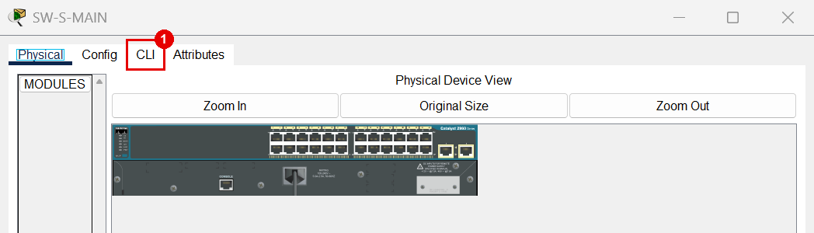

**How every mission is built:** 🌐 the network now → ❗ the problem → 💡 the solution → 📋 do it yourself → 🖱 the full solution, with what to click, what to write and what you must see.

## Mission 1 — Sub-interfaces and HSRP on R-S-MAIN
**🌐 The network now.** Five VLANs that can't talk to each other. We configure the main router:

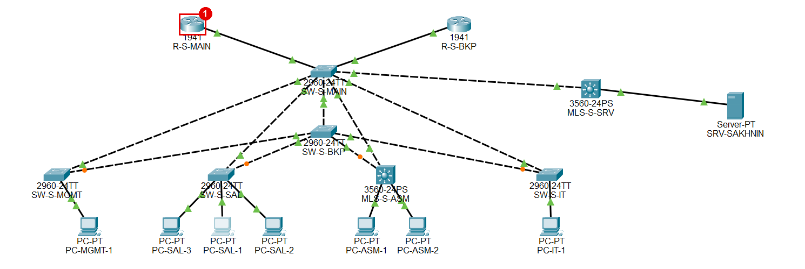

**❗ The problem.** Salaries needs a file from IT. PC-SAL-1 → Command Prompt → `ping 192.168.40.21`:

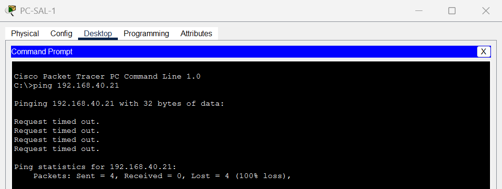

A switch does not pass frames from VLAN to VLAN, and the PC has no gateway. And buying a router port for every VLAN is expensive: a 1941 has only two.

**💡 The solution.** Router-on-a-stick: **one** cable, five sub-interfaces (theory 1.1). In each one we already prepare HSRP (1.2) and a DHCP relay (1.3).

**📋 Do it in the project.** On R-S-MAIN: turn on g0/0 without an IP, and for each VLAN a sub-interface with .254, VIP .252, priority 110, preempt, helper 192.168.50.1 (not in VLAN 50).

### 🖱 The solution: what to click and what to write
**R-S-MAIN** → CLI → log in → `enable`:
```
configure terminal
interface g0/0
no shutdown
exit
interface g0/0.10
encapsulation dot1Q 10
ip address 192.168.10.254 255.255.255.0
standby 10 ip 192.168.10.252
standby 10 priority 110
standby 10 preempt
ip helper-address 192.168.50.1
exit
interface g0/0.20
encapsulation dot1Q 20
ip address 192.168.20.254 255.255.255.0
standby 20 ip 192.168.20.252
standby 20 priority 110
standby 20 preempt
ip helper-address 192.168.50.1
exit
interface g0/0.30
encapsulation dot1Q 30
ip address 192.168.30.254 255.255.255.0
standby 30 ip 192.168.30.252
standby 30 priority 110
standby 30 preempt
ip helper-address 192.168.50.1
exit
interface g0/0.40
encapsulation dot1Q 40
ip address 192.168.40.254 255.255.255.0
standby 40 ip 192.168.40.252
standby 40 priority 110
standby 40 preempt
ip helper-address 192.168.50.1
exit
interface g0/0.50
encapsulation dot1Q 50
ip address 192.168.50.254 255.255.255.0
standby 50 ip 192.168.50.252
standby 50 priority 110
standby 50 preempt
end
copy running-config startup-config
```

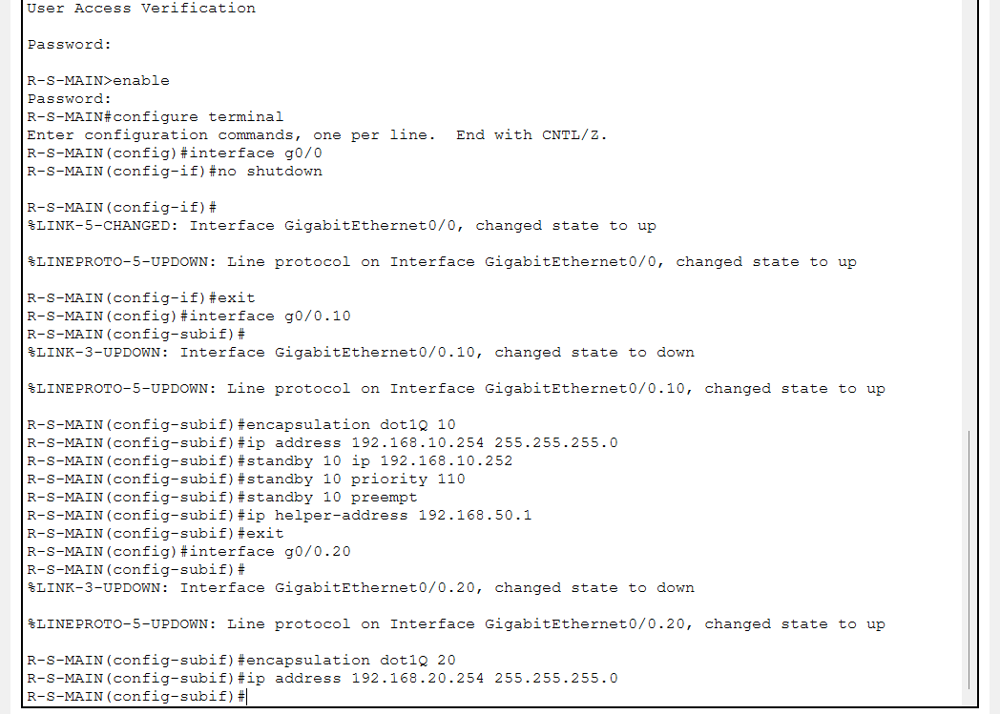

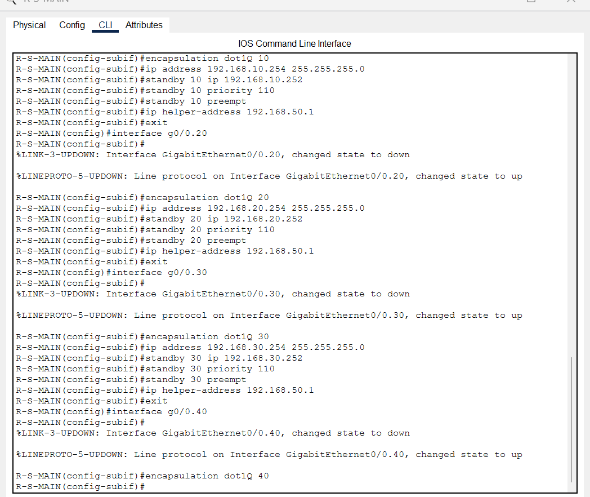

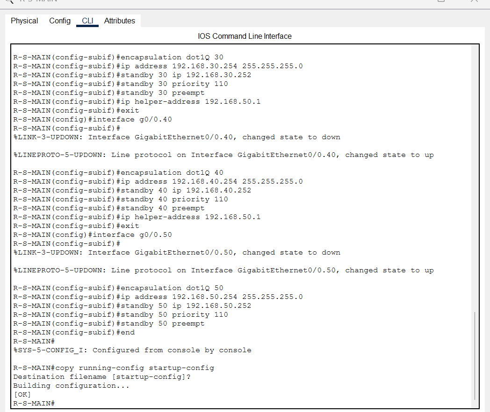

| Command | What it does | Why |
|---|---|---|
| `interface g0/0` + `no shutdown` | turns on the physical port | router ports are off by default |
| `interface g0/0.10` | creates a sub-interface | one per VLAN |
| `encapsulation dot1Q 10` | "this is VLAN 10" | **before** the IP, otherwise the router refuses |
| `standby 10 ip` | the VIP of group 10 | the gateway for the PCs |
| `standby 10 priority 110` | higher wins | main = 110, backup = 105 |
| `standby 10 preempt` | takes Active back | otherwise the backup stays Active |
| `ip helper-address` | forwards DHCP to the server | not needed in VLAN 50, where the server is |

## Mission 2 — R-S-BKP
**🌐 The network now.** R-S-MAIN (2) routes for everybody. We configure R-S-BKP (1):

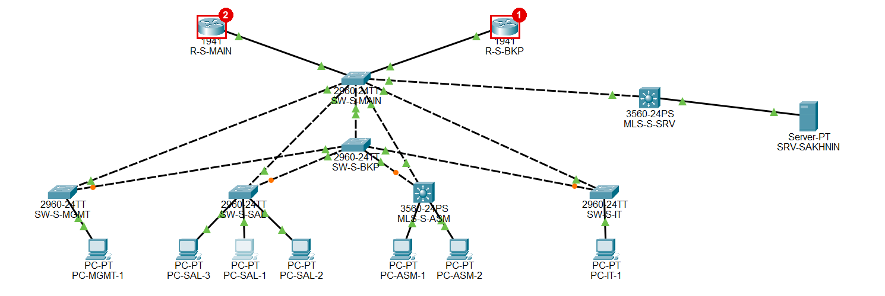

**❗ The problem.** One router = one failure stops five departments. R-S-MAIN, `show standby brief`:

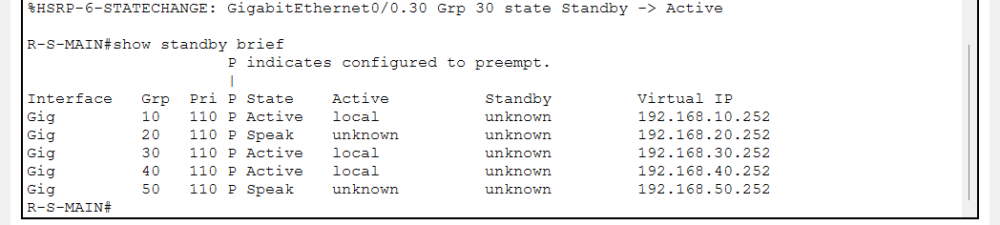

`Standby: unknown` means that there is no backup. (`Speak` = still starting, `Active` after a few seconds.)

**💡 The solution.** The second router joins the **same** groups with the **same** VIP and a lower priority (105). If the main goes silent, it takes over.

**📋 Do it in the project.** Copy the block of Mission 1 and change only two things. Which two?

### 🖱 The solution: what to click and what to write
The same, with **.253** and **priority 105**:
```
configure terminal
interface g0/0
no shutdown
exit
interface g0/0.10
encapsulation dot1Q 10
ip address 192.168.10.253 255.255.255.0
standby 10 ip 192.168.10.252
standby 10 priority 105
standby 10 preempt
ip helper-address 192.168.50.1
exit
interface g0/0.20
encapsulation dot1Q 20
ip address 192.168.20.253 255.255.255.0
standby 20 ip 192.168.20.252
standby 20 priority 105
standby 20 preempt
ip helper-address 192.168.50.1
exit
interface g0/0.30
encapsulation dot1Q 30
ip address 192.168.30.253 255.255.255.0
standby 30 ip 192.168.30.252
standby 30 priority 105
standby 30 preempt
ip helper-address 192.168.50.1
exit
interface g0/0.40
encapsulation dot1Q 40
ip address 192.168.40.253 255.255.255.0
standby 40 ip 192.168.40.252
standby 40 priority 105
standby 40 preempt
ip helper-address 192.168.50.1
exit
interface g0/0.50
encapsulation dot1Q 50
ip address 192.168.50.253 255.255.255.0
standby 50 ip 192.168.50.252
standby 50 priority 105
standby 50 preempt
end
copy running-config startup-config
```

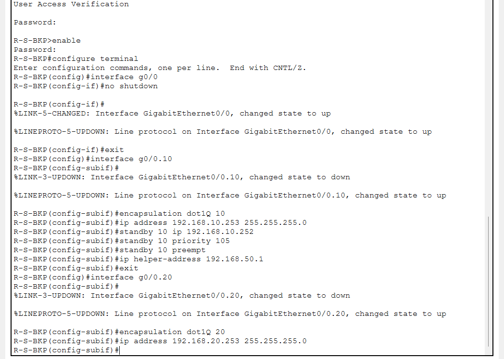

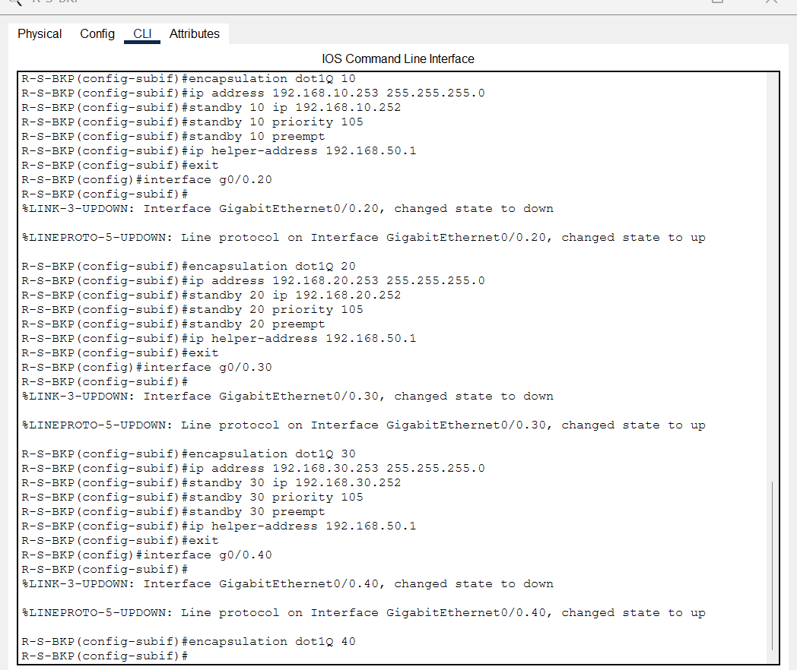

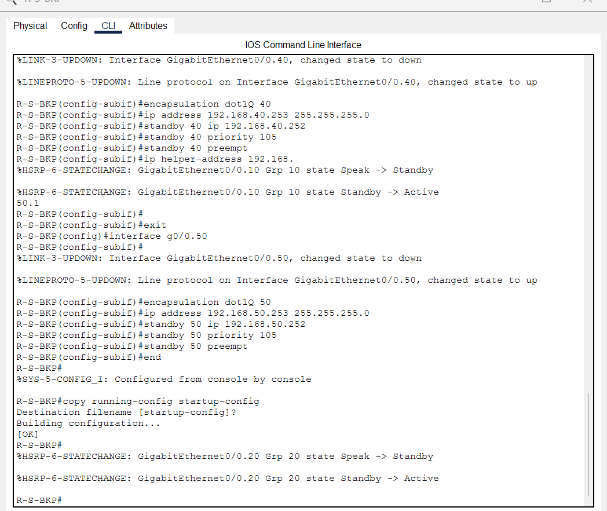

✅ Wait about 20 seconds. `show standby brief` on both: main **Active**, backup **Standby**.


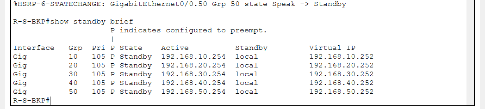

## Mission 3 — The server
**🌐 The network now.** The departments are connected. The server is on, but empty:

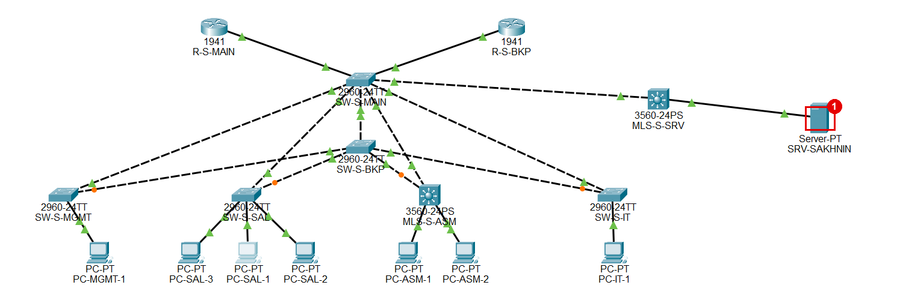

**❗ The problem.** PC-SAL-1 → Desktop → **Web Browser** → `http://www.osem.com` → Go. Nothing appears:

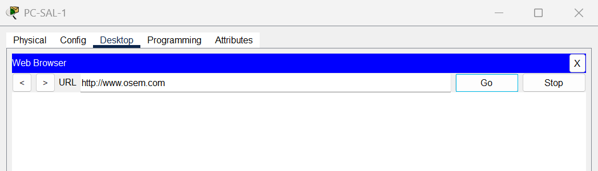

Nobody knows the name, there is no site, addresses are typed by hand on each PC, and there is no mail.

**💡 The solution.** Five services on one server:

| Service | The problem without it | What it does |
|---|---|---|
| DHCP | typing an address on every PC, with mistakes | gives the address, gateway and DNS automatically |
| DNS | remembering 192.168.50.1 | translates www.osem.com to an IP |
| HTTP | no company site | shows the page |
| FTP | files walk on a disk-on-key | a shared folder with a user and password |
| EMAIL | no mail between employees | SMTP sends, POP3 reads |

**📋 Do it in the project.** One student per service, with the values of the tables below. Fixed address first!

### 🖱 The solution: what to click and what to write
Click **SRV-SAKHNIN** → **Services** (1). The list is on the left, for example DHCP (2) and DNS (3):

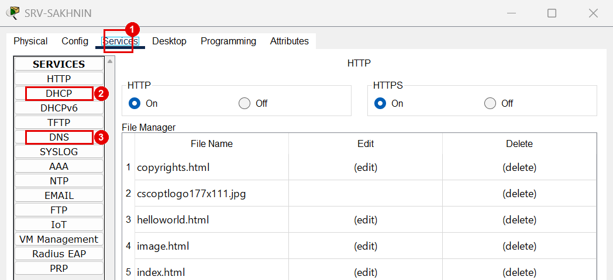

### 3.1 Fixed address

❗ If the server's address changes, every PC, DNS record and helper points to the wrong place. 💡 A static address, with the **VIP** as gateway.

**SRV-SAKHNIN** → **Desktop** → **IP Configuration** → Static: address `192.168.50.1` (1), mask
`255.255.255.0` (2), gateway **`192.168.50.252`** — the VIP (3), DNS `192.168.50.1` (4).

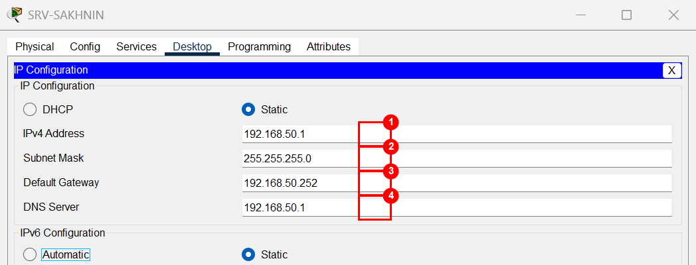

🧠 A server must have a **fixed** address, because everyone looks for it there.

### 3.2 DHCP

❗ PCs in four different networks ask one server. 💡 A **pool** per network, each with its own gateway.

**Services** (1) → **DHCP** (2). For each row fill the form (3) and click **Add** (4):

| Pool Name | Default Gateway | DNS Server | Start IP | Mask | Max users |
|---|---|---|---|---|---|
| MANAGEMENT | 192.168.10.252 | 192.168.50.1 | 192.168.10.20 | 255.255.255.0 | 50 |
| DISPLAY-SALARIES | 192.168.20.252 | 192.168.50.1 | 192.168.20.20 | 255.255.255.0 | 50 |
| ASSEMBLY-MEETING | 192.168.30.252 | 192.168.50.1 | 192.168.30.20 | 255.255.255.0 | 50 |
| IT | 192.168.40.252 | 192.168.50.1 | 192.168.40.20 | 255.255.255.0 | 50 |

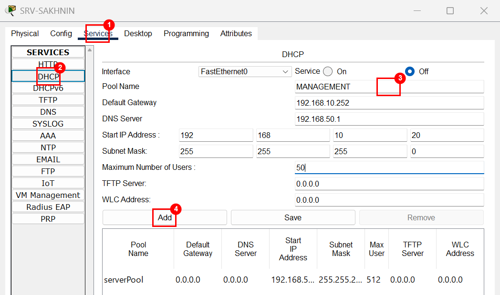

Then **Service: On** (1) and **Save** (2).

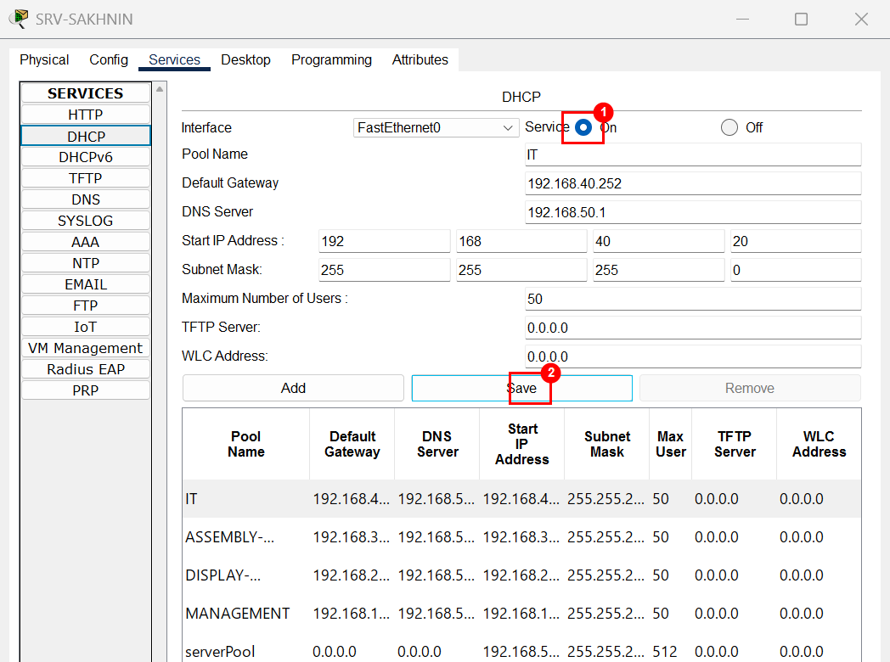

### 3.3 DNS

❗ People remember names, computers need an IP. 💡 An **A record**: name → IP.

**DNS** → On (1). Name (2) `www.osem.com`, Address (3) `192.168.50.1` → **Add** (4). Again for `mail.osem.com`.

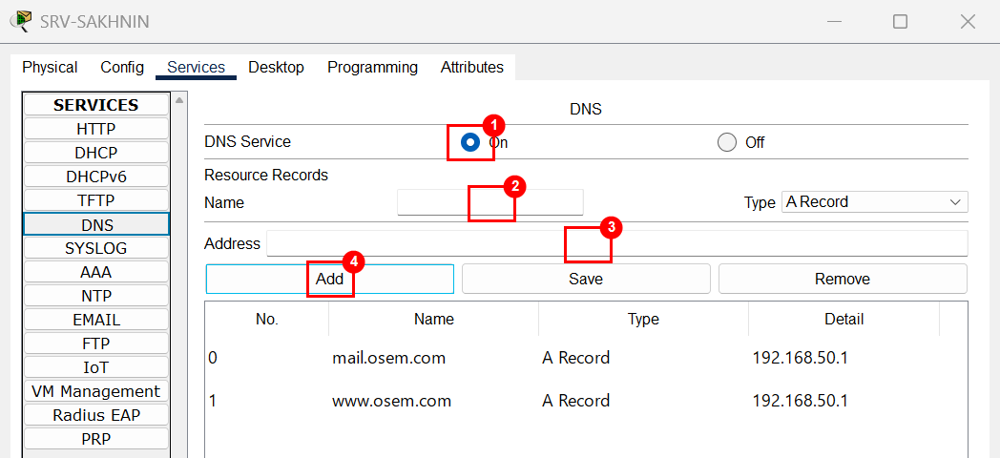

### 3.4 Website

❗ Opening the default Cisco page proves nothing. 💡 Our own text: if you see it, you reached **our** server.

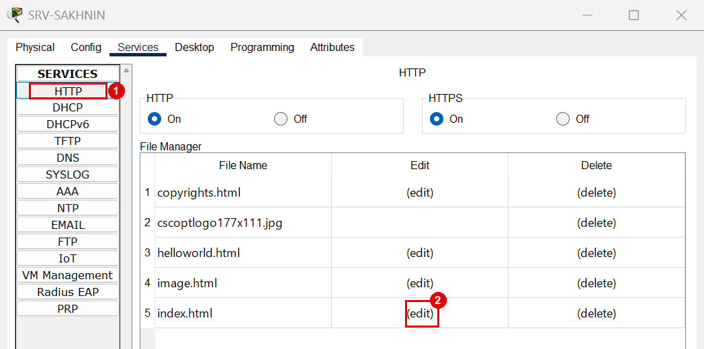

**HTTP** → next to `index.html` click **(edit)**. In the third line, keep `<hr>` and replace the text after it
(`Welcome to Cisco Packet Tracer. … Mind Wide Open.`) with `Welcome to Osem - Sakhnin branch` → **Save** (1) → **Yes** to overwrite.

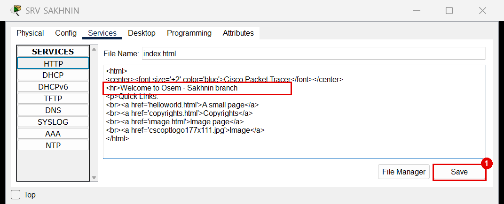

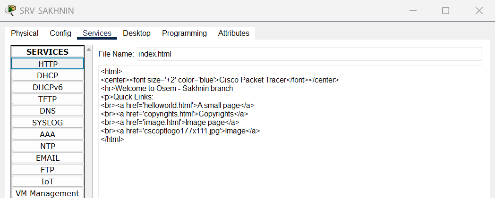

### 3.5 FTP

❗ Anyone could take the company's files. 💡 A user, a password and permissions.

**FTP** → Username (1) `sakhnin`, Password (2) `Osem#Ftp`, tick all five permissions → **Add** (3).


### 3.6 Mail

❗ The server has no mailboxes and doesn't know which domain it serves. 💡 A domain and a user for every employee.

**EMAIL** → Domain Name (1) `osem.com` → **Set** (2). User (3) `sakhnin1`, Password (4) `Osem#Mail` → **+** (5). Again for `sakhnin2`.

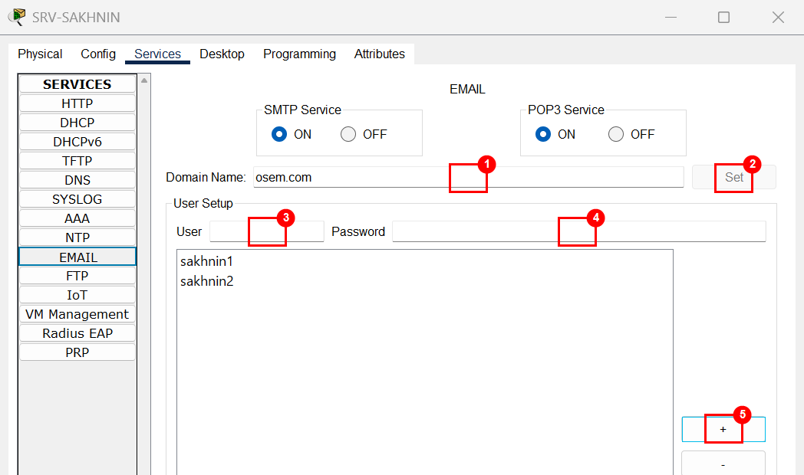

## Mission 4 — PCs get an address
**🌐 The network now.** The server gives addresses. The seven PCs still have the addresses typed by hand, **without a gateway**:

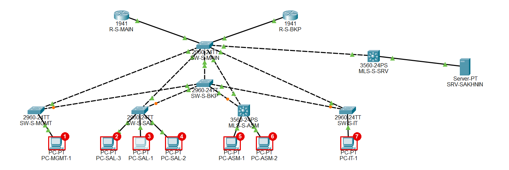

**❗ The problem.** Without a gateway a PC can't leave its VLAN, and the server is in another VLAN. Worse: a PC that asks for DHCP sends a broadcast, and a broadcast stops at the router.

**💡 The solution.** DHCP on the PC + the relay (`ip helper-address`) that we wrote in Missions 1 and 2. DORA is explained in theory 1.3.

**📋 Do it in the project.** Move all the PCs to DHCP and write down for each one: address, gateway, DNS. Is the gateway .254 or .252? Why?

### 🖱 The solution: what to click and what to write
Each PC → Desktop → **IP Configuration** → **DHCP** (1). Gateway .252 and the DNS arrive by themselves:

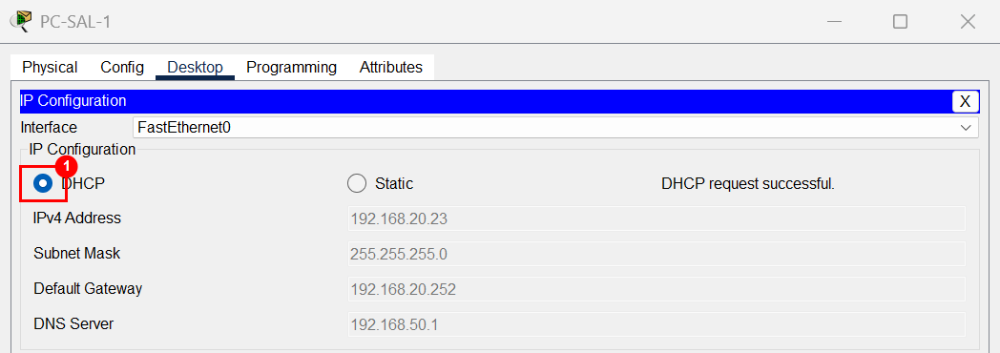

⚠️ The first request sometimes fails while STP and HSRP are still starting. Click Static and DHCP again, or `ipconfig /renew`.

## Mission 5 — Test everything
**🌐 The network now.** Five services, two routers, seven PCs with addresses.

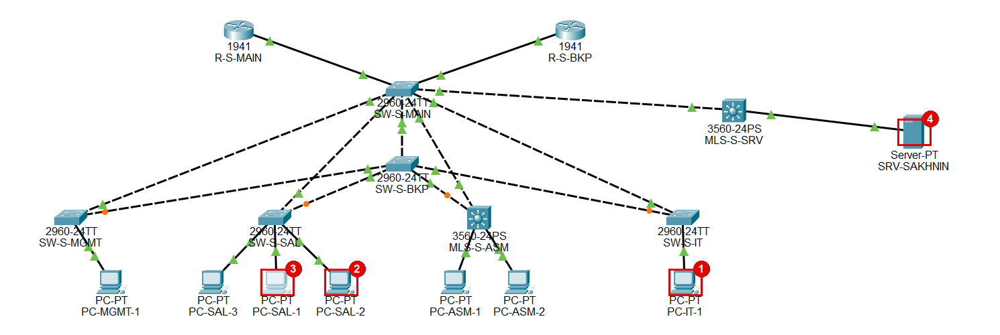

**❗ The problem.** One page that opens doesn't prove that DNS, FTP and mail work. When something fails we must know **which** link of the chain broke.

**💡 The solution.** One test per service, from different VLANs, in this order: DNS → web → ping and FTP → path → mail.

**📋 Do it in the project.** Do the five tests. For each one say which service and which port it checks.

### 🖱 The solution: what to click and what to write
1. **PC-IT-1**: `nslookup www.osem.com`

   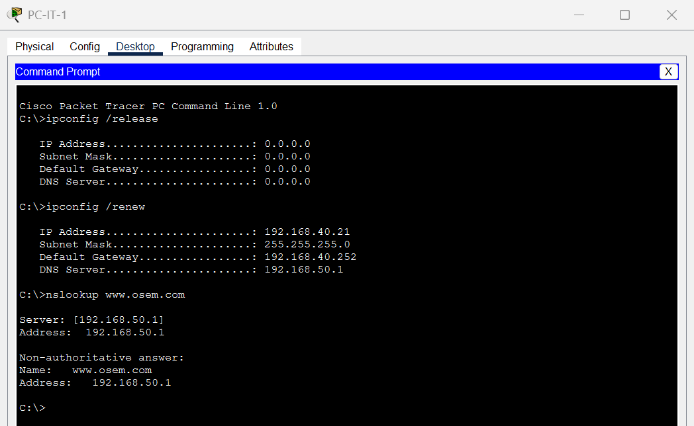
2. **PC-SAL-2** → Desktop → **Web Browser** → `http://www.osem.com` → **Go**

   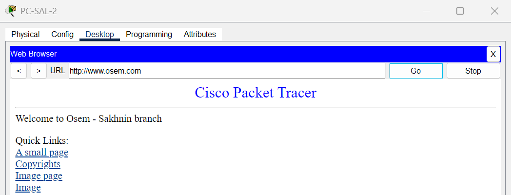
3. **PC-SAL-1**: `ping 192.168.50.1`, then `ftp 192.168.50.1` (user `sakhnin`, password `Osem#Ftp`), `quit`.

   
4. **PC-SAL-1**: `tracert 192.168.40.21` (the address of PC-IT-1, check yours with `ipconfig`). The first hop is **.254**, the main router. Remember it for Mission 7!

   
5. **Mail.** PC-SAL-1 → Desktop → **Email** → fill in and **Save**:

   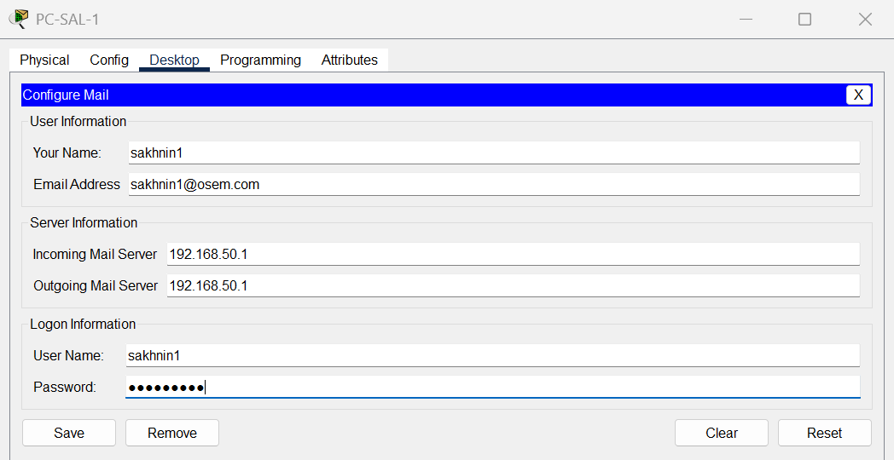

   On PC-SAL-2 the same with `sakhnin2`. Then on PC-SAL-1 → **Compose**: To (1) `sakhnin2@osem.com`, Subject (2) → **Send** (3).

   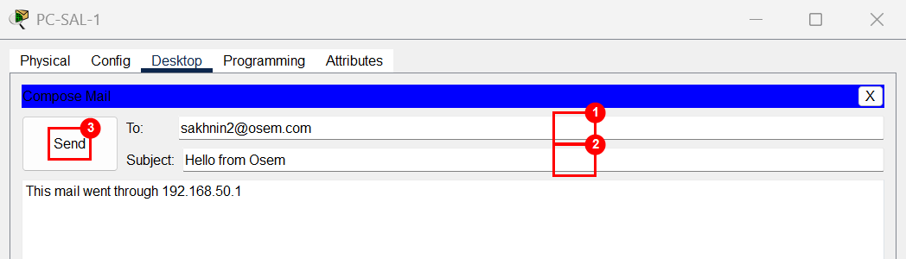

   On PC-SAL-2 → **Receive** (1):

   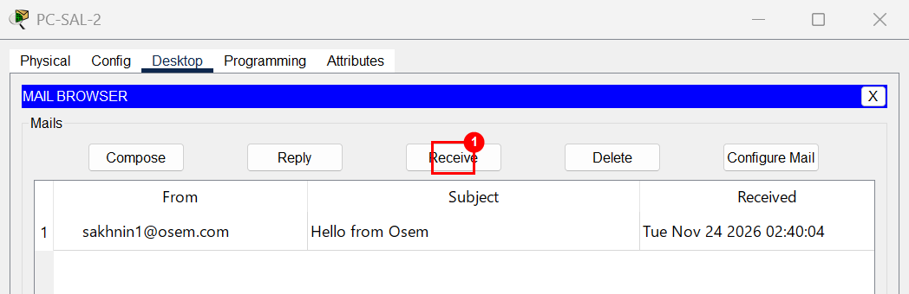

## Mission 6 — DHCP snooping
**🌐 The network now.** Everyone gets an address automatically. Whoever answers **first** wins:

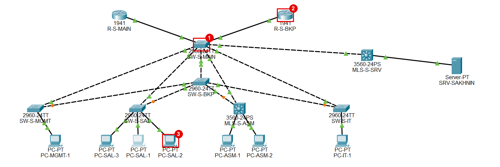

**❗ The problem.** A PC believes **any** DHCP server. A home router connected by mistake, or an attacker, can give a false gateway and read all the traffic. The switch does not check. SW-S-MAIN, `show ip dhcp snooping`:

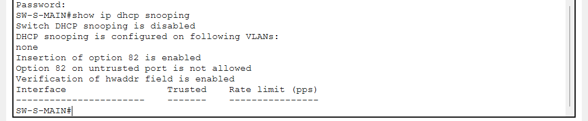

**💡 The solution.** DHCP snooping: answers of a server are accepted only from **trusted** ports (theory 1.5).

**📋 Do it in the project.** Turn it on for VLANs 10–40 and decide which ports of SW-S-MAIN are trusted. Then attack, in 6.1.

### 🖱 The solution: what to click and what to write
**SW-S-MAIN:**
```
configure terminal
ip dhcp snooping
ip dhcp snooping vlan 10,20,30,40
no ip dhcp snooping information option
interface range fa0/2 , fa0/5 - 7
ip dhcp snooping trust
end
copy running-config startup-config
show ip dhcp snooping
```

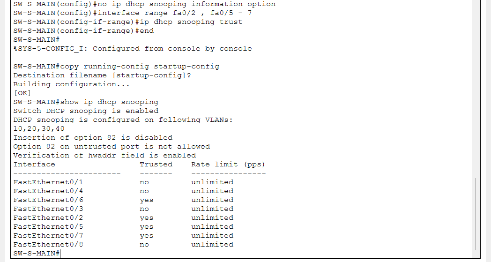

| Port | Connected to | Why trusted |
|---|---|---|
| Fa0/2 | server switch | the real DHCP server is there |
| Fa0/5, Fa0/6 | routers | the relay answers come from them |
| Fa0/7 | backup switch | another path to the same network |


💡 In Packet Tracer the table `show ip dhcp snooping binding` stayed empty in our tests, so check with `show ip dhcp snooping`.

✅ On a PC: `ipconfig /release` and `ipconfig /renew` still work.

### 6.1 See the attack
A "stranger" gives addresses. For the demonstration **R-S-BKP** plays the attacker:
```
configure terminal
ip dhcp excluded-address 192.168.20.1 192.168.20.199
ip dhcp pool ROGUE
network 192.168.20.0 255.255.255.0
default-router 192.168.20.99
dns-server 6.6.6.6
end
```

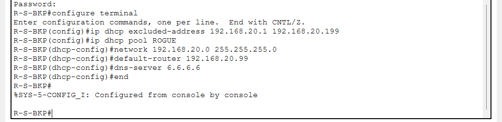

On **PC-SAL-2**: `ipconfig /release`, `ipconfig /renew`. The gateway is **192.168.20.99** and the DNS **6.6.6.6**: all
the PC's traffic now goes to the attacker!

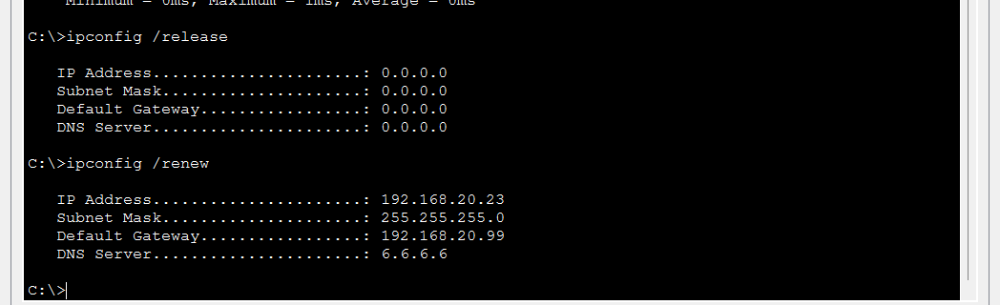

Why did snooping not stop it? Because the port to R-S-BKP is **trusted**. On **SW-S-MAIN** take the trust away:
```
configure terminal
interface fa0/5
no ip dhcp snooping trust
end
```

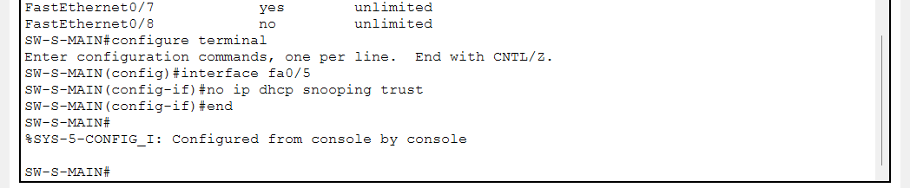

Release and renew again on PC-SAL-2: gateway **.252** and DNS **192.168.50.1**. The switch dropped the fake offer.

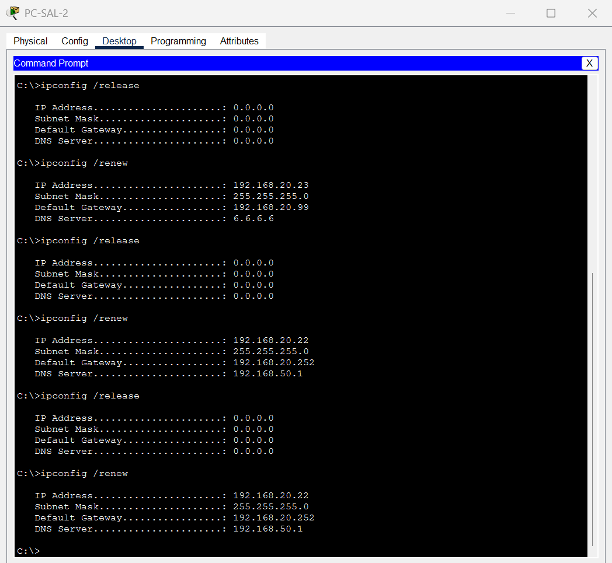

**Clean up** on R-S-BKP:
```
configure terminal
no ip dhcp pool ROGUE
no ip dhcp excluded-address 192.168.20.1 192.168.20.199
end
```

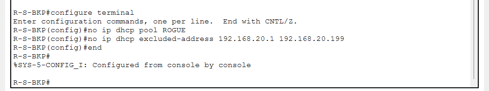

And on SW-S-MAIN, `interface fa0/5`: `ip dhcp snooping trust`.

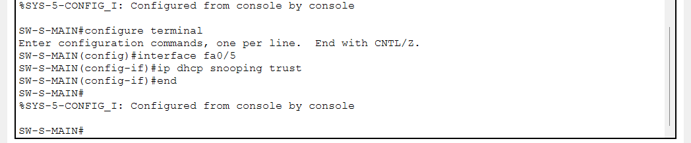

🧠 Snooping protects only the switch that runs it. A rogue server on SW-S-SAL can still cheat its neighbors on the
**same** switch, so a full protection puts it on every department switch (exercise 4).

## Mission 7 — Kill the main router
**🌐 The network now.** Two routers with HSRP. We break one on purpose:

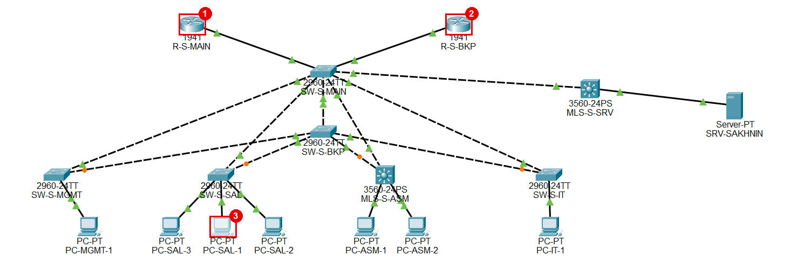

**❗ The problem.** A backup that was never tested is not a backup. In the real project we started from, part of the backup never worked, and nobody knew.

**💡 The solution.** A planned failure: turn off the main, check that work continues, bring it back.

**📋 Do it in the project.** Before: which hop does `tracert` show? Guess what it will show during the failure and after it.

### 🖱 The solution: what to click and what to write
1. **R-S-MAIN**: `configure terminal` → `interface g0/0` → `shutdown`.

   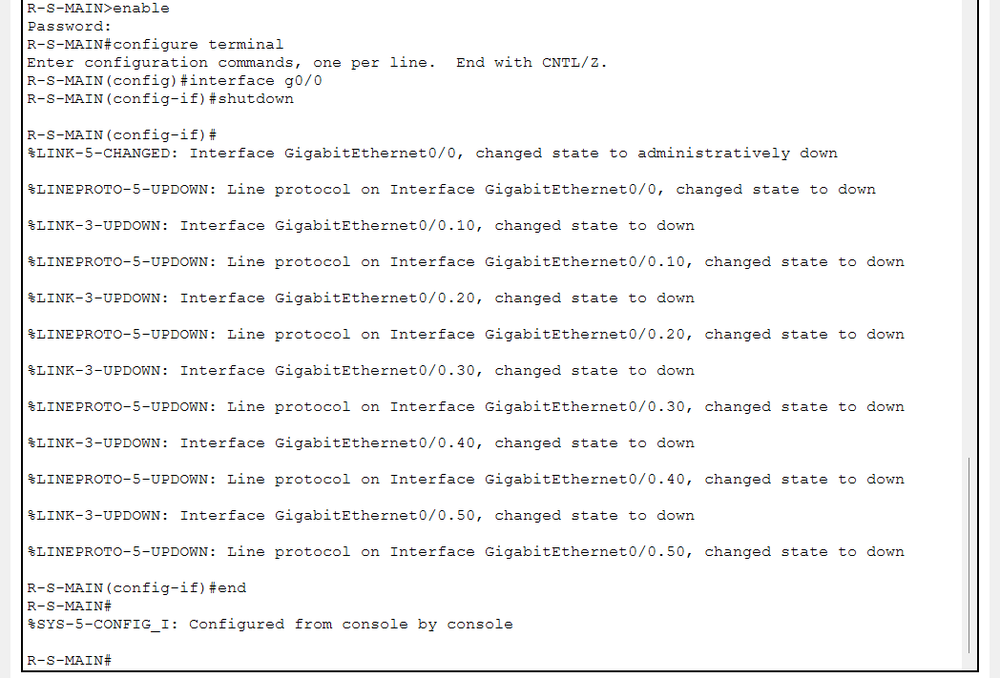

2. After about 10 seconds on **R-S-BKP**: `show standby brief` → **Active**.

   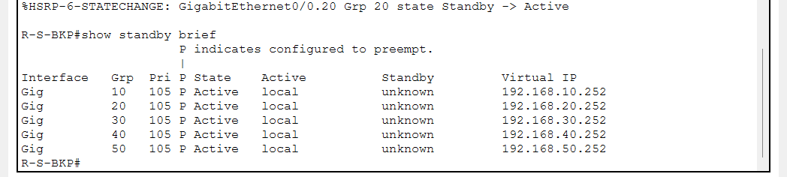
3. **PC-SAL-1**: `ping 192.168.50.1` works, and `tracert 192.168.40.21` now goes through **.253**. The PC changed **nothing**.

   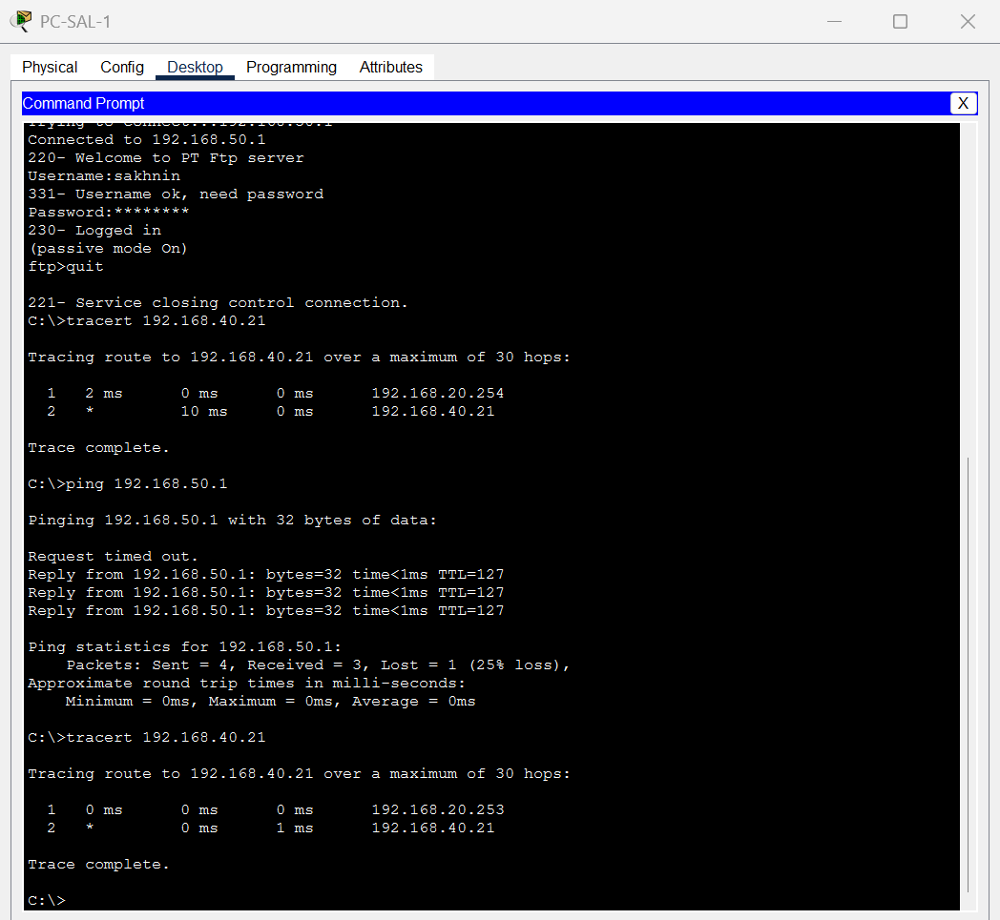
4. Return it: `no shutdown`, wait 30 seconds. R-S-MAIN is Active again, thanks to `preempt`.

   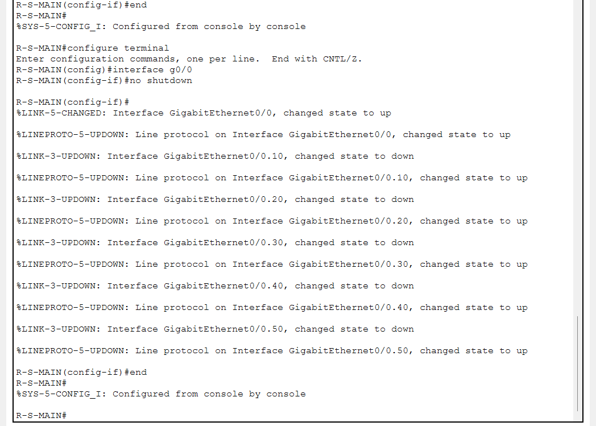

   
5. `copy running-config startup-config` on the routers and on SW-S-MAIN, File → Save.

   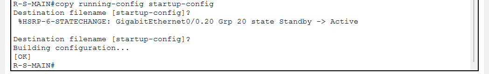

## 👀 See it happen — the relay and the virtual MAC
Simulation was explained in [lesson 1](../lesson-01/).

### A. DHCP through the relay
1. PC-SAL-1 → Desktop → **IP Configuration** → **Static**.
2. **Simulation** → filters: only **DHCP**.
3. In IP Configuration click **DHCP** and close the window.
4. Step until **R-S-MAIN** appears in the *At Device* column, and open that packet.

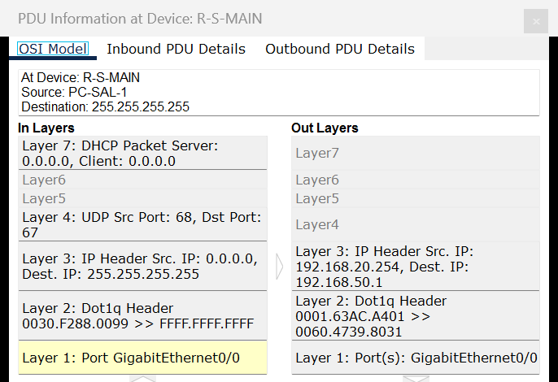

| | In | Out |
|---|---|---|
| Source IP | 0.0.0.0 (no address yet) | **192.168.20.254** |
| Destination IP | 255.255.255.255 (everybody) | **192.168.50.1** (the server) |

This is the whole meaning of `ip helper-address`. The request comes from the network 192.168.20.0, so the server knows which pool to use.

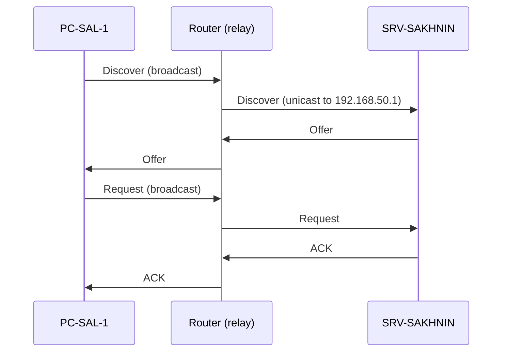

❓ R-S-BKP sends a copy to the server too. Is that a problem?

<details><summary>Answer</summary>

No. Both routers have a helper, so the server gets the request twice and the PC uses one offer. That is also why DHCP works
when one router is down.

</details>

### B. The ping and the virtual MAC
**Realtime**, wait until PC-SAL-1 has an address. **Simulation** → only **ICMP** → `ping 192.168.50.1`. Open the packet on
**R-S-MAIN** → **Next Layer**:

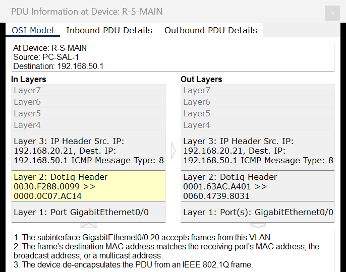

| Look at | Meaning |
|---|---|
| in: `0000.0C07.AC14` | the **HSRP virtual MAC**: hex 14 = 20 = the group number |
| *The subinterface GigabitEthernet0/0.20 accepts frames* | router-on-a-stick: the tag chose the sub-interface |
| the IPs are the same on both sides | a router doesn't change the IP (without NAT) |
| the MACs are different on both sides | the router writes a **new** layer 2 header |

💡 You may also see copies on other switches and PCs. A switch that hasn't learned the virtual MAC floods, and whoever the
packet isn't meant for drops it.

✏️ **Try:** ping a PC in VLAN 30. What is the destination MAC when the packet leaves PC-SAL-1?

<details><summary>Answer</summary>

Again `0000.0C07.AC14`: everything that leaves the network goes to the gateway.

</details>

## 🧯 It doesn't work?
| What you see | Probably | What to do |
|---|---|---|
| `% Configuring IP routing on a LAN subinterface is only allowed if...` | the IP came before `encapsulation dot1Q` | write encapsulation first |
| both routers are Active | they don't see each other | trunk on Fa0/5 and Fa0/6, the same VLAN number |
| `DHCP request failed` | helper missing, the service is Off, or STP isn't ready | `show run`, server → DHCP → On, wait and `/renew` |
| an address 169.254.x.x | nobody answered the request | same as above |
| ping by IP works, by name doesn't | DNS | `nslookup`, check the record and the PC's DNS |
| mail is not sent | domain not set, or wrong user | EMAIL → Set, check `sakhnin1` / `Osem#Mail` |

---

## 🔎 Find the bug — from a real project
1. `standby 10 track` was set on the **LAN** port itself.
2. The physical port `g0/0` had an IP address.
3. The server's gateway was **.254**.
4. The server's default pool (`serverPool`) gave out 192.168.50.0–51.255, the servers' own network.

<details><summary>Answer</summary>

1. If the LAN port falls, HSRP knows anyway. Tracking helps for the port to the **internet** (lesson 4).
2. With sub-interfaces each VLAN has its IP on its sub-interface. An IP on the physical port belongs to the native VLAN and confuses.
3. .254 is the main router itself. When it fails the server is cut off. Fix: the VIP **.252**.
4. Servers get fixed addresses. A pool in their network can give a PC an address that is already taken.

</details>

## 🏋 Exercises
1. Without `ip helper-address` on g0/0.20 (on **both** routers), do `ipconfig /renew` on PC-SAL-1. What happens? Why only in VLAN 20? Put it back.
2. Make R-S-BKP Active only for VLAN 40 (hint: priority). Why would we do that?
3. Add `ftp.osem.com` to DNS and connect with `ftp ftp.osem.com`.

4. Put DHCP snooping on **SW-S-SAL** too: VLAN 20, trust only on the trunks Fa0/1 and Fa0/4. Check that PC-SAL-2 still gets an address.

<details><summary>Answers (we tested them)</summary>

1. `DHCP request failed.` PC-IT-1 in VLAN 40 still gets an address: the helper is set on each sub-interface separately. After you put it back, the address arrives.
2. On R-S-BKP, `interface g0/0.40`: `standby 40 priority 120`. `show standby brief` shows it Active in group 40 and Standby in the others. Reason: share the load between the two routers. Put 105 back.
3. `Connected to ftp.osem.com`, user `sakhnin`. DNS only translates the name: FTP itself does not change.
4. These commands, and the PC still gets an address:

```
configure terminal
ip dhcp snooping
ip dhcp snooping vlan 20
no ip dhcp snooping information option
interface range fa0/1 , fa0/4
ip dhcp snooping trust
end
```

</details>

## 🎓 Explain it to the examiner
- What is a sub-interface and why do we need `encapsulation dot1Q`?
- What is the VIP? What happens, step by step, when R-S-MAIN falls?
- Explain DORA. Why is a relay needed?
- What is the difference between SMTP and POP3?
- What attack does DHCP snooping prevent, and which ports are trusted?

<details><summary>Model answers</summary>

1. A logical part of a physical port, one for each VLAN. `encapsulation dot1Q 20` says that frames tagged 20 belong to it.
2. The virtual IP that the PCs use as a gateway. The main stops sending hello → after about 10 seconds the backup becomes Active, takes the VIP and its virtual MAC → the PCs continue.
3. Discover, Offer, Request, Ack. Discover is a broadcast and a router stops broadcasts, so the router passes it on as a direct message.
4. SMTP (25) sends and passes mail between servers. POP3 (110) downloads mail from the mailbox.
5. A fake DHCP server that gives a wrong gateway (man in the middle). Trusted: the port of the real server, the routers and the link to the backup switch.

</details>

## ✏️ Exit quiz (3 minutes)
1. Which address do we write as the gateway of a PC in VLAN 30?
2. Priority 110 and 105: who is Active?
3. What is written on the physical port g0/0?
4. Which port does DNS use?
5. Where is `ip helper-address` written?

<details><summary>Answers</summary>

1. 192.168.30.252.
2. 110.
3. Only `no shutdown`, no IP.
4. UDP 53.
5. On the sub-interface that the PCs' request arrives at.

</details>

## 🛠 Your own project
- [ ] A table: VLAN, main .254, backup .253, VIP .252.
- [ ] Sub-interfaces and HSRP on two routers.
- [ ] A server with a fixed address, the VIP as gateway, and a DHCP pool per VLAN.
- [ ] DNS, web, FTP and mail with **your** domain and users.
- [ ] DHCP snooping.
- [ ] Screenshots: `show standby brief` on both routers, DHCP on a PC, the website by name, mail received, the failure test with two tracerts.
