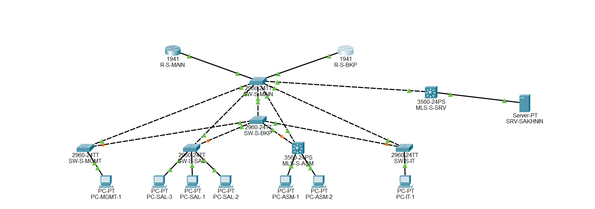
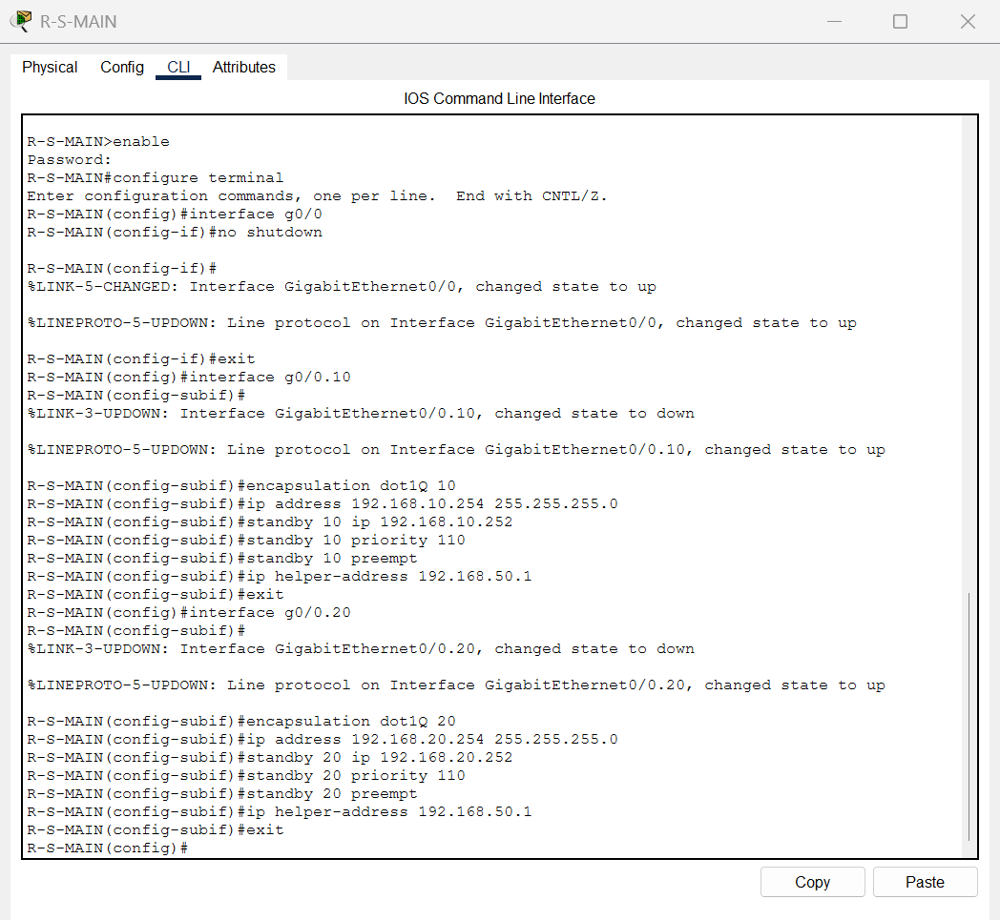
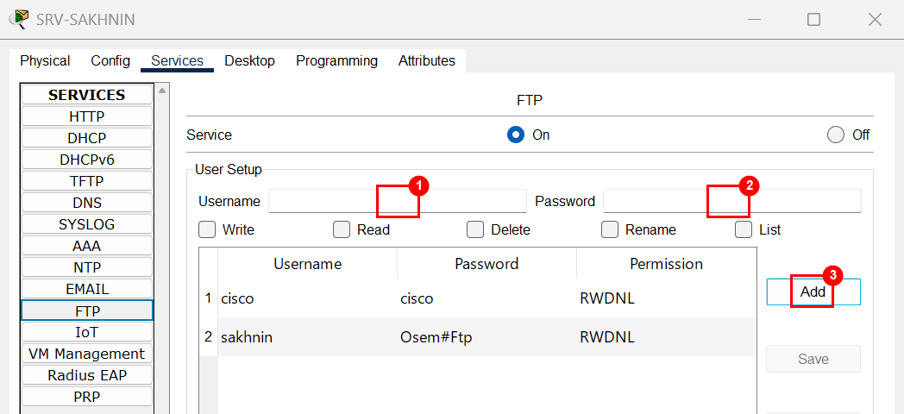
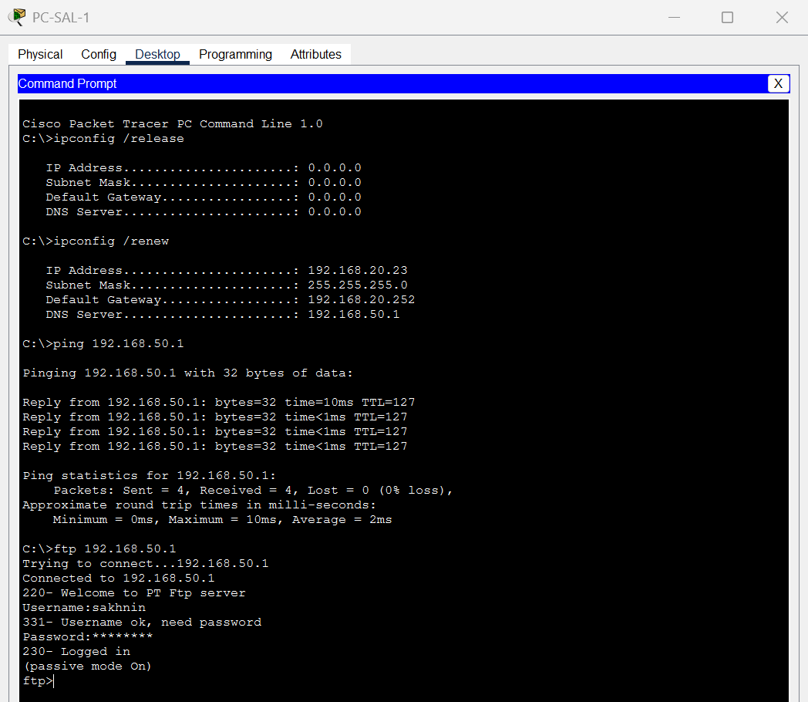
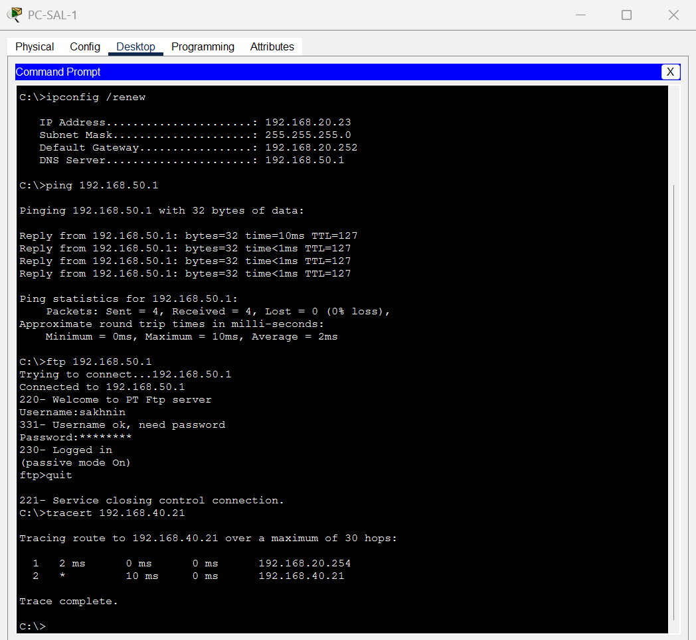
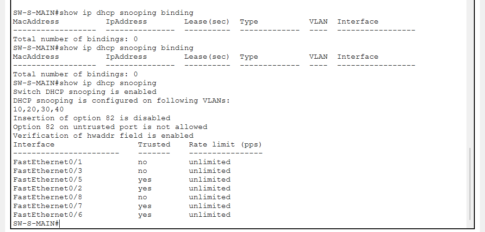
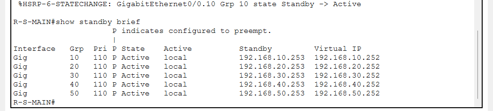

# Lesson 03 — Sakhnin routing and services: HSRP, DHCP, DNS, Web, FTP, Mail

> ⏱ 90 minutes · 🧰 Packet Tracer 9.x · 📂 start: [`lesson03-start.pkt`](lesson03-start.pkt) · 💾 save as `lesson03.pkt`

## What you will have at the end
The departments can talk to each other through **two routers that back each other up**, and one
server gives the whole branch addresses, names, a website, files and mail.



## Lesson plan (for the teacher)
| Minutes | Part |
|---|---|
| 0–20 | Part 1 — theory on the board |
| 20–40 | Missions 1–2 — sub-interfaces and HSRP |
| 40–60 | Mission 3 — the server (one student per service) |
| 60–72 | Missions 4–5 — clients, tests and mail |
| 72–82 | Missions 6–7 — DHCP snooping and the failure test |
| 82–90 | Find the bug, questions, "your own project" |

The start file is the end of lesson 2, plus the routers R-S-MAIN and R-S-BKP, cabled and with base configuration.

---

## Part 1 — Theory: understand it first

### 1.1 Router-on-a-stick
One cable (trunk) from the switch to the router carries all the VLANs. We cut the physical port
into **sub-interfaces**: g0/0.10 for VLAN 10, g0/0.20 for VLAN 20... Each has an IP and is the
**gateway** of its VLAN. The physical port itself has **no IP**.

### 1.2 HSRP — two routers, one gateway
A PC can have only **one** default gateway. If that router dies, the department is cut off.
**HSRP**: two routers share a **virtual IP** (VIP). The PCs use the VIP and don't know which router answers.

| Address | Device |
|---|---|
| .254 | R-S-MAIN, priority 110 → **Active** |
| .253 | R-S-BKP, priority 105 → **Standby** |
| **.252** | the **VIP**: the gateway of all PCs and of the server |

`preempt` = when the main router returns, it takes the Active role back.

### 1.3 DHCP and relay
DHCP gives a PC its address in four steps, **DORA**: **D**iscover → **O**ffer → **R**equest → **A**ck.
Discover is a **broadcast**, and a router does not forward broadcasts. `ip helper-address` on the
router turns it into a direct message to the server: this is the **relay**.

### 1.4 The services
| Service | Port | What for |
|---|---|---|
| DNS | UDP 53 | name → IP (`www.osem.com` → 192.168.50.1) |
| HTTP | TCP 80 | website |
| FTP | TCP 20/21 | files |
| SMTP | TCP 25 | **sending** mail |
| POP3 | TCP 110 | **reading** mail |

### 1.5 DHCP snooping
A student brings a home router from home, and it gives everyone a wrong gateway. With **DHCP
snooping**, the switch accepts DHCP answers only from **trusted** ports.

---

## Mission 1 — Sub-interfaces and HSRP on R-S-MAIN
**R-S-MAIN** → CLI → log in → `enable`:
```
configure terminal
interface g0/0
no shutdown
exit
interface g0/0.10
encapsulation dot1Q 10
ip address 192.168.10.254 255.255.255.0
standby 10 ip 192.168.10.252
standby 10 priority 110
standby 10 preempt
ip helper-address 192.168.50.1
exit
interface g0/0.20
encapsulation dot1Q 20
ip address 192.168.20.254 255.255.255.0
standby 20 ip 192.168.20.252
standby 20 priority 110
standby 20 preempt
ip helper-address 192.168.50.1
exit
interface g0/0.30
encapsulation dot1Q 30
ip address 192.168.30.254 255.255.255.0
standby 30 ip 192.168.30.252
standby 30 priority 110
standby 30 preempt
ip helper-address 192.168.50.1
exit
interface g0/0.40
encapsulation dot1Q 40
ip address 192.168.40.254 255.255.255.0
standby 40 ip 192.168.40.252
standby 40 priority 110
standby 40 preempt
ip helper-address 192.168.50.1
exit
interface g0/0.50
encapsulation dot1Q 50
ip address 192.168.50.254 255.255.255.0
standby 50 ip 192.168.50.252
standby 50 priority 110
standby 50 preempt
end
copy running-config startup-config
```


| Command | What it does | Why |
|---|---|---|
| `interface g0/0` + `no shutdown` | turns on the physical port | router ports are off by default |
| `interface g0/0.10` | creates a sub-interface | one per VLAN |
| `encapsulation dot1Q 10` | "this is VLAN 10" | **before** the IP, otherwise the router refuses |
| `standby 10 ip` | the VIP of group 10 | the gateway for the PCs |
| `standby 10 priority 110` | higher wins | main = 110, backup = 105 |
| `standby 10 preempt` | takes Active back | otherwise the backup stays Active |
| `ip helper-address` | forwards DHCP to the server | not needed in VLAN 50, where the server is |

## Mission 2 — R-S-BKP
The same, with **.253** and **priority 105**:
```
configure terminal
interface g0/0
no shutdown
exit
interface g0/0.10
encapsulation dot1Q 10
ip address 192.168.10.253 255.255.255.0
standby 10 ip 192.168.10.252
standby 10 priority 105
standby 10 preempt
ip helper-address 192.168.50.1
exit
interface g0/0.20
encapsulation dot1Q 20
ip address 192.168.20.253 255.255.255.0
standby 20 ip 192.168.20.252
standby 20 priority 105
standby 20 preempt
ip helper-address 192.168.50.1
exit
interface g0/0.30
encapsulation dot1Q 30
ip address 192.168.30.253 255.255.255.0
standby 30 ip 192.168.30.252
standby 30 priority 105
standby 30 preempt
ip helper-address 192.168.50.1
exit
interface g0/0.40
encapsulation dot1Q 40
ip address 192.168.40.253 255.255.255.0
standby 40 ip 192.168.40.252
standby 40 priority 105
standby 40 preempt
ip helper-address 192.168.50.1
exit
interface g0/0.50
encapsulation dot1Q 50
ip address 192.168.50.253 255.255.255.0
standby 50 ip 192.168.50.252
standby 50 priority 105
standby 50 preempt
end
copy running-config startup-config
```
✅ Wait about 20 seconds. `show standby brief` on both: main **Active**, backup **Standby**.


## Mission 3 — The server
### 3.1 Fixed address
**SRV-SAKHNIN** → **Desktop** → **IP Configuration** → Static: address `192.168.50.1` (1), mask
`255.255.255.0` (2), gateway **`192.168.50.252`** — the VIP (3), DNS `192.168.50.1` (4).


🧠 A server must have a **fixed** address, because everyone looks for it there.

### 3.2 DHCP
**Services** (1) → **DHCP** (2). For each row fill the form (3) and click **Add** (4):

| Pool Name | Default Gateway | DNS Server | Start IP | Mask | Max users |
|---|---|---|---|---|---|
| MANAGEMENT | 192.168.10.252 | 192.168.50.1 | 192.168.10.20 | 255.255.255.0 | 50 |
| DISPLAY-SALARIES | 192.168.20.252 | 192.168.50.1 | 192.168.20.20 | 255.255.255.0 | 50 |
| ASSEMBLY-MEETING | 192.168.30.252 | 192.168.50.1 | 192.168.30.20 | 255.255.255.0 | 50 |
| IT | 192.168.40.252 | 192.168.50.1 | 192.168.40.20 | 255.255.255.0 | 50 |


Then **Service: On** (1) and **Save** (2).


### 3.3 DNS
**DNS** → On (1). Name (2) `www.osem.com`, Address (3) `192.168.50.1` → **Add** (4). Again for `mail.osem.com`.


### 3.4 Website
**HTTP** → next to `index.html` click **(edit)** → change the line after `<hr>` to
`Welcome to Osem - Sakhnin branch` → **Save** (confirm if asked).


### 3.5 FTP
**FTP** → Username (1) `sakhnin`, Password (2) `Osem#Ftp`, tick all five permissions → **Add** (3).



### 3.6 Mail
**EMAIL** → Domain Name (1) `osem.com` → **Set** (2). User (3) `sakhnin1`, Password (4) `Osem#Mail` → **+** (5). Again for `sakhnin2`.


## Mission 4 — PCs get an address
Each PC → Desktop → **IP Configuration** → **DHCP** (1). Gateway .252 and the DNS arrive by themselves:


⚠️ The first request sometimes fails while STP and HSRP are still starting. Click Static and DHCP again, or `ipconfig /renew`.

## Mission 5 — Test everything
1. **PC-IT-1**: `nslookup www.osem.com`

   
2. **PC-SAL-2** → Desktop → **Web Browser** → `http://www.osem.com` → **Go**

   
3. **PC-SAL-1**: `ping 192.168.50.1`, then `ftp 192.168.50.1` (user `sakhnin`, password `Osem#Ftp`), `quit`.

   
4. **PC-SAL-1**: `tracert 192.168.40.21` (the address of PC-IT-1, check yours with `ipconfig`). The first hop is **.254**, the main router. Remember it for Mission 7!

   
5. **Mail.** PC-SAL-1 → Desktop → **Email** → fill in and **Save**:

   

   On PC-SAL-2 the same with `sakhnin2`. Then on PC-SAL-1 → **Compose**: To (1) `sakhnin2@osem.com`, Subject (2) → **Send** (3).

   

   On PC-SAL-2 → **Receive** (1):

   

## Mission 6 — DHCP snooping
**SW-S-MAIN:**
```
configure terminal
ip dhcp snooping
ip dhcp snooping vlan 10,20,30,40
no ip dhcp snooping information option
interface range fa0/2 , fa0/5 - 7
ip dhcp snooping trust
end
copy running-config startup-config
show ip dhcp snooping
```
| Port | Connected to | Why trusted |
|---|---|---|
| Fa0/2 | server switch | the real DHCP server is there |
| Fa0/5, Fa0/6 | routers | the relay answers come from them |
| Fa0/7 | backup switch | another path to the same network |



💡 In Packet Tracer the table `show ip dhcp snooping binding` stayed empty in our tests, so check with `show ip dhcp snooping`.

✅ On a PC: `ipconfig /release` and `ipconfig /renew` still work.

## Mission 7 — Kill the main router
1. **R-S-MAIN**: `configure terminal` → `interface g0/0` → `shutdown`.
2. After about 10 seconds on **R-S-BKP**: `show standby brief` → **Active**.

   
3. **PC-SAL-1**: `ping 192.168.50.1` works, and `tracert 192.168.40.21` now goes through **.253**. The PC changed **nothing**.

   
4. Return it: `no shutdown`, wait 30 seconds. R-S-MAIN is Active again, thanks to `preempt`.

   
5. `copy running-config startup-config` on the routers and on SW-S-MAIN, File → Save.

---

## 🔎 Find the bug — from a real project
1. `standby 10 track` was set on the **LAN** port itself.
2. The physical port `g0/0` had an IP address.
3. The server's gateway was **.254**.
4. The server's default pool (`serverPool`) gave out 192.168.50.0–51.255, the servers' own network.

<details><summary>Answer</summary>

1. If the LAN port falls, HSRP knows anyway. Tracking helps for the port to the **internet** (lesson 4).
2. With sub-interfaces each VLAN has its IP on its sub-interface. An IP on the physical port belongs to the native VLAN and confuses.
3. .254 is the main router itself. When it fails the server is cut off. Fix: the VIP **.252**.
4. Servers get fixed addresses. A pool in their network can give a PC an address that is already taken.

</details>

## 🏋 Exercises
1. Without `ip helper-address` on g0/0.20 (on **both** routers), do `ipconfig /renew` on PC-SAL-1. What happens? Why only in VLAN 20? Put it back.
2. Make R-S-BKP Active only for VLAN 40 (hint: priority). Why would we do that?
3. Add `ftp.osem.com` to DNS and connect with `ftp ftp.osem.com`.

## 🎓 Explain it to the examiner
- What is a sub-interface and why do we need `encapsulation dot1Q`?
- What is the VIP? What happens, step by step, when R-S-MAIN falls?
- Explain DORA. Why is a relay needed?
- What is the difference between SMTP and POP3?
- What attack does DHCP snooping prevent, and which ports are trusted?

## 🛠 Your own project
- [ ] A table: VLAN, main .254, backup .253, VIP .252.
- [ ] Sub-interfaces and HSRP on two routers.
- [ ] A server with a fixed address, the VIP as gateway, and a DHCP pool per VLAN.
- [ ] DNS, web, FTP and mail with **your** domain and users.
- [ ] DHCP snooping.
- [ ] Screenshots: `show standby brief` on both routers, DHCP on a PC, the website by name, mail received, the failure test with two tracerts.
</content>
</invoke>
