# Lesson 04 — Connecting the branches: WAN, OSPF, EIGRP, BGP and NAT

> ⏱ 90 minutes · 🧰 Packet Tracer 9.x · 📂 start: [`lesson04-start.pkt`](lesson04-start.pkt) · 💾 save as `lesson04.pkt`

## What you will have at the end
Three branches connected to an internet provider: OSPF in Sakhnin, EIGRP in Ashdod and Eilat, BGP
to the provider, and three kinds of NAT.


## Lesson plan (for the teacher)
| Minutes | Part |
|---|---|
| 0–20 | Part 1 — theory on the board |
| 20–35 | Mission 1 — WAN addresses (Sakhnin by hand, the rest by pasting) |
| 35–50 | Missions 2–3 — HSRP track, OSPF, EIGRP |
| 50–60 | Mission 4 — BGP |
| 60–75 | Mission 5 — NAT |
| 75–82 | Mission 6 — the failure test |
| 82–90 | Find the bug, questions, "your own project" |

In the start file Sakhnin is the end of lesson 3, and the LANs of Ashdod and Eilat are ready-made
(same method as Sakhnin). The WAN links exist but have no addresses, so they are **red**.

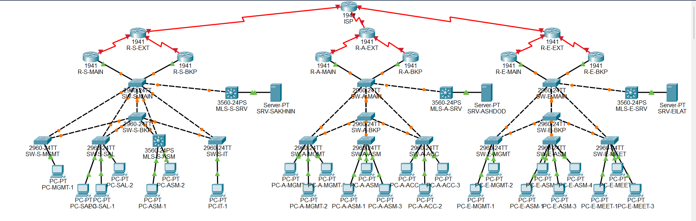

💡 **How to paste a block:** log in on the router, type `enable` and the password → copy the block
→ click **Paste** at the bottom right of the CLI. At the end: `copy running-config startup-config`.

---

## Part 1 — Theory: understand it first

### 1.1 Serial and clock rate
A serial line has two ends: **DCE** sets the clock, **DTE** follows it. In this project the DCE side
is the router nearer to the provider: EXT towards the branch, ISP towards EXT.

💬 **In simple words:** two people carry a sofa, and one of them says "one, two, one, two". The one who sets the
pace is the DCE. `show controllers s0/0/0` says which side you are on.

### 1.2 Three routing protocols
| | OSPF | EIGRP | BGP |
|---|---|---|---|
| Type | link state | advanced distance vector | path vector |
| Works | inside a company (IGP) | inside a company (IGP) | **between** companies (EGP) |
| Measures | cost (by bandwidth) | bandwidth + delay | list of AS numbers, policy |
| Admin distance | 110 | 90 | 20 (external) |
| In show ip route | `O` | `D` | `B` |
| Number | process 52, area 0 | AS 54, AS 84 | AS 511, 411, 611, 311 |

The OSPF process number is **local**; the EIGRP AS number must be **identical** on all the routers of the branch.

💬 **In simple words:** OSPF is a navigation app that knows the **whole map** and calculates the best way. EIGRP knows its
neighbors and what they told it. BGP is the agreement between **countries**: which countries you pass on the way.

**Example — the wildcard mask** (what may change). Subtract the mask from 255.255.255.255:

| Mask | Wildcard | Meaning |
|---|---|---|
| 255.255.255.0 (/24) | 0.0.0.255 | one network |
| 255.255.252.0 (/22) | 0.0.3.255 | 4 networks: 192.168.80–83 |
| 255.255.192.0 (/18) | 0.0.63.255 | 64 networks: 192.168.0–63 |

**Example — how a router chooses** (R-S-EXT): first the **most specific** route, and only between equal routes the lower
admin distance.

| Destination | Matching routes | Chosen |
|---|---|---|
| 192.168.20.20 | `O 192.168.20.0/24`, `S* 0.0.0.0/0` | O: /24 is more specific |
| 200.200.0.10 | `B 200.200.0.0/24`, `S* 0.0.0.0/0` | B: /24 |
| 8.8.8.8 | `S* 0.0.0.0/0` | the default route, to the provider |

### 1.3 AS
An **autonomous system** is a network under one management. Each branch is an AS, and the provider (311) is another.
**eBGP** = BGP between different AS numbers. Neighbors are configured **by hand**, on both sides.

### 1.4 NAT
Private addresses (192.168.x.x) don't travel on the internet. The edge router **translates** them:

| Kind | Where | How |
|---|---|---|
| **PAT** (overload) | Sakhnin | everybody goes out with **one** address, separated by port numbers |
| **Static** | Ashdod, the server | one private ↔ one public, so people from outside can **enter** |
| **Dynamic pool** | Eilat | takes a free address from a list (.20–.30) |

| Term | Meaning |
|---|---|
| Inside local | the real address of our PC (192.168.20.20) |
| Inside global | how the internet sees it (200.130.0.1) |

💬 **In simple words:** an office with one outside phone number (PAT). The secretary remembers which employee made
each call and passes the answer to that employee. Static = an employee with a direct number. Pool = a drawer with 11 direct
numbers, first come first served.

**Example — two PCs go out together with PAT:**

| PC (inside local) | Port | Goes out as (inside global) | The answer returns to |
|---|---|---|---|
| 192.168.20.20 | 1025 | 200.130.0.1 : 1025 | 192.168.20.20 |
| 192.168.40.21 | 1025 | 200.130.0.1 : **1024** | 192.168.40.21 |

Both chose the same port, so the router changed one of them: that is why it's called **port** address translation.
(The numbers are an illustration.)

### 1.5 The WAN plan
| Link | Network | First side | Second side |
|---|---|---|---|
| R-S-MAIN ↔ R-S-EXT | 200.100.0.0/24 | S0/0/0 .1 | S0/0/0 .2 (DCE) |
| R-S-BKP ↔ R-S-EXT | 200.90.0.0/24 | S0/0/0 .1 | S0/1/0 .2 (DCE) |
| R-S-EXT ↔ ISP | 200.130.0.0/24 | S0/0/1 .1 | S0/0/0 .2 (DCE) |
| R-A-MAIN ↔ R-A-EXT | 200.110.0.0/24 | S0/0/0 .2 | S0/0/1 .1 (DCE) |
| R-A-BKP ↔ R-A-EXT | 200.120.0.0/24 | S0/0/0 .1 | S0/1/0 .2 (DCE) |
| R-A-EXT ↔ ISP | 200.200.0.0/24 | S0/0/0 .1 | S0/0/1 .2 (DCE) |
| R-E-MAIN ↔ R-E-EXT | 200.140.0.0/24 | S0/0/0 .2 | S0/0/1 .1 (DCE) |
| R-E-BKP ↔ R-E-EXT | 200.160.0.0/24 | S0/0/0 .2 | S0/1/0 .1 (DCE) |
| R-E-EXT ↔ ISP | 200.150.0.0/24 | S0/0/0 .1 | S0/1/0 .2 (DCE) |

---

## 🔑 Opening a device
Click the device → **CLI** (1) → click in the text, Enter → `Osem#Con` → `enable` → `Osem#En1`. With pictures: [lesson 2](../lesson-02/).

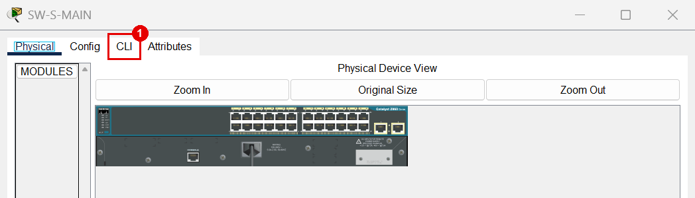

**How every mission is built:** 🌐 the network now → ❗ the problem → 💡 the solution → 📋 do it yourself → 🖱 the full solution, with what to click, what to write and what you must see.

## Mission 1 — WAN addresses
**🌐 The network now.** Three finished branches, three islands. Ten routers are waiting:

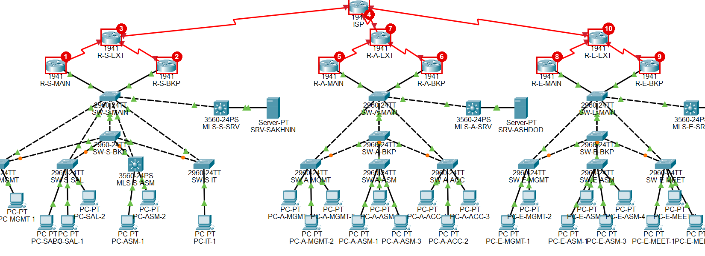

**❗ The problem.** All the serial lines are red. R-S-MAIN, `show ip interface brief`:

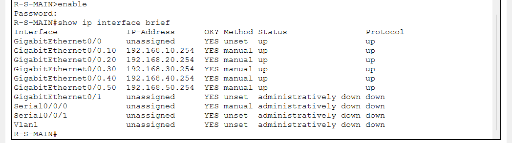

`Serial0/0/0` has no address and is turned off. A router port is born turned off.

**💡 The solution.** For each end: an address from the WAN plan (1.5), `no shutdown`, and on the **DCE** side also `clock rate` (1.1).

**📋 Do it in the project.** Find your router's rows in table 1.5, mark which ends are DCE, and configure. When do the two triangles turn green?

### 🖱 The solution: what to click and what to write
**R-S-MAIN:**
```
configure terminal
interface s0/0/0
ip address 200.100.0.1 255.255.255.0
no shutdown
end
```

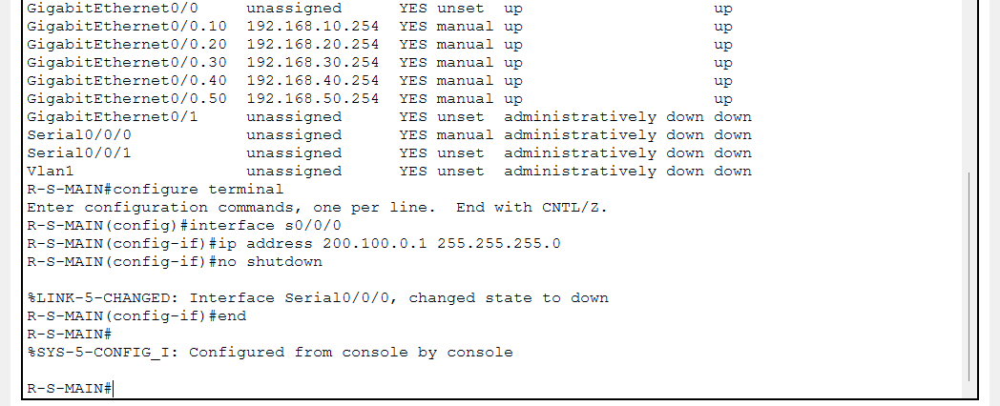

**R-S-BKP:**
```
configure terminal
interface s0/0/0
ip address 200.90.0.1 255.255.255.0
no shutdown
end
```

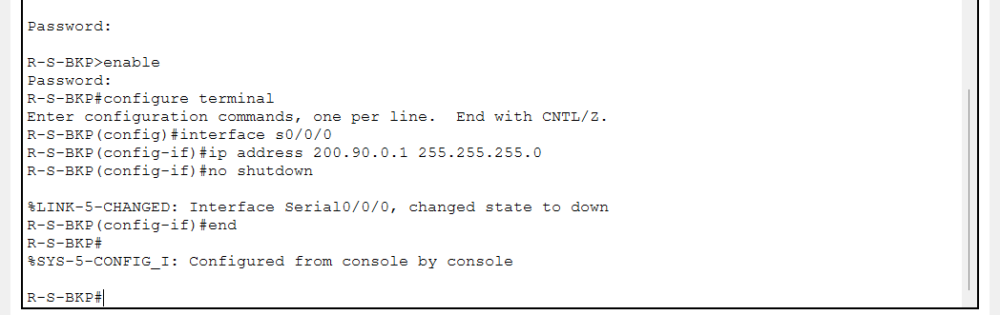

**R-S-EXT:**
```
configure terminal
interface s0/0/0
ip address 200.100.0.2 255.255.255.0
clock rate 2000000
no shutdown
exit
interface s0/1/0
ip address 200.90.0.2 255.255.255.0
clock rate 2000000
no shutdown
exit
interface s0/0/1
ip address 200.130.0.1 255.255.255.0
no shutdown
end
```

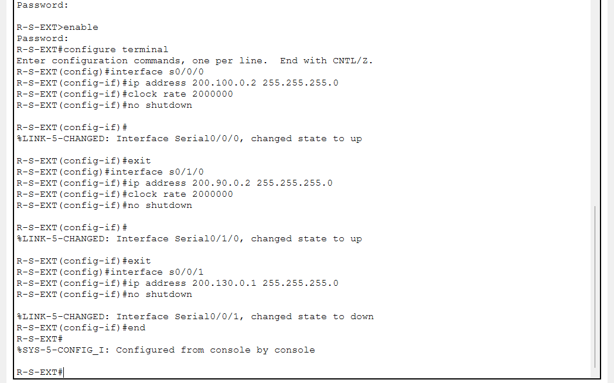

**ISP:**
```
configure terminal
interface s0/0/0
ip address 200.130.0.2 255.255.255.0
clock rate 2000000
no shutdown
exit
interface s0/0/1
ip address 200.200.0.2 255.255.255.0
clock rate 2000000
no shutdown
exit
interface s0/1/0
ip address 200.150.0.2 255.255.255.0
clock rate 2000000
no shutdown
end
```

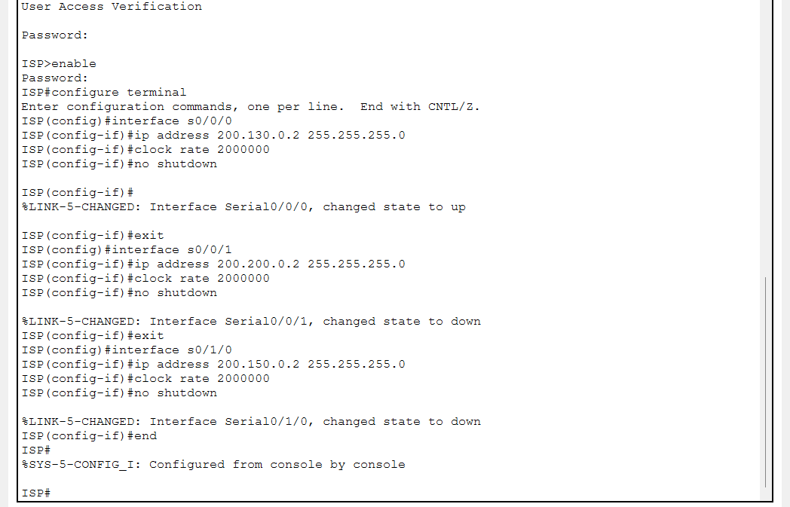

❓ Which side gets `clock rate`? Only the **DCE**. On a DTE side the command is not needed.

**Ashdod and Eilat:** each group pastes one router. These blocks contain **everything** for the
branch: WAN, HSRP track, EIGRP, BGP and NAT. Read them while going through missions 2–5.

<details><summary>R-A-MAIN, R-A-BKP, R-A-EXT</summary>

**R-A-MAIN**
```
configure terminal
interface s0/0/0
ip address 200.110.0.2 255.255.255.0
no shutdown
exit
interface g0/0.60
standby 60 track s0/0/0
exit
interface g0/0.61
standby 61 track s0/0/0
exit
interface g0/0.62
standby 62 track s0/0/0
exit
interface g0/0.63
standby 63 track s0/0/0
exit
router eigrp 54
network 192.168.60.0
network 192.168.61.0
network 192.168.62.0
network 192.168.63.0
network 200.110.0.0
no auto-summary
passive-interface g0/0.60
passive-interface g0/0.61
passive-interface g0/0.62
passive-interface g0/0.63
exit
ip route 0.0.0.0 0.0.0.0 200.110.0.1
end
```


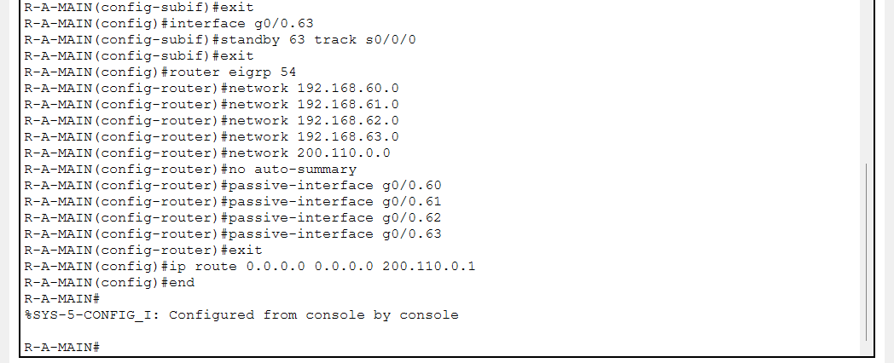

**R-A-BKP**
```
configure terminal
interface s0/0/0
ip address 200.120.0.1 255.255.255.0
no shutdown
exit
router eigrp 54
network 192.168.60.0
network 192.168.61.0
network 192.168.62.0
network 192.168.63.0
network 200.120.0.0
no auto-summary
passive-interface g0/0.60
passive-interface g0/0.61
passive-interface g0/0.62
passive-interface g0/0.63
exit
ip route 0.0.0.0 0.0.0.0 200.120.0.2
end
```

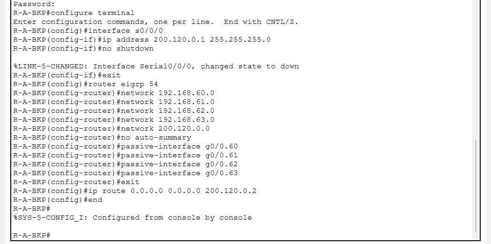

**R-A-EXT**
```
configure terminal
interface s0/0/1
ip address 200.110.0.1 255.255.255.0
clock rate 2000000
no shutdown
exit
interface s0/1/0
ip address 200.120.0.2 255.255.255.0
clock rate 2000000
no shutdown
exit
interface s0/0/0
ip address 200.200.0.1 255.255.255.0
no shutdown
exit
router eigrp 54
network 200.110.0.0
network 200.120.0.0
no auto-summary
exit
ip route 0.0.0.0 0.0.0.0 200.200.0.2
router bgp 411
neighbor 200.200.0.2 remote-as 311
network 200.200.0.0 mask 255.255.255.0
exit
ip nat inside source static 192.168.63.1 200.200.0.10
access-list 1 permit 192.168.60.0 0.0.3.255
ip nat inside source list 1 interface s0/0/0 overload
interface s0/0/1
ip nat inside
interface s0/1/0
ip nat inside
interface s0/0/0
ip nat outside
exit
end
```

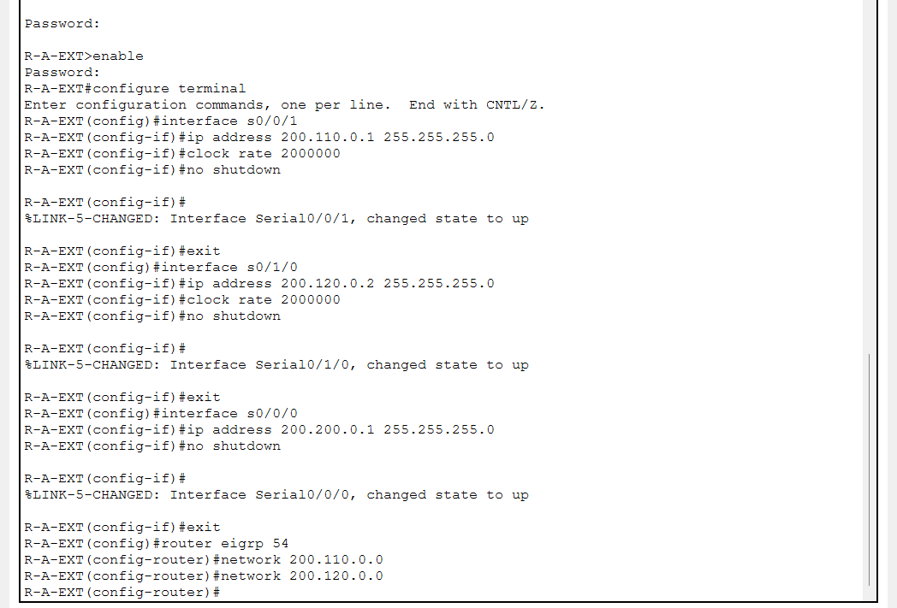

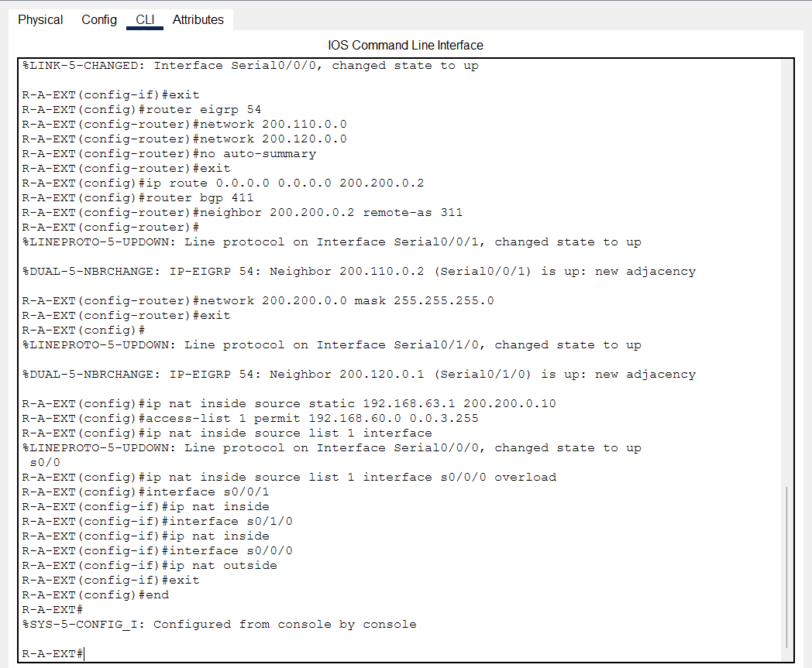

</details>

<details><summary>R-E-MAIN, R-E-BKP, R-E-EXT</summary>

**R-E-MAIN**
```
configure terminal
interface s0/0/0
ip address 200.140.0.2 255.255.255.0
no shutdown
exit
interface g0/0.80
standby 80 track s0/0/0
exit
interface g0/0.81
standby 81 track s0/0/0
exit
interface g0/0.82
standby 82 track s0/0/0
exit
interface g0/0.83
standby 83 track s0/0/0
exit
router eigrp 84
network 192.168.80.0
network 192.168.81.0
network 192.168.82.0
network 192.168.83.0
network 200.140.0.0
no auto-summary
passive-interface g0/0.80
passive-interface g0/0.81
passive-interface g0/0.82
passive-interface g0/0.83
exit
ip route 0.0.0.0 0.0.0.0 200.140.0.1
end
```

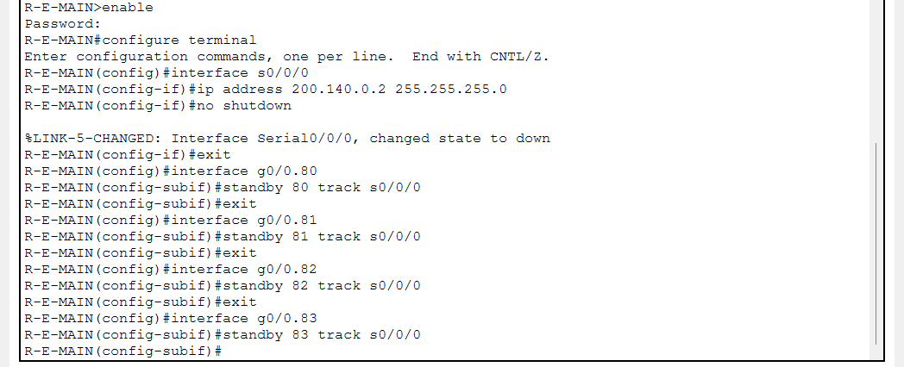


**R-E-BKP**
```
configure terminal
interface s0/0/0
ip address 200.160.0.2 255.255.255.0
no shutdown
exit
router eigrp 84
network 192.168.80.0
network 192.168.81.0
network 192.168.82.0
network 192.168.83.0
network 200.160.0.0
no auto-summary
passive-interface g0/0.80
passive-interface g0/0.81
passive-interface g0/0.82
passive-interface g0/0.83
exit
ip route 0.0.0.0 0.0.0.0 200.160.0.1
end
```


**R-E-EXT**
```
configure terminal
interface s0/0/1
ip address 200.140.0.1 255.255.255.0
clock rate 2000000
no shutdown
exit
interface s0/1/0
ip address 200.160.0.1 255.255.255.0
clock rate 2000000
no shutdown
exit
interface s0/0/0
ip address 200.150.0.1 255.255.255.0
no shutdown
exit
router eigrp 84
network 200.140.0.0
network 200.160.0.0
no auto-summary
exit
ip route 0.0.0.0 0.0.0.0 200.150.0.2
router bgp 611
neighbor 200.150.0.2 remote-as 311
network 200.150.0.0 mask 255.255.255.0
exit
ip nat pool EILAT-POOL 200.150.0.20 200.150.0.30 netmask 255.255.255.0
ip access-list extended NAT-E
permit ip 192.168.80.0 0.0.3.255 any
exit
ip nat inside source list NAT-E pool EILAT-POOL
interface s0/0/1
ip nat inside
interface s0/1/0
ip nat inside
interface s0/0/0
ip nat outside
exit
end
```

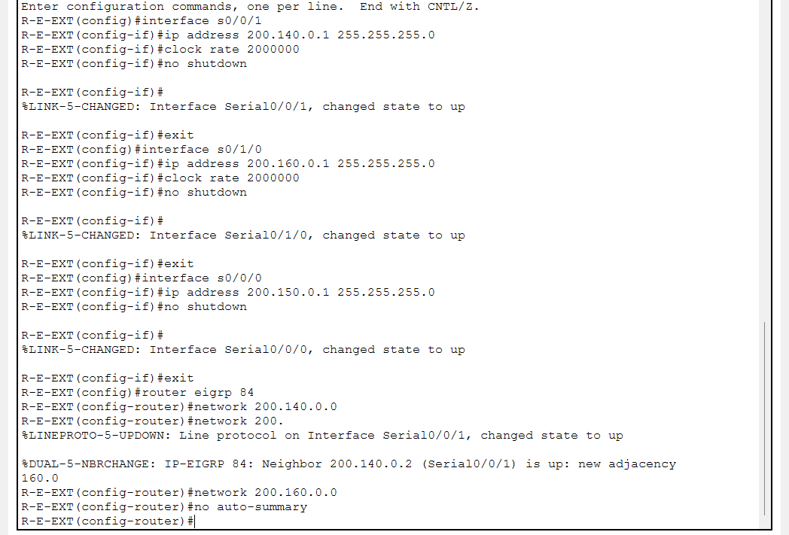

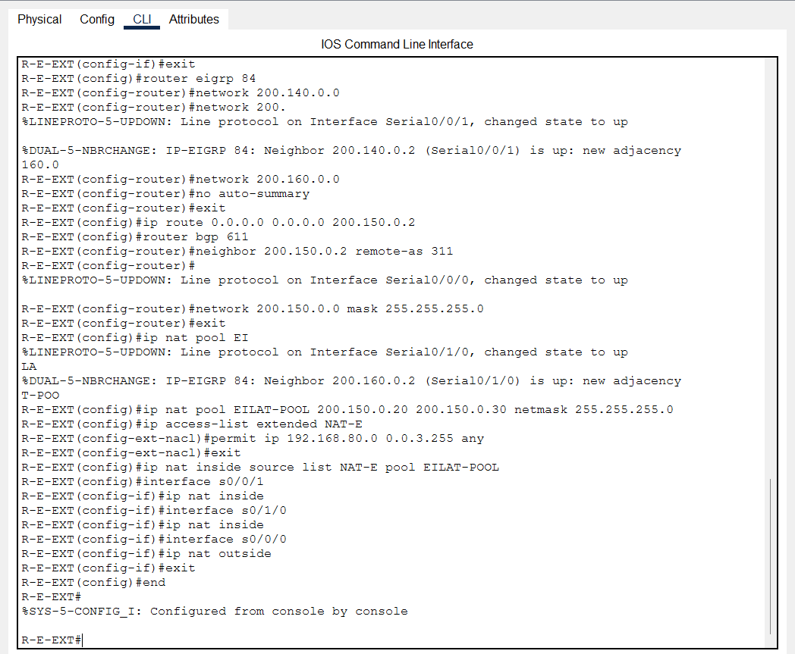

</details>

✅ All serial links are green.

## Mission 2 — HSRP watches the internet line
**🌐 The network now.** R-S-MAIN (1) and R-S-BKP (2) each have their own line to R-S-EXT.

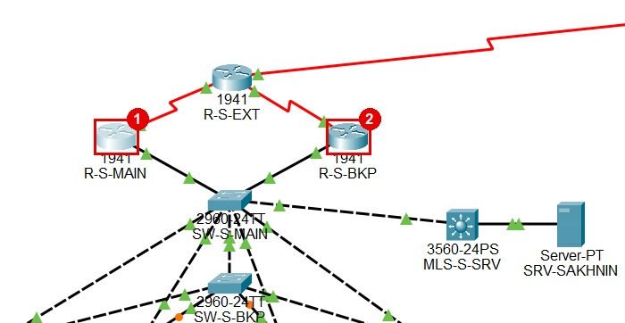

**❗ The problem.** Turn off the **internet** line of the main (`interface s0/0/0`, `shutdown`), wait 15 seconds, and write `show standby brief`:

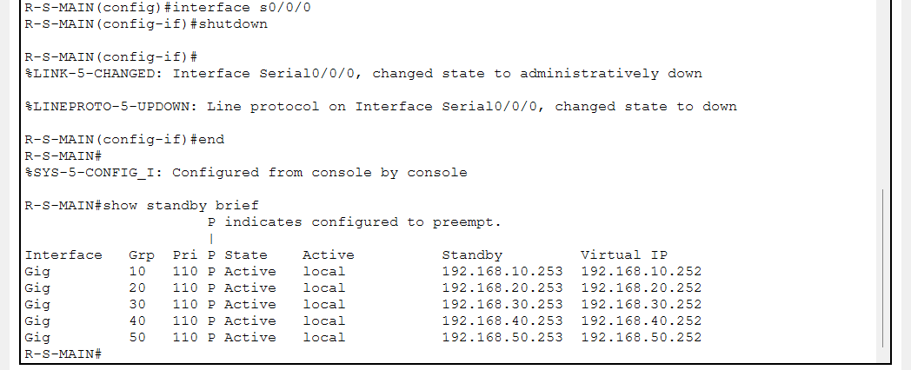

It is **still Active**! Its LAN side is fine, so HSRP sees no problem. All the PCs keep sending to a router that has no way out. (Bring it back: `no shutdown`.)

**💡 The solution.** `track`: HSRP watches the serial line. If it falls, the priority drops by 10.

**📋 Do it in the project.** Add track to the five groups of R-S-MAIN. Calculate first: what will the priority be, and who will be Active?

### 🖱 The solution: what to click and what to write
In lesson 3 the backup took over only if the LAN failed. Now the main router also loses priority
when its **serial line** fails. On **R-S-MAIN**:
```
configure terminal
interface g0/0.10
standby 10 track s0/0/0
interface g0/0.20
standby 20 track s0/0/0
interface g0/0.30
standby 30 track s0/0/0
interface g0/0.40
standby 40 track s0/0/0
interface g0/0.50
standby 50 track s0/0/0
end
```

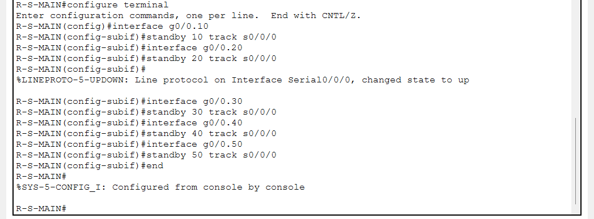

🧠 The line falls → 110 − 10 = **100**, which is less than 105 → the backup takes over.

| Serial line | Main | Backup | Active |
|---|---|---|---|
| up | 110 | 105 | R-S-MAIN |
| down | 110 − 10 = **100** | 105 | R-S-BKP |

❓ **Ask the class:** what would happen if the backup's priority were 99?

<details><summary>Answer</summary>

100 is still higher than 99: the main router would stay Active without internet. The difference must be **smaller than 10**.

</details>

## Mission 3 — OSPF in Sakhnin
**🌐 The network now.** The lines are up. Each router knows only its neighbors:

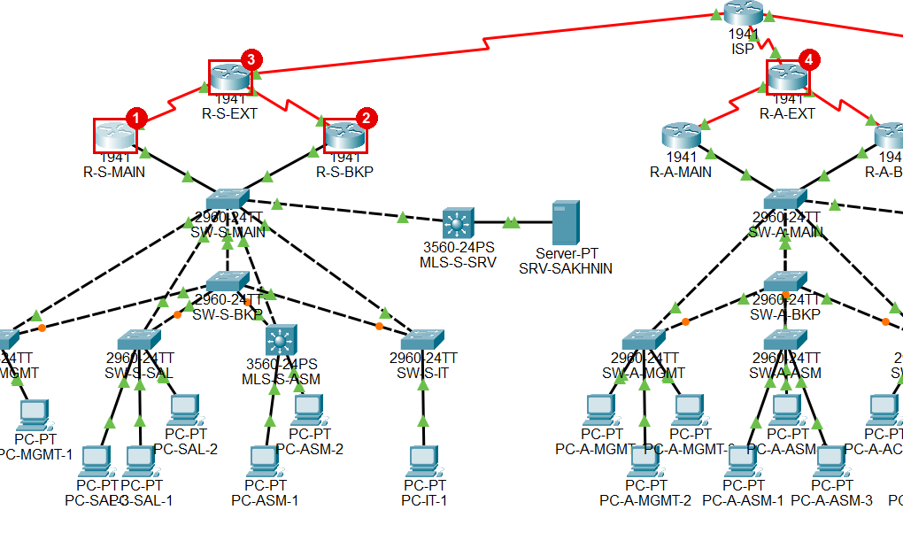

**❗ The problem.** R-S-EXT, `show ip route`:

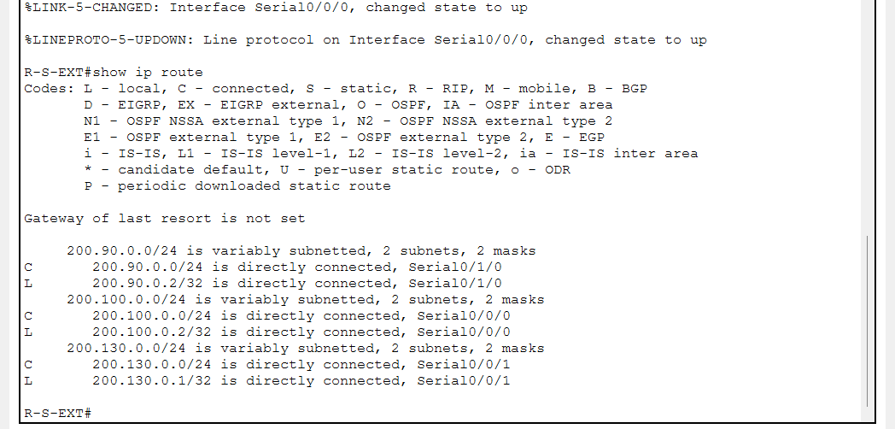

Not one 192.168 network. When an answer comes from the internet for a PC, R-S-EXT doesn't know where to send it and throws it away.

**💡 The solution.** A routing protocol: the routers **tell** each other what they know. OSPF in Sakhnin, EIGRP in Ashdod and Eilat (1.2). Writing five static routes in three routers would work too, until a line falls: static routes don't react.

**📋 Do it in the project.** OSPF 52, area 0, router-id 1.1.1.1 / 1.1.1.2 / 1.1.1.3, passive on every LAN sub-interface, and a default route to the next router towards the internet.

### 🖱 The solution: what to click and what to write
**R-S-MAIN:**
```
configure terminal
router ospf 52
router-id 1.1.1.1
network 192.168.10.0 0.0.0.255 area 0
network 192.168.20.0 0.0.0.255 area 0
network 192.168.30.0 0.0.0.255 area 0
network 192.168.40.0 0.0.0.255 area 0
network 192.168.50.0 0.0.0.255 area 0
network 200.100.0.0 0.0.0.255 area 0
passive-interface g0/0.10
passive-interface g0/0.20
passive-interface g0/0.30
passive-interface g0/0.40
passive-interface g0/0.50
exit
ip route 0.0.0.0 0.0.0.0 200.100.0.2
end
```

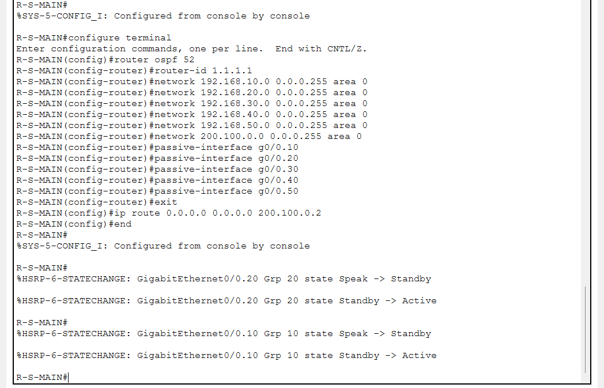

**R-S-BKP:** the same, with `router-id 1.1.1.2`, `network 200.90.0.0 0.0.0.255 area 0` instead of 200.100, and
`ip route 0.0.0.0 0.0.0.0 200.90.0.2`.

The full block of R-S-BKP:
```
configure terminal
router ospf 52
router-id 1.1.1.2
network 192.168.10.0 0.0.0.255 area 0
network 192.168.20.0 0.0.0.255 area 0
network 192.168.30.0 0.0.0.255 area 0
network 192.168.40.0 0.0.0.255 area 0
network 192.168.50.0 0.0.0.255 area 0
network 200.90.0.0 0.0.0.255 area 0
passive-interface g0/0.10
passive-interface g0/0.20
passive-interface g0/0.30
passive-interface g0/0.40
passive-interface g0/0.50
exit
ip route 0.0.0.0 0.0.0.0 200.90.0.2
end
```

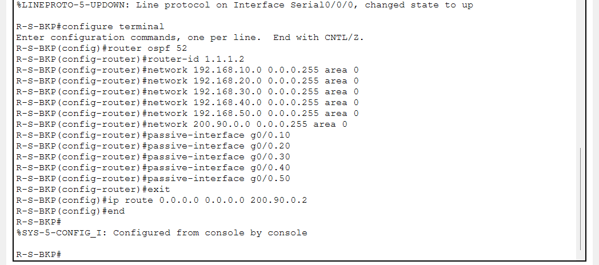

**R-S-EXT:**
```
configure terminal
router ospf 52
router-id 1.1.1.3
network 200.100.0.0 0.0.0.255 area 0
network 200.90.0.0 0.0.0.255 area 0
exit
ip route 0.0.0.0 0.0.0.0 200.130.0.2
end
```

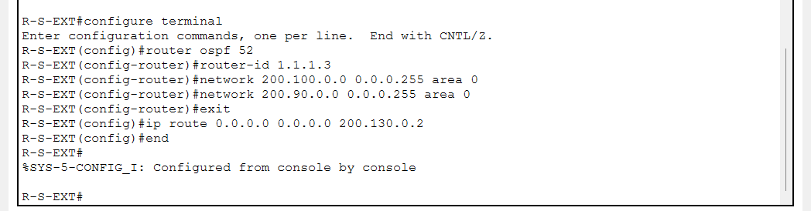

| Command | What it does | Why |
|---|---|---|
| `router-id` | the router's name in OSPF | fixed, so it doesn't change with the addresses |
| `network ... 0.0.0.255 area 0` | announces the network | wildcard mask: the opposite of a subnet mask |
| `passive-interface` | no OSPF messages to the PCs | security: nobody in the LAN can become a "neighbor" |
| `ip route 0.0.0.0 0.0.0.0` | default route | "everything I don't know → to the internet" |

✅ R-S-EXT: `show ip ospf neighbor` → two neighbors **FULL**. `show ip route` → the five networks with `O`, through **both** routers.

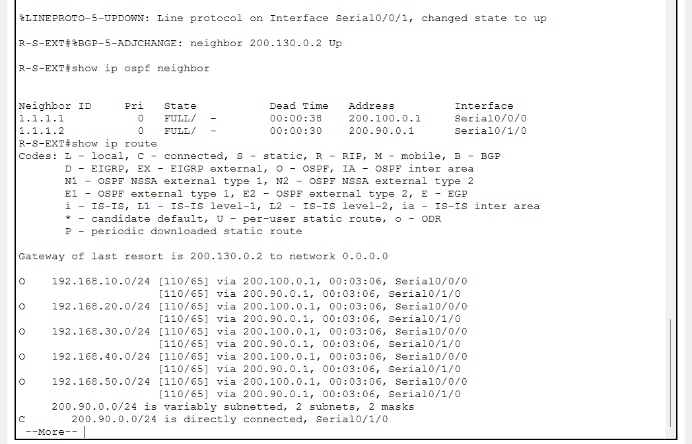

✅ R-S-MAIN: `show ip route` → gateway of last resort 200.100.0.2.

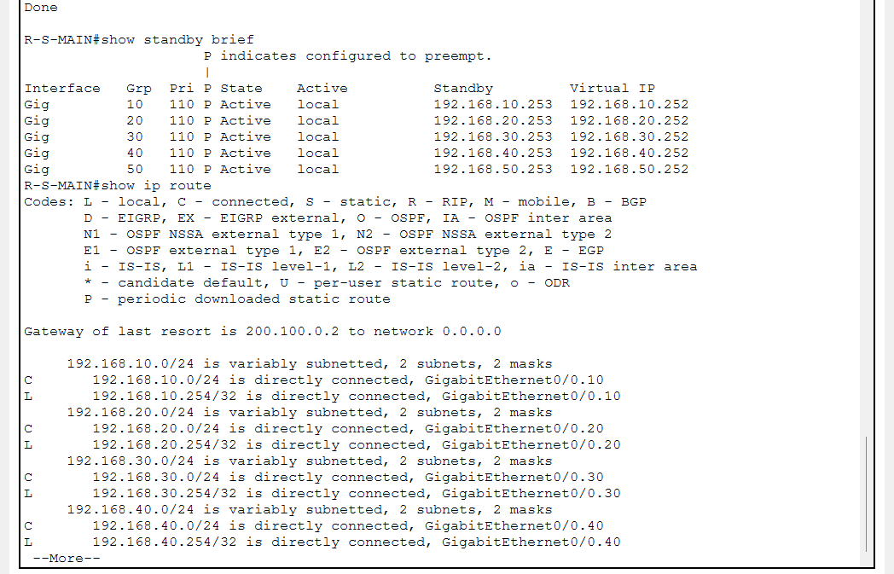

**Ashdod (EIGRP 54):** look at the R-A block. `show ip eigrp neighbors` in R-A-EXT shows two neighbors:

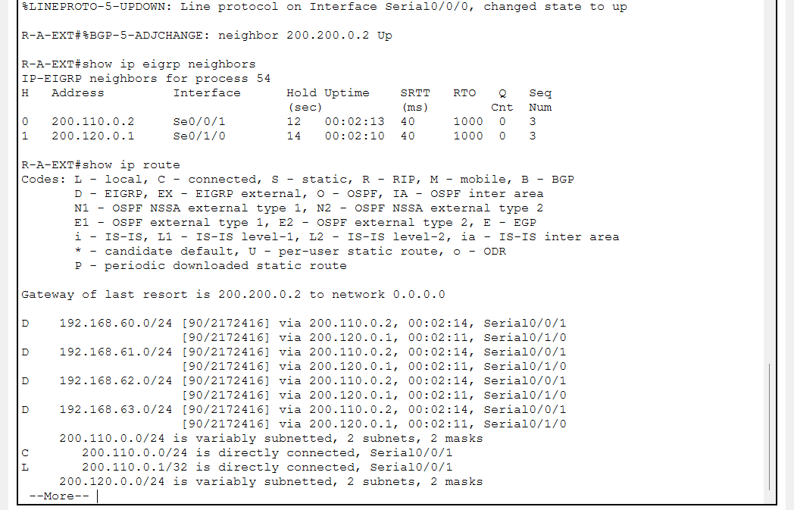

❓ Why is there `no auto-summary`? So that EIGRP announces the exact networks and not a whole class.

## Mission 4 — BGP to the provider
**🌐 The network now.** Every branch knows itself. Between the branches stands the provider:

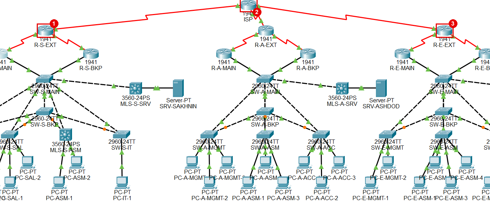

**❗ The problem.** The provider is **another company**: you can't run OSPF together, because then it would see your whole inside network and could change your routes. On the ISP, `show ip bgp summary` returns nothing: no neighbor, so it passes nobody's networks on.

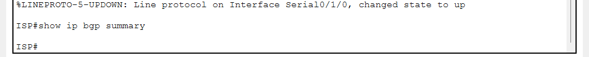

🧠 To be honest: in our small model the three branches touch the **same** provider router, so the default route alone would already reach them. On the real internet there are thousands of providers, and only BGP tells them who is where.

**💡 The solution.** eBGP: each branch is an AS, and it announces **only** its public network to the provider (1.3).

**📋 Do it in the project.** Sakhnin = AS 511, ISP = AS 311. Configure both sides. Which AS is written after `remote-as`, yours or the neighbor's?

### 🖱 The solution: what to click and what to write
**R-S-EXT:**
```
configure terminal
router bgp 511
neighbor 200.130.0.2 remote-as 311
network 200.130.0.0 mask 255.255.255.0
end
```

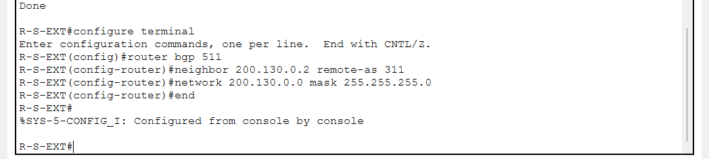

**ISP:**
```
configure terminal
router bgp 311
neighbor 200.130.0.1 remote-as 511
neighbor 200.200.0.1 remote-as 411
neighbor 200.150.0.1 remote-as 611
end
```

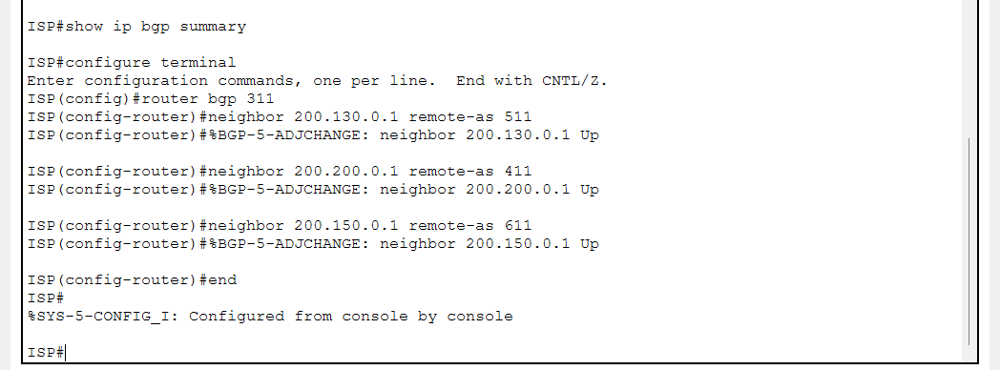

| Command | What it does |
|---|---|
| `router bgp 511` | our AS number |
| `neighbor 200.130.0.2 remote-as 311` | who the neighbor is and which AS it's in; both sides must agree |
| `network 200.130.0.0 mask 255.255.255.0` | announces our public network; the mask must be exactly as in the routing table |

✅ ISP: `show ip bgp summary`. Three neighbors, and **MsgRcvd** is above 0.

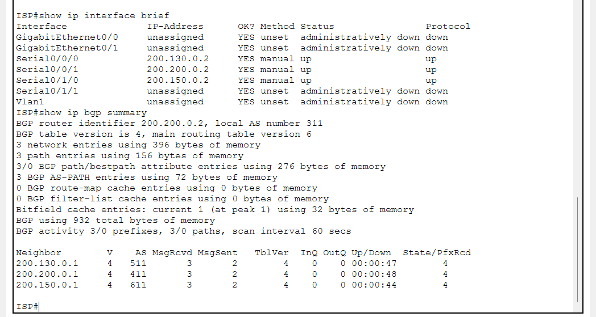

✅ The real proof — R-E-EXT: `show ip route bgp`. The public networks of the other branches arrived with `B`:

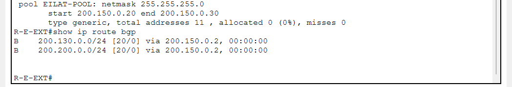

⚠️ In real equipment a word like `Idle` in the last column means "not connected". In Packet Tracer the column shows a number
**even when the AS is wrong** (we checked), so trust `show ip route bgp`.

✅ ISP: `show ip route`. It does **not** know a single 192.168 network, and that is correct: a provider must not know our inside.

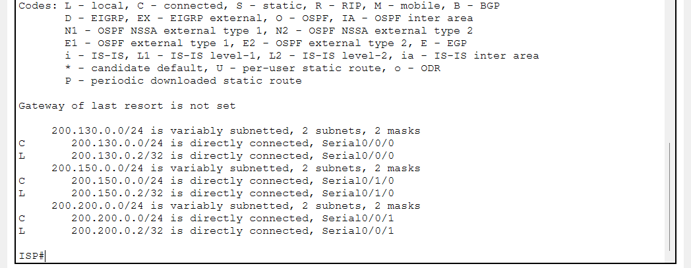

## Mission 5 — NAT
**🌐 The network now.** The routes exist. We go out to the internet from 2, and from 5 we enter Ashdod's server:

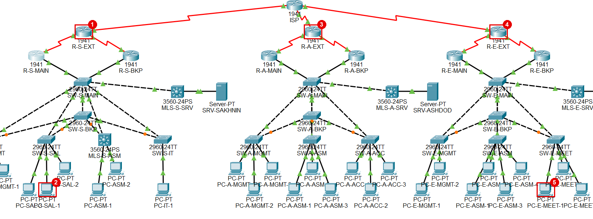

**❗ The problem.** PC-SAL-1 → `ping 200.130.0.2`:

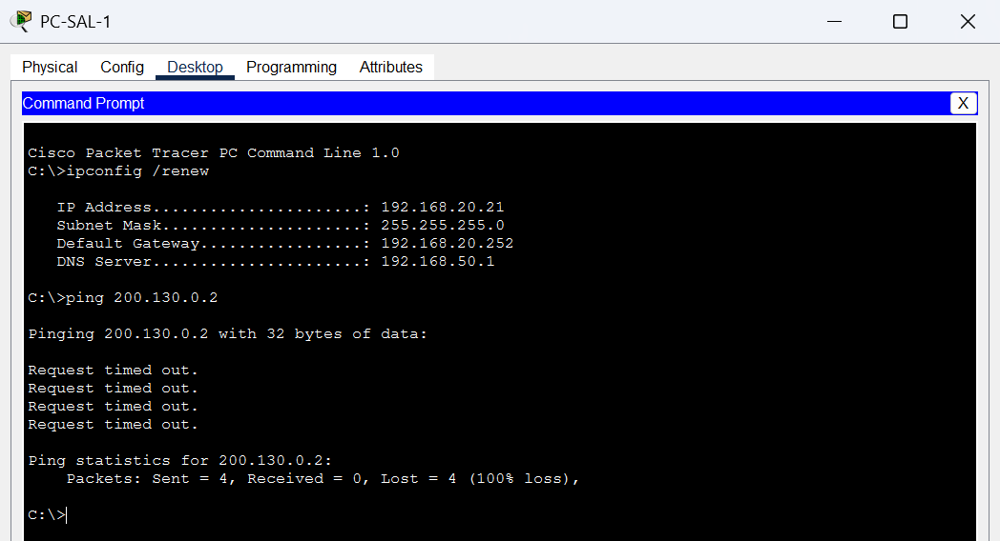

The ping **does** arrive at the provider, but the answer is for 192.168.20.x, and no provider has a route to a private address. The answer dies there.

**💡 The solution.** NAT on the edge router: on the way out replace the private address with a public one, and remember it for the answer (1.4).

**📋 Do it in the project.** PAT on R-S-EXT: who is translated, to which address, which ports are inside and which is outside? Then find the static NAT and the pool in the blocks of Ashdod and Eilat.

### 🖱 The solution: what to click and what to write
**R-S-EXT (PAT):**
```
configure terminal
ip access-list extended NAT-S
permit ip 192.168.0.0 0.0.63.255 any
exit
ip nat inside source list NAT-S interface s0/0/1 overload
interface s0/0/0
ip nat inside
interface s0/1/0
ip nat inside
interface s0/0/1
ip nat outside
end
```

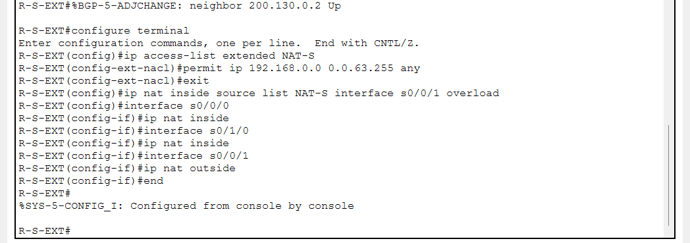

| Command | What it does |
|---|---|
| `permit ip 192.168.0.0 0.0.63.255 any` | who is translated: 192.168.0–192.168.63 |
| `overload` | PAT: many PCs, one address |
| `ip nat inside` / `outside` | which side is home and which is the internet |

✅ **PC-SAL-1**: first `ipconfig` (you need an address), then `ping 200.130.0.2` and `ping 200.200.0.2` (the provider's side of Ashdod).

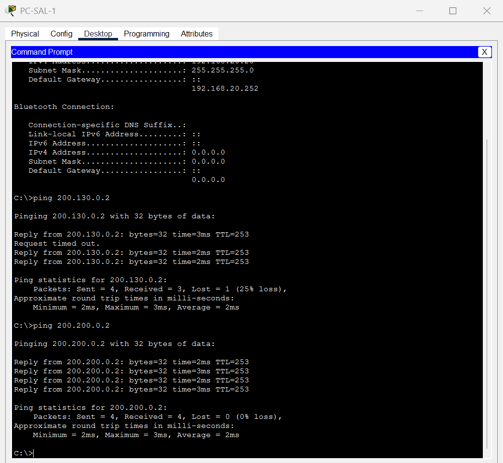

✅ Immediately on R-S-EXT: `show ip nat translations`. 192.168.20.20 goes out as **200.130.0.1**.


**Static NAT in Ashdod** (in the pasted block): the server 192.168.63.1 is published as **200.200.0.10**.
From **PC-E-MEET-1** in Eilat: `ping 200.200.0.10`, and in the browser `http://200.200.0.10`:

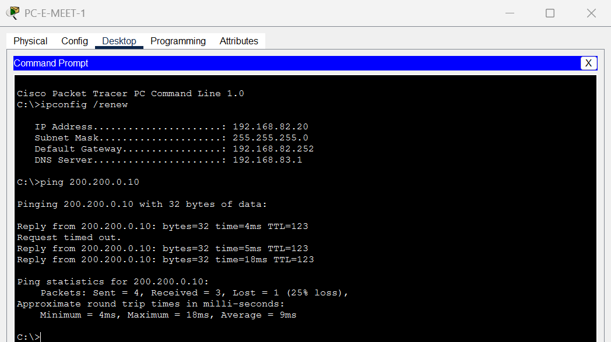

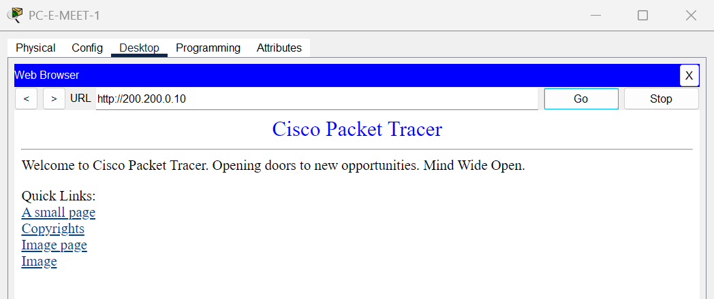

In R-A-EXT the `---` line is permanent: that is the static translation.

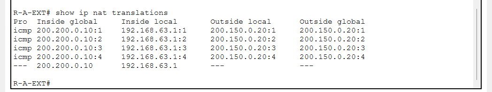

**Pool in Eilat:** the same PC went out as 200.150.0.20, the first address of the pool.


## Mission 6 — Cut the line
**🌐 The network now.** Everything works, with two ways out:

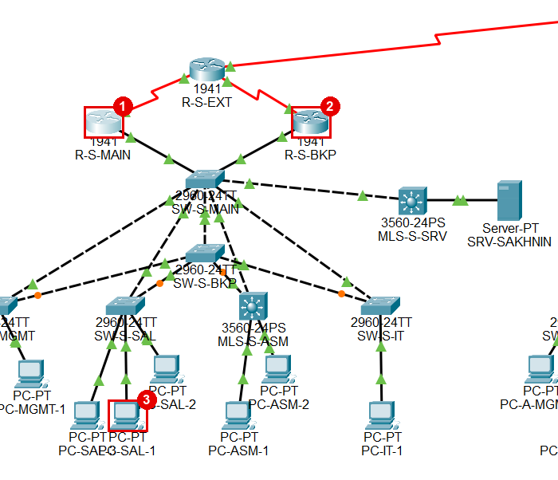

**❗ The problem.** In Mission 2 we saw the main stay Active without internet. Did `track` really solve it? We have to prove it.

**💡 The solution.** Cut the same line again and compare: this time the priority must drop to 100 and the backup must take over.

**📋 Do it in the project.** Cut, check `show standby brief`, check `tracert` from PC-SAL-1, bring it back.

### 🖱 The solution: what to click and what to write
1. **R-S-MAIN**: `interface s0/0/0` → `shutdown`. Wait 15 seconds, `show standby brief`: priority **100**, and it's no longer Active (it passes through *Speak* to *Standby*).

   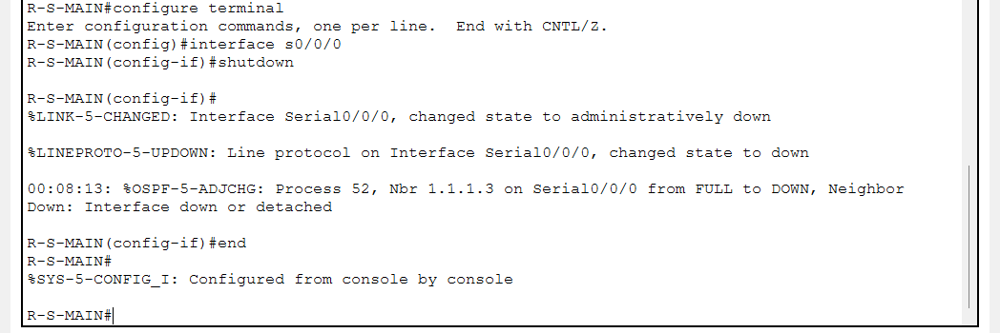

   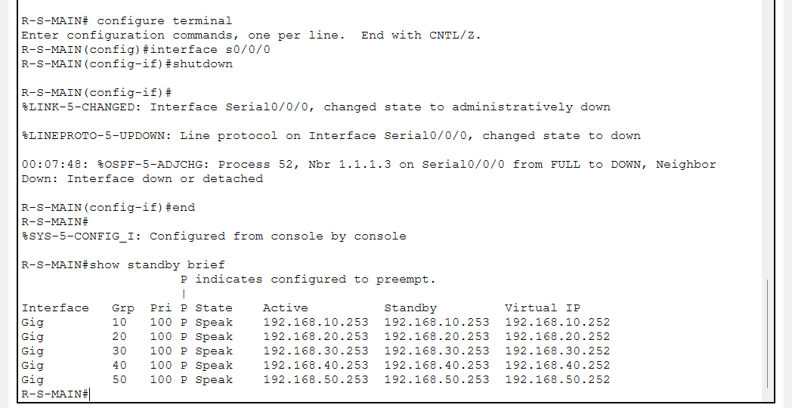
2. **PC-SAL-1**: `tracert 200.130.0.2` → .253 → 200.90.0.2: through the backup, and the internet still works.

   
3. `no shutdown`, and after about 30 seconds R-S-MAIN is Active again.

   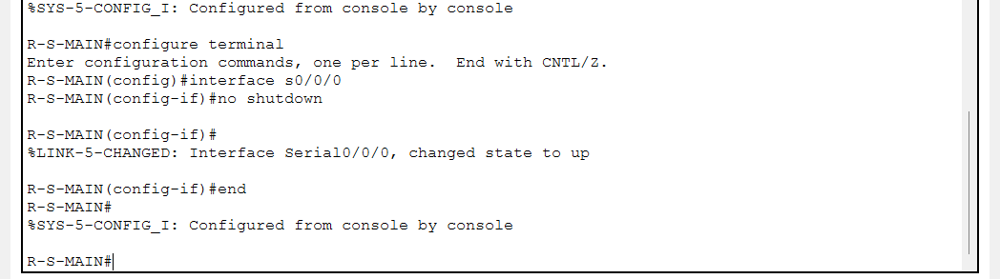

4. Save on all routers: `copy running-config startup-config`. File → Save.

## 👀 See it happen — NAT changes the address
Simulation was explained in [lesson 1](../lesson-01/). First in Realtime: `ping 200.130.0.2` from PC-SAL-1 works.
**Simulation** → only **ICMP** → `ping 200.130.0.2` again, and step until the packet comes back.

**On the way out**, open the packet on **R-S-EXT**:

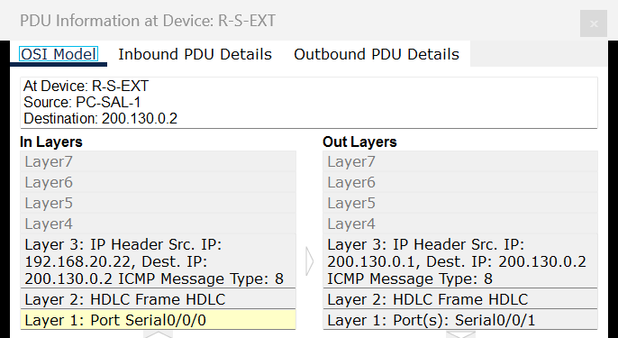

**On the way back**, on the same router:

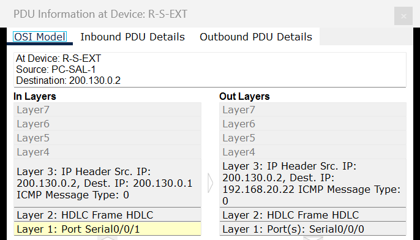

| | In | Out |
|---|---|---|
| On the way out: the source | 192.168.20.22 | **200.130.0.1** |
| On the way back: the destination | 200.130.0.1 | **192.168.20.22** |

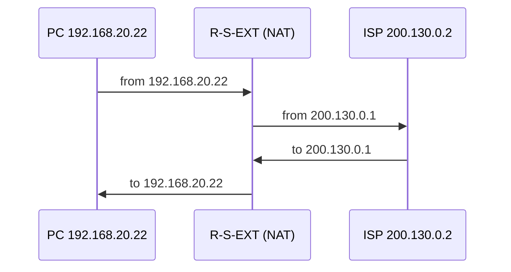

❓ The provider sees only 200.130.0.1. How does R-S-EXT know who gets the answer?

<details><summary>Answer</summary>

It wrote a line in the translation table (`show ip nat translations`) when the packet went out, and reads it in the opposite
direction.

</details>

💡 Layer 2 is now **HDLC** and not Ethernet: a serial line has only two sides, so no MACs are needed.

✏️ **Try:** open the packet on **ISP**, layer 3. Is there a 192.168 address there?

<details><summary>Answer</summary>

No. That is also why the provider needs no route to your private networks.

</details>

## 🧯 It doesn't work?
| What you see | Probably | What to do |
|---|---|---|
| a serial link is red on one side | `no shutdown` is missing on one end | `show ip interface brief` on both ends |
| `up/down` | `clock rate` is missing on the DCE | `show controllers`, then `clock rate 2000000` |
| no OSPF neighbor | wrong network/wildcard, or a different area | `show ip protocols`, `show run` |
| no EIGRP neighbor | a different AS number | 54 in Ashdod, 84 in Eilat, on all three routers |
| ping to the internet fails, OSPF is fine | NAT | `ip nat inside` / `outside` on the right ports |
| `show ip nat translations` is empty | the entries expired | ping, and look immediately |
| the first ping is lost | ARP / routes are still being learned | ping again |

---

## 🔎 Find the bug — from a real project
1. Ashdod used 192.168.50.0, the same network as the servers in Sakhnin.
2. The ISP ran OSPF + two EIGRP + BGP with **redistribution** between all of them.
3. Only **one** BGP neighbor was configured, out of three.
4. All three branches used PAT only, although the book promised static and dynamic.

<details><summary>Answer</summary>

1. Two branches with the same network can never be connected: the router doesn't know where to send. Fix: Ashdod uses 60–63, and plan the addresses for the **whole** company in advance.
2. The provider knows all the private networks of the customers: not realistic, and not safe. Fix: IGP only inside the branch, eBGP to the provider, a default route out.
3. BGP has no automatic neighbors. Each side must be written by hand.
4. Static for a server that people enter from outside, a pool for dynamic, PAT for the rest. The examiner checks that what is written in the book exists in the file.

</details>

## 🏋 Exercises
1. On R-S-EXT remove `ip nat inside` from s0/0/0 and ping from PC-SAL-1. What happens and why? Put it back.
2. Change the AS of the neighbor in R-E-EXT to 312. What does `show ip bgp summary` show? Put it back.
3. Calculate the wildcard of 255.255.252.0. Which networks does `192.168.80.0 0.0.3.255` cover?

<details><summary>Answers (we tested 1 and 2)</summary>

1. `Request timed out`, and the translation table is empty. The packet goes out as 192.168.20.x; the provider doesn't know this network, so the answer cannot return. After `ip nat inside` the ping works.
2. `%BGP-3-NOTIFICATION ... (peer in wrong AS)`, and `show ip route bgp` is **empty**. To return: `no neighbor 200.150.0.2 remote-as 312` and then `neighbor 200.150.0.2 remote-as 311`.

   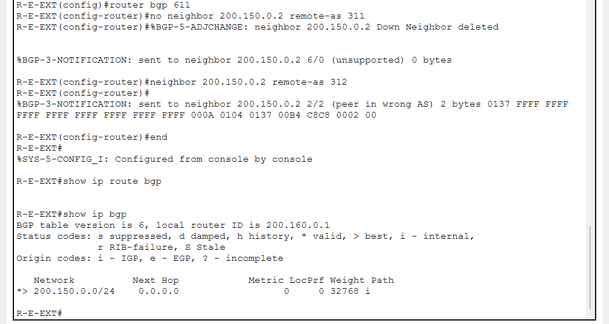
3. 0.0.3.255. 192.168.80.0, 81.0, 82.0 and 83.0.

</details>

## 🎓 Explain it to the examiner
- What is the difference between an IGP and an EGP? Why not OSPF to the provider?
- What are DCE and DTE?
- Why is the admin distance important when there are two protocols?
- What is the difference between PAT, static and dynamic NAT? What are inside local and inside global?
- What does `standby track` do, and why on the serial and not on the LAN?

<details><summary>Model answers</summary>

1. IGP = inside one company (OSPF, EIGRP). EGP = between companies (BGP). With OSPF the provider would learn our whole inside, and our faults would reach it.
2. The two ends of a serial line. DCE gives the clock, DTE receives it.
3. If the same network is learned from two protocols, the one with the lower distance enters the table: EIGRP 90 before OSPF 110.
4. PAT: many → one, by ports. Static: one ↔ one, permanent, allows entering. Dynamic: one ↔ one, temporary, from a pool. Local = the real address inside, global = how the world sees it.
5. Lowers the priority when a port falls. HSRP already notices a LAN failure by itself, but without track it doesn't know that the internet line fell.

</details>

## ✏️ Exit quiz (3 minutes)
1. Which protocol runs between R-S-EXT and the ISP?
2. What is the wildcard of /24?
3. Which NAT would you choose for a web server?
4. What does `S*` mean in the routing table?
5. EIGRP 54 on one router and EIGRP 84 on its neighbor. What happens?

<details><summary>Answers</summary>

1. eBGP.
2. 0.0.0.255.
3. Static.
4. A static default route.
5. They don't become neighbors.

</details>

## 🛠 Your own project
- [ ] An address plan for **all** branches, without duplicates.
- [ ] A WAN table with DCE/DTE.
- [ ] A different IGP where required, with passive-interface and a default route.
- [ ] eBGP to the provider from every branch.
- [ ] At least one static NAT, one pool and one PAT.
- [ ] Screenshots: `show ip ospf neighbor`, `show ip eigrp neighbors`, `show ip bgp summary`, `show ip nat translations`, the failure test.
