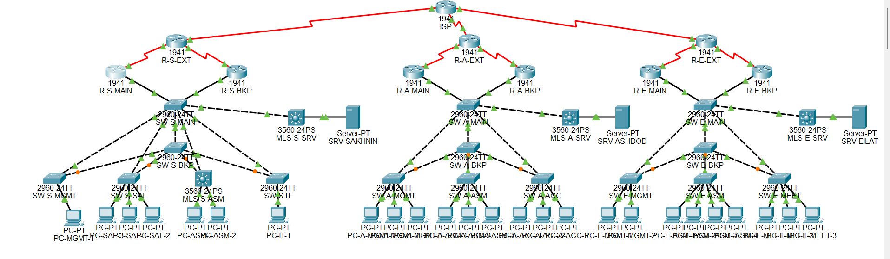
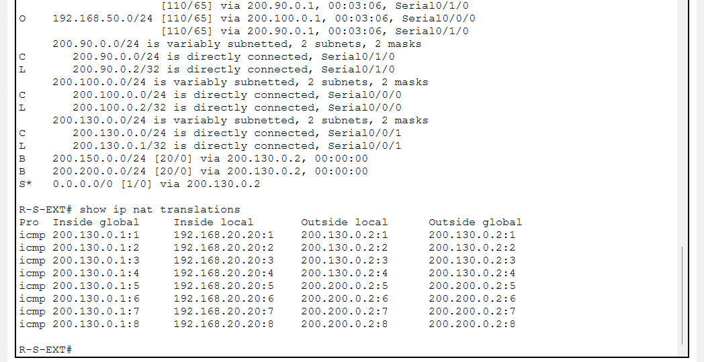
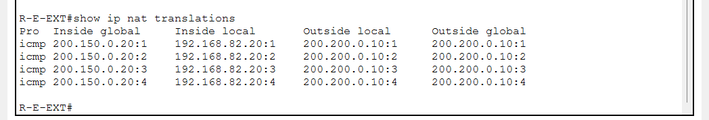
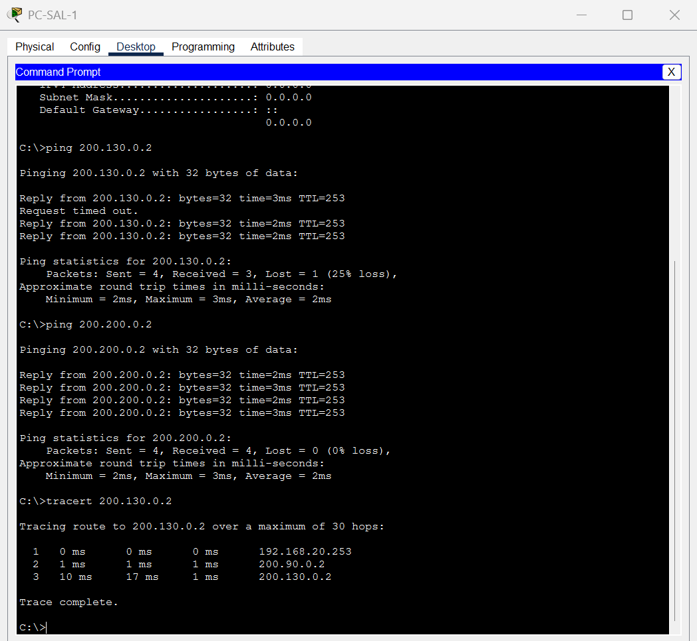

# Lesson 04 — Connecting the branches: WAN, OSPF, EIGRP, BGP and NAT

> ⏱ 90 minutes · 🧰 Packet Tracer 9.x · 📂 start: [`lesson04-start.pkt`](lesson04-start.pkt) · 💾 save as `lesson04.pkt`

## What you will have at the end
Three branches connected to an internet provider: OSPF in Sakhnin, EIGRP in Ashdod and Eilat, BGP
to the provider, and three kinds of NAT.



## Lesson plan (for the teacher)
| Minutes | Part |
|---|---|
| 0–20 | Part 1 — theory on the board |
| 20–35 | Mission 1 — WAN addresses (Sakhnin by hand, the rest by pasting) |
| 35–50 | Missions 2–3 — HSRP track, OSPF, EIGRP |
| 50–60 | Mission 4 — BGP |
| 60–75 | Mission 5 — NAT |
| 75–82 | Mission 6 — the failure test |
| 82–90 | Find the bug, questions, "your own project" |

In the start file Sakhnin is the end of lesson 3, and the LANs of Ashdod and Eilat are ready-made
(same method as Sakhnin). The WAN links exist but have no addresses, so they are **red**.


💡 **How to paste a block:** log in on the router, type `enable` and the password → copy the block
→ click **Paste** at the bottom right of the CLI. At the end: `copy running-config startup-config`.

---

## Part 1 — Theory: understand it first

### 1.1 Serial and clock rate
A serial line has two ends: **DCE** sets the clock, **DTE** follows it. In this project the DCE side
is the router nearer to the provider: EXT towards the branch, ISP towards EXT.

### 1.2 Three routing protocols
| | OSPF | EIGRP | BGP |
|---|---|---|---|
| Type | link state | advanced distance vector | path vector |
| Works | inside a company (IGP) | inside a company (IGP) | **between** companies (EGP) |
| Measures | cost (by bandwidth) | bandwidth + delay | list of AS numbers, policy |
| Admin distance | 110 | 90 | 20 (external) |
| In show ip route | `O` | `D` | `B` |
| Number | process 52, area 0 | AS 54, AS 84 | AS 511, 411, 611, 311 |

The OSPF process number is **local**; the EIGRP AS number must be **identical** on all the routers of the branch.

### 1.3 AS
An **autonomous system** is a network under one management. Each branch is an AS, and the provider (311) is another.
**eBGP** = BGP between different AS numbers. Neighbors are configured **by hand**, on both sides.

### 1.4 NAT
Private addresses (192.168.x.x) don't travel on the internet. The edge router **translates** them:

| Kind | Where | How |
|---|---|---|
| **PAT** (overload) | Sakhnin | everybody goes out with **one** address, separated by port numbers |
| **Static** | Ashdod, the server | one private ↔ one public, so people from outside can **enter** |
| **Dynamic pool** | Eilat | takes a free address from a list (.20–.30) |

| Term | Meaning |
|---|---|
| Inside local | the real address of our PC (192.168.20.20) |
| Inside global | how the internet sees it (200.130.0.1) |

### 1.5 The WAN plan
| Link | Network | First side | Second side |
|---|---|---|---|
| R-S-MAIN ↔ R-S-EXT | 200.100.0.0/24 | S0/0/0 .1 | S0/0/0 .2 (DCE) |
| R-S-BKP ↔ R-S-EXT | 200.90.0.0/24 | S0/0/0 .1 | S0/1/0 .2 (DCE) |
| R-S-EXT ↔ ISP | 200.130.0.0/24 | S0/0/1 .1 | S0/0/0 .2 (DCE) |
| R-A-MAIN ↔ R-A-EXT | 200.110.0.0/24 | S0/0/0 .2 | S0/0/1 .1 (DCE) |
| R-A-BKP ↔ R-A-EXT | 200.120.0.0/24 | S0/0/0 .1 | S0/1/0 .2 (DCE) |
| R-A-EXT ↔ ISP | 200.200.0.0/24 | S0/0/0 .1 | S0/0/1 .2 (DCE) |
| R-E-MAIN ↔ R-E-EXT | 200.140.0.0/24 | S0/0/0 .2 | S0/0/1 .1 (DCE) |
| R-E-BKP ↔ R-E-EXT | 200.160.0.0/24 | S0/0/0 .2 | S0/1/0 .1 (DCE) |
| R-E-EXT ↔ ISP | 200.150.0.0/24 | S0/0/0 .1 | S0/1/0 .2 (DCE) |

---

## Mission 1 — WAN addresses
**R-S-MAIN:**
```
configure terminal
interface s0/0/0
ip address 200.100.0.1 255.255.255.0
no shutdown
end
```
**R-S-BKP:**
```
configure terminal
interface s0/0/0
ip address 200.90.0.1 255.255.255.0
no shutdown
end
```
**R-S-EXT:**
```
configure terminal
interface s0/0/0
ip address 200.100.0.2 255.255.255.0
clock rate 2000000
no shutdown
exit
interface s0/1/0
ip address 200.90.0.2 255.255.255.0
clock rate 2000000
no shutdown
exit
interface s0/0/1
ip address 200.130.0.1 255.255.255.0
no shutdown
end
```
**ISP:**
```
configure terminal
interface s0/0/0
ip address 200.130.0.2 255.255.255.0
clock rate 2000000
no shutdown
exit
interface s0/0/1
ip address 200.200.0.2 255.255.255.0
clock rate 2000000
no shutdown
exit
interface s0/1/0
ip address 200.150.0.2 255.255.255.0
clock rate 2000000
no shutdown
end
```
❓ Which side gets `clock rate`? Only the **DCE**. On a DTE side the command is not needed.

**Ashdod and Eilat:** each group pastes one router. These blocks contain **everything** for the
branch: WAN, HSRP track, EIGRP, BGP and NAT. Read them while going through missions 2–5.

<details><summary>R-A-MAIN, R-A-BKP, R-A-EXT</summary>

**R-A-MAIN**
```
configure terminal
interface s0/0/0
ip address 200.110.0.2 255.255.255.0
no shutdown
exit
interface g0/0.60
standby 60 track s0/0/0
exit
interface g0/0.61
standby 61 track s0/0/0
exit
interface g0/0.62
standby 62 track s0/0/0
exit
interface g0/0.63
standby 63 track s0/0/0
exit
router eigrp 54
network 192.168.60.0
network 192.168.61.0
network 192.168.62.0
network 192.168.63.0
network 200.110.0.0
no auto-summary
passive-interface g0/0.60
passive-interface g0/0.61
passive-interface g0/0.62
passive-interface g0/0.63
exit
ip route 0.0.0.0 0.0.0.0 200.110.0.1
end
```

**R-A-BKP**
```
configure terminal
interface s0/0/0
ip address 200.120.0.1 255.255.255.0
no shutdown
exit
router eigrp 54
network 192.168.60.0
network 192.168.61.0
network 192.168.62.0
network 192.168.63.0
network 200.120.0.0
no auto-summary
passive-interface g0/0.60
passive-interface g0/0.61
passive-interface g0/0.62
passive-interface g0/0.63
exit
ip route 0.0.0.0 0.0.0.0 200.120.0.2
end
```

**R-A-EXT**
```
configure terminal
interface s0/0/1
ip address 200.110.0.1 255.255.255.0
clock rate 2000000
no shutdown
exit
interface s0/1/0
ip address 200.120.0.2 255.255.255.0
clock rate 2000000
no shutdown
exit
interface s0/0/0
ip address 200.200.0.1 255.255.255.0
no shutdown
exit
router eigrp 54
network 200.110.0.0
network 200.120.0.0
no auto-summary
exit
ip route 0.0.0.0 0.0.0.0 200.200.0.2
router bgp 411
neighbor 200.200.0.2 remote-as 311
network 200.200.0.0 mask 255.255.255.0
exit
ip nat inside source static 192.168.63.1 200.200.0.10
access-list 1 permit 192.168.60.0 0.0.3.255
ip nat inside source list 1 interface s0/0/0 overload
interface s0/0/1
ip nat inside
interface s0/1/0
ip nat inside
interface s0/0/0
ip nat outside
exit
end
```

</details>

<details><summary>R-E-MAIN, R-E-BKP, R-E-EXT</summary>

**R-E-MAIN**
```
configure terminal
interface s0/0/0
ip address 200.140.0.2 255.255.255.0
no shutdown
exit
interface g0/0.80
standby 80 track s0/0/0
exit
interface g0/0.81
standby 81 track s0/0/0
exit
interface g0/0.82
standby 82 track s0/0/0
exit
interface g0/0.83
standby 83 track s0/0/0
exit
router eigrp 84
network 192.168.80.0
network 192.168.81.0
network 192.168.82.0
network 192.168.83.0
network 200.140.0.0
no auto-summary
passive-interface g0/0.80
passive-interface g0/0.81
passive-interface g0/0.82
passive-interface g0/0.83
exit
ip route 0.0.0.0 0.0.0.0 200.140.0.1
end
```

**R-E-BKP**
```
configure terminal
interface s0/0/0
ip address 200.160.0.2 255.255.255.0
no shutdown
exit
router eigrp 84
network 192.168.80.0
network 192.168.81.0
network 192.168.82.0
network 192.168.83.0
network 200.160.0.0
no auto-summary
passive-interface g0/0.80
passive-interface g0/0.81
passive-interface g0/0.82
passive-interface g0/0.83
exit
ip route 0.0.0.0 0.0.0.0 200.160.0.1
end
```

**R-E-EXT**
```
configure terminal
interface s0/0/1
ip address 200.140.0.1 255.255.255.0
clock rate 2000000
no shutdown
exit
interface s0/1/0
ip address 200.160.0.1 255.255.255.0
clock rate 2000000
no shutdown
exit
interface s0/0/0
ip address 200.150.0.1 255.255.255.0
no shutdown
exit
router eigrp 84
network 200.140.0.0
network 200.160.0.0
no auto-summary
exit
ip route 0.0.0.0 0.0.0.0 200.150.0.2
router bgp 611
neighbor 200.150.0.2 remote-as 311
network 200.150.0.0 mask 255.255.255.0
exit
ip nat pool EILAT-POOL 200.150.0.20 200.150.0.30 netmask 255.255.255.0
ip access-list extended NAT-E
permit ip 192.168.80.0 0.0.3.255 any
exit
ip nat inside source list NAT-E pool EILAT-POOL
interface s0/0/1
ip nat inside
interface s0/1/0
ip nat inside
interface s0/0/0
ip nat outside
exit
end
```

</details>

✅ All serial links are green.

## Mission 2 — HSRP watches the internet line
In lesson 3 the backup took over only if the LAN failed. Now the main router also loses priority
when its **serial line** fails. On **R-S-MAIN**:
```
configure terminal
interface g0/0.10
standby 10 track s0/0/0
interface g0/0.20
standby 20 track s0/0/0
interface g0/0.30
standby 30 track s0/0/0
interface g0/0.40
standby 40 track s0/0/0
interface g0/0.50
standby 50 track s0/0/0
end
```
🧠 The line falls → 110 − 10 = **100**, which is less than 105 → the backup takes over.

## Mission 3 — OSPF in Sakhnin
**R-S-MAIN:**
```
configure terminal
router ospf 52
router-id 1.1.1.1
network 192.168.10.0 0.0.0.255 area 0
network 192.168.20.0 0.0.0.255 area 0
network 192.168.30.0 0.0.0.255 area 0
network 192.168.40.0 0.0.0.255 area 0
network 192.168.50.0 0.0.0.255 area 0
network 200.100.0.0 0.0.0.255 area 0
passive-interface g0/0.10
passive-interface g0/0.20
passive-interface g0/0.30
passive-interface g0/0.40
passive-interface g0/0.50
exit
ip route 0.0.0.0 0.0.0.0 200.100.0.2
end
```
**R-S-BKP:** the same, with `router-id 1.1.1.2`, `network 200.90.0.0 0.0.0.255 area 0` instead of 200.100, and
`ip route 0.0.0.0 0.0.0.0 200.90.0.2`.

**R-S-EXT:**
```
configure terminal
router ospf 52
router-id 1.1.1.3
network 200.100.0.0 0.0.0.255 area 0
network 200.90.0.0 0.0.0.255 area 0
exit
ip route 0.0.0.0 0.0.0.0 200.130.0.2
end
```
| Command | What it does | Why |
|---|---|---|
| `router-id` | the router's name in OSPF | fixed, so it doesn't change with the addresses |
| `network ... 0.0.0.255 area 0` | announces the network | wildcard mask: the opposite of a subnet mask |
| `passive-interface` | no OSPF messages to the PCs | security: nobody in the LAN can become a "neighbor" |
| `ip route 0.0.0.0 0.0.0.0` | default route | "everything I don't know → to the internet" |

✅ R-S-EXT: `show ip ospf neighbor` → two neighbors **FULL**. `show ip route` → the five networks with `O`, through **both** routers.


✅ R-S-MAIN: `show ip route` → gateway of last resort 200.100.0.2.


**Ashdod (EIGRP 54):** look at the R-A block. `show ip eigrp neighbors` in R-A-EXT shows two neighbors:


❓ Why is there `no auto-summary`? So that EIGRP announces the exact networks and not a whole class.

## Mission 4 — BGP to the provider
**R-S-EXT:**
```
configure terminal
router bgp 511
neighbor 200.130.0.2 remote-as 311
network 200.130.0.0 mask 255.255.255.0
end
```
**ISP:**
```
configure terminal
router bgp 311
neighbor 200.130.0.1 remote-as 511
neighbor 200.200.0.1 remote-as 411
neighbor 200.150.0.1 remote-as 611
end
```
✅ ISP: `show ip bgp summary`. Three neighbors with a **number** in the last column (a word like `Idle` or `Active` = not connected).


✅ ISP: `show ip route`. It does **not** know a single 192.168 network, and that is correct: a provider must not know our inside.


## Mission 5 — NAT
**R-S-EXT (PAT):**
```
configure terminal
ip access-list extended NAT-S
permit ip 192.168.0.0 0.0.63.255 any
exit
ip nat inside source list NAT-S interface s0/0/1 overload
interface s0/0/0
ip nat inside
interface s0/1/0
ip nat inside
interface s0/0/1
ip nat outside
end
```
| Command | What it does |
|---|---|
| `permit ip 192.168.0.0 0.0.63.255 any` | who is translated: 192.168.0–192.168.63 |
| `overload` | PAT: many PCs, one address |
| `ip nat inside` / `outside` | which side is home and which is the internet |

✅ **PC-SAL-1**: first `ipconfig` (you need an address), then `ping 200.130.0.2` and `ping 200.200.0.2` (the provider's side of Ashdod).


✅ Immediately on R-S-EXT: `show ip nat translations`. 192.168.20.20 goes out as **200.130.0.1**.



**Static NAT in Ashdod** (in the pasted block): the server 192.168.63.1 is published as **200.200.0.10**.
From **PC-E-MEET-1** in Eilat: `ping 200.200.0.10`, and in the browser `http://200.200.0.10`:


In R-A-EXT the `---` line is permanent: that is the static translation.


**Pool in Eilat:** the same PC went out as 200.150.0.20, the first address of the pool.



## Mission 6 — Cut the line
1. **R-S-MAIN**: `interface s0/0/0` → `shutdown`. Wait 15 seconds, `show standby brief`: priority **100**, and it's no longer Active (it passes through *Speak* to *Standby*).

   
2. **PC-SAL-1**: `tracert 200.130.0.2` → .253 → 200.90.0.2: through the backup, and the internet still works.

   
3. `no shutdown`, and after about 30 seconds R-S-MAIN is Active again.
4. Save on all routers: `copy running-config startup-config`. File → Save.

---

## 🔎 Find the bug — from a real project
1. Ashdod used 192.168.50.0, the same network as the servers in Sakhnin.
2. The ISP ran OSPF + two EIGRP + BGP with **redistribution** between all of them.
3. Only **one** BGP neighbor was configured, out of three.
4. All three branches used PAT only, although the book promised static and dynamic.

<details><summary>Answer</summary>

1. Two branches with the same network can never be connected: the router doesn't know where to send. Fix: Ashdod uses 60–63, and plan the addresses for the **whole** company in advance.
2. The provider knows all the private networks of the customers: not realistic, and not safe. Fix: IGP only inside the branch, eBGP to the provider, a default route out.
3. BGP has no automatic neighbors. Each side must be written by hand.
4. Static for a server that people enter from outside, a pool for dynamic, PAT for the rest. The examiner checks that what is written in the book exists in the file.

</details>

## 🏋 Exercises
1. On R-S-EXT remove `ip nat inside` from s0/0/0 and ping from PC-SAL-1. What happens and why? Put it back.
2. Change the AS of the neighbor in R-E-EXT to 312. What does `show ip bgp summary` show? Put it back.
3. Calculate the wildcard of 255.255.252.0. Which networks does `192.168.80.0 0.0.3.255` cover?

## 🎓 Explain it to the examiner
- What is the difference between an IGP and an EGP? Why not OSPF to the provider?
- What are DCE and DTE?
- Why is the admin distance important when there are two protocols?
- What is the difference between PAT, static and dynamic NAT? What are inside local and inside global?
- What does `standby track` do, and why on the serial and not on the LAN?

## 🛠 Your own project
- [ ] An address plan for **all** branches, without duplicates.
- [ ] A WAN table with DCE/DTE.
- [ ] A different IGP where required, with passive-interface and a default route.
- [ ] eBGP to the provider from every branch.
- [ ] At least one static NAT, one pool and one PAT.
- [ ] Screenshots: `show ip ospf neighbor`, `show ip eigrp neighbors`, `show ip bgp summary`, `show ip nat translations`, the failure test.
