# Lesson 05 — Security and management: ACL, VPN, SSH, AAA, NTP, Syslog and ASA

> ⏱ 90 minutes · 🧰 Packet Tracer 9.x · 📂 start: [`lesson05-start.pkt`](lesson05-start.pkt) or your own file after [Part D](../from-zero/README.md#part-d--the-firewall-and-the-servers-of-ashdod-and-eilat) · 💾 save as `lesson05.pkt`

## What you will have at the end
A protected company: departments that can't reach what they shouldn't, an encrypted tunnel
Sakhnin ↔ Eilat, encrypted management with central users, correct time and logs, and a firewall.

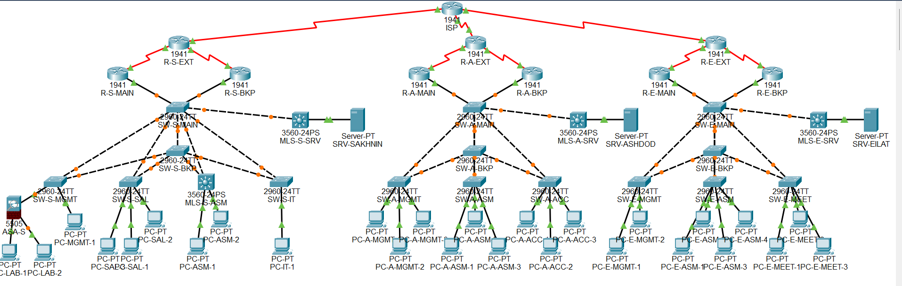

## Lesson plan (for the teacher)
| Minutes | Part |
|---|---|
| 0–15 | Part 1 — theory on the board |
| 15–23 | Mission 1 — the server (AAA, NTP, Syslog) |
| 23–35 | Mission 2 — ACL |
| 35–58 | Mission 3 — VPN, including the planned failure |
| 58–72 | Mission 4 — SSH, AAA, NTP, Syslog (Sakhnin in class, the rest by pasting) |
| 72–83 | Mission 5 — ASA |
| 83–90 | Final test table, "your own project" |

This is the fullest lesson. If time runs out: the switch SSH (4.4) and the ASA are good homework.
The AAA and NTP services of the Ashdod and Eilat servers are already configured in the start file.

---

## Part 1 — Theory: understand it first

### 1.1 ACL
A list of rules, read from **top to bottom**. The first match wins, and at the end there is an invisible **deny all**.

| | Standard | Extended |
|---|---|---|
| Checks | source only | source, destination, protocol, port |
| Numbers | 1–99 | 100–199 |
| Placed | near the **destination** | near the **source** |

💬 **In simple words:** a guard at the door with a list. The guard reads from the top, acts on the **first** line that fits, and
whoever isn't on the list doesn't enter.

**Example — read our list (Mission 2) as the router does:**

| Packet | First line that fits | Result |
|---|---|---|
| 0.0.0.0 → 255.255.255.255, UDP 67 (DHCP) | `permit udp any any eq bootps` | ✅ passes |
| 192.168.62.22 → 192.168.60.21, ping | `deny ip ...62.0 ...60.0` | ❌ blocked |
| 192.168.62.22 → 192.168.63.1, TCP 80 | `permit tcp ... eq www` | ✅ passes |
| 192.168.62.22 → 192.168.63.1, ping | `deny ip ...62.0 ...63.0` | ❌ blocked |
| 192.168.62.22 → 200.200.0.2, ping | `permit ip ...62.0 any` | ✅ passes |

❓ **Ask the class:** what happens if the last line is written first?

<details><summary>Answer</summary>

It fits everything that VLAN 62 sends, so the deny lines are never reached and nothing is blocked.

</details>

### 1.2 VPN IPsec
| Phase | What happens | Command |
|---|---|---|
| 1 (ISAKMP) | the routers identify each other (key) and agree on encryption | `crypto isakmp policy` |
| 2 (IPsec) | the data itself is encrypted (ESP) | `transform-set` |

- **Encryption** (AES) — nobody can read. **Hash** (SHA) — nobody changed it. **Pre-shared key** — it's really you. **DH group** — creating a shared secret over an open line.
- **Interesting traffic**: an ACL that says what enters the tunnel.

💬 **In simple words:** two branches send letters by regular mail, inside a locked safe. The mail carriers see only the
addresses of the branches, not what is inside or who wrote to whom.

**Example — a ping from PC-E-MEET-1 (192.168.82.23) to the Sakhnin server:**

| Where | Source → destination | Can be read? |
|---|---|---|
| in the Eilat LAN | 192.168.82.23 → 192.168.50.1 | yes |
| on the internet | **200.150.0.1 → 200.130.0.1** (ESP) | no, encrypted |
| in the Sakhnin LAN | 192.168.82.23 → 192.168.50.1 | yes |

### 1.3 AAA
| | Question |
|---|---|
| Authentication | who are you? |
| Authorization | what are you allowed to do? |
| Accounting | what did you do? |

| | TACACS+ | RADIUS |
|---|---|---|
| Port | TCP 49 | UDP 1645 / 1812 |
| Encrypts | the whole message | only the password |
| Good for | managing network devices | Wi-Fi and VPN users |

💬 **In simple words:** entering a company building. The guard checks who you are (authentication), your card opens only
some doors (authorization), and the camera records where you were (accounting).

**Example — `ssh -l osemuser 192.168.10.254`:** the router asks the TACACS+ server "is this password right?" → yes → in. If the server
**doesn't answer**, the router checks its own local users (`local`). If the server answers "no", there is **no** second chance.

### 1.4 The rest
- **SSH** — encrypted management. Telnet sends passwords as plain text.
- **NTP** — the same time everywhere, otherwise the logs are worthless. With authentication, so nobody can fake it.
- **Syslog** — all messages to one server.
- **ASA** — a firewall: from security level 100 (inside) to 0 (outside) is allowed, the other way is **blocked**. `inspect` lets the **answers** return.

**Example — the ASA decides:**

| Packet | Levels | Result |
|---|---|---|
| PC-LAB-1 → server, new connection | 100 → 0 | ✅ |
| server → PC-LAB-1, the **answer** | 0 → 100 | ✅ thanks to `inspect` |
| PC-MGMT-1 → PC-LAB-1, new connection | 0 → 100 | ❌ |

---

## 🔑 Opening a device
Click the device → **CLI** (1) → click in the text, Enter → `Osem#Con` → `enable` → `Osem#En1`. With pictures: [lesson 2](../lesson-02/).

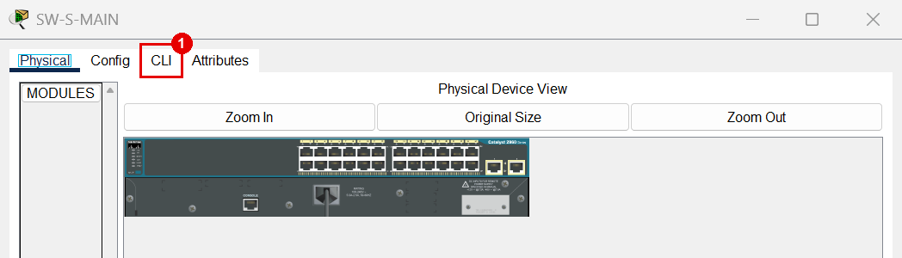

**How every mission is built:** 🌐 the network now → ❗ the problem → 💡 the solution → 📋 do it yourself → 🖱 the full solution, with what to click, what to write and what you must see.

## Mission 1 — The server
**🌐 The network now.** Three branches on the internet. We start from the server of Sakhnin:

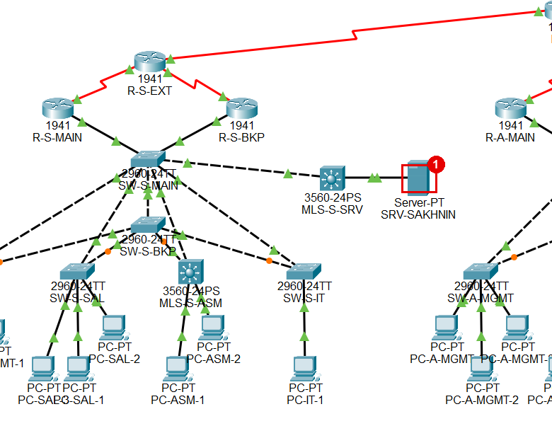

**❗ The problem.** Almost 30 devices with the same password, written on a note. An employee leaves: you change them all. Something happened at night: each device shows a different time and keeps its own log. The AAA service is empty and off:

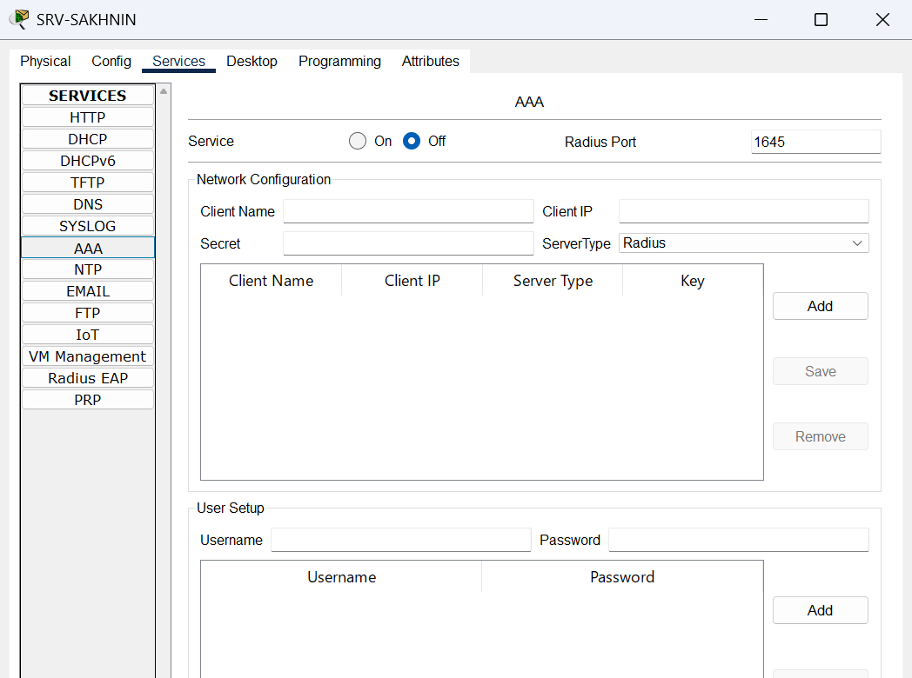

**💡 The solution.** One server that checks users (**AAA**), gives the time (**NTP**) and collects the messages (**Syslog**). We prepare the server now and connect the routers in Mission 4.

**📋 Do it in the project.** Two AAA clients (the two routers), one user, NTP with key 1, Syslog on.

### 🖱 The solution: what to click and what to write
Click **SRV-SAKHNIN** → **Services** (1) → AAA (2), NTP (3), SYSLOG (4):

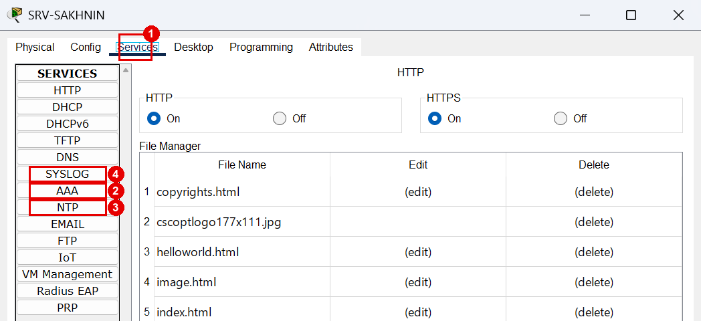

**SRV-SAKHNIN** → Services → **AAA** → On (1). Client Name (2), Client IP (3), Secret (4), ServerType → **Tacacs** → **Add** (5):

| Client Name | Client IP | Secret | Type |
|---|---|---|---|
| R-S-MAIN | 192.168.50.254 | Osem#Aaa | Tacacs |
| R-S-BKP | 192.168.50.253 | Osem#Aaa | Tacacs |

Below: Username (6) `osemuser`, Password `Osem#User` → **Add** (7).

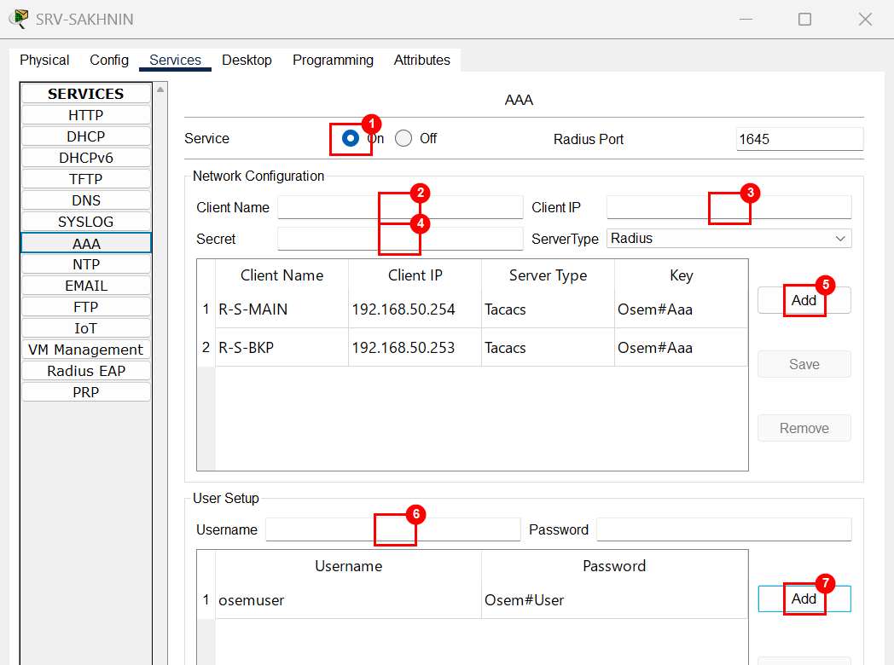

**NTP** → Authentication **Enable** (1), Key (2) `1`, Password (3) `Osem#Ntp`. It is shown as `01`, and it works.

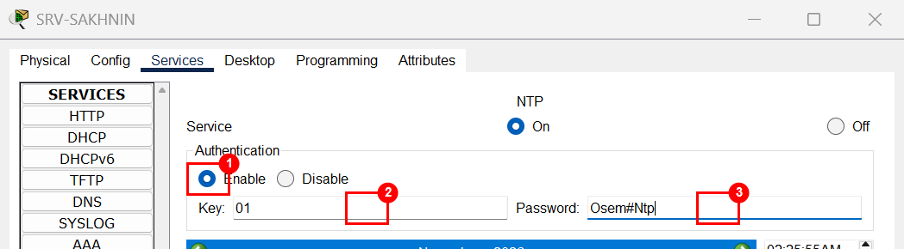

**SYSLOG** → check that it is On.

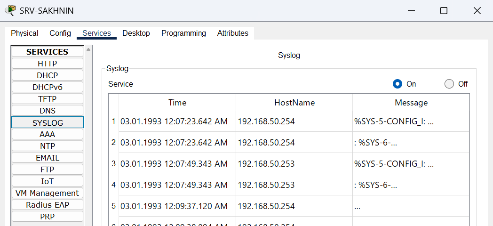

Messages from the routers appear in this list only after Mission 4.

| Field | What it is | Must match |
|---|---|---|
| Client | the router that will ask the server | its address towards the server (VLAN 50) |
| Secret | a key between router and server | `tacacs-server host ... key` |
| ServerType | the language: Tacacs / Radius | `group tacacs+` on the router |
| Username | the person who logs in | only here, not on the router |

## Mission 2 — ACL in Ashdod and Eilat
**🌐 The network now.** Ashdod: accounting is VLAN 62, management VLAN 60, the server 63. Eilat: assembly 81, management 80.

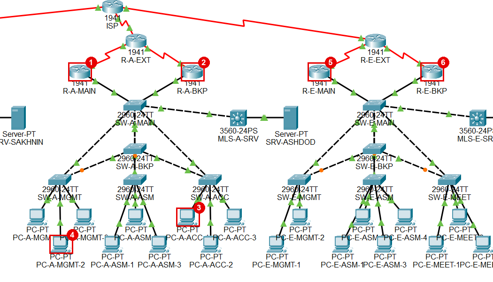

**❗ The problem.** In lesson 3 we opened everything to everybody. An accounting PC can ping the manager's PC and try to enter any service on the server. We'll see it in the first screenshot.

**💡 The solution.** An **extended ACL**, close to the source: on the sub-interface of VLAN 62, on **both** routers (1.1).

**📋 Do it in the project.** Before looking: write in words, line by line, what is allowed and what is not, in the right order. Don't forget how a PC gets its address.

### 🖱 The solution: what to click and what to write
**Goal:** accounting (VLAN 62) does not reach management (VLAN 60), and gets only web, DNS and FTP from the server.

Before: from **PC-A-ACC-1** check the address of PC-A-MGMT-2 and ping it. It works.

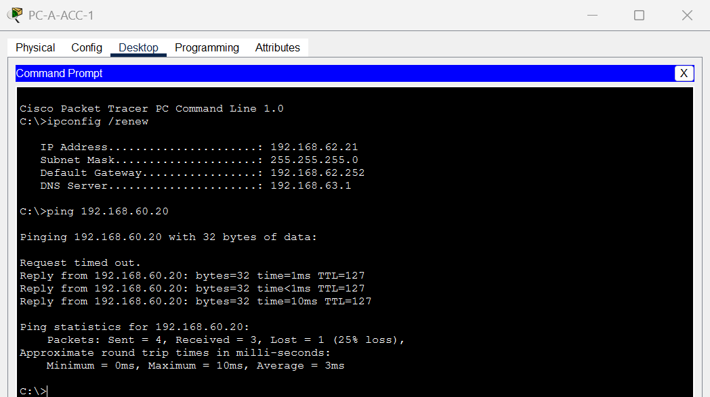

On **R-A-MAIN and also R-A-BKP**:
```
configure terminal
access-list 110 permit udp any any eq bootps
access-list 110 deny ip 192.168.62.0 0.0.0.255 192.168.60.0 0.0.0.255
access-list 110 permit tcp 192.168.62.0 0.0.0.255 host 192.168.63.1 eq www
access-list 110 permit udp 192.168.62.0 0.0.0.255 host 192.168.63.1 eq domain
access-list 110 permit tcp 192.168.62.0 0.0.0.255 host 192.168.63.1 eq ftp
access-list 110 deny ip 192.168.62.0 0.0.0.255 192.168.63.0 0.0.0.255
access-list 110 permit ip 192.168.62.0 0.0.0.255 any
interface g0/0.62
ip access-group 110 in
end
```

**R-A-MAIN:**

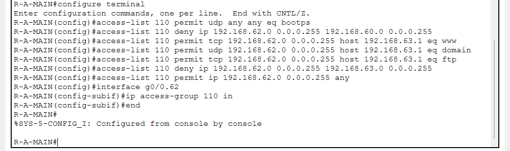

**R-A-BKP, the same commands:**

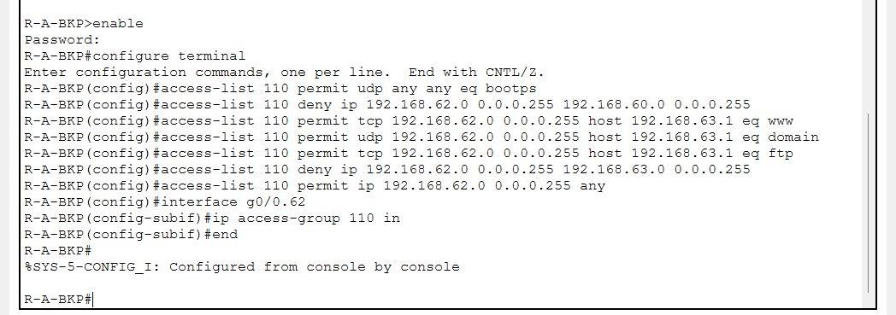

❓ **Why the first line?** A PC asking for DHCP has no address yet: it sends from 0.0.0.0, and no
other line allows that. We tested without it, on both routers: `ipconfig /renew` hangs.

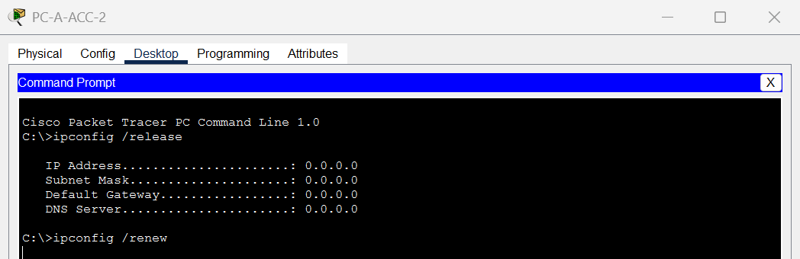

❓ **Why on both routers?** Each can be Active. We also tested on the main only, without the bootps line: DHCP still worked, because
the **backup** relayed the request. An ACL on one router is full of holes.

✅ From PC-A-ACC-2: management — blocked, ping to the server — blocked, internet — works, web — works.

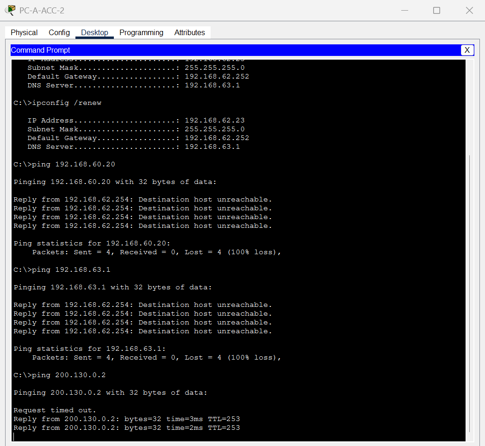

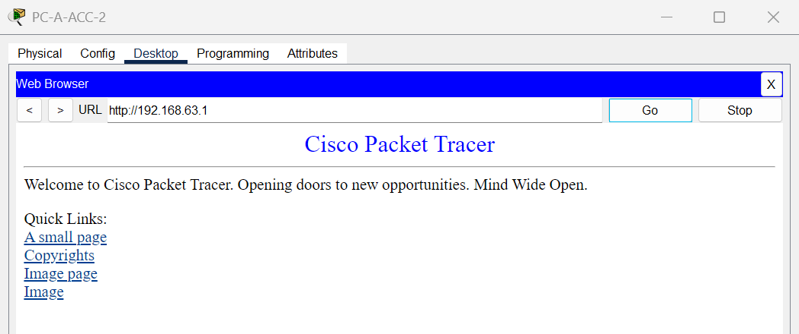

✅ R-A-MAIN: `show access-lists` → the matches count.

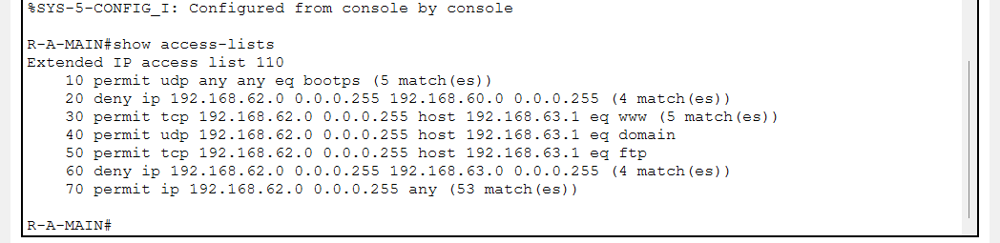

### 2.1 🔎 FTP connects, but `dir` hangs. Why?
From **PC-A-ACC-2**: `ftp 192.168.63.1`, user `ashdod`, password `Osem#Ftp`. Login works. Now `dir`:

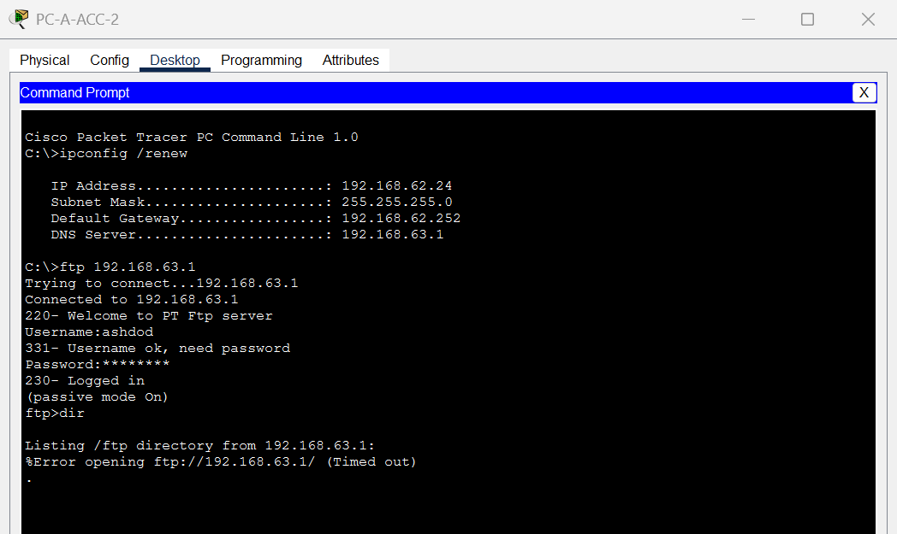

<details><summary>Answer</summary>

FTP uses **two** connections: commands on port 21, and data on another port. In *passive mode* the server chooses a high
port (above 1023) for the data. We opened only 21, so the data falls on the `deny ip ... 192.168.63.0` line.

</details>

The fix, on **R-A-MAIN and R-A-BKP**. Number 52 puts the line **before** the deny (60):
```
configure terminal
ip access-list extended 110
52 permit tcp 192.168.62.0 0.0.0.255 host 192.168.63.1 gt 1023
end
copy running-config startup-config
```

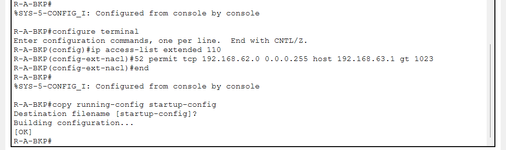

On R-A-MAIN, check with `show access-lists`:

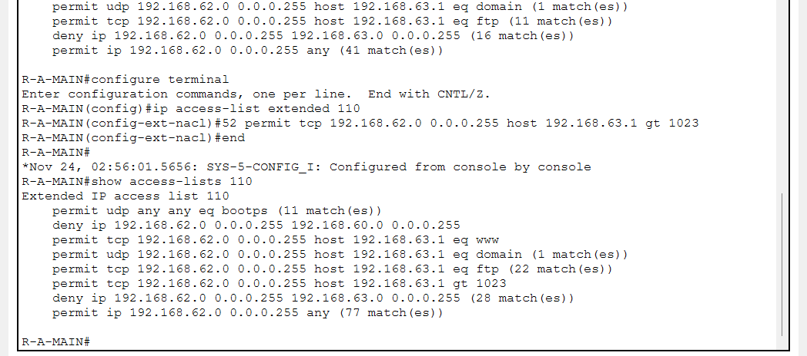

✅ From PC-A-ACC-3 the list arrives, and a ping to the server is still blocked. (`quit` leaves FTP.)

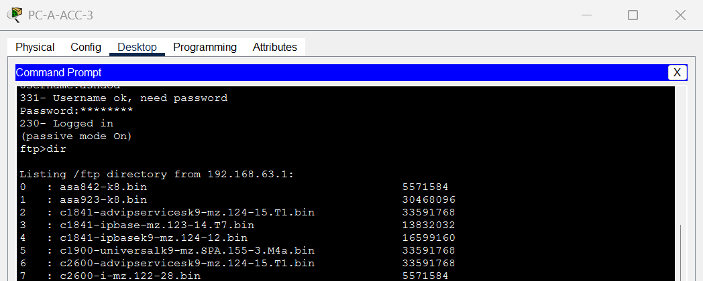

### 2.2 Eilat

❗ The same problem in Eilat: assembly reaches management. 💡 The same idea, one deny line.

**Eilat** (assembly 81 does not reach management 80), **R-E-MAIN and R-E-BKP**:
```
configure terminal
access-list 120 permit udp any any eq bootps
access-list 120 deny ip 192.168.81.0 0.0.0.255 192.168.80.0 0.0.0.255
access-list 120 permit ip 192.168.81.0 0.0.0.255 any
interface g0/0.81
ip access-group 120 in
end
copy running-config startup-config
```

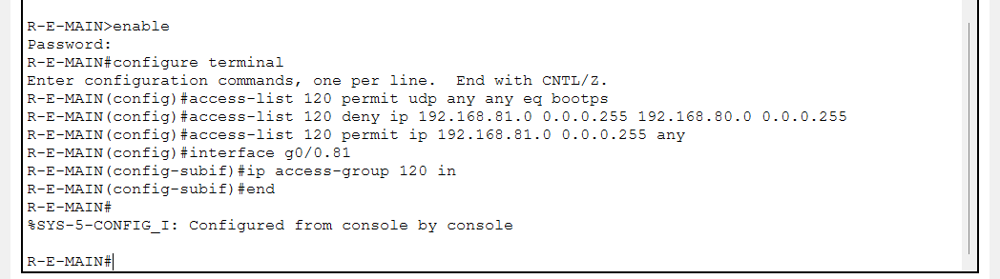

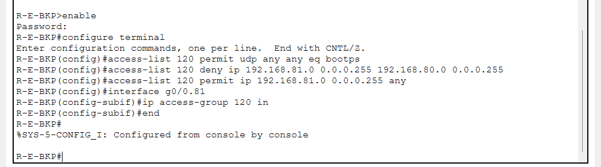

## Mission 3 — VPN Sakhnin ↔ Eilat
**🌐 The network now.** Sakhnin and Eilat, each behind NAT, with the internet in between:

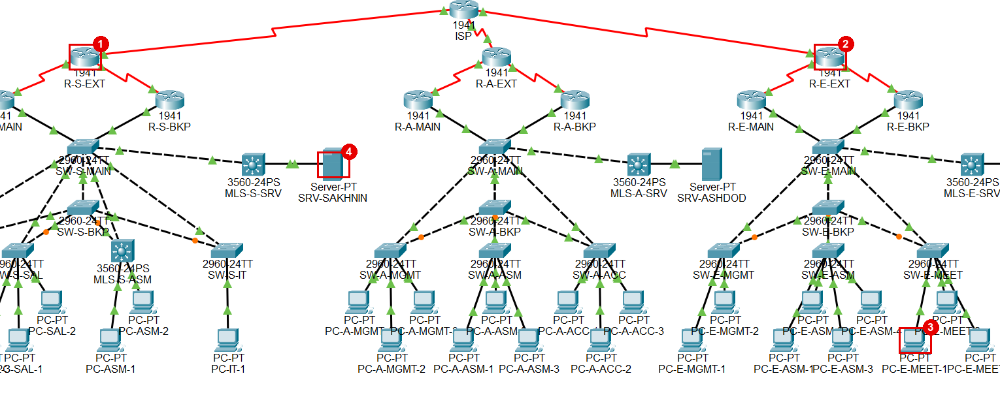

**❗ The problem.** An employee in Eilat needs the server in Sakhnin. PC-E-MEET-1 → `ping 192.168.50.1`:

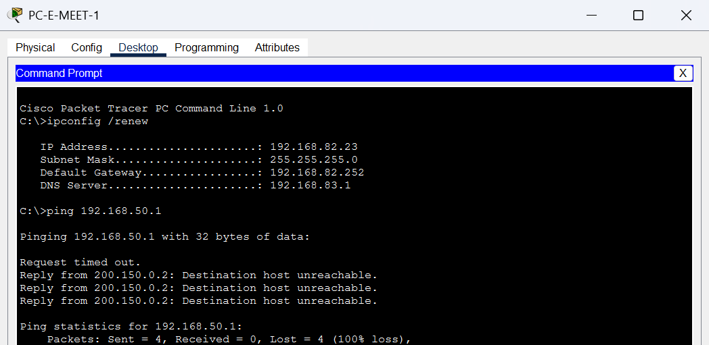

The provider doesn't know private addresses. And even if we published the server with static NAT, everything would travel **unencrypted** and everybody could try to get in.

**💡 The solution.** A site-to-site **IPsec VPN**: the private packet travels, encrypted, inside a public packet (1.2).

**📋 Do it in the project.** License → tunnel on both sides → test → find out why it fails → fix. The two sides must be a mirror image.

### 🖱 The solution: what to click and what to write
### 3.1 The license

❗ The router doesn't know the `crypto` commands. 💡 Activate the security license, save and restart.

On R-S-EXT try `crypto isakmp policy 10`. The 1941 doesn't know the command:

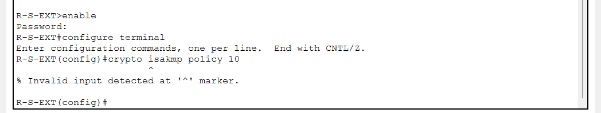

On **R-S-EXT and R-E-EXT**:
```
configure terminal
license boot module c1900 technology-package securityk9
```
⚠️ **Nothing was printed?** That happens in Packet Tracer when the router was restarted before. Write **the same command again**,
and now the agreement appears:

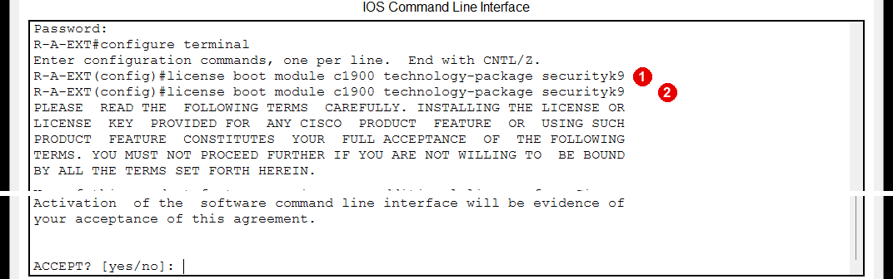

At `ACCEPT? [yes/no]:` answer `yes`. You must see `Next reboot level = securityk9`. Then:
```
end
copy running-config startup-config
reload
```

After `yes`, on R-E-EXT:

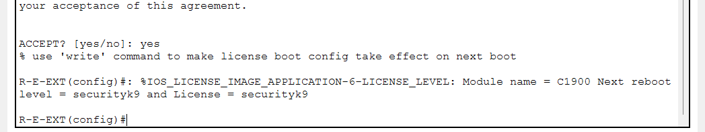

At `Proceed with reload? [confirm]` press **Enter**. The router restarts:

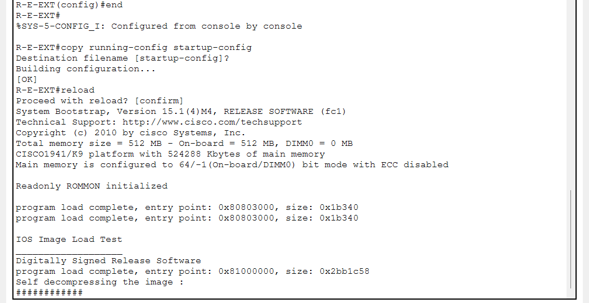

On R-E-EXT after the restart:

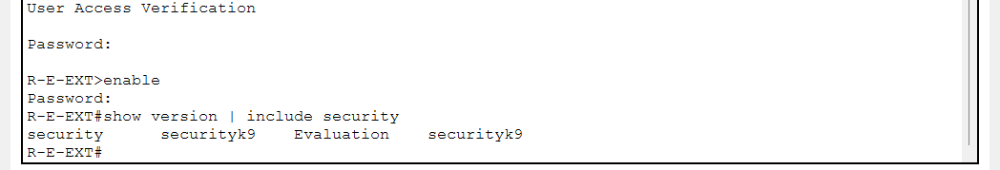

On R-S-EXT:


After the boot, log in again: `show version | include security` → `securityk9`

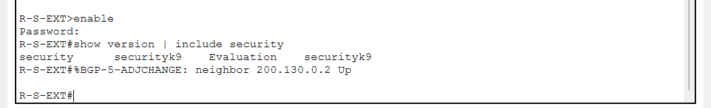

### 3.2 The tunnel

❗ The routers must agree on a language and recognise each other before they encrypt. 💡 Phase 1 (policy + key), phase 2 (transform-set), what enters the tunnel (ACL), and everything tied together in a crypto map on the outgoing port.

**R-S-EXT:**
```
configure terminal
crypto isakmp policy 10
encryption aes 256
hash sha
authentication pre-share
group 5
lifetime 86400
exit
crypto isakmp key OsemVpn2026 address 200.150.0.1
crypto ipsec transform-set VPN-SET esp-aes 256 esp-sha-hmac
ip access-list extended VPN-S-E
permit ip 192.168.0.0 0.0.63.255 192.168.80.0 0.0.3.255
exit
crypto map VPN-MAP 10 ipsec-isakmp
set peer 200.150.0.1
set transform-set VPN-SET
match address VPN-S-E
exit
interface s0/0/1
crypto map VPN-MAP
end
```
**R-E-EXT** (mirror image):
```
configure terminal
crypto isakmp policy 10
encryption aes 256
hash sha
authentication pre-share
group 5
lifetime 86400
exit
crypto isakmp key OsemVpn2026 address 200.130.0.1
crypto ipsec transform-set VPN-SET esp-aes 256 esp-sha-hmac
ip access-list extended VPN-E-S
permit ip 192.168.80.0 0.0.3.255 192.168.0.0 0.0.63.255
exit
crypto map VPN-MAP 10 ipsec-isakmp
set peer 200.130.0.1
set transform-set VPN-SET
match address VPN-E-S
exit
interface s0/0/0
crypto map VPN-MAP
end
```

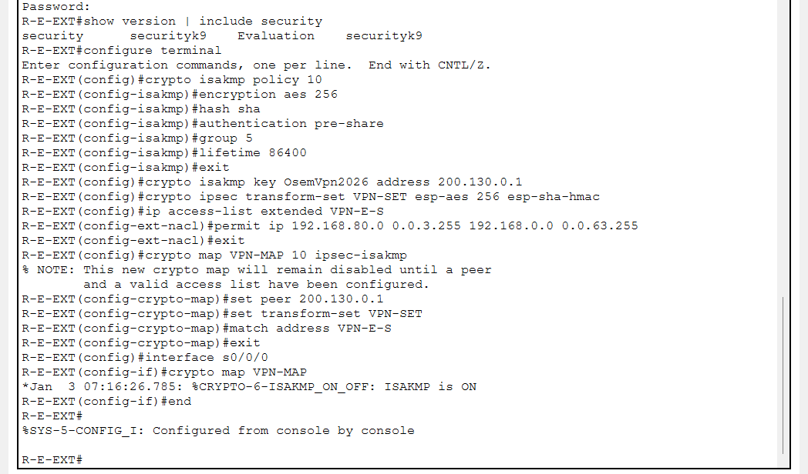

And R-S-EXT:

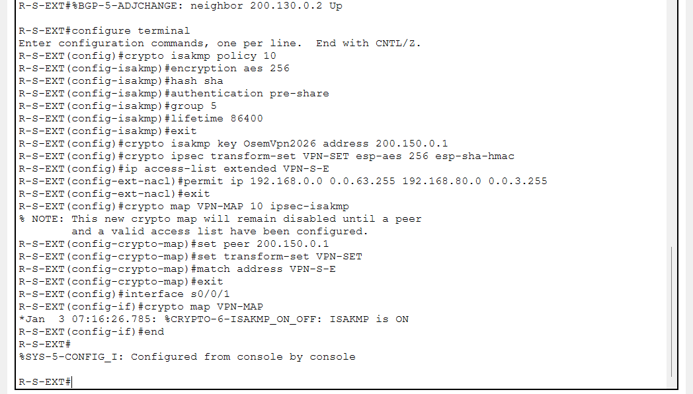

| Command | What it does |
|---|---|
| `crypto isakmp policy 10` | phase 1: must be identical on both sides |
| `crypto isakmp key` | the same key, with the **other side's** address |
| `transform-set` | how the data is encrypted in phase 2 |
| `match address` | what enters the tunnel; a mirror image on the other side |
| `crypto map` on the interface | turns it on, on the **outgoing** port |

⚠️ Use a key without `#`. In our tests a key with `#` never brought the tunnel up.

### 3.3 🔎 It doesn't work! Why?
**PC-E-MEET-1** → `ping 192.168.50.1`. "Destination host unreachable" from the **provider**:

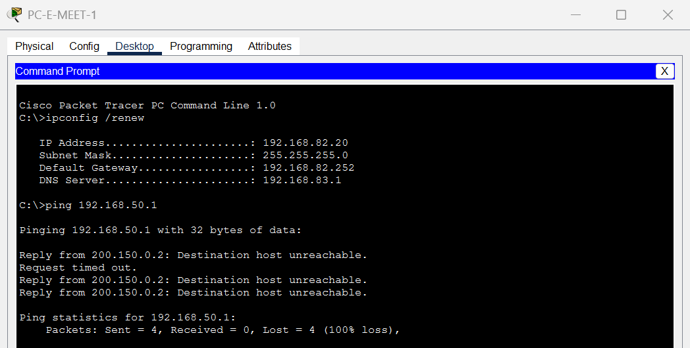

Let the class investigate on R-E-EXT: `show ip access-lists`, `show crypto isakmp sa`, `show ip nat translations`.

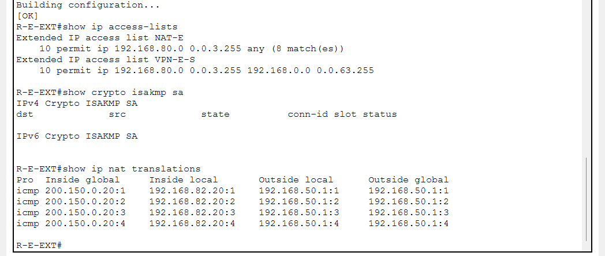

<details><summary>Answer</summary>

The VPN list has no matches, and the NAT list has 8. The router does **NAT before encryption**: the
source became 200.150.0.20, so the packet no longer fits the VPN list and went to the internet, where
nobody knows 192.168.50.1. The fix: tell the NAT **not** to translate traffic to the other branch. The
line must come **before** the permit, so we give it number 5.

</details>

### 3.4 The fix
**R-S-EXT:**
```
configure terminal
ip access-list extended NAT-S
5 deny ip 192.168.0.0 0.0.63.255 192.168.80.0 0.0.3.255
end
clear ip nat translation *
copy running-config startup-config
```
**R-E-EXT:**
```
configure terminal
ip access-list extended NAT-E
5 deny ip 192.168.80.0 0.0.3.255 192.168.0.0 0.0.63.255
end
clear ip nat translation *
copy running-config startup-config
```

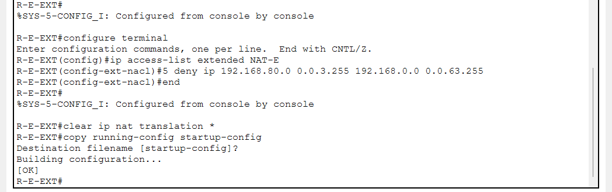

And on R-S-EXT:

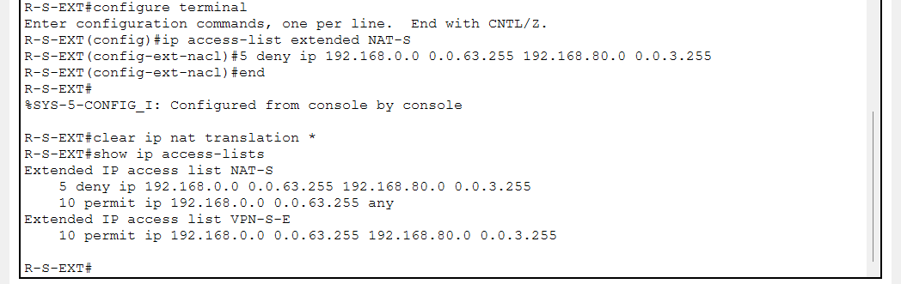

✅ Ping again, **from Eilat only**. The first reply may be lost while the tunnel goes up.

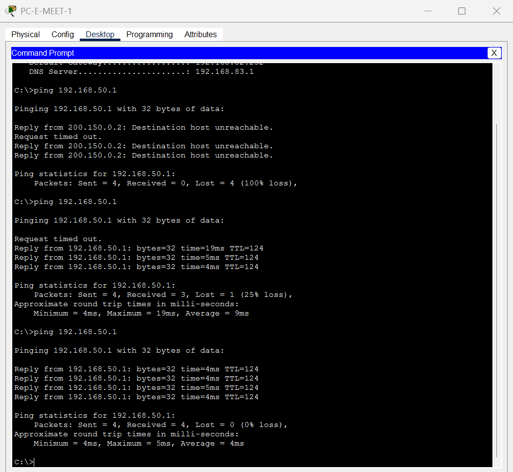

✅ R-E-EXT: `show crypto isakmp sa` → **QM_IDLE**, and `show crypto ipsec sa` → encaps and decaps rise.

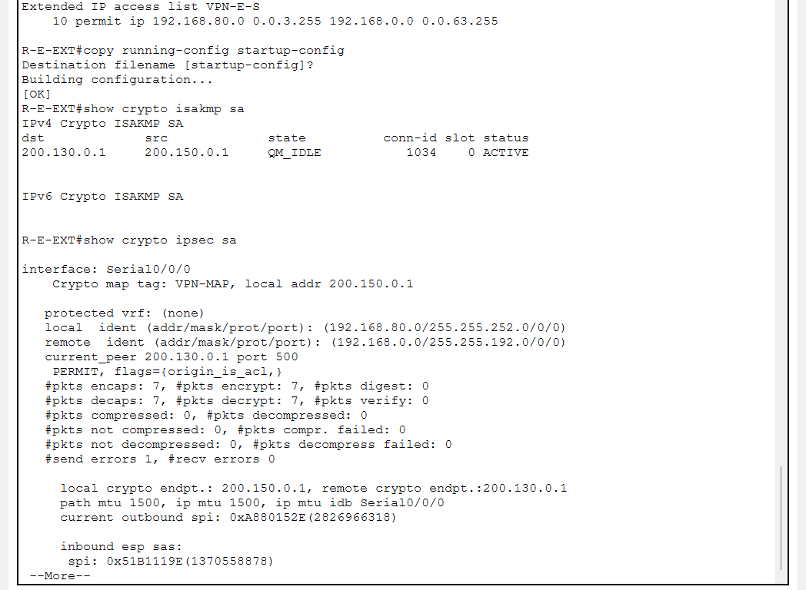

💡 Stuck? Restart the tunnel: on the outgoing port of **both** edge routers `no crypto map VPN-MAP` and then `crypto map VPN-MAP`,
and ping from one side only. (Real routers also have `clear crypto isakmp`; Packet Tracer doesn't.)

## Mission 4 — SSH, AAA, NTP and Syslog
**🌐 The network now.** The server is ready since Mission 1. Now the devices learn to use it:

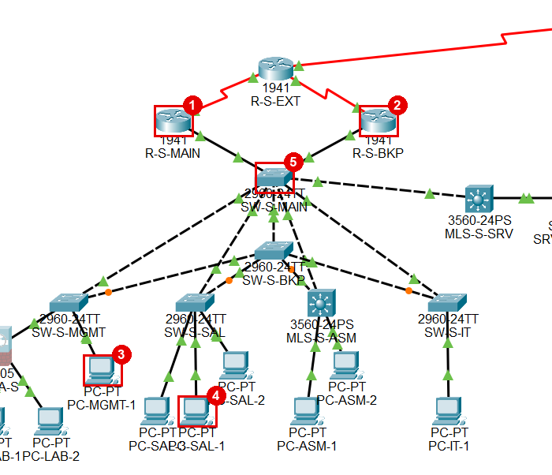

**❗ The problem.** PC-MGMT-1 → `telnet 192.168.10.254`. The router opens the line and closes it: no remote management at all. And if we only set a password, Telnet would send it **unencrypted**:

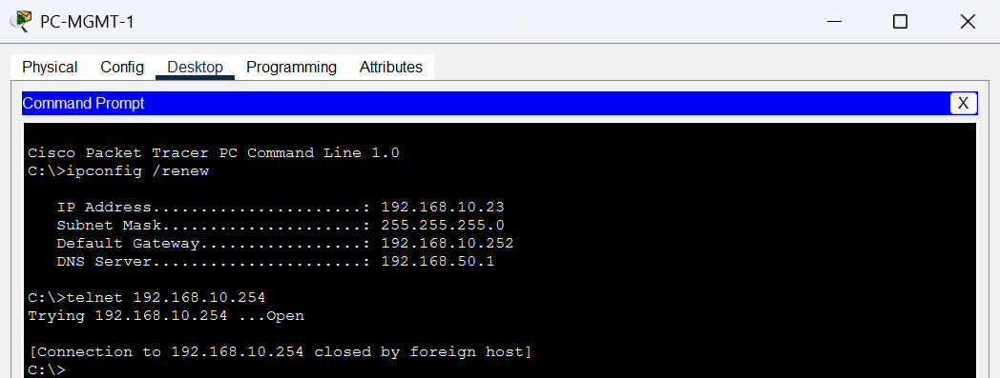

R-S-MAIN, `show clock`: the year is 1993, and NTP is off. Such a log proves nothing:

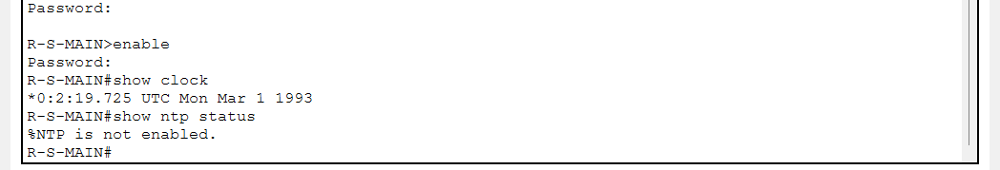

**💡 The solution.** SSH (encrypted), AAA (the user is checked on the server, with a local user as backup), NTP with a key, Syslog, and an access-class so that only management enters (1.3, 1.4).

**📋 Do it in the project.** The order matters: first a local user, and only then `aaa new-model`. Why?

### 🖱 The solution: what to click and what to write
### 4.1 R-S-MAIN, and the same on R-S-BKP
```
configure terminal
ip domain-name osem.com
username admin privilege 15 secret Osem#Adm1
crypto key generate rsa general-keys modulus 1024
ip ssh version 2
aaa new-model
tacacs-server host 192.168.50.1 key Osem#Aaa
aaa authentication login default group tacacs+ local
aaa authorization exec default group tacacs+ local
aaa authentication login CONSOLE local
line console 0
login authentication CONSOLE
exit
access-list 10 permit 192.168.10.0 0.0.0.255
line vty 0 4
transport input ssh
login authentication default
access-class 10 in
exit
ntp authentication-key 1 md5 Osem#Ntp
ntp authenticate
ntp trusted-key 1
ntp server 192.168.50.1 key 1
ntp update-calendar
logging host 192.168.50.1
service timestamps log datetime msec
end
copy running-config startup-config
```

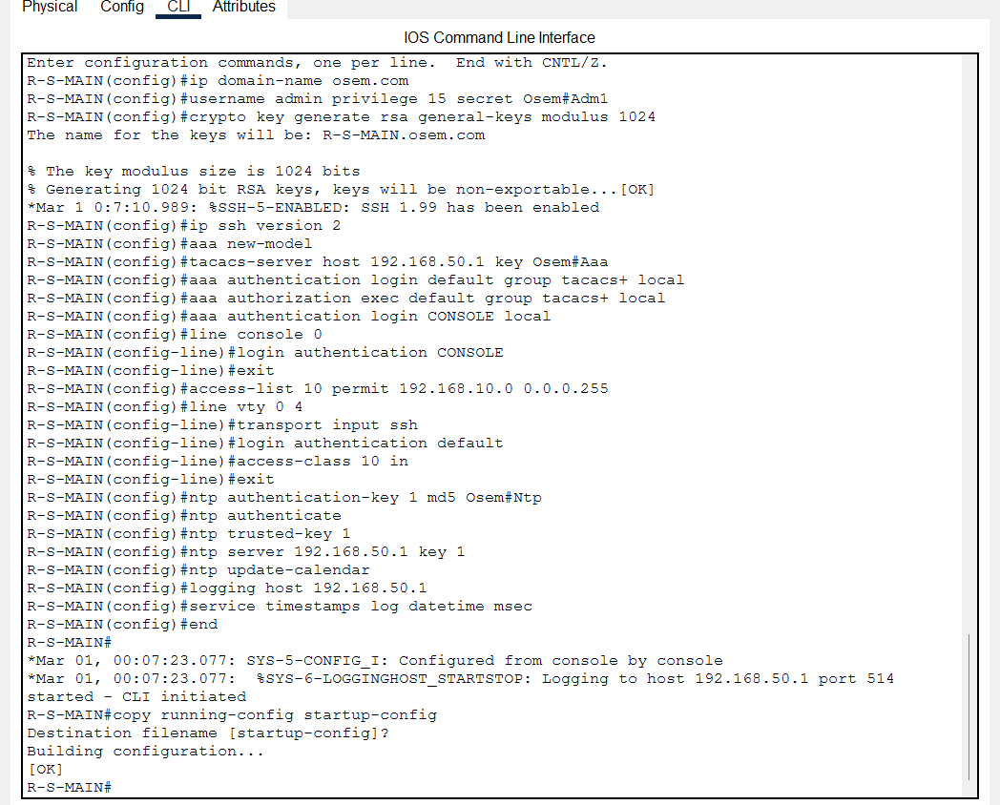


| Command | What it does | Why |
|---|---|---|
| `username admin` **before** `aaa new-model` | a local user | otherwise you lock yourself out |
| `crypto key generate rsa ... 1024` | keys for SSH | without them there is no SSH 2 |
| `group tacacs+ local` | first the server, and if it doesn't answer — the local user | so you're not stuck |
| `CONSOLE local` | the console uses the local user | you can always get in with the cable |
| `access-class 10 in` | only VLAN 10 manages | a standard ACL near the destination |
| `ntp trusted-key` + `key 1` | accepts time only from a signed server | |

⚠️ From now on the **console asks for a username**: `admin` / `Osem#Adm1`.

### 4.2 Test
1. **PC-MGMT-1**: `ssh -l osemuser 192.168.10.254`, password `Osem#User`, then `show users`. The user exists **only on the server**, so AAA works.

   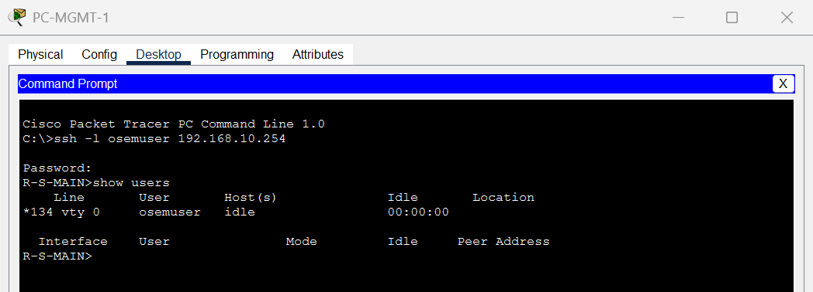
2. `exit`, and `telnet 192.168.10.254` → closed.

   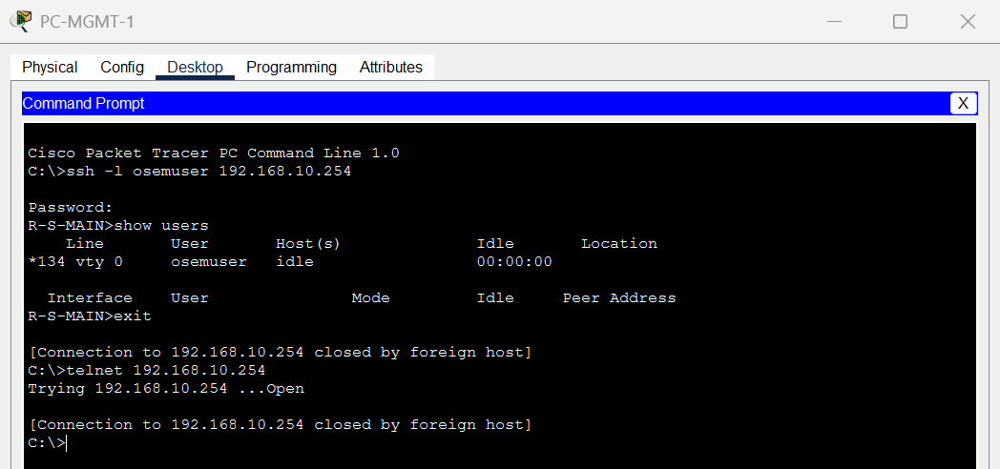
3. **PC-SAL-1**: `ssh -l osemuser 192.168.20.254` → **refused** (access-class).

   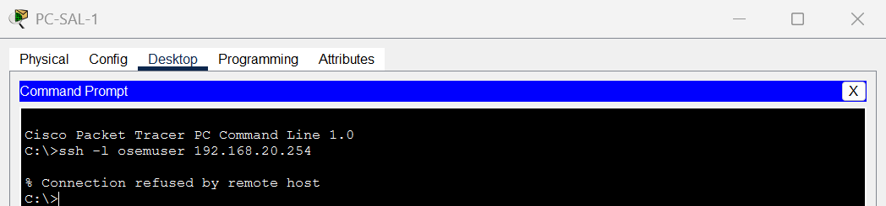
4. R-S-MAIN: `show ntp status` → **synchronized** (may take a few minutes).

   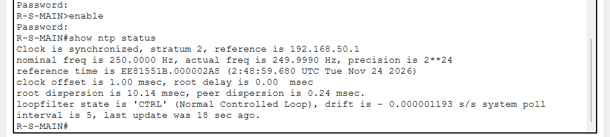
5. On R-S-MAIN: `interface g0/1` → `no shutdown` → `shutdown`. Server → SYSLOG: the messages arrived. Notice the jump of the date from 1993 to today: NTP!

   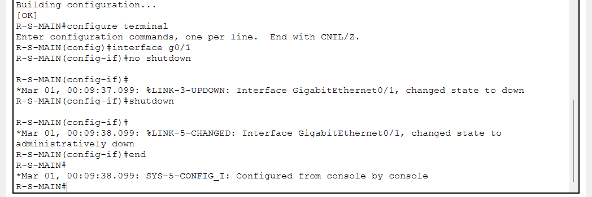

   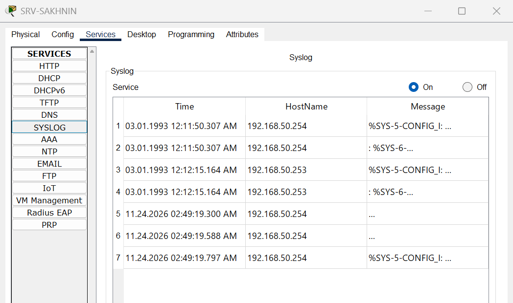

### 4.3 Ashdod and Eilat

❗ The same problem in two more branches. 💡 The same commands, each branch with **its own** server.

Ashdod uses **RADIUS**, Eilat **TACACS+**. The type must be the same on the router and on the server!

<details><summary>R-A-MAIN, R-A-BKP (paste the same on both)</summary>

```
configure terminal
ip domain-name osem.com
username admin privilege 15 secret Osem#Adm1
crypto key generate rsa general-keys modulus 1024
ip ssh version 2
aaa new-model
radius-server host 192.168.63.1 key Osem#Aaa
aaa authentication login default group radius local
aaa authorization exec default group radius local
aaa authentication login CONSOLE local
line console 0
login authentication CONSOLE
exit
line vty 0 4
transport input ssh
login authentication default
exit
ntp authentication-key 2 md5 Osem#Ntp
ntp authenticate
ntp trusted-key 2
ntp server 192.168.63.1 key 2
ntp update-calendar
logging host 192.168.63.1
service timestamps log datetime msec
end
copy running-config startup-config
```

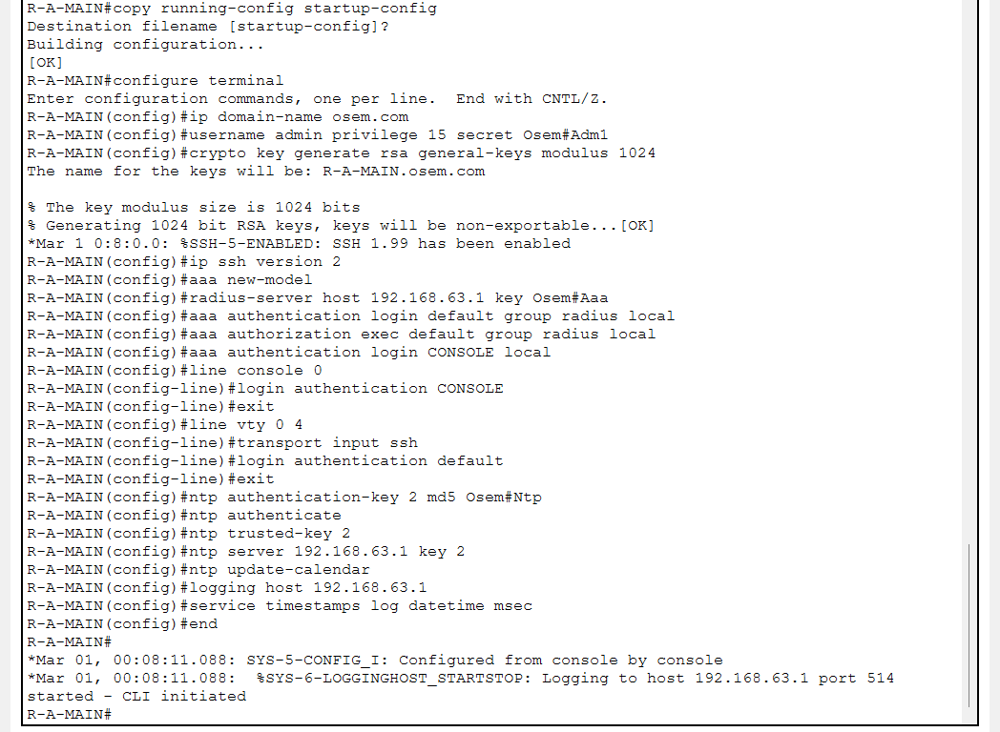

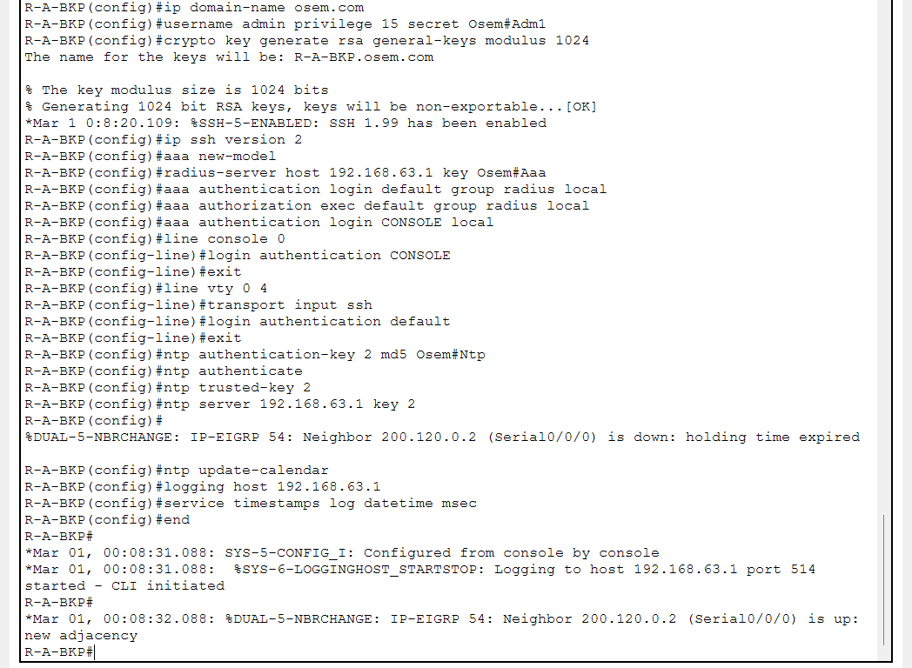

</details>

<details><summary>R-E-MAIN, R-E-BKP (paste the same on both)</summary>

```
configure terminal
ip domain-name osem.com
username admin privilege 15 secret Osem#Adm1
crypto key generate rsa general-keys modulus 1024
ip ssh version 2
aaa new-model
tacacs-server host 192.168.83.1 key Osem#Aaa
aaa authentication login default group tacacs+ local
aaa authorization exec default group tacacs+ local
aaa authentication login CONSOLE local
line console 0
login authentication CONSOLE
exit
line vty 0 4
transport input ssh
login authentication default
exit
ntp authentication-key 3 md5 Osem#Ntp
ntp authenticate
ntp trusted-key 3
ntp server 192.168.83.1 key 3
ntp update-calendar
logging host 192.168.83.1
service timestamps log datetime msec
end
copy running-config startup-config
```


</details>

### 4.4 Switches and edge routers (homework)

❗ A layer 2 switch has no IP address, so nobody can manage it from far away. 💡 An address on a VLAN interface, a gateway, and SSH with the local user.

The devices:

| Kind | Devices | The vty line |
|---|---|---|
| routers | ISP, R-S-EXT, R-A-EXT, R-E-EXT | `line vty 0 4` |
| switches, Sakhnin | SW-S-MAIN, SW-S-BKP, SW-S-MGMT, SW-S-SAL, SW-S-IT, MLS-S-ASM, MLS-S-SRV | `line vty 0 15` |
| switches, Ashdod | SW-A-MAIN, SW-A-BKP, SW-A-MGMT, SW-A-ASM, SW-A-ACC, MLS-A-SRV | `line vty 0 15` |
| switches, Eilat | SW-E-MAIN, SW-E-BKP, SW-E-MGMT, SW-E-ASM, SW-E-MEET, MLS-E-SRV | `line vty 0 15` |

**Each of the four routers:**
```
configure terminal
ip domain-name osem.com
username admin privilege 15 secret Osem#Adm1
crypto key generate rsa general-keys modulus 1024
ip ssh version 2
line vty 0 4
transport input ssh
login local
end
copy running-config startup-config
```

**Each of the 19 switches:**
```
configure terminal
ip domain-name osem.com
username admin privilege 15 secret Osem#Adm1
crypto key generate rsa general-keys modulus 1024
ip ssh version 2
line vty 0 15
transport input ssh
login local
end
copy running-config startup-config
```


A management address for the three main switches:

**SW-S-MAIN:**
```
configure terminal
interface vlan 10
ip address 192.168.10.240 255.255.255.0
no shutdown
exit
ip default-gateway 192.168.10.252
end
copy running-config startup-config
```

**SW-A-MAIN:**
```
configure terminal
interface vlan 60
ip address 192.168.60.240 255.255.255.0
no shutdown
exit
ip default-gateway 192.168.60.252
end
copy running-config startup-config
```

**SW-E-MAIN:**
```
configure terminal
interface vlan 80
ip address 192.168.80.240 255.255.255.0
no shutdown
exit
ip default-gateway 192.168.80.252
end
copy running-config startup-config
```


✅ `ssh -l admin 192.168.10.240`


## Mission 5 — The ASA firewall
**🌐 The network now.** A test lab (PC-LAB-1, PC-LAB-2) behind a firewall that is still not configured:


**❗ The problem.** The lab must reach the server, but nobody should reach **into** the lab. PC-LAB-1 → `ipconfig`, `ping 192.168.50.1`: no address and no network.


A router passes everything that isn't forbidden, so an ACL alone must list every danger.

**💡 The solution.** A firewall works the other way: from outside **everything** is forbidden unless it's an answer to somebody inside (security levels + `inspect`, 1.4).

**📋 Do it in the project.** inside = 100, outside = 0, default route to the VIP, NAT, DHCP for the lab, inspect for icmp, http, dns. Predict who can ping whom.

### 🖱 The solution: what to click and what to write
Click **ASA-S** → **CLI** → `enable` → **Enter** (there is no password):


**ASA-S** → CLI. `enable`, and just **Enter** at the password:
```
configure terminal
hostname ASA-S
interface Ethernet0/0
switchport access vlan 2
interface Ethernet0/1
switchport access vlan 1
interface Ethernet0/2
switchport access vlan 1
interface Vlan1
nameif inside
security-level 100
ip address 192.168.1.1 255.255.255.0
interface Vlan2
nameif outside
security-level 0
no ip address
ip address 192.168.10.15 255.255.255.0
exit
route outside 0.0.0.0 0.0.0.0 192.168.10.252
object network INSIDE-NET
subnet 192.168.1.0 255.255.255.0
nat (inside,outside) dynamic interface
end
```


```
configure terminal
no dhcpd auto_config outside
dhcpd address 192.168.1.10-192.168.1.30 inside
dhcpd dns 192.168.50.1
dhcpd enable inside
class-map inspection_default
match default-inspection-traffic
exit
policy-map global_policy
class inspection_default
inspect icmp
inspect http
inspect dns
exit
service-policy global_policy global
end
write memory
```


⚠️ In Packet Tracer `exit` from `object network` jumps straight to `#`, so here we use `end` and open `configure terminal` again.

✅ `show switch vlan` and `show interface ip brief`


✅ **PC-LAB-1** → IP Configuration → **DHCP** (1): 192.168.1.10 from the ASA. (In Packet Tracer the DNS may stay 0.0.0.0, so test with addresses.) Then `ping 192.168.50.1` works:


✅ Browse from PC-LAB-1 to `http://192.168.50.1`, and within 30 seconds on the ASA: `show xlate`


✅ **From outside in.** PC-MGMT-1 → `ping 192.168.1.10` fails. At first because the router doesn't know the network
("unreachable" from the provider). So that only the ASA decides, add **for the test** on R-S-MAIN:
`ip route 192.168.1.0 255.255.255.0 192.168.10.15`, and ping again: **timed out**, the ASA blocked it. Then remove it with `no ip route ...`.


| Command | What it does | Why |
|---|---|---|
| `nameif inside` / `outside` | gives the port a role | the ASA works with names, not with numbers |
| `security-level 100` / `0` | how much we trust the side | high → low is allowed |
| `route outside 0.0.0.0 0.0.0.0 192.168.10.252` | default route | one only, to the HSRP VIP |
| `object network` + `nat ... dynamic interface` | PAT through the outside port | the branch doesn't know 192.168.1.0 |
| `dhcpd address ... inside` | the ASA is a DHCP server | for the lab PCs |
| `inspect icmp` | remembers outgoing pings | otherwise the answers are blocked |

## 👀 See it happen — the ACL and the tunnel
Simulation was explained in [lesson 1](../lesson-01/).

### A. The ACL drops a packet
In Realtime check the address of PC-A-MGMT-2 (here 192.168.60.20). **Simulation** → only **ICMP** → ping it from
PC-A-ACC-1, and step until a red packet appears:


The red packet is the answer of R-A-MAIN. Now open the packet that **entered** R-A-MAIN → **Next Layer** twice, to layer 3:


Packet Tracer shows **the exact line** that blocked it. This is the best way to debug an ACL.

❓ All the Out Layers are empty. What does that mean?

<details><summary>Answer</summary>

The packet stopped here. It has no way out.

</details>

### B. The VPN hides the addresses
In Realtime: `ping 192.168.50.1` from PC-E-MEET-1 until it answers, so the tunnel is up. **Simulation** → **ICMP** and also
**IPSec** (tab Misc) → ping again, and open the packet in three places:

**R-E-EXT, the entrance to the tunnel:**


**ISP, in the middle of the internet:**


**R-S-EXT, the exit of the tunnel:**


| Where | Source | Destination | Do we see that it's ICMP? |
|---|---|---|---|
| Eilat | 192.168.82.25 | 192.168.50.1 | yes |
| the internet | **200.150.0.1** | **200.130.0.1** | **no** |
| Sakhnin | 192.168.82.25 | 192.168.50.1 | yes |


❓ Compare with lesson 4. What is the difference between this and NAT?

<details><summary>Answer</summary>

NAT **replaces** an address, and the rest of the packet can be read. The VPN puts the **whole** packet, encrypted, inside a new
packet, and the other side gets it back exactly as it was.

</details>

✏️ **Try:** ping 200.130.0.2 from PC-E-MEET-1. Does it go through the tunnel?

<details><summary>Answer</summary>

No. The destination isn't in the list of the tunnel, so it goes out with NAT as usual, and on the ISP we see ICMP.

</details>

## 🧯 It doesn't work?
| What you see | Probably | What to do |
|---|---|---|
| `renew` fails after an ACL | no bootps line, or only on one router | `show access-lists` on both |
| `crypto` → `Invalid input` | no licence, or no `reload` | `show version`, include security |
| the VPN doesn't come up | key, peer, or policy is different | compare the two configurations line by line |
| the tunnel is up, ping fails | NAT takes the packet | the `5 deny` line on both sides |
| SSH `Connection refused` | no RSA key, or access-class | `show ip ssh`, from VLAN 10 |
| locked out | AAA without a local user | console: `admin` / `Osem#Adm1` |
| NTP is not synchronized | the key, or too little time | the same key number on the server, wait 5 minutes |

---

## Final tests — the whole project
| Topic | Check | Correct result |
|---|---|---|
| VLAN / VTP | `show vlan brief`, `show vtp status` | the same VLANs in the branch |
| Trunk / STP | `show interfaces trunk`, `show spanning-tree` | the main switch is root |
| HSRP | `show standby brief` | Active / Standby, replaced on failure |
| DHCP / DNS / web / FTP / mail | from the PCs | everything works |
| DHCP snooping | `show ip dhcp snooping` | trusted ports |
| Port security | a strange MAC | err-disabled |
| OSPF / EIGRP | `show ip ospf neighbor`, `show ip eigrp neighbors` | FULL / two neighbors |
| BGP | `show ip route bgp` on an EXT router | `B` routes to the other branches |
| NAT | `show ip nat translations` | static, pool, PAT |
| VPN | `show crypto isakmp sa` | QM_IDLE |
| ACL | `show access-lists` | matches |
| SSH / AAA | `ssh -l osemuser` | in. Telnet is rejected |
| NTP / Syslog | `show ntp status`, server | synchronized, messages |
| ASA | `show xlate` | inside → outside works, the reverse doesn't |

Finally: save on all devices, save the file, **close Packet Tracer, open again** and check that everything was saved.

## 🔎 Find the bug — from a real project
1. The ACL was only on the backup router.
2. The router in Ashdod used RADIUS, and the server was set to TACACS.
3. `ip ssh version 1` and users with `password 0`.
4. The VPN encrypted only VLAN 10 ↔ VLAN 80, with no NAT exemption.
5. The ASA had three default routes, one of them to **inside**.

<details><summary>Answer</summary>

1. As long as the main router is Active the ACL does nothing.
2. They don't speak the same language, so login always falls back to the local user. The same type and key on both sides.
3. SSH 1 is broken, and password 0 is readable in `show run`. Create RSA keys first, then version 2 and `secret`.
4. Even if the tunnel comes up, NAT takes the packets. All the networks, plus the `deny` line in the NAT list.
5. One default route only, towards outside, to the HSRP **VIP**.

</details>

## 🏋 Exercises
1. On R-E-EXT replace the key with `Osem123` and restart the tunnel (`no crypto map VPN-MAP` and `crypto map VPN-MAP` on s0/0/0). Ping from Eilat. What does `show crypto isakmp sa` show now? Put it back.
2. Allow accounting (62) also `ping` to the server only. Where in the list must the line be?
3. Stop the AAA service on the server and connect by SSH with `admin`. Why does it work?

<details><summary>Answers (we tested them)</summary>

1. The ping fails, and instead of `QM_IDLE` you see `MM_KEY_EXCH ... (deleted)`: phase 1 stopped at the key. Without restarting the tunnel nothing changes, because the old tunnel keeps working! To return: `no crypto isakmp key Osem123 address 200.130.0.1`, the original key, and restart.

   
2. Before the deny of 63.0 (line 60): `ip access-list extended 110` → `55 permit icmp 192.168.62.0 0.0.0.255 host 192.168.63.1`. Remove it with `no 55`.
3. `osemuser` gets `Login invalid`, and `admin` enters: the server doesn't answer, so `local` is used. Put the service back On.

</details>

## 🎓 Explain it to the examiner
- Why must the order of the ACL lines be right? What is the invisible line?
- What are phase 1 and phase 2? What is "interesting traffic"?
- Why must VPN traffic be exempted from NAT?
- TACACS+ against RADIUS: three differences.
- What is the difference between the ASA and a router with an ACL? What does `inspect` do?

<details><summary>Model answers</summary>

1. The first match decides. At the end there is an invisible `deny ip any any`.
2. Phase 1: the routers authenticate (key) and build a protected channel. Phase 2: encrypts the data itself. Interesting traffic: what the ACL in `match address` permits.
3. NAT happens before encryption: the source changes, the packet no longer fits the VPN list, and it goes out unencrypted.
4. TCP 49 against UDP; encrypts everything against only the password; separates authentication and authorization, so it suits device management.
5. A firewall remembers connections (stateful) and has security levels. A regular ACL checks every packet by itself. `inspect` follows a protocol so that its answers may return.

</details>

## ✏️ Exit quiz (3 minutes)
1. An ACL has only one line: `deny ip host 1.1.1.1 any`. What passes?
2. Which state shows that phase 1 is OK?
3. Why must the local user exist before `aaa new-model`?
4. From inside (100) to outside (0): allowed or blocked?
5. Why does a log need NTP?

<details><summary>Answers</summary>

1. Nothing, because of the invisible deny.
2. QM_IDLE.
3. So you don't get locked out.
4. Allowed.
5. So that the times of all the devices can be compared.

</details>

## 🛠 Your own project
- [ ] Two extended ACLs and one standard, on **every** router that can be Active.
- [ ] A site-to-site VPN with NAT exemption, between the branches required in **your** proposal.
- [ ] SSH 2, AAA from the server, local backup user, NTP with a key, Syslog.
- [ ] ASA with inside/outside, NAT and DHCP.
- [ ] The final test table with a screenshot for every row, for the project book.

➡ Finished? Do the [final check](../from-zero/README.md#final-check): 14 tests that prove the project is complete.
