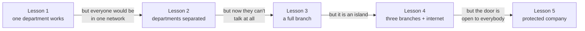

# Tesla — build a full 3-branch project, step by step

A complete final project (Tesla: Herzliya, Be'er Sheva, Haifa), built **click by click** in **5 lessons of
90 minutes**, with the theory behind each step. You work alone: every step has the explanation, what to
click, what to write, and a screenshot of what you must see.
Each lesson ends with **"Your project book"**: what to write and what to photograph while it is fresh.

## 📖 The story of the project
*This is a made-up story. The network is an example for learning, it is not the network of the real company.*

**How we got here.** In our story, Tesla sells and services electric cars. It started with one small office in **Herzliya**. Everybody sat in one room, shouted across it, and carried files on a USB stick. Then the company grew: departments, a server, a second branch in **Be'er Sheva**, a third in **Haifa**. Nobody planned the network; it was just cables. One morning the sales file was open on a computer in the car service hall, and the same day one broken cable stopped the whole building.

**Where you come in.** The manager hired **you**, the new network engineer. You get an empty Packet Tracer file and one sentence: *"Build us a network that is organized, that doesn't stop when something breaks, that connects the three branches, and that doesn't let strangers in."*

**What we want in the end.** Those four wishes are the whole project. Everything we type belongs to one of them:

| The manager's wish | In network language | Where |
|---|---|---|
| "Organized" | names, VLANs, addresses, DHCP, DNS | lessons 1–3 |
| "Doesn't stop when something breaks" | backup switch + STP, two routers + HSRP, two lines to the edge router | lessons 2, 3, 4 |
| "Connects the branches" | serial lines, OSPF, EIGRP, BGP, NAT | lesson 4 |
| "Doesn't let strangers in" | passwords, port security, DHCP snooping, ACL, VPN, SSH + AAA, ASA | all lessons, mostly 5 |

**The road.** Each chapter solves one problem and **discovers the next one**. That's why the order can't be changed:

| Chapter | We start with | The problem | What we build, and why it solves it | We end with | The new problem |
|---|---|---|---|---|---|
| [1](lesson-01/) | an empty file | three people can't share one file | a **switch**: it connects many devices and sends each frame only to its owner | Sales works | more departments = one big noisy network |
| [2](lesson-02/) | seven connected switches | everybody sees everybody | **VLANs** separate, **trunks** carry them, **STP** allows a backup road, **port security** guards the sockets | five separate departments | they can't talk at all, and addresses are typed by hand |
| [3](lesson-03/) | five islands in one building | no road between VLANs, no services | two **routers with HSRP** as the road, one **server** for addresses, names, web, files, mail | a complete branch | the branch can't reach the world |
| [4](lesson-04/) | three branches, three islands | red lines, no routes, private addresses | **serial lines**, **OSPF/EIGRP** inside, **BGP** to the provider, **NAT** at the exit | three branches on the internet | what can go out can also be attacked |
| [5](lesson-05/) | a working, open network | everything is allowed, everything is readable | **ACL** limits, **VPN** encrypts, **SSH + AAA** identify, **NTP + Syslog** remember, **ASA** blocks | the finished project | now explain it to an examiner |

In every lesson you will find **📖 The story** at the beginning and **⏭ What comes next** at the end. In every mission three lines do the same: 📖 how we got here, 🎯 what we want now, ⏭ what comes next. At the end of a mission, **📘 the commands explained** tells you what each line does and why it is there.

📘 **Forgot what a command does?** [All the commands of the project](commands/), explained.

| Lesson | Topic | File to open |
|---|---|---|
| [01](lesson-01/) | First department: devices, cables, names, passwords | a new file |
| [02](lesson-02/) | Herzliya switching: VLAN, VTP, trunks, STP, port security | [lesson02-start.pkt](lesson-02/lesson02-start.pkt) |
| [03](lesson-03/) | Herzliya routing and services: HSRP, DHCP, DNS, web, FTP, mail | [lesson03-start.pkt](lesson-03/lesson03-start.pkt) |
| [04](lesson-04/) | Connecting the branches: WAN, OSPF, EIGRP, BGP, NAT | [lesson04-start.pkt](lesson-04/lesson04-start.pkt) |
| [05](lesson-05/) | Security: ACL, VPN, SSH, AAA, NTP, Syslog, ASA | [lesson05-start.pkt](lesson-05/lesson05-start.pkt) |

🧱 **Want to build everything alone, without start files?** [From an empty file to the whole project](from-zero/): every device, cable and command that the start files do for you, and 14 tests at the end.

📝 **Practise for the exam:** [questions, missions, faults and three mock exams (PDF)](exam/tesla-exam-practice.pdf). Try first, and only then open the [answer key (PDF)](exam/tesla-answer-key.pdf).

🏁 **The finished project:** [tesla-final.pkt](tesla-final.pkt). Use it to **compare** with your file when something doesn't work, not instead of building.

The start file of each lesson is the result of the previous one, so if you got stuck you can always
go on. **Packet Tracer 9.0.1** is recommended: that is the version we tested with.

## What you find in every lesson
| Sign | What it is | How to use it |
|---|---|---|
| 📖 🎯 ⏭ | how we got here, what we want now, what comes next | read it, close the page, and tell it in your own words |
| 🌐 | the network now, with a numbered map | find the place on your screen. The numbers show which device to click |
| ❗ | the problem | see it happen on your screen **before** you solve it |
| 💡 | the solution, in words | after it, explain it aloud to somebody (or to the wall) |
| 📋 | do it yourself in the project | try 5 minutes, without looking down |
| 🖱 | the full solution: what to click, what to write, what you must see | compare screen to screenshot, step by step |
| 📘 | every command or field, explained | cover the right side and explain every line yourself |
| 💬 | the idea in simple words | read it before the definition |
| **Example** | a worked example with our addresses | solve it on paper, then compare, one row at a time |
| ❓ | a question to yourself | answer before you open the answer |
| ✅ | a check | don't continue before it is true on your screen |
| 👀 | see the packets move, in Simulation mode | guess where the packet goes, then click |
| 🧯 | "It doesn't work?" | look here first, then ask your teacher |
| 🔎 | find the bug | 3 minutes, no peeking |
| 🏋 | exercises, with answers | on another day, to check that you remember |
| 🎓 | examiner questions, with model answers | ask a friend or a parent to read the questions to you |
| ✏️ | exit quiz | 3 minutes at the end, on paper, book closed |

Every lesson has more material than 90 minutes: the missions are the core, and 🏋, 🎓 and ✏️ can wait for another day.

## The address plan
| Branch | VLAN | Name | Network | Gateway (VIP) |
|---|---|---|---|---|
| Herzliya | 12 | MANAGEMENT | 192.168.12.0/24 | .1 |
| Herzliya | 22 | SALES | 192.168.22.0/24 | .1 |
| Herzliya | 32 | SERVICE | 192.168.32.0/24 | .1 |
| Herzliya | 42 | IT | 192.168.42.0/24 | .1 |
| Herzliya | 52 | SERVERS | 192.168.52.0/24 | .1 |
| Be'er Sheva | 64–67 | 67 = servers | 192.168.64–67.0/24 | .1 |
| Haifa | 96–99 | 99 = servers | 192.168.96–99.0/24 | .1 |

In every network .2 is the main router and .3 the backup. The WAN table is in lesson 4.

## The passwords of the project
| Where | Value |
|---|---|
| Console / enable | `Tesla#Con` / `Tesla#En1` |
| After lesson 5, console of the main and backup routers | `admin` / `Tesla#Adm1` |

These are practice passwords that everybody can read here. Never use them in a real network.
