# From an empty file to the whole project

> 🧰 Packet Tracer 9.0.1 · 🏠 at home, at your own speed · 💾 your own file: `tesla-full.pkt`

The five lessons have **start files**, so you can begin at any lesson without placing 60 devices. This page is for a student who wants to
build **everything alone**: it contains every step that the start files do for you. Together with the five lessons it is the
complete project.

| Do this | Then you have |
|---|---|
| Lesson 1 | 2 switches and 3 PCs |
| **[Part A](#part-a--the-rest-of-herzliya)** | the same as `lesson02-start.pkt` |
| Lesson 2 | the switching of Herzliya |
| **[Part B](#part-b--two-routers-for-herzliya)** | the same as `lesson03-start.pkt` |
| Lesson 3 | a full branch |
| **[Part C](#part-c--the-provider-beer-sheva-and-haifa)** | the same as `lesson04-start.pkt` |
| Lesson 4 | three connected branches |
| **[Part D](#part-d--the-firewall-and-the-servers-of-beer-sheva-and-haifa)** | the same as `lesson05-start.pkt` |
| Lesson 5, and the **[final check](#final-check)** | the finished project |

**Three rules.** (1) Names exactly as written. (2) Ports exactly as in the tables: all the commands depend on them.
(3) After every mission: `copy running-config startup-config` on each device you touched, and **File → Save** (Ctrl+S). Packet Tracer sometimes closes by itself, so save often.

✔️ **Tested.** All the commands and the server forms on this page and in the five lessons were typed, one after the other, into factory-empty devices.
The result was identical to the finished project (30 of 30 configured devices, 3 servers), and the 14 tests of the [final check](#final-check) were run on the finished file and passed.
The building tables were checked too, line by line against the finished project: all 60 devices, 14 HWIC cards and 72 cables are identical, including the DCE side of the nine serial lines. This is what it looks like when everything is placed and cabled:

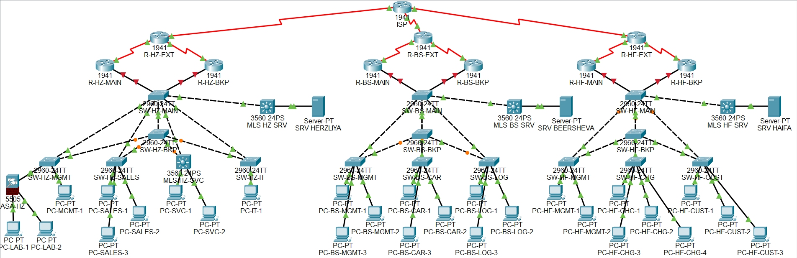

**How every mission is built:** 🌐 the network now → ❗ the problem → 💡 the solution → 📋 do it yourself → 🖱 the full solution.

The whole project, when it's finished:

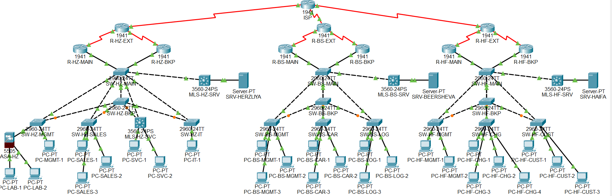

## 📖 The story — the parts the start files hide
**How we got here.** Each lesson begins with a file where somebody already connected new devices. That saves time, but in the real world **nobody does it for you**. This page tells the missing part of the story.

**What we want.** Your own file, from empty to finished, without a single step that appears by magic.

| Part | What happened in the story | What you build | So that |
|---|---|---|---|
| A | the other departments asked to join | five switches, a server, four PCs | lesson 2 has departments to separate |
| B | departments can't talk, so routers were bought | two routers with serial cards | lesson 3 has a road to build |
| C | the company opened Be'er Sheva and Haifa | two complete branches, a provider, nine lines | lesson 4 has islands to connect |
| D | a test lab was added, and the security plan began | a firewall, two PCs, users on two servers | lesson 5 has something to protect |

---

# Part A — the rest of Herzliya

*After lesson 1, before lesson 2. Continue in the file you saved in lesson 1.*

## A1 — Place the devices
**📖 How we got here.** Sales works (lesson 1), and the other departments want the same.

**🌐 The network now.** SW-HZ-MAIN, SW-HZ-SALES and three PCs, from lesson 1.

**❗ The problem.** The branch has five networks (four kinds of departments and the servers), and you have one department.

**🎯 What we want now.** All the devices of the branch on the table, with the names of our plan.

**💡 The solution.** A switch for each department, a backup switch, a switch for the server, and the server itself. Service and the servers get a **3560**: a multilayer switch.

**📋 Do it in the project.** Place the devices of the table and give them these names.

### 🖱 The solution: what to click and what to write
1. **Network Devices** (1) → **Switches** (2) → **2960** (3) or **3560-24PS** (4; not the 3650 next to it), and click on the workspace.

   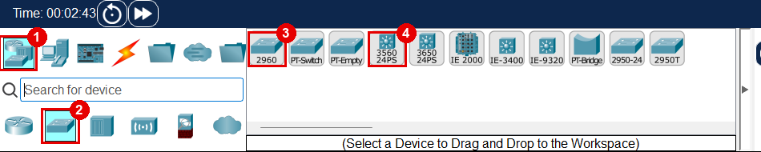
2. For the PCs and the server: **End Devices** (1) → **PC** (2) or **Server** (3).

   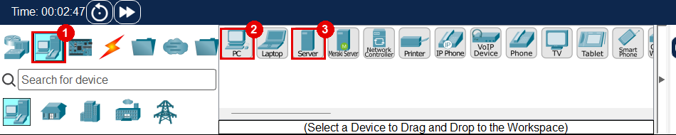
3. Rename every device like in lesson 1: click it → **Config** → **Display Name**.

| Name | Model |
|---|---|
| SW-HZ-BKP | 2960 |
| SW-HZ-IT | 2960 |
| SW-HZ-MGMT | 2960 |
| MLS-HZ-SVC | 3560-24PS |
| MLS-HZ-SRV | 3560-24PS |
| SRV-HERZLIYA | Server |
| PC-SVC-1 | PC |
| PC-SVC-2 | PC |
| PC-IT-1 | PC |
| PC-MGMT-1 | PC |

Arrange them like this. The label at each end of a cable is the port (for the next mission). A dashed line is a cross-over cable:

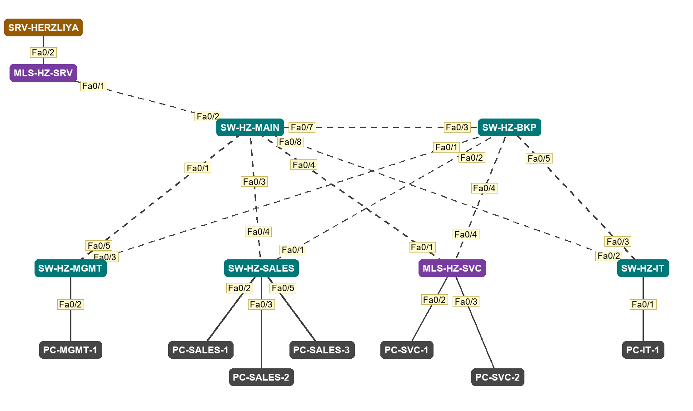

**⏭ What comes next.** Devices alone are furniture. Next we connect them.

## A2 — The cables
**📖 How we got here.** Fifteen devices stand in Herzliya, and only Sales is connected.

**🌐 The network now.** Devices without cables.

**❗ The problem.** In lesson 2 every command names a port. A cable in another port = a VLAN on the wrong device.

**🎯 What we want now.** Two roads up from each department, in exactly the ports of the plan.

**💡 The solution.** A port table. Every department switch has **two** uplinks: one to the main switch and one to the backup.

**📋 Do it in the project.** Connect by the table. Say aloud for each row: straight-through or cross-over, and why?

### 🖱 The solution: what to click and what to write
**Connections** (1) → **Copper Straight-Through** (2) or **Copper Cross-Over** (3) → click the first device and choose its port → click the second device and choose its port.

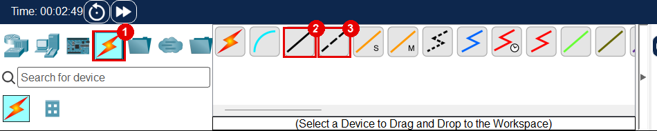

| # | Cable | First device | Port | Second device | Port |
|---|---|---|---|---|---|
| 1 | Cross-Over | SW-HZ-MAIN | Fa0/1 | SW-HZ-MGMT | Fa0/5 |
| 2 | Cross-Over | SW-HZ-MAIN | Fa0/2 | MLS-HZ-SRV | Fa0/1 |
| 3 | Cross-Over | SW-HZ-MAIN | Fa0/4 | MLS-HZ-SVC | Fa0/1 |
| 4 | Cross-Over | SW-HZ-MAIN | Fa0/7 | SW-HZ-BKP | Fa0/3 |
| 5 | Cross-Over | SW-HZ-MAIN | Fa0/8 | SW-HZ-IT | Fa0/2 |
| 6 | Cross-Over | SW-HZ-BKP | Fa0/1 | SW-HZ-MGMT | Fa0/3 |
| 7 | Cross-Over | SW-HZ-BKP | Fa0/2 | SW-HZ-SALES | Fa0/1 |
| 8 | Cross-Over | SW-HZ-BKP | Fa0/4 | MLS-HZ-SVC | Fa0/4 |
| 9 | Cross-Over | SW-HZ-BKP | Fa0/5 | SW-HZ-IT | Fa0/3 |
| 10 | Straight-Through | SW-HZ-IT | Fa0/1 | PC-IT-1 | Fa0 |
| 11 | Straight-Through | SW-HZ-MGMT | Fa0/2 | PC-MGMT-1 | Fa0 |
| 12 | Straight-Through | MLS-HZ-SVC | Fa0/2 | PC-SVC-1 | Fa0 |
| 13 | Straight-Through | MLS-HZ-SVC | Fa0/3 | PC-SVC-2 | Fa0 |
| 14 | Straight-Through | MLS-HZ-SRV | Fa0/2 | SRV-HERZLIYA | Fa0 |

✅ After about a minute: green, and some links orange on one side. That is STP blocking a loop, and it's correct.

**⏭ What comes next.** Everything is connected, and five switches are open to anyone.

## A3 — Base configuration of five switches
**📖 How we got here.** In lesson 1 we locked two switches. Five new ones are still open.

**🌐 The network now.** SW-HZ-MAIN and SW-HZ-SALES were configured in lesson 1. Five new switches are still called `Switch` and have no password.

**❗ The problem.** Anyone with a console cable enters, and you can't see which switch you're on.

**🎯 What we want now.** The same name, password and banner on every switch. Nothing new, and that is the point: a standard.

**💡 The solution.** The block of lesson 1, with one line changed: `hostname`.

**📋 Do it in the project.** Configure SW-HZ-BKP, SW-HZ-MGMT, SW-HZ-IT, MLS-HZ-SVC, MLS-HZ-SRV. Try the first one from memory.

### 🖱 The solution: what to click and what to write
Click the switch → **CLI** → **Enter** until `Switch>` appears. Write the block of **SW-HZ-BKP** (at `Destination filename` press Enter):

```
enable
configure terminal
hostname SW-HZ-BKP
no ip domain-lookup
enable secret Tesla#En1
service password-encryption
banner motd # Tesla - Authorized access only #
line console 0
password Tesla#Con
login
logging synchronous
exec-timeout 10 0
end
copy running-config startup-config
```

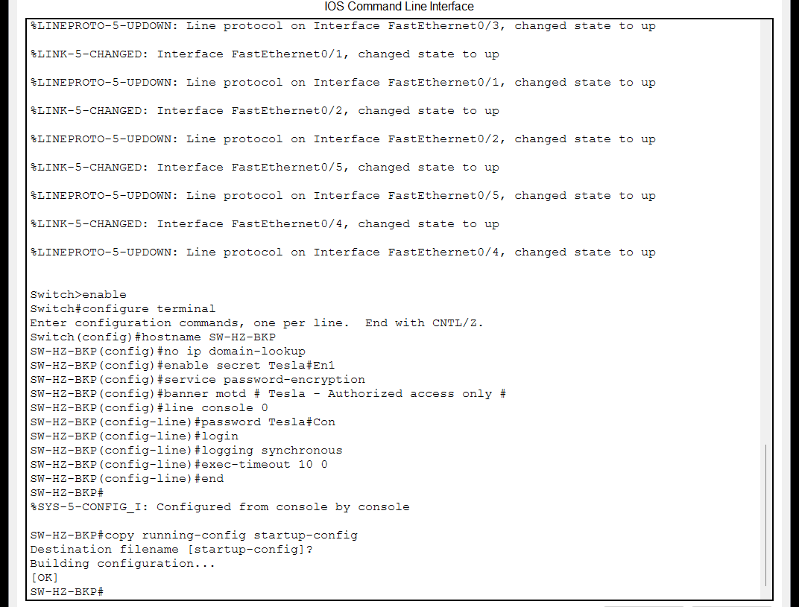

For the other four, the same block. Only one line changes:

| Device | The line that changes |
|---|---|
| SW-HZ-MGMT | `hostname SW-HZ-MGMT` |
| SW-HZ-IT | `hostname SW-HZ-IT` |
| MLS-HZ-SVC | `hostname MLS-HZ-SVC` |
| MLS-HZ-SRV | `hostname MLS-HZ-SRV` |

⚠️ The **3560** (MLS-…) starts with a question, like a router: `Would you like to enter the initial configuration dialog? [yes/no]:`. Write `no`, press Enter, and Enter again until `Switch>`. After that it takes exactly the same commands:

⚠️ **Or you see `(config)#` and no question.** Opening the **Config** tab (to change the name) answers the question and enters configuration mode by itself. Write `end` and press Enter, and then write the block from its first line. The same is true for every switch and router:

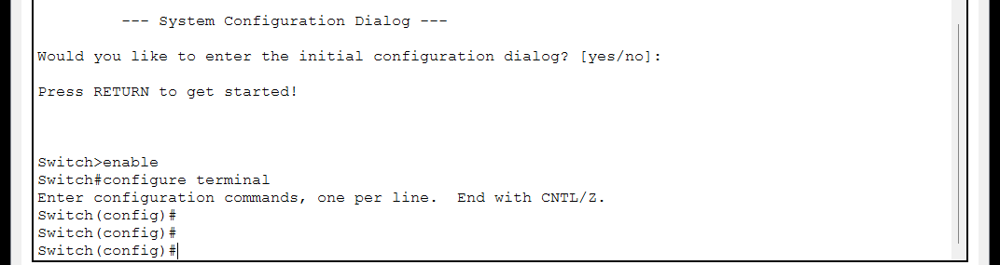

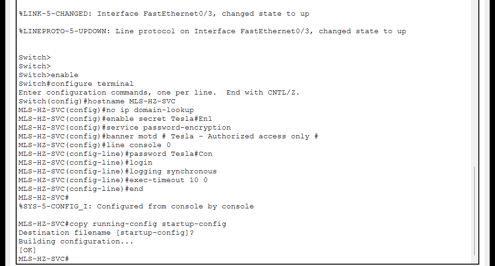

<details><summary><b>📘 The commands of this mission, explained</b></summary>

| Command | What it does, and why it is here |
|---|---|
| `enable` | From looking (`>`) to managing (`#`). This is where the enable password is asked for. |
| `hostname SW-HZ-BKP` | Gives the device its name, the one you see in the prompt. It prevents typing on the wrong device. |
| `no ip domain-lookup` | A typing mistake is not looked up as a name in DNS, so you don't wait after every typo. |
| `enable secret Tesla#En1` | The password for `#`, stored as a hash (not readable). |
| `service password-encryption` | Hides the other passwords in `show run`. Weak, but better than plain text. |
| `banner motd # Tesla - Authorized access only #` | A warning shown before login. The `#` signs mark where the text starts and ends. |
| `line console 0` | Enters the settings of the console port (the blue cable / the CLI tab). |
| `password Tesla#Con` | The password of this line. |
| `login` | "Ask for the password". Without it the password exists and nobody is asked. |
| `logging synchronous` | System messages don't cut the line you are writing. |
| `exec-timeout 10 0` | Logs out after this many minutes and seconds without typing (10 minutes, 0 seconds). |
| `copy running-config startup-config` | Saves what is in memory to the startup file. Without it a power failure erases the work. |

</details>

**⏭ What comes next.** The switches are ready. Four PCs still have no address.

## A4 — Addresses of the PCs
**📖 How we got here.** The switches are locked, and only Sales has addresses.

**🌐 The network now.** Only the Sales PCs have addresses (lesson 1).

**❗ The problem.** In lesson 2 we show which PCs can talk and which can't. A PC without an address proves nothing.

**🎯 What we want now.** A temporary address for each PC, in the network of its future VLAN.

**💡 The solution.** A fixed address for every PC, in the network of its future VLAN. In lesson 3 they change to DHCP.

**📋 Do it in the project.** Give the four new PCs an address. Which PCs can ping each other now? Why?

### 🖱 The solution: what to click and what to write
PC → **Desktop** → **IP Configuration** → **Static**, like in lesson 1. The gateway stays empty.

| PC | IPv4 Address | Subnet Mask |
|---|---|---|
| PC-MGMT-1 | 192.168.12.21 | 255.255.255.0 |
| PC-SVC-1 | 192.168.32.21 | 255.255.255.0 |
| PC-SVC-2 | 192.168.32.22 | 255.255.255.0 |
| PC-IT-1 | 192.168.42.21 | 255.255.255.0 |

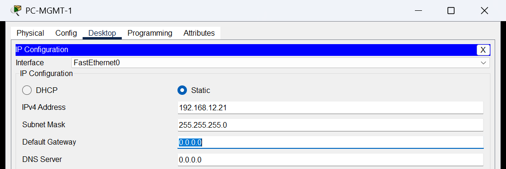

✅ From PC-SVC-1: `ping 192.168.32.22` works, and `ping 192.168.42.21` fails (another network, and there is no router yet).

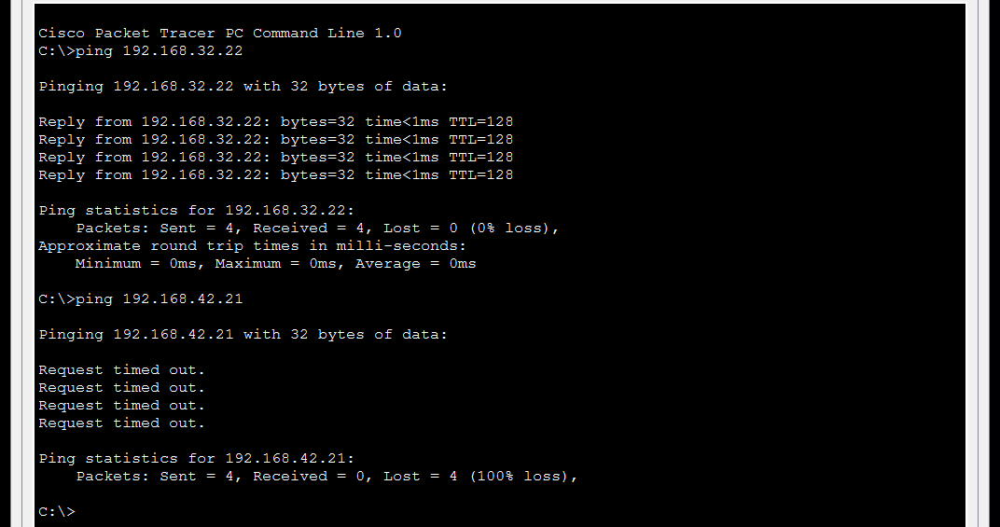

<details><summary><b>📘 The form, field by field</b></summary>

| Field or click | What it is, and why |
|---|---|
| **Static**, IPv4 Address, Subnet Mask | As in lesson 1, Mission 5. Each PC already gets the network of its **future** VLAN, so in lesson 2 we'll see the separation. |

</details>

<details><summary><b>📘 The commands of this mission, explained</b></summary>

| Command | What it does, and why it is here |
|---|---|
| `ping 192.168.32.22` | Sends 4 test messages. Replies = the road works in **both** directions. |

</details>

**⏭ What comes next.** Everyone is connected to everyone. Lesson 2 separates them.

➡ Now do **[lesson 2](../lesson-02/)** in your file.

---

# Part B — two routers for Herzliya

*After lesson 2, before lesson 3.*

## B1 — Place two routers and add a serial card
**📖 How we got here.** Lesson 2 built walls, and now no department can talk to another.

**🌐 The network now.** Five VLANs, switched and protected. Nothing routes between them.

**❗ The problem.** We need two routers, and later a serial line to the internet. A new 1941 has two Ethernet ports and **no serial port**.

**🎯 What we want now.** Two routers (one is for backup), with a card for the internet line that comes in lesson 4.

**💡 The solution.** Two **1941** routers, each with an **HWIC-2T** card: two serial ports. A card goes in only when the power is **off**.

**📋 Do it in the project.** Place R-HZ-MAIN and R-HZ-BKP, and put one HWIC-2T in the **right** slot of each.

### 🖱 The solution: what to click and what to write
1. **Network Devices** (1) → **Routers** (2) → **1941** (3). Names: `R-HZ-MAIN`, `R-HZ-BKP`.

   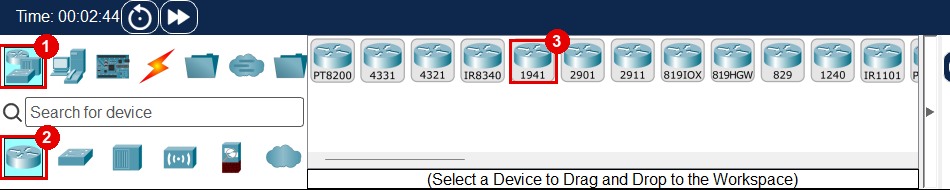
2. Click the router → **Physical** tab. Click the **power switch** (1): its green light goes off.
3. Drag **HWIC-2T** (2) from the list to the **right** slot (3). Press the mouse button on the name **HWIC-2T**, keep it pressed until you are above the black slot, and release.
4. Click the power switch (1) again: the light is green.

   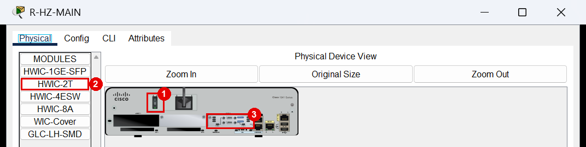

⚠️ The **right** slot is slot 0: its ports are `S0/0/0` and `S0/0/1`. The left slot is slot 1: `S0/1/0` and `S0/1/1`. A card in the
wrong slot = the serial commands of lesson 4 are rejected.

**⏭ What comes next.** The routers stand on the table. We connect them to the main switch.

## B2 — Cables and base configuration
**📖 How we got here.** Two routers with cards, connected to nothing.

**🌐 The network now.** Two routers that are connected to nothing.

**❗ The problem.** A new router doesn't start with `Router>` but with a **question**. Answer `yes` and you're in a long questionnaire.

**🎯 What we want now.** A cable from each one to the main switch, and the same locks as on the switches.

**💡 The solution.** Answer `no`, and write the base block.

**📋 Do it in the project.** Connect both routers to SW-HZ-MAIN and configure. Which cable goes between a router and a switch?

### 🖱 The solution: what to click and what to write
| # | Cable | First device | Port | Second device | Port |
|---|---|---|---|---|---|
| 1 | Straight-Through | R-HZ-BKP | G0/0 | SW-HZ-MAIN | Fa0/5 |
| 2 | Straight-Through | R-HZ-MAIN | G0/0 | SW-HZ-MAIN | Fa0/6 |

The triangles stay **red**: router ports are off until `no shutdown` (lesson 3).

Click **R-HZ-MAIN** → **CLI**. At `Would you like to enter the initial configuration dialog? [yes/no]:` write `no` and press Enter. Press Enter again until `Router>`:

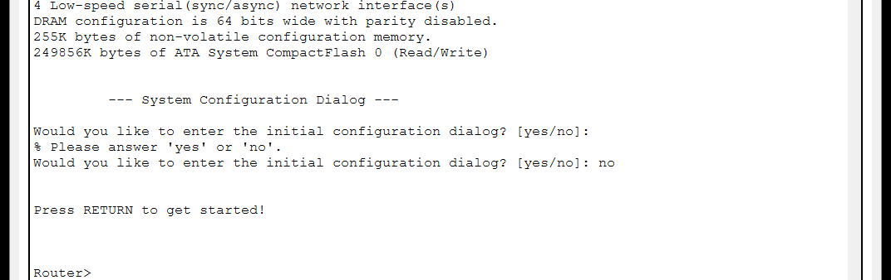

No question, but `Router(config)#`? You opened the **Config** tab after the power was turned on. Write `end`, press Enter, and continue with the block.

**R-HZ-MAIN**:

```
enable
configure terminal
hostname R-HZ-MAIN
no ip domain-lookup
enable secret Tesla#En1
service password-encryption
banner motd # Tesla - Authorized access only #
line console 0
password Tesla#Con
login
logging synchronous
exec-timeout 10 0
end
copy running-config startup-config
```

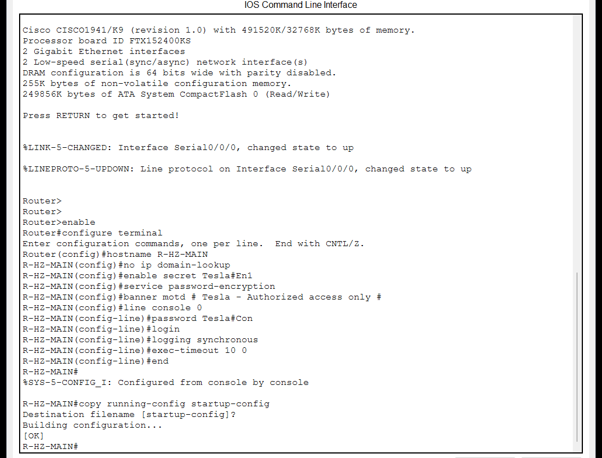

**R-HZ-BKP**: first `no`, and then the same block. Only one line changes: `hostname R-HZ-BKP`.

<details><summary><b>📘 The commands of this mission, explained</b></summary>

| Command | What it does, and why it is here |
|---|---|
| `no shutdown` | Turns the port on. Router ports are off by default. |
| `enable` | From looking (`>`) to managing (`#`). This is where the enable password is asked for. |
| `hostname R-HZ-MAIN` | Gives the device its name, the one you see in the prompt. It prevents typing on the wrong device. |
| `no ip domain-lookup` | A typing mistake is not looked up as a name in DNS, so you don't wait after every typo. |
| `enable secret Tesla#En1` | The password for `#`, stored as a hash (not readable). |
| `service password-encryption` | Hides the other passwords in `show run`. Weak, but better than plain text. |
| `banner motd # Tesla - Authorized access only #` | A warning shown before login. The `#` signs mark where the text starts and ends. |
| `line console 0` | Enters the settings of the console port (the blue cable / the CLI tab). |
| `password Tesla#Con` | The password of this line. |
| `login` | "Ask for the password". Without it the password exists and nobody is asked. |
| `logging synchronous` | System messages don't cut the line you are writing. |
| `exec-timeout 10 0` | Logs out after this many minutes and seconds without typing (10 minutes, 0 seconds). |
| `copy running-config startup-config` | Saves what is in memory to the startup file. Without it a power failure erases the work. |

</details>

**⏭ What comes next.** The road is laid but closed. Lesson 3 opens it.

➡ Now do **[lesson 3](../lesson-03/)**.

---

# Part C — the provider, Be'er Sheva and Haifa

*After lesson 3, before lesson 4. The longest part.*

## C1 — The edge routers, the provider and the serial lines
**📖 How we got here.** Herzliya is complete (lesson 3), and it is an island.

**🌐 The network now.** Herzliya works, but it's an island.

**❗ The problem.** There is no router towards the internet, no provider, and no other branch.

**🎯 What we want now.** The skeleton of the world: an edge router per branch, the provider, and nine serial lines.

**💡 The solution.** In each branch one **edge router** (EXT), and one **ISP** router for all. These routers are connected by **serial** cables.

**📋 Do it in the project.** Place the eight routers with the right cards, and connect the nine serial lines.

### 🖱 The solution: what to click and what to write
1. Place the **1941** routers and insert the cards like in B1 (power off → drag → power on):

   | Router | Cards | Where |
   |---|---|---|
   | ISP, R-HZ-EXT, R-BS-EXT, R-HF-EXT | **two** HWIC-2T | right slot **and** left slot |
   | R-BS-MAIN, R-BS-BKP, R-HF-MAIN, R-HF-BKP | one HWIC-2T | right slot |

   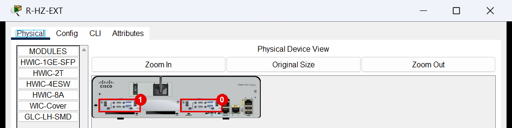
2. **Connections** (1) → **Serial DCE** (2) → click **first** the DCE device of the table, and then the second one.

   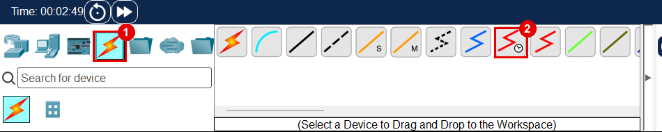

   | # | First (DCE) | Port | Second | Port |
   |---|---|---|---|---|
   | 1 | R-HZ-EXT | S0/0/0 | R-HZ-MAIN | S0/0/0 |
   | 2 | R-HZ-EXT | S0/1/0 | R-HZ-BKP | S0/0/0 |
   | 3 | ISP | S0/0/0 | R-HZ-EXT | S0/0/1 |
   | 4 | R-BS-EXT | S0/0/1 | R-BS-MAIN | S0/0/0 |
   | 5 | R-BS-EXT | S0/1/0 | R-BS-BKP | S0/0/0 |
   | 6 | ISP | S0/0/1 | R-BS-EXT | S0/0/0 |
   | 7 | R-HF-EXT | S0/0/1 | R-HF-MAIN | S0/0/0 |
   | 8 | R-HF-EXT | S0/1/0 | R-HF-BKP | S0/0/0 |
   | 9 | ISP | S0/1/0 | R-HF-EXT | S0/0/0 |

   ⚠️ The **first** device you click is the DCE: it gives the clock. In lesson 4 `clock rate` is written on that side.
3. Base configuration: on each new router answer `no`, and write the block of B2 with its own name:

| Device | The line that changes |
|---|---|
| R-HZ-EXT | `hostname R-HZ-EXT` |
| ISP | `hostname ISP` |
| R-BS-EXT | `hostname R-BS-EXT` |
| R-BS-MAIN | `hostname R-BS-MAIN` |
| R-BS-BKP | `hostname R-BS-BKP` |
| R-HF-EXT | `hostname R-HF-EXT` |
| R-HF-MAIN | `hostname R-HF-MAIN` |
| R-HF-BKP | `hostname R-HF-BKP` |

All the serial lines stay **red** until lesson 4. That's correct.

<details><summary><b>📘 The form, field by field</b></summary>

| Field or click | What it is, and why |
|---|---|
| **Serial DCE** | The serial cable. The **first** device you click is the DCE side, the one that sets the clock. |

</details>

**⏭ What comes next.** The lines lead to places that don't exist yet. We build them: first Be'er Sheva.

## C2 — Be'er Sheva: devices, cables, base
**📖 How we got here.** The routers of Be'er Sheva stand alone.

**🌐 The network now.** The routers of Be'er Sheva stand alone.

**❗ The problem.** A whole branch is missing: management, car service, logistics and servers.

**🎯 What we want now.** A whole branch, from the same plan as Herzliya: the same devices, other names and ports.

**💡 The solution.** Exactly the same design as Herzliya. **This is the test of what you learned**: nothing here is new.

**📋 Do it in the project.** Place, name, connect, and give every switch its base configuration.

### 🖱 The solution: what to click and what to write
| Name | Model |
|---|---|
| SW-BS-MAIN | 2960 |
| SW-BS-BKP | 2960 |
| SW-BS-LOG | 2960 |
| SW-BS-CAR | 2960 |
| SW-BS-MGMT | 2960 |
| MLS-BS-SRV | 3560-24PS |
| SRV-BEERSHEVA | Server |
| PC-BS-LOG-1 | PC |
| PC-BS-LOG-2 | PC |
| PC-BS-LOG-3 | PC |
| PC-BS-CAR-1 | PC |
| PC-BS-CAR-2 | PC |
| PC-BS-CAR-3 | PC |
| PC-BS-MGMT-1 | PC |
| PC-BS-MGMT-2 | PC |
| PC-BS-MGMT-3 | PC |

| # | Cable | First device | Port | Second device | Port |
|---|---|---|---|---|---|
| 1 | Straight-Through | R-BS-BKP | G0/0 | SW-BS-MAIN | Fa0/6 |
| 2 | Straight-Through | R-BS-MAIN | G0/0 | SW-BS-MAIN | Fa0/2 |
| 3 | Cross-Over | SW-BS-MAIN | Fa0/1 | SW-BS-MGMT | Fa0/4 |
| 4 | Cross-Over | SW-BS-MAIN | Fa0/3 | SW-BS-CAR | Fa0/4 |
| 5 | Cross-Over | SW-BS-MAIN | Fa0/4 | MLS-BS-SRV | Fa0/1 |
| 6 | Cross-Over | SW-BS-MAIN | Fa0/5 | SW-BS-LOG | Fa0/4 |
| 7 | Cross-Over | SW-BS-MAIN | Fa0/7 | SW-BS-BKP | Fa0/4 |
| 8 | Cross-Over | SW-BS-BKP | Fa0/1 | SW-BS-MGMT | Fa0/5 |
| 9 | Cross-Over | SW-BS-BKP | Fa0/2 | SW-BS-CAR | Fa0/5 |
| 10 | Cross-Over | SW-BS-BKP | Fa0/3 | SW-BS-LOG | Fa0/5 |
| 11 | Straight-Through | SW-BS-LOG | Fa0/1 | PC-BS-LOG-1 | Fa0 |
| 12 | Straight-Through | SW-BS-LOG | Fa0/2 | PC-BS-LOG-2 | Fa0 |
| 13 | Straight-Through | SW-BS-LOG | Fa0/3 | PC-BS-LOG-3 | Fa0 |
| 14 | Straight-Through | SW-BS-CAR | Fa0/1 | PC-BS-CAR-1 | Fa0 |
| 15 | Straight-Through | SW-BS-CAR | Fa0/2 | PC-BS-CAR-2 | Fa0 |
| 16 | Straight-Through | SW-BS-CAR | Fa0/3 | PC-BS-CAR-3 | Fa0 |
| 17 | Straight-Through | SW-BS-MGMT | Fa0/1 | PC-BS-MGMT-1 | Fa0 |
| 18 | Straight-Through | SW-BS-MGMT | Fa0/2 | PC-BS-MGMT-2 | Fa0 |
| 19 | Straight-Through | SW-BS-MGMT | Fa0/3 | PC-BS-MGMT-3 | Fa0 |
| 20 | Straight-Through | MLS-BS-SRV | Fa0/2 | SRV-BEERSHEVA | Fa0 |

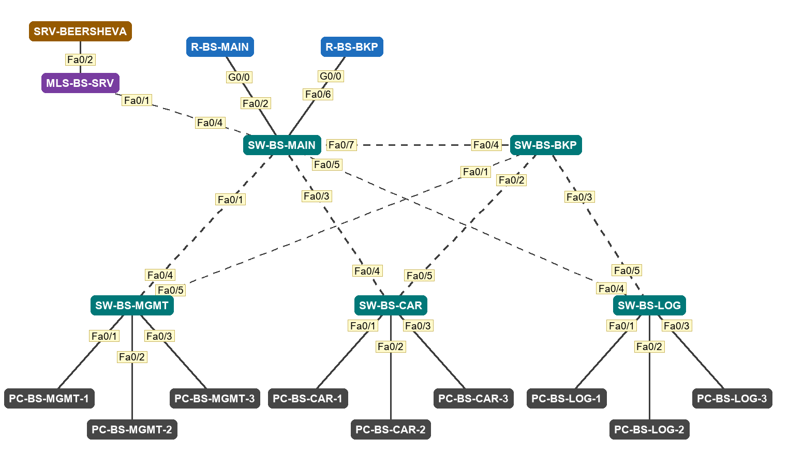

The base block of A3 on every switch, with its own name (on the MLS: first answer `no`):

| Device | The line that changes |
|---|---|
| SW-BS-MAIN | `hostname SW-BS-MAIN` |
| SW-BS-BKP | `hostname SW-BS-BKP` |
| SW-BS-MGMT | `hostname SW-BS-MGMT` |
| SW-BS-CAR | `hostname SW-BS-CAR` |
| SW-BS-LOG | `hostname SW-BS-LOG` |
| MLS-BS-SRV | `hostname MLS-BS-SRV` |

**⏭ What comes next.** It's connected, and everyone is in one network, exactly like the beginning of lesson 2.

## C3 — Be'er Sheva: switching
**📖 How we got here.** Be'er Sheva is connected and unseparated.

**🌐 The network now.** Everything connected, everything in VLAN 1.

**❗ The problem.** The same as in lesson 2: one big network, loops, and open ports.

**🎯 What we want now.** The whole of lesson 2 and the snooping of lesson 3, in one block for each switch.

**💡 The solution.** Everything of lesson 2 and the DHCP snooping of lesson 3, in one block per switch.

**📋 Do it in the project.** Write the block of SW-BS-LOG alone, from the plan. Then compare.

| VLAN | Name | Network | Switch |
|---|---|---|---|
| 64 | MANAGEMENT | 192.168.64.0/24 | SW-BS-MGMT |
| 65 | CAR-SERVICE | 192.168.65.0/24 | SW-BS-CAR |
| 66 | LOGISTICS | 192.168.66.0/24 | SW-BS-LOG |
| 67 | SERVERS | 192.168.67.0/24 | MLS-BS-SRV |

### 🖱 The solution: what to click and what to write
On each switch: log in, `enable`, and write the block. Messages about ports that go down, and `PVID` messages, are normal here.

**SW-BS-MAIN:**
```
configure terminal
vtp domain BEERSHEVA
vtp password Tesla#Vtp
vtp mode server
vlan 64
name MANAGEMENT
vlan 65
name CAR-SERVICE
vlan 66
name LOGISTICS
vlan 67
name SERVERS
exit
spanning-tree vlan 1,64,65,66,67 root primary
ip dhcp snooping
ip dhcp snooping vlan 64,65,66
no ip dhcp snooping information option
interface range fa0/1 - 3 , fa0/5 - 7
switchport mode trunk
exit
interface range fa0/1 , fa0/3 , fa0/5
spanning-tree guard root
exit
interface fa0/4
switchport mode access
switchport access vlan 67
switchport port-security
switchport port-security maximum 2
switchport port-security mac-address sticky
switchport port-security violation shutdown
exit
interface range fa0/2 , fa0/4 , fa0/6 - 7
ip dhcp snooping trust
exit
interface range fa0/8 - 24 , g0/1 - 2
shutdown
end
copy running-config startup-config
```
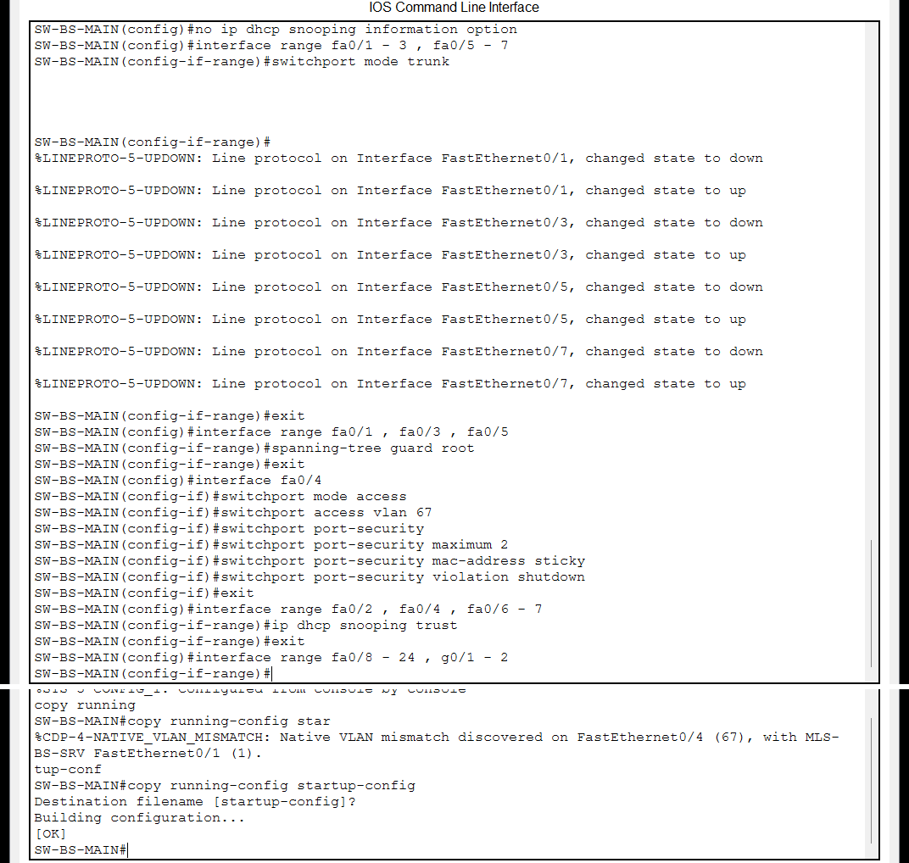

**SW-BS-BKP:**
```
configure terminal
vtp domain BEERSHEVA
vtp password Tesla#Vtp
vtp mode client
spanning-tree vlan 1,64,65,66,67 root secondary
interface range fa0/1 - 4
switchport mode trunk
exit
interface range fa0/5 - 24 , g0/1 - 2
shutdown
end
copy running-config startup-config
```
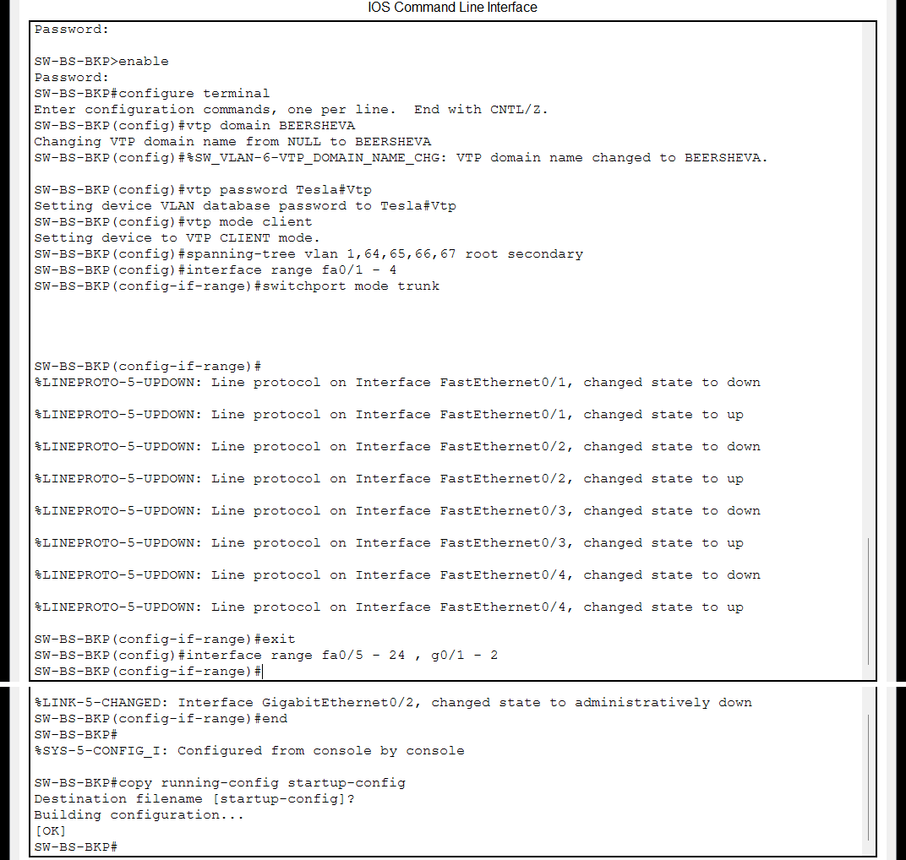

**SW-BS-MGMT:**
```
configure terminal
vtp domain BEERSHEVA
vtp password Tesla#Vtp
vtp mode client
interface range fa0/4 - 5
switchport mode trunk
exit
interface range fa0/1 - 3
switchport mode access
switchport access vlan 64
spanning-tree portfast
spanning-tree bpduguard enable
switchport port-security
switchport port-security maximum 1
switchport port-security mac-address sticky
switchport port-security violation shutdown
exit
interface range fa0/6 - 24 , g0/1 - 2
shutdown
end
copy running-config startup-config
```
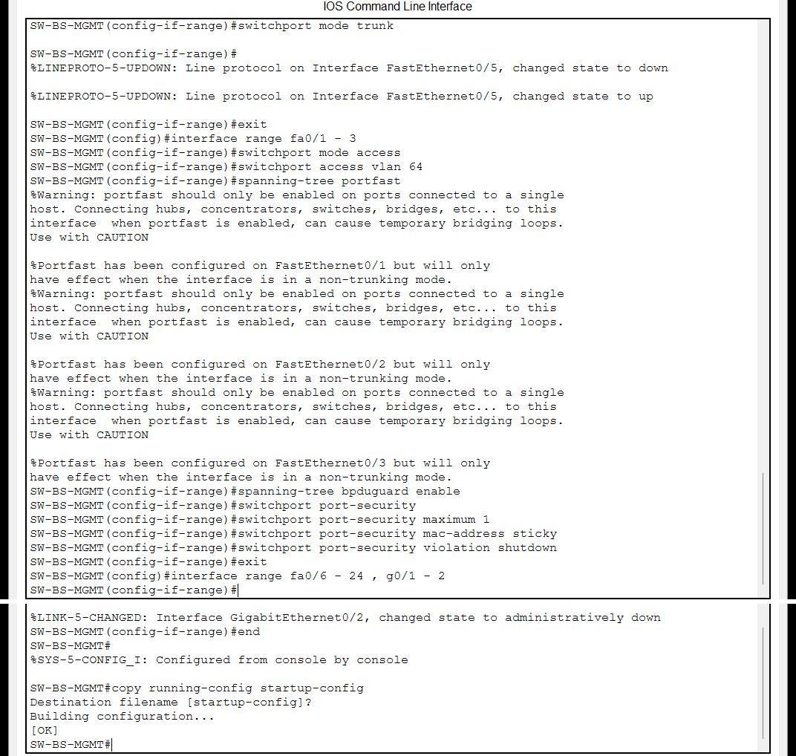

**SW-BS-CAR:**
```
configure terminal
vtp domain BEERSHEVA
vtp password Tesla#Vtp
vtp mode client
interface range fa0/4 - 5
switchport mode trunk
exit
interface range fa0/1 - 3
switchport mode access
switchport access vlan 65
spanning-tree portfast
spanning-tree bpduguard enable
switchport port-security
switchport port-security maximum 1
switchport port-security mac-address sticky
switchport port-security violation shutdown
exit
interface range fa0/6 - 24 , g0/1 - 2
shutdown
end
copy running-config startup-config
```


**SW-BS-LOG:**
```
configure terminal
vtp domain BEERSHEVA
vtp password Tesla#Vtp
vtp mode client
interface range fa0/4 - 5
switchport mode trunk
exit
interface range fa0/1 - 3
switchport mode access
switchport access vlan 66
spanning-tree portfast
spanning-tree bpduguard enable
switchport port-security
switchport port-security maximum 1
switchport port-security mac-address sticky
switchport port-security violation shutdown
exit
interface range fa0/6 - 24 , g0/1 - 2
shutdown
end
copy running-config startup-config
```
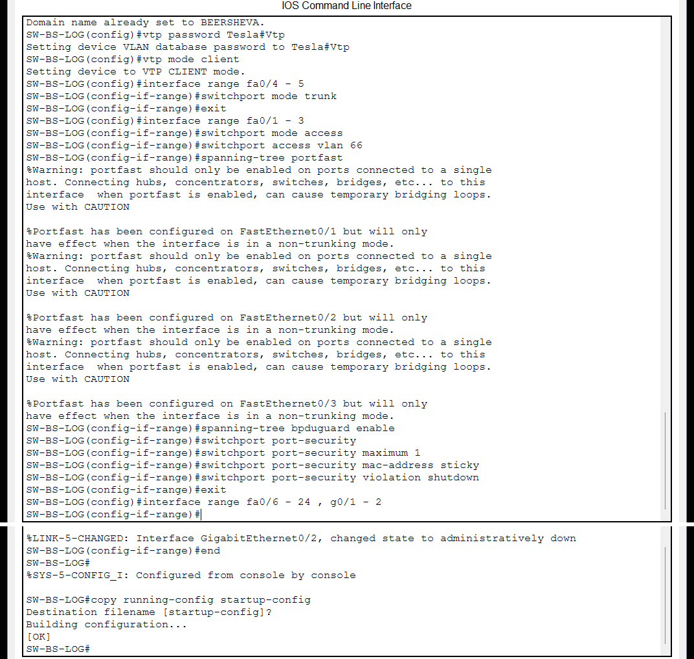

**MLS-BS-SRV:**
```
configure terminal
vtp mode transparent
vlan 67
name SERVERS
exit
interface range fa0/1 - 2
switchport mode access
switchport access vlan 67
exit
interface range fa0/3 - 24 , g0/1 - 2
shutdown
exit
interface fa0/2
spanning-tree portfast
spanning-tree bpduguard enable
switchport port-security
switchport port-security maximum 1
switchport port-security mac-address sticky
switchport port-security violation shutdown
end
copy running-config startup-config
```


✅ On SW-BS-LOG: `show vtp status` (client, domain BEERSHEVA) and `show vlan brief`: VLANs 64–67, and Fa0/1–3 in VLAN 66.

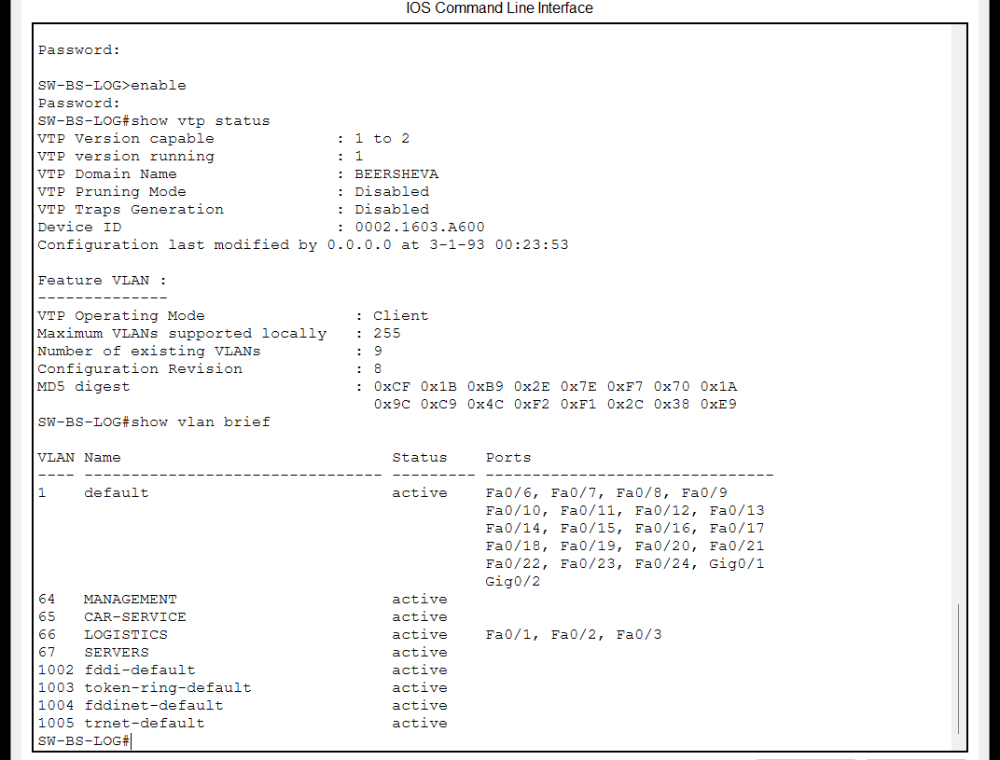

<details><summary><b>📘 The commands of this mission, explained</b></summary>

| Command | What it does, and why it is here |
|---|---|
| `vtp domain BEERSHEVA` | The name of the VTP group. Only switches with **exactly** the same name share the VLAN list (capital letters matter). |
| `vtp password Tesla#Vtp` | A shared secret, so a strange switch can't change our VLANs. It must be the same on all. |
| `vtp mode server` | This switch may create VLANs and teach the others. |
| `vlan 64` | Creates the VLAN with this number. The number is what travels in the tag. |
| `name MANAGEMENT` | A name for the VLAN, for people only. The switch works with the number. |
| `spanning-tree vlan 1,64,65,66,67 root primary` | Makes this switch the root of these VLANs (priority 24576; lower wins). |
| `ip dhcp snooping` | Turns DHCP snooping on in the whole switch. |
| `ip dhcp snooping vlan 64,65,66` | In which VLANs to check DHCP. |
| `no ip dhcp snooping information option` | Doesn't add "option 82" to requests; without this line the relay drops them. |
| `interface range fa0/1 - 3 , fa0/5 - 7` | Configures several ports together. Note the spaces around the comma and the dash. |
| `switchport mode trunk` | The port carries **all** the VLANs, with a tag. For switch ↔ switch and switch ↔ router. |
| `spanning-tree guard root` | Root Guard: a switch connected here is **not** allowed to become root. |
| `interface fa0/4` | Chooses the port. Everything below applies to it, until `exit`. |
| `switchport mode access` | The port belongs to one VLAN, for one end device. |
| `switchport access vlan 67` | Which VLAN the port belongs to. |
| `switchport port-security` | Turns port security **on**. Without this line the three others do nothing. |
| `switchport port-security maximum 2` | How many MAC addresses may be on this port. |
| `switchport port-security mac-address sticky` | Learns the MAC that is connected now and remembers it. |
| `switchport port-security violation shutdown` | What to do with a stranger: shut the port. |
| `ip dhcp snooping trust` | DHCP **answers** are accepted from this port: it leads to our server. All the rest are not trusted. |
| `shutdown` | Turns the port off. |
| `copy running-config startup-config` | Saves what is in memory to the startup file. Without it a power failure erases the work. |
| `vtp mode client` | This switch only receives the list. `vlan 12` on it is refused. |
| `spanning-tree vlan 1,64,65,66,67 root secondary` | The deputy (priority 28672): root only if the first falls. |
| `spanning-tree portfast` | The port becomes green at once. Only for end devices: a PC can't create a loop. |
| `spanning-tree bpduguard enable` | If a switch is connected to this port, shut it. Protects PortFast. |
| `vtp mode transparent` | This switch keeps its own list and doesn't learn from VTP. Good for a switch that needs one VLAN only. |
| `show vtp status` | Domain, mode and revision number. All must have the same domain. |
| `show vlan brief` | The list of VLANs and the ports in each one. Trunks do not appear. |

</details>

**⏭ What comes next.** The departments are separated. Now the road between them.

## C4 — Be'er Sheva: routers
**📖 How we got here.** Four VLANs in Be'er Sheva, with no gateway.

**🌐 The network now.** Four VLANs, and no gateway.

**❗ The problem.** No way between the departments, and no way to the DHCP server.

**🎯 What we want now.** The missions 1–2 of lesson 3: sub-interfaces, HSRP, and the helper towards the server.

**💡 The solution.** Sub-interfaces, HSRP and helper, like in lesson 3.

**📋 Do it in the project.** Copy your own block of R-HZ-MAIN and change the VLANs, the addresses and the helper. In which VLAN is there no helper?

### 🖱 The solution: what to click and what to write
**R-BS-MAIN:**
```
configure terminal
interface g0/0
no shutdown
exit
interface g0/0.64
encapsulation dot1Q 64
ip address 192.168.64.2 255.255.255.0
standby 64 ip 192.168.64.1
standby 64 priority 110
standby 64 preempt
ip helper-address 192.168.67.10
exit
interface g0/0.65
encapsulation dot1Q 65
ip address 192.168.65.2 255.255.255.0
standby 65 ip 192.168.65.1
standby 65 priority 110
standby 65 preempt
ip helper-address 192.168.67.10
exit
interface g0/0.66
encapsulation dot1Q 66
ip address 192.168.66.2 255.255.255.0
standby 66 ip 192.168.66.1
standby 66 priority 110
standby 66 preempt
ip helper-address 192.168.67.10
exit
interface g0/0.67
encapsulation dot1Q 67
ip address 192.168.67.2 255.255.255.0
standby 67 ip 192.168.67.1
standby 67 priority 110
standby 67 preempt
exit
end
copy running-config startup-config
```
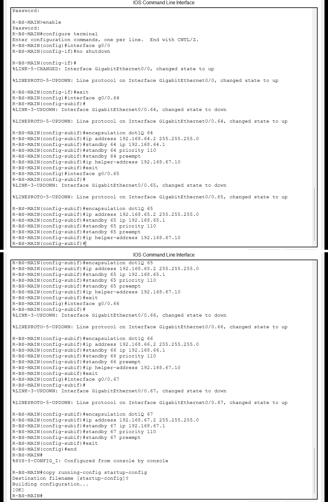

**R-BS-BKP:**
```
configure terminal
interface g0/0
no shutdown
exit
interface g0/0.64
encapsulation dot1Q 64
ip address 192.168.64.3 255.255.255.0
standby 64 ip 192.168.64.1
standby 64 priority 105
standby 64 preempt
ip helper-address 192.168.67.10
exit
interface g0/0.65
encapsulation dot1Q 65
ip address 192.168.65.3 255.255.255.0
standby 65 ip 192.168.65.1
standby 65 priority 105
standby 65 preempt
ip helper-address 192.168.67.10
exit
interface g0/0.66
encapsulation dot1Q 66
ip address 192.168.66.3 255.255.255.0
standby 66 ip 192.168.66.1
standby 66 priority 105
standby 66 preempt
ip helper-address 192.168.67.10
exit
interface g0/0.67
encapsulation dot1Q 67
ip address 192.168.67.3 255.255.255.0
standby 67 ip 192.168.67.1
standby 67 priority 105
standby 67 preempt
exit
end
copy running-config startup-config
```


✅ After 20 seconds, `show standby brief` on R-BS-MAIN: **Active** in four groups.

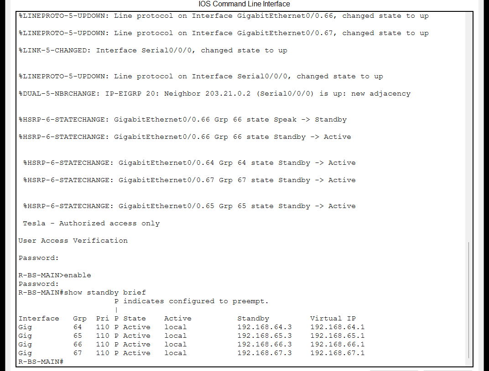

<details><summary><b>📘 The commands of this mission, explained</b></summary>

| Command | What it does, and why it is here |
|---|---|
| `interface g0/0` | Chooses the port. Everything below applies to it, until `exit`. |
| `no shutdown` | Turns the port on. Router ports are off by default. |
| `interface g0/0.64` | A **sub-interface**: a virtual door on the same physical port, one for each VLAN. |
| `encapsulation dot1Q 64` | "This sub-interface is VLAN number…". Must come **before** the IP address. |
| `ip address 192.168.64.2 255.255.255.0` | The address and the mask of this interface. In a LAN it is the address of the gateway. |
| `standby 64 ip 192.168.64.1` | HSRP: the shared virtual address (VIP) that both routers answer for. This is the gateway of the PCs. |
| `standby 64 priority 110` | The higher number is Active. Main 110, backup 105. |
| `standby 64 preempt` | A router with a higher priority takes the role back when it returns. |
| `ip helper-address 192.168.67.10` | The DHCP relay: turns the PC's broadcast into a direct message to this server. |
| `copy running-config startup-config` | Saves what is in memory to the startup file. Without it a power failure erases the work. |
| `show standby brief` | Who is Active and who is Standby in each group, and the priority. |

</details>

**⏭ What comes next.** The road is ready, and the server is empty.

## C5 — Be'er Sheva: server and PCs
**📖 How we got here.** Routers and switches work, and nobody has an address.

**🌐 The network now.** Routers and switches work, and nobody has an address.

**❗ The problem.** An empty server.

**🎯 What we want now.** The services of lesson 3 with the values of Be'er Sheva, and then DHCP on every PC.

**💡 The solution.** The same services as in lesson 3, with Be'er Sheva's values. (The website stays the default page: in lesson 4 that is how you recognise Be'er Sheva's server.)

**📋 Do it in the project.** Fill in from the tables. Fixed address first!

### 🖱 The solution: what to click and what to write
Every form is explained with pictures in [lesson 3, Mission 3](../lesson-03/). Only the values change.

**SRV-BEERSHEVA** → **Desktop** → **IP Configuration** → Static:

| Address | Mask | Gateway | DNS |
|---|---|---|---|
| 192.168.67.10 | 255.255.255.0 | 192.168.67.1 | 192.168.67.10 |

**Services** → **DHCP**: for each row fill in and click **Add**. At the end **Service: On** → **Save**.

| Pool Name | Default Gateway | DNS Server | Start IP | Mask | Max users |
|---|---|---|---|---|---|
| MANAGEMENT | 192.168.64.1 | 192.168.67.10 | 192.168.64.20 | 255.255.255.0 | 50 |
| CAR-SERVICE | 192.168.65.1 | 192.168.67.10 | 192.168.65.20 | 255.255.255.0 | 50 |
| LOGISTICS | 192.168.66.1 | 192.168.67.10 | 192.168.66.20 | 255.255.255.0 | 50 |

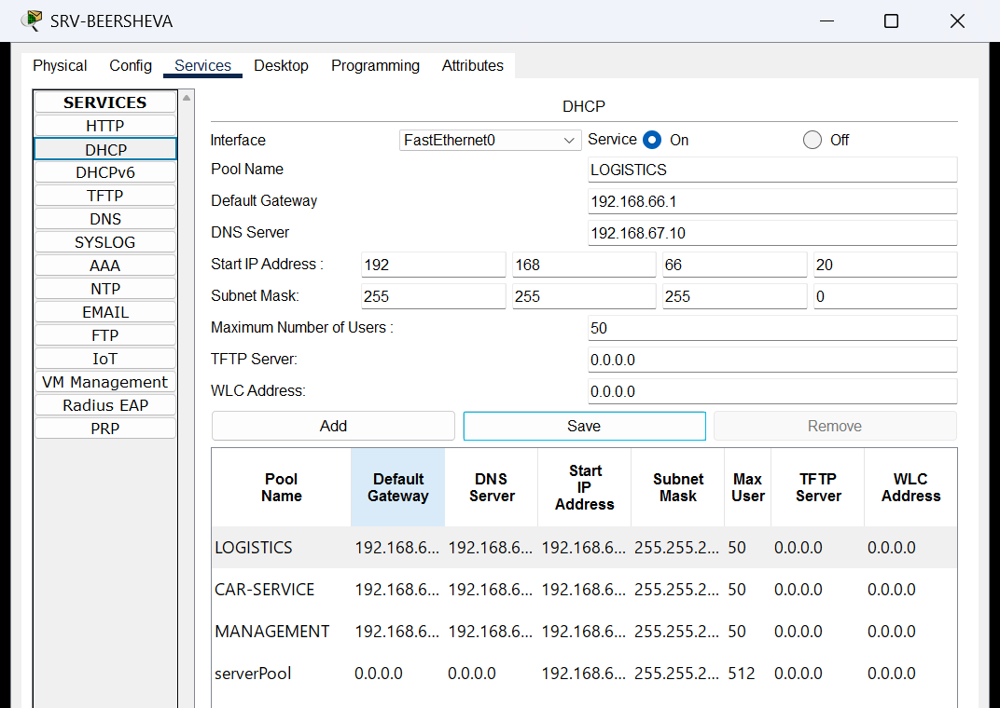

**DNS** → On → Name `www.tesla.lab`, Address `192.168.67.10` → **Add**.

**FTP** → Username `beersheva`, Password `Tesla#Ftp`, all five permissions → **Add**.

**EMAIL** → Domain `tesla.lab` → **Set**. Users `beersheva1` and `beersheva2`, password `Tesla#Mail` → **+**.

Then **every PC** of Be'er Sheva: Desktop → IP Configuration → **DHCP**.

✅ From PC-BS-LOG-1: an address 192.168.66.x, gateway .1, and `ping 192.168.67.10` works.


<details><summary><b>📘 The form, field by field</b></summary>

| Field or click | What it is, and why |
|---|---|
| Every field | Explained in lesson 3, Mission 3. Only the values change, and **why** they change: Be'er Sheva's networks are 64–67, and its server is in 67. |

</details>

<details><summary><b>📘 The commands of this mission, explained</b></summary>

| Command | What it does, and why it is here |
|---|---|
| `ping 192.168.67.10` | Sends 4 test messages. Replies = the road works in **both** directions. |

</details>

**⏭ What comes next.** Be'er Sheva is a finished branch. One more is left.

## C6 — Haifa: devices, cables, base
**📖 How we got here.** Two branches are finished.

**🌐 The network now.** Herzliya and Be'er Sheva are ready.

**❗ The problem.** The third branch. The names, the numbers and **the ports** are not the same as in Be'er Sheva.

**🎯 What we want now.** The third one, in which names, numbers **and ports** are different. That checks if you understand or copy.

**💡 The solution.** The same design for the third time.

**📋 Do it in the project.** Build it from the tables only, without looking at Be'er Sheva.

### 🖱 The solution: what to click and what to write
| Name | Model |
|---|---|
| SW-HF-MAIN | 2960 |
| SW-HF-BKP | 2960 |
| SW-HF-CHG | 2960 |
| SW-HF-CUST | 2960 |
| SW-HF-MGMT | 2960 |
| MLS-HF-SRV | 3560-24PS |
| SRV-HAIFA | Server |
| PC-HF-CHG-1 | PC |
| PC-HF-CHG-2 | PC |
| PC-HF-CHG-3 | PC |
| PC-HF-CHG-4 | PC |
| PC-HF-CUST-1 | PC |
| PC-HF-CUST-2 | PC |
| PC-HF-CUST-3 | PC |
| PC-HF-MGMT-1 | PC |
| PC-HF-MGMT-2 | PC |

| # | Cable | First device | Port | Second device | Port |
|---|---|---|---|---|---|
| 1 | Straight-Through | R-HF-BKP | G0/0 | SW-HF-MAIN | Fa0/6 |
| 2 | Straight-Through | R-HF-MAIN | G0/0 | SW-HF-MAIN | Fa0/4 |
| 3 | Cross-Over | SW-HF-MAIN | Fa0/1 | SW-HF-MGMT | Fa0/3 |
| 4 | Cross-Over | SW-HF-MAIN | Fa0/2 | MLS-HF-SRV | Fa0/1 |
| 5 | Cross-Over | SW-HF-MAIN | Fa0/3 | SW-HF-CHG | Fa0/5 |
| 6 | Cross-Over | SW-HF-MAIN | Fa0/5 | SW-HF-CUST | Fa0/4 |
| 7 | Cross-Over | SW-HF-MAIN | Fa0/7 | SW-HF-BKP | Fa0/3 |
| 8 | Cross-Over | SW-HF-BKP | Fa0/1 | SW-HF-MGMT | Fa0/4 |
| 9 | Cross-Over | SW-HF-BKP | Fa0/2 | SW-HF-CHG | Fa0/6 |
| 10 | Cross-Over | SW-HF-BKP | Fa0/4 | SW-HF-CUST | Fa0/5 |
| 11 | Straight-Through | SW-HF-CHG | Fa0/1 | PC-HF-CHG-1 | Fa0 |
| 12 | Straight-Through | SW-HF-CHG | Fa0/2 | PC-HF-CHG-2 | Fa0 |
| 13 | Straight-Through | SW-HF-CHG | Fa0/3 | PC-HF-CHG-3 | Fa0 |
| 14 | Straight-Through | SW-HF-CHG | Fa0/4 | PC-HF-CHG-4 | Fa0 |
| 15 | Straight-Through | SW-HF-CUST | Fa0/1 | PC-HF-CUST-1 | Fa0 |
| 16 | Straight-Through | SW-HF-CUST | Fa0/2 | PC-HF-CUST-2 | Fa0 |
| 17 | Straight-Through | SW-HF-CUST | Fa0/3 | PC-HF-CUST-3 | Fa0 |
| 18 | Straight-Through | SW-HF-MGMT | Fa0/1 | PC-HF-MGMT-1 | Fa0 |
| 19 | Straight-Through | SW-HF-MGMT | Fa0/2 | PC-HF-MGMT-2 | Fa0 |
| 20 | Straight-Through | MLS-HF-SRV | Fa0/2 | SRV-HAIFA | Fa0 |

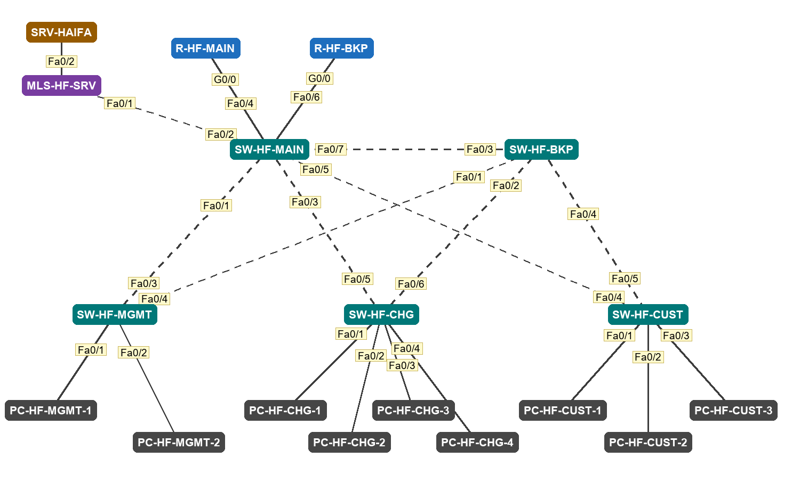

The base block of A3 on every switch, with its own name (on the MLS: first answer `no`):

| Device | The line that changes |
|---|---|
| SW-HF-MAIN | `hostname SW-HF-MAIN` |
| SW-HF-BKP | `hostname SW-HF-BKP` |
| SW-HF-MGMT | `hostname SW-HF-MGMT` |
| SW-HF-CHG | `hostname SW-HF-CHG` |
| SW-HF-CUST | `hostname SW-HF-CUST` |
| MLS-HF-SRV | `hostname MLS-HF-SRV` |

**⏭ What comes next.** Connected, and again in one network.

## C7 — Haifa: switching
**📖 How we got here.** Haifa is connected and unseparated.

**🌐 The network now.** Connected, and everything in VLAN 1.

**❗ The problem.** The same as C3. In Haifa the server switch is on **Fa0/2** of the main switch and R-HF-MAIN on **Fa0/4**. Copying from Be'er Sheva without thinking cuts the branch.

**🎯 What we want now.** The same blocks as C3, with the plan of Haifa. The server's switch is on another port.

**💡 The solution.** The same blocks, by Haifa's plan.

**📋 Do it in the project.** Write the block of SW-HF-CHG alone. How many PC ports does it have?

| VLAN | Name | Network | Switch |
|---|---|---|---|
| 96 | MANAGEMENT | 192.168.96.0/24 | SW-HF-MGMT |
| 97 | CHARGING | 192.168.97.0/24 | SW-HF-CHG |
| 98 | CUSTOMERS | 192.168.98.0/24 | SW-HF-CUST |
| 99 | SERVERS | 192.168.99.0/24 | MLS-HF-SRV |

### 🖱 The solution: what to click and what to write
**SW-HF-MAIN:**
```
configure terminal
vtp domain HAIFA
vtp password Tesla#Vtp
vtp mode server
vlan 96
name MANAGEMENT
vlan 97
name CHARGING
vlan 98
name CUSTOMERS
vlan 99
name SERVERS
exit
spanning-tree vlan 1,96,97,98,99 root primary
ip dhcp snooping
ip dhcp snooping vlan 96,97,98
no ip dhcp snooping information option
interface range fa0/1 , fa0/3 - 7
switchport mode trunk
exit
interface range fa0/1 , fa0/3 , fa0/5
spanning-tree guard root
exit
interface fa0/2
switchport mode access
switchport access vlan 99
switchport port-security
switchport port-security maximum 2
switchport port-security mac-address sticky
switchport port-security violation shutdown
exit
interface range fa0/2 , fa0/4 , fa0/6 - 7
ip dhcp snooping trust
exit
interface range fa0/8 - 24 , g0/1 - 2
shutdown
end
copy running-config startup-config
```
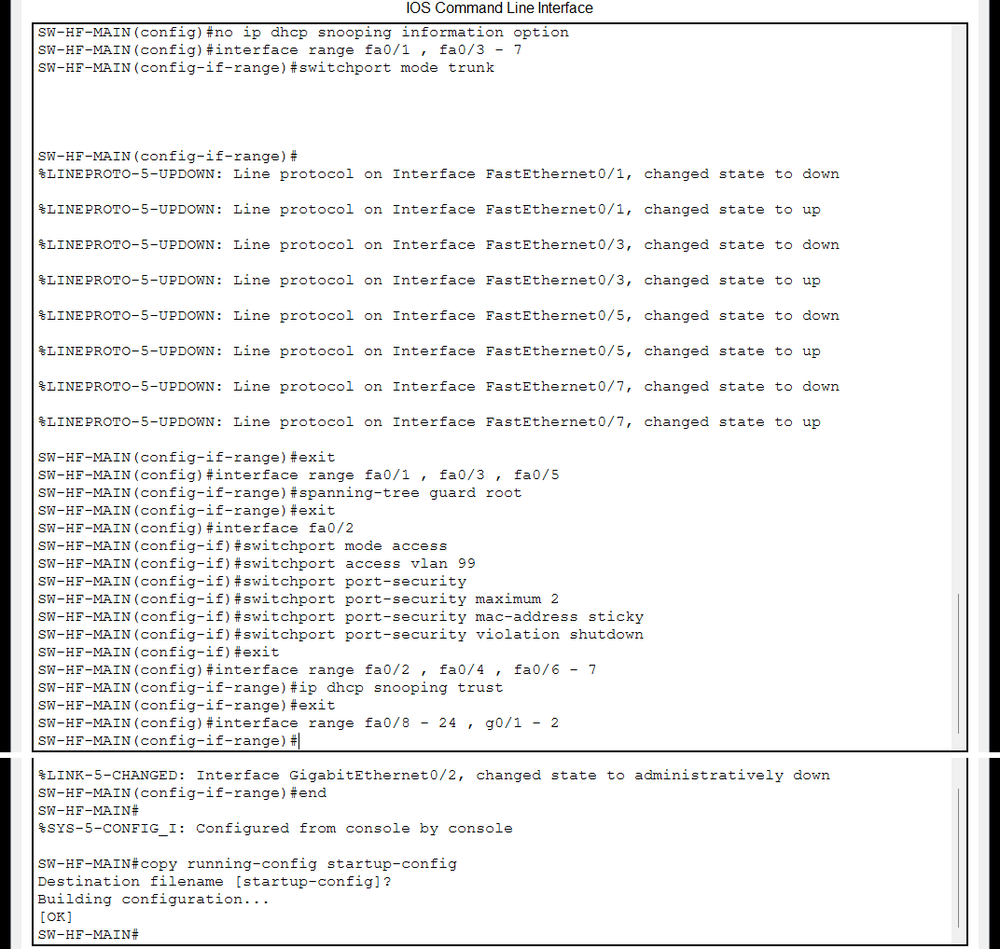

**SW-HF-BKP:**
```
configure terminal
vtp domain HAIFA
vtp password Tesla#Vtp
vtp mode client
spanning-tree vlan 1,96,97,98,99 root secondary
interface range fa0/1 - 4
switchport mode trunk
exit
interface range fa0/5 - 24 , g0/1 - 2
shutdown
end
copy running-config startup-config
```
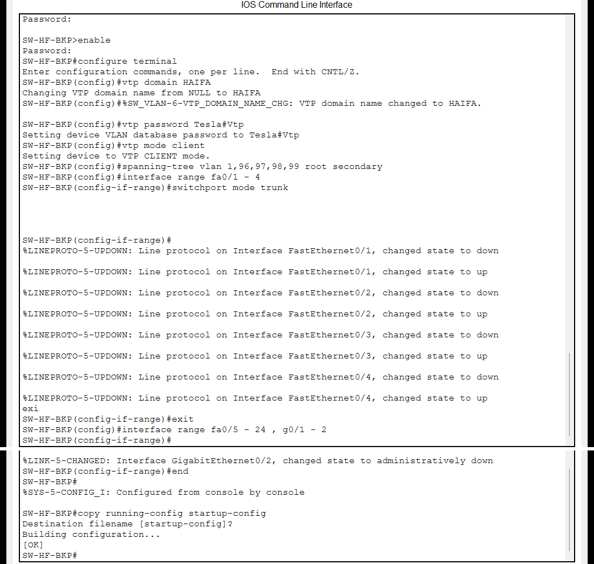

**SW-HF-MGMT:**
```
configure terminal
vtp domain HAIFA
vtp password Tesla#Vtp
vtp mode client
interface range fa0/3 - 4
switchport mode trunk
exit
interface range fa0/1 - 2
switchport mode access
switchport access vlan 96
spanning-tree portfast
spanning-tree bpduguard enable
switchport port-security
switchport port-security maximum 1
switchport port-security mac-address sticky
switchport port-security violation shutdown
exit
interface range fa0/5 - 24 , g0/1 - 2
shutdown
end
copy running-config startup-config
```
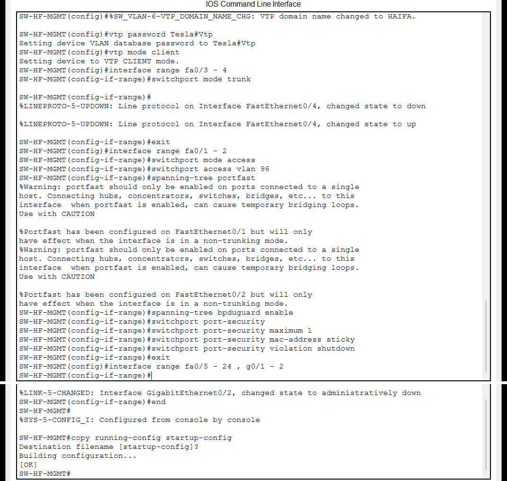

**SW-HF-CHG:**
```
configure terminal
vtp domain HAIFA
vtp password Tesla#Vtp
vtp mode client
interface range fa0/5 - 6
switchport mode trunk
exit
interface range fa0/1 - 4
switchport mode access
switchport access vlan 97
spanning-tree portfast
spanning-tree bpduguard enable
switchport port-security
switchport port-security maximum 1
switchport port-security mac-address sticky
switchport port-security violation shutdown
exit
interface range fa0/7 - 24 , g0/1 - 2
shutdown
end
copy running-config startup-config
```
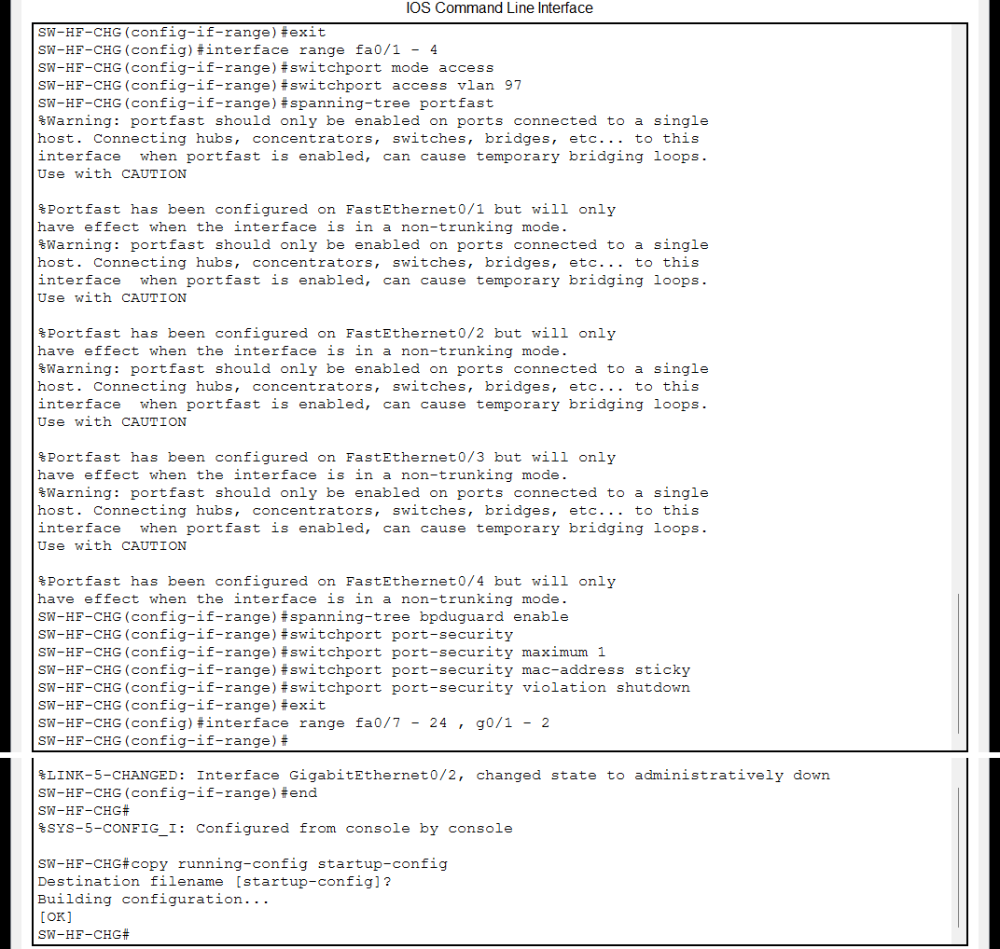

**SW-HF-CUST:**
```
configure terminal
vtp domain HAIFA
vtp password Tesla#Vtp
vtp mode client
interface range fa0/4 - 5
switchport mode trunk
exit
interface range fa0/1 - 3
switchport mode access
switchport access vlan 98
spanning-tree portfast
spanning-tree bpduguard enable
switchport port-security
switchport port-security maximum 1
switchport port-security mac-address sticky
switchport port-security violation shutdown
exit
interface range fa0/6 - 24 , g0/1 - 2
shutdown
end
copy running-config startup-config
```
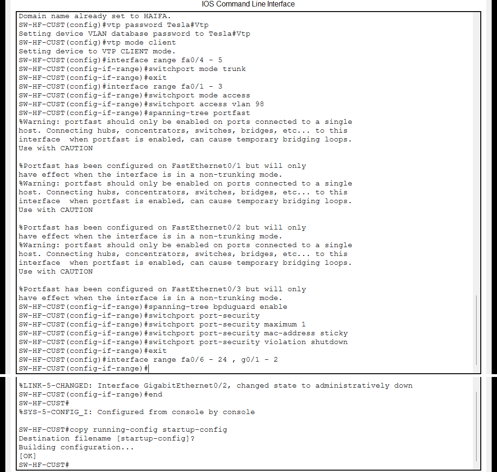

**MLS-HF-SRV:**
```
configure terminal
vtp mode transparent
vlan 99
name SERVERS
exit
interface range fa0/1 - 2
switchport mode access
switchport access vlan 99
exit
interface range fa0/3 - 24 , g0/1 - 2
shutdown
exit
interface fa0/2
spanning-tree portfast
spanning-tree bpduguard enable
switchport port-security
switchport port-security maximum 1
switchport port-security mac-address sticky
switchport port-security violation shutdown
end
copy running-config startup-config
```
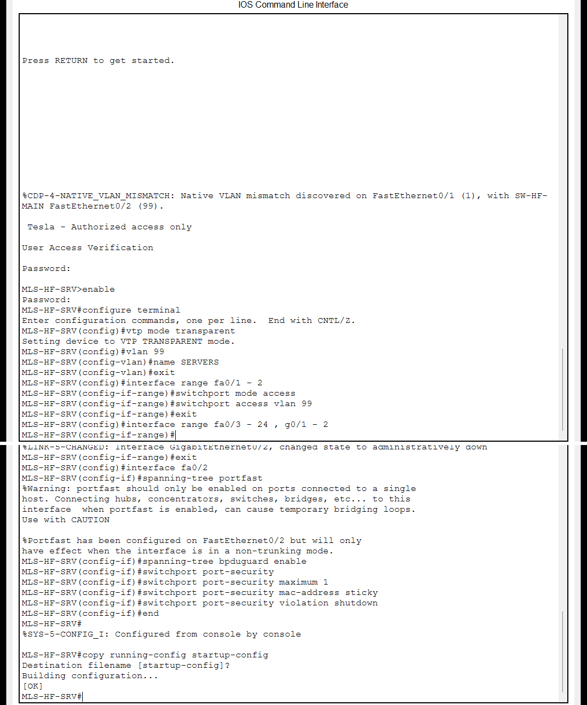

✅ On SW-HF-CUST: `show vtp status` and `show vlan brief`: VLANs 96–99, and Fa0/1–3 in VLAN 98.

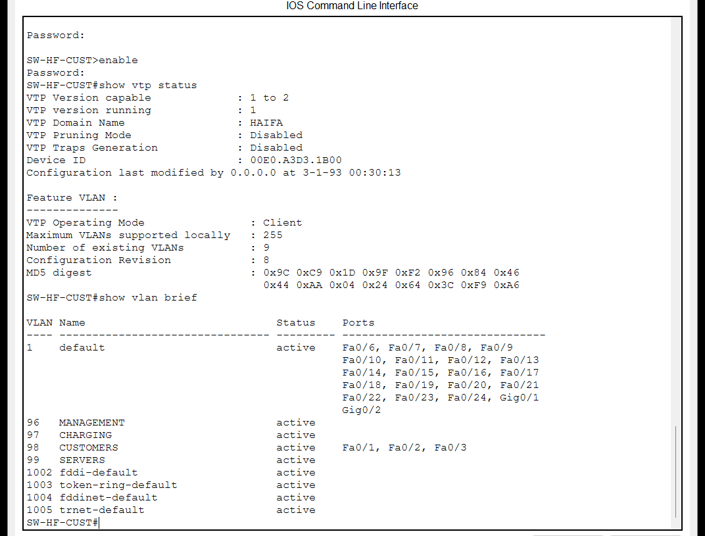

<details><summary><b>📘 The commands of this mission, explained</b></summary>

| Command | What it does, and why it is here |
|---|---|
| `vtp domain HAIFA` | The name of the VTP group. Only switches with **exactly** the same name share the VLAN list (capital letters matter). |
| `vtp password Tesla#Vtp` | A shared secret, so a strange switch can't change our VLANs. It must be the same on all. |
| `vtp mode server` | This switch may create VLANs and teach the others. |
| `vlan 96` | Creates the VLAN with this number. The number is what travels in the tag. |
| `name MANAGEMENT` | A name for the VLAN, for people only. The switch works with the number. |
| `spanning-tree vlan 1,96,97,98,99 root primary` | Makes this switch the root of these VLANs (priority 24576; lower wins). |
| `ip dhcp snooping` | Turns DHCP snooping on in the whole switch. |
| `ip dhcp snooping vlan 96,97,98` | In which VLANs to check DHCP. |
| `no ip dhcp snooping information option` | Doesn't add "option 82" to requests; without this line the relay drops them. |
| `interface range fa0/1 , fa0/3 - 7` | Configures several ports together. Note the spaces around the comma and the dash. |
| `switchport mode trunk` | The port carries **all** the VLANs, with a tag. For switch ↔ switch and switch ↔ router. |
| `spanning-tree guard root` | Root Guard: a switch connected here is **not** allowed to become root. |
| `interface fa0/2` | Chooses the port. Everything below applies to it, until `exit`. |
| `switchport mode access` | The port belongs to one VLAN, for one end device. |
| `switchport access vlan 99` | Which VLAN the port belongs to. |
| `switchport port-security` | Turns port security **on**. Without this line the three others do nothing. |
| `switchport port-security maximum 2` | How many MAC addresses may be on this port. |
| `switchport port-security mac-address sticky` | Learns the MAC that is connected now and remembers it. |
| `switchport port-security violation shutdown` | What to do with a stranger: shut the port. |
| `ip dhcp snooping trust` | DHCP **answers** are accepted from this port: it leads to our server. All the rest are not trusted. |
| `shutdown` | Turns the port off. |
| `copy running-config startup-config` | Saves what is in memory to the startup file. Without it a power failure erases the work. |
| `vtp mode client` | This switch only receives the list. `vlan 12` on it is refused. |
| `spanning-tree vlan 1,96,97,98,99 root secondary` | The deputy (priority 28672): root only if the first falls. |
| `spanning-tree portfast` | The port becomes green at once. Only for end devices: a PC can't create a loop. |
| `spanning-tree bpduguard enable` | If a switch is connected to this port, shut it. Protects PortFast. |
| `vtp mode transparent` | This switch keeps its own list and doesn't learn from VTP. Good for a switch that needs one VLAN only. |
| `show vtp status` | Domain, mode and revision number. All must have the same domain. |
| `show vlan brief` | The list of VLANs and the ports in each one. Trunks do not appear. |

</details>

**⏭ What comes next.** The departments are separated, and again without a gateway.

## C8 — Haifa: routers
**📖 How we got here.** Four VLANs in Haifa, with no gateway.

**🌐 The network now.** Four VLANs without a gateway.

**❗ The problem.** The same as C4.

**🎯 What we want now.** Sub-interfaces and HSRP for the last time. Write them from memory.

**💡 The solution.** Sub-interfaces 96–99, HSRP, and helper 192.168.99.10.

**📋 Do it in the project.** Write R-HF-MAIN from memory, and check.

### 🖱 The solution: what to click and what to write
**R-HF-MAIN:**
```
configure terminal
interface g0/0
no shutdown
exit
interface g0/0.96
encapsulation dot1Q 96
ip address 192.168.96.2 255.255.255.0
standby 96 ip 192.168.96.1
standby 96 priority 110
standby 96 preempt
ip helper-address 192.168.99.10
exit
interface g0/0.97
encapsulation dot1Q 97
ip address 192.168.97.2 255.255.255.0
standby 97 ip 192.168.97.1
standby 97 priority 110
standby 97 preempt
ip helper-address 192.168.99.10
exit
interface g0/0.98
encapsulation dot1Q 98
ip address 192.168.98.2 255.255.255.0
standby 98 ip 192.168.98.1
standby 98 priority 110
standby 98 preempt
ip helper-address 192.168.99.10
exit
interface g0/0.99
encapsulation dot1Q 99
ip address 192.168.99.2 255.255.255.0
standby 99 ip 192.168.99.1
standby 99 priority 110
standby 99 preempt
exit
end
copy running-config startup-config
```


**R-HF-BKP:**
```
configure terminal
interface g0/0
no shutdown
exit
interface g0/0.96
encapsulation dot1Q 96
ip address 192.168.96.3 255.255.255.0
standby 96 ip 192.168.96.1
standby 96 priority 105
standby 96 preempt
ip helper-address 192.168.99.10
exit
interface g0/0.97
encapsulation dot1Q 97
ip address 192.168.97.3 255.255.255.0
standby 97 ip 192.168.97.1
standby 97 priority 105
standby 97 preempt
ip helper-address 192.168.99.10
exit
interface g0/0.98
encapsulation dot1Q 98
ip address 192.168.98.3 255.255.255.0
standby 98 ip 192.168.98.1
standby 98 priority 105
standby 98 preempt
ip helper-address 192.168.99.10
exit
interface g0/0.99
encapsulation dot1Q 99
ip address 192.168.99.3 255.255.255.0
standby 99 ip 192.168.99.1
standby 99 priority 105
standby 99 preempt
exit
end
copy running-config startup-config
```


✅ After 20 seconds, `show standby brief` on R-HF-MAIN: **Active** in four groups.

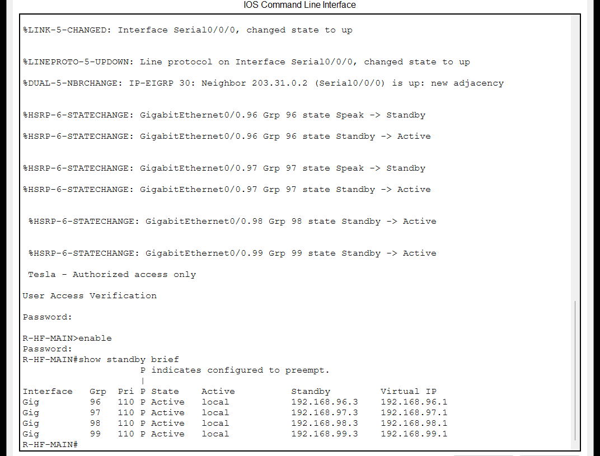

<details><summary><b>📘 The commands of this mission, explained</b></summary>

| Command | What it does, and why it is here |
|---|---|
| `interface g0/0` | Chooses the port. Everything below applies to it, until `exit`. |
| `no shutdown` | Turns the port on. Router ports are off by default. |
| `interface g0/0.96` | A **sub-interface**: a virtual door on the same physical port, one for each VLAN. |
| `encapsulation dot1Q 96` | "This sub-interface is VLAN number…". Must come **before** the IP address. |
| `ip address 192.168.96.2 255.255.255.0` | The address and the mask of this interface. In a LAN it is the address of the gateway. |
| `standby 96 ip 192.168.96.1` | HSRP: the shared virtual address (VIP) that both routers answer for. This is the gateway of the PCs. |
| `standby 96 priority 110` | The higher number is Active. Main 110, backup 105. |
| `standby 96 preempt` | A router with a higher priority takes the role back when it returns. |
| `ip helper-address 192.168.99.10` | The DHCP relay: turns the PC's broadcast into a direct message to this server. |
| `copy running-config startup-config` | Saves what is in memory to the startup file. Without it a power failure erases the work. |
| `show standby brief` | Who is Active and who is Standby in each group, and the priority. |

</details>

**⏭ What comes next.** Only the server and the PCs are left.

## C9 — Haifa: server and PCs
**📖 How we got here.** The roads of Haifa are ready.

**🌐 The network now.** An empty server, and PCs without addresses.

**❗ The problem.** The same as C5.

**🎯 What we want now.** The services, and DHCP on every PC.

**💡 The solution.** The same services, with Haifa's values.

**📋 Do it in the project.** Fill in the forms.

### 🖱 The solution: what to click and what to write
**SRV-HAIFA** → **Desktop** → **IP Configuration** → Static:

| Address | Mask | Gateway | DNS |
|---|---|---|---|
| 192.168.99.10 | 255.255.255.0 | 192.168.99.1 | 192.168.99.10 |

**Services** → **DHCP**: for each row fill in and click **Add**. At the end **Service: On** → **Save**.

| Pool Name | Default Gateway | DNS Server | Start IP | Mask | Max users |
|---|---|---|---|---|---|
| MANAGEMENT | 192.168.96.1 | 192.168.99.10 | 192.168.96.20 | 255.255.255.0 | 50 |
| CHARGING | 192.168.97.1 | 192.168.99.10 | 192.168.97.20 | 255.255.255.0 | 50 |
| CUSTOMERS | 192.168.98.1 | 192.168.99.10 | 192.168.98.20 | 255.255.255.0 | 50 |

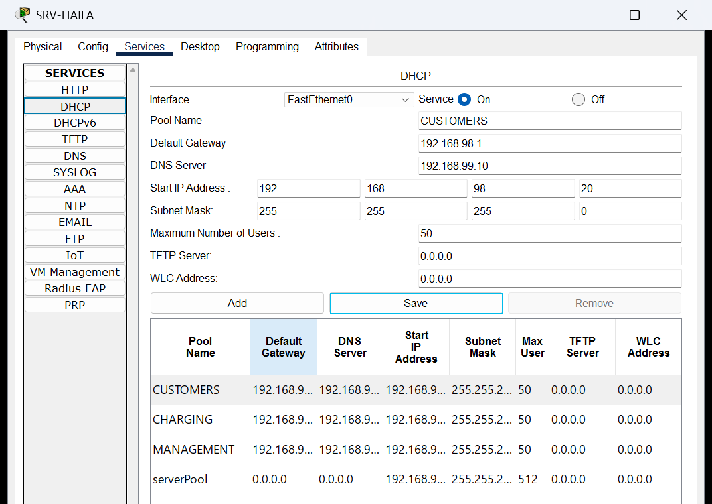

**DNS** → On → Name `www.tesla.lab`, Address `192.168.99.10` → **Add**.

**FTP** → Username `haifa`, Password `Tesla#Ftp`, all five permissions → **Add**.

**EMAIL** → Domain `tesla.lab` → **Set**. Users `haifa1` and `haifa2`, password `Tesla#Mail` → **+**.

Then **every PC** of Haifa: Desktop → IP Configuration → **DHCP**.

✅ From PC-HF-CUST-1: an address 192.168.98.x, gateway .1, and `ping 192.168.99.10` works.

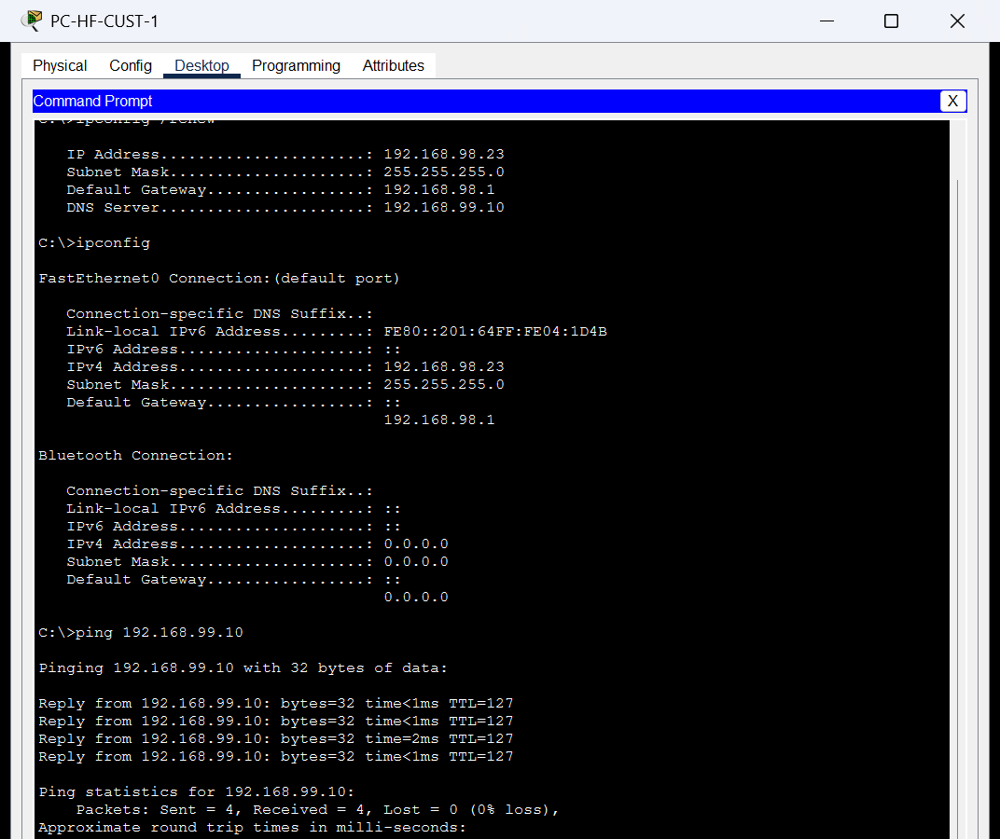

<details><summary><b>📘 The form, field by field</b></summary>

| Field or click | What it is, and why |
|---|---|
| Every field | Explained in lesson 3, Mission 3. Haifa's networks are 96–99, and its server is in 99. |

</details>

<details><summary><b>📘 The commands of this mission, explained</b></summary>

| Command | What it does, and why it is here |
|---|---|
| `ping 192.168.99.10` | Sends 4 test messages. Replies = the road works in **both** directions. |

</details>

**⏭ What comes next.** Three branches, three islands, nine red lines. That is exactly the beginning of lesson 4.

➡ Save everything, and do **[lesson 4](../lesson-04/)**.

---

# Part D — the firewall, and the servers of Be'er Sheva and Haifa

*After lesson 4, before lesson 5.*

## D1 — The lab and the firewall
**📖 How we got here.** Three branches are on the internet (lesson 4).

**🌐 The network now.** Three branches on the internet.

**❗ The problem.** Lesson 5 builds a test lab behind a firewall. There is no firewall and no lab.

**🎯 What we want now.** A corner for experiments: two PCs behind a firewall that isn't configured yet.

**💡 The solution.** An **ASA 5505** and two PCs. No configuration: lesson 5 does it.

**📋 Do it in the project.** Place, name and connect.

### 🖱 The solution: what to click and what to write
**Network Devices** (1) → **Security** (2) → **5505** (3), name `ASA-HZ`. And two PCs: `PC-LAB-1`, `PC-LAB-2`.

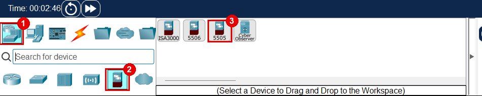

| # | Cable | First device | Port | Second device | Port |
|---|---|---|---|---|---|
| 1 | Straight-Through | ASA-HZ | E0/0 | SW-HZ-MGMT | Fa0/1 |
| 2 | Straight-Through | ASA-HZ | E0/1 | PC-LAB-1 | Fa0 |
| 3 | Straight-Through | ASA-HZ | E0/2 | PC-LAB-2 | Fa0 |

Write down in the switch what is connected there. **SW-HZ-MGMT**:

```
configure terminal
interface fa0/1
description to ASA-HZ
end
copy running-config startup-config
```

<details><summary><b>📘 The commands of this mission, explained</b></summary>

| Command | What it does, and why it is here |
|---|---|
| `interface fa0/1` | Chooses the port. Everything below applies to it, until `exit`. |
| `description to ASA-HZ` | A note on the port. It changes nothing, but it helps people. |
| `copy running-config startup-config` | Saves what is in memory to the startup file. Without it a power failure erases the work. |

</details>

**⏭ What comes next.** Lesson 5 needs users on **every** branch's server. Herzliya's is done in lesson 5, the others here.

## D2 — AAA, NTP and Syslog on the servers of Be'er Sheva and Haifa
**📖 How we got here.** In lesson 5 each branch asks its own server who may log in.

**🌐 The network now.** In lesson 5, Mission 1, you configure this on the server of Herzliya.

**❗ The problem.** The routers of Be'er Sheva and Haifa will ask **their own** servers, and there is nobody to answer.

**🎯 What we want now.** Users, keys and time on the servers of Be'er Sheva (RADIUS) and Haifa (TACACS).

**💡 The solution.** The same forms with other values. Be'er Sheva = **Radius**, Haifa = **Tacacs**.

**📋 Do it in the project.** Read lesson 5, Mission 1 (the forms have pictures there), and fill in the two servers.

### 🖱 The solution: what to click and what to write
**Services** → **AAA** → **On**. For each row fill in and click **Add**:

| Server | Client Name | Client IP | Secret | ServerType |
|---|---|---|---|---|
| SRV-BEERSHEVA | R-BS-MAIN | 192.168.67.2 | Tesla#Aaa | **Radius** |
| SRV-BEERSHEVA | R-BS-BKP | 192.168.67.3 | Tesla#Aaa | **Radius** |
| SRV-HAIFA | R-HF-MAIN | 192.168.99.2 | Tesla#Aaa | **Tacacs** |
| SRV-HAIFA | R-HF-BKP | 192.168.99.3 | Tesla#Aaa | **Tacacs** |

On both servers, below: Username `teslauser`, Password `Tesla#User` → **Add**.

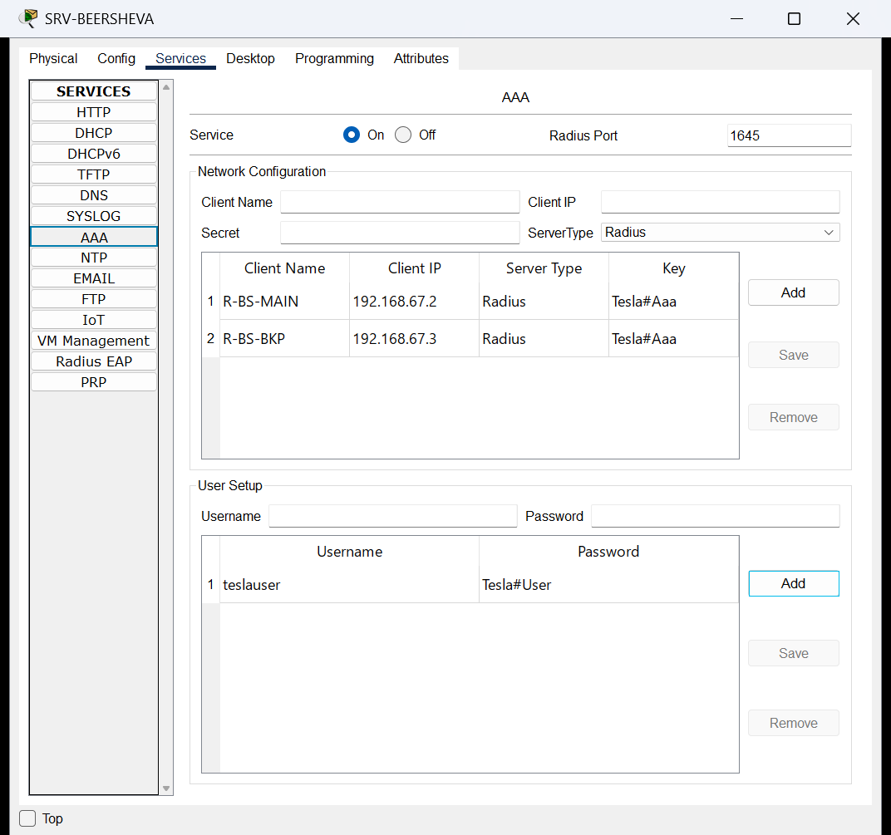

**NTP** → Authentication **Enable**, Password `Tesla#Ntp`, Key: **2** in Be'er Sheva, **3** in Haifa.

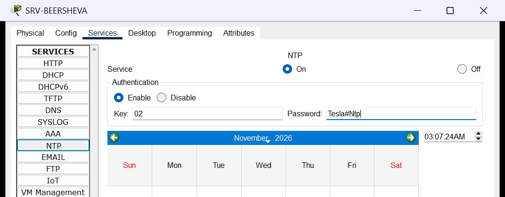

**SYSLOG** → check that it's On.

<details><summary><b>📘 The form, field by field</b></summary>

| Field or click | What it is, and why |
|---|---|
| Client Name, Client IP | The router that will ask, and its address **towards the server**. |
| Secret | The key between the router and the server. The same text is written on the router. |
| ServerType | The language: Radius in Be'er Sheva, Tacacs in Haifa. Must match the router. |
| Username, Password | The person who logs in. Written only here, not on the routers. |
| NTP Key | The number of the key. Each branch has its own: 1, 2, 3. |

</details>

**⏭ What comes next.** Everything is ready for the last chapter: lesson 5.

➡ Now do **[lesson 5](../lesson-05/)**.

---

# Final check

Do these tests in order. The first ping to a new place may be lost (`Request timed out`): that is normal. If one fails, the column on the right says where to look.

| # | From | Write | You must see | If not |
|---|---|---|---|---|
| 1 | PC-SALES-1 | `ipconfig /renew` | 192.168.22.x, gateway .1 | lesson 3, Missions 1–4 |
| 2 | PC-SALES-1 | `ping` to the address of PC-IT-1 | replies | lesson 3, Missions 1–2 |
| 3 | PC-SALES-1 | browser: `http://www.tesla.lab` | Welcome to Tesla - Herzliya branch | lesson 3, Mission 3 |
| 4 | PC-BS-MGMT-1 | `ping 192.168.67.10` | replies | C3–C5 |
| 5 | PC-HF-MGMT-1 | `ping 192.168.99.10` | replies | C7–C9 |
| 6 | PC-SALES-1 | `ping 203.20.0.2` | replies | lesson 4, Missions 1–5 |
| 7 | PC-HF-CUST-1 | `ping 203.20.0.10` | replies (static NAT) | lesson 4, block of R-BS-EXT |
| 8 | PC-HF-CUST-1 | `ping 192.168.52.10` | replies (VPN, the first may be lost) | lesson 5, Mission 3 |
| 9 | PC-BS-LOG-1 | `ping 192.168.67.10` | **fails** (ACL) | lesson 5, Mission 2 |
| 10 | PC-MGMT-1 | `ssh -l teslauser 192.168.12.2` | a password, and then `R-HZ-MAIN` | lesson 5, Missions 1 and 4 |
| 11 | PC-BS-MGMT-1 | `ssh -l teslauser 192.168.64.2` | a password, and then `R-BS-MAIN` | D2, and lesson 5 Mission 4.3 |
| 12 | PC-HF-MGMT-1 | `ssh -l teslauser 192.168.96.2` | a password, and then `R-HF-MAIN` | D2, and lesson 5 Mission 4.3 |
| 13 | PC-LAB-1 | `ping 192.168.52.10` | replies, through the ASA | lesson 5, Mission 5 |
| 14 | PC-MGMT-1 | `ping 192.168.1.10` | **fails** (nobody outside reaches into the lab) | lesson 5, Mission 5 |

The password of `teslauser` is `Tesla#User`. The passwords of the consoles are on the [main page](../README.md).
