# Lesson 04 — Connecting the branches: WAN, OSPF, EIGRP, BGP and NAT

> ⏱ 90 minutes · 🧰 Packet Tracer 9.x · 📂 start: [`lesson04-start.pkt`](lesson04-start.pkt) or your own file after [Part C](../from-zero/README.md#part-c--the-provider-beer-sheva-and-haifa) · 💾 save as `lesson04.pkt`

## What you will have at the end
Three branches connected to an internet provider: OSPF in Herzliya, EIGRP in Be'er Sheva and Haifa, BGP
to the provider, and three kinds of NAT.

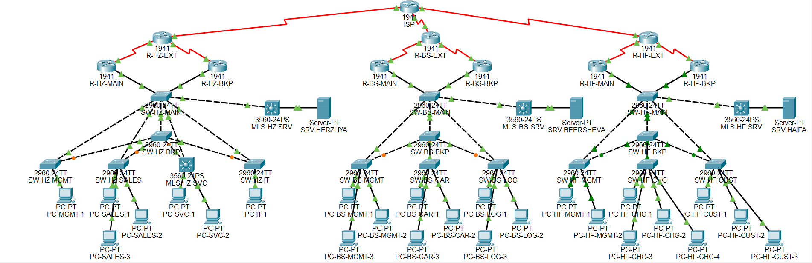

## 📖 The story — chapter 4: bridges between the islands
**How we got here.** Lesson 1 connected a department, lesson 2 separated five, lesson 3 made them one working branch. Meanwhile our colleagues built **Be'er Sheva** and **Haifa** in exactly the same way (the start file, or [Part C](../from-zero/) if you build them yourself: it is the best exam of lessons 2 and 3).

**Where we are now.** Three branches that work perfectly, each one alone. Between them stand ten routers and an internet provider, with nine lines, **all red**.

**What we want today.** Any branch can reach the internet, the world can reach Be'er Sheva's server, and if the line of the main router breaks nobody notices.

**The road of today:**

| Mission | The question it answers | Why exactly now |
|---|---|---|
| 1 WAN | are the lines alive? | no protocol can run on a dead line |
| 2 Track | does HSRP know that the line died? | now a router can be healthy and still useless |
| 3 OSPF | which way inside the company? | the lines are up, but a router knows only its neighbors |
| 4 BGP | how do we talk to another company? | the provider isn't ours, so it can't be in OSPF |
| 5 NAT | why doesn't the answer come back? | the packet leaves with an address the internet doesn't know |
| 6 Failure | does the second line work? | same as lesson 3: proof, not hope |

## Plan your time (90 minutes, take breaks)
| Minutes | Part |
|---|---|
| 0–20 | Part 1 — read the theory, answer every ❓ before you open the answer |
| 20–35 | Mission 1 — WAN addresses (Herzliya by hand, the rest by pasting) |
| 35–50 | Missions 2–3 — HSRP track, OSPF, EIGRP |
| 50–60 | Mission 4 — BGP |
| 60–75 | Mission 5 — NAT |
| 75–82 | Mission 6 — the failure test |
| 82–90 | Find the bug, questions, your project book |

In the start file Herzliya is the end of lesson 3, and the LANs of Be'er Sheva and Haifa are ready-made
(same method as Herzliya). The WAN links exist but have no addresses, so they are **red**.

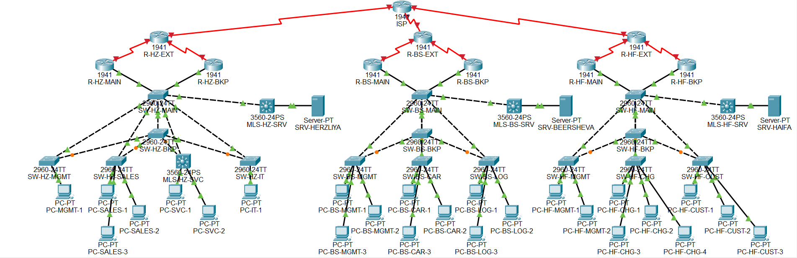

💡 **How to paste a block:** log in on the router, type `enable` and the password → copy the block
→ click **Paste** at the bottom right of the CLI. At the end: `copy running-config startup-config`.

---

## Part 1 — Theory: understand it first

### 1.1 Serial and clock rate
A serial line has two ends: **DCE** sets the clock, **DTE** follows it. In this project the DCE side
is the router nearer to the provider: EXT towards the branch, ISP towards EXT.

💬 **In simple words:** two people carry a sofa, and one of them says "one, two, one, two". The one who sets the
pace is the DCE. `show controllers s0/0/0` says which side you are on.

### 1.2 Three routing protocols
| | OSPF | EIGRP | BGP |
|---|---|---|---|
| Type | link state | advanced distance vector | path vector |
| Works | inside a company (IGP) | inside a company (IGP) | **between** companies (EGP) |
| Measures | cost (by bandwidth) | bandwidth + delay | list of AS numbers, policy |
| Admin distance | 110 | 90 | 20 (external) |
| In show ip route | `O` | `D` | `B` |
| Number | process 10, area 0 | AS 20, AS 30 | AS 65010, 65020, 65030, 65000 |

The OSPF process number is **local**; the EIGRP AS number must be **identical** on all the routers of the branch.

💬 **In simple words:** OSPF is a navigation app that knows the **whole map** and calculates the best way. EIGRP knows its
neighbors and what they told it. BGP is the agreement between **countries**: which countries you pass on the way.

**Example — the wildcard mask** (what may change). Subtract the mask from 255.255.255.255:

| Mask | Wildcard | Meaning |
|---|---|---|
| 255.255.255.0 (/24) | 0.0.0.255 | one network |
| 255.255.252.0 (/22) | 0.0.3.255 | 4 networks: 192.168.96–99 |
| 255.255.192.0 (/18) | 0.0.63.255 | 64 networks: 192.168.0–63 |

**Example — how a router chooses** (R-HZ-EXT): first the **most specific** route, and only between equal routes the lower
admin distance.

| Destination | Matching routes | Chosen |
|---|---|---|
| 192.168.22.20 | `O 192.168.22.0/24`, `S* 0.0.0.0/0` | O: /24 is more specific |
| 203.20.0.10 | `B 203.20.0.0/24`, `S* 0.0.0.0/0` | B: /24 |
| 8.8.8.8 | `S* 0.0.0.0/0` | the default route, to the provider |

### 1.3 AS
An **autonomous system** is a network under one management. Each branch is an AS, and the provider (65000) is another.
**eBGP** = BGP between different AS numbers. Neighbors are configured **by hand**, on both sides.

### 1.4 NAT
Private addresses (192.168.x.x) don't travel on the internet. The edge router **translates** them:

| Kind | Where | How |
|---|---|---|
| **PAT** (overload) | Herzliya | everybody goes out with **one** address, separated by port numbers |
| **Static** | Be'er Sheva, the server | one private ↔ one public, so people from outside can **enter** |
| **Dynamic pool** | Haifa | takes a free address from a list (.20–.30) |

| Term | Meaning |
|---|---|
| Inside local | the real address of our PC (192.168.22.20) |
| Inside global | how the internet sees it (203.10.0.1) |

💬 **In simple words:** an office with one outside phone number (PAT). The secretary remembers which employee made
each call and passes the answer to that employee. Static = an employee with a direct number. Pool = a drawer with 11 direct
numbers, first come first served.

**Example — two PCs go out together with PAT:**

| PC (inside local) | Port | Goes out as (inside global) | The answer returns to |
|---|---|---|---|
| 192.168.22.20 | 1025 | 203.10.0.1 : 1025 | 192.168.22.20 |
| 192.168.42.21 | 1025 | 203.10.0.1 : **1024** | 192.168.42.21 |

Both chose the same port, so the router changed one of them: that is why it's called **port** address translation.
(The numbers are an illustration.)

### 1.5 The WAN plan
| Link | Network | First side | Second side |
|---|---|---|---|
| R-HZ-MAIN ↔ R-HZ-EXT | 203.11.0.0/24 | S0/0/0 .1 | S0/0/0 .2 (DCE) |
| R-HZ-BKP ↔ R-HZ-EXT | 203.12.0.0/24 | S0/0/0 .1 | S0/1/0 .2 (DCE) |
| R-HZ-EXT ↔ ISP | 203.10.0.0/24 | S0/0/1 .1 | S0/0/0 .2 (DCE) |
| R-BS-MAIN ↔ R-BS-EXT | 203.21.0.0/24 | S0/0/0 .2 | S0/0/1 .1 (DCE) |
| R-BS-BKP ↔ R-BS-EXT | 203.22.0.0/24 | S0/0/0 .1 | S0/1/0 .2 (DCE) |
| R-BS-EXT ↔ ISP | 203.20.0.0/24 | S0/0/0 .1 | S0/0/1 .2 (DCE) |
| R-HF-MAIN ↔ R-HF-EXT | 203.31.0.0/24 | S0/0/0 .2 | S0/0/1 .1 (DCE) |
| R-HF-BKP ↔ R-HF-EXT | 203.32.0.0/24 | S0/0/0 .2 | S0/1/0 .1 (DCE) |
| R-HF-EXT ↔ ISP | 203.30.0.0/24 | S0/0/0 .1 | S0/1/0 .2 (DCE) |

---

## 🔑 Opening a device
Click the device → **CLI** (1) → click in the text, Enter → `Tesla#Con` → `enable` → `Tesla#En1`. With pictures: [lesson 2](../lesson-02/).

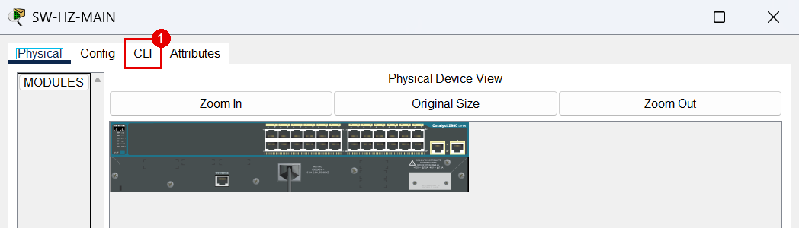

**How every mission is built:** 🌐 the network now → ❗ the problem → 💡 the solution → 📋 do it yourself → 🖱 the full solution, with what to click, what to write and what you must see.

## Mission 1 — WAN addresses
**📖 How we got here.** Three finished branches, and nine red lines between them.

**🌐 The network now.** Three finished branches, three islands. Ten routers are waiting:

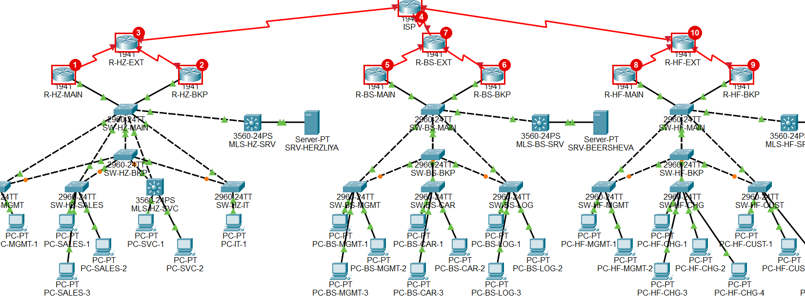

**❗ The problem.** All the serial lines are red. R-HZ-MAIN, `show ip interface brief`:

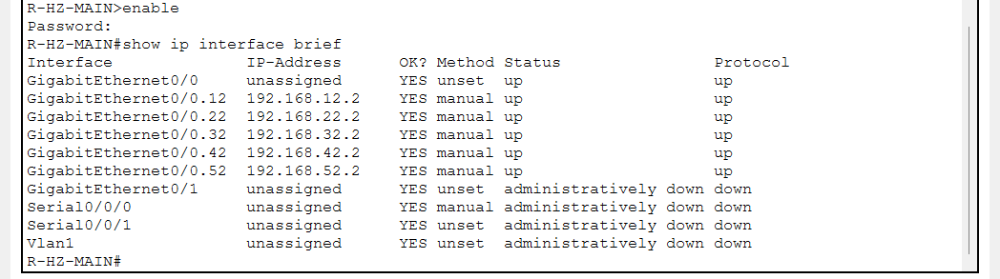

`Serial0/0/0` has no address and is turned off. A router port is born turned off.

**🎯 What we want now.** Addresses and a clock on every serial line, so the lines turn green.

**💡 The solution.** For each end: an address from the WAN plan (1.5), `no shutdown`, and on the **DCE** side also `clock rate` (1.1).

**📋 Do it in the project.** Find your router's rows in table 1.5, mark which ends are DCE, and configure. When do the two triangles turn green?

### 🖱 The solution: what to click and what to write
**R-HZ-MAIN:**
```
configure terminal
interface s0/0/0
ip address 203.11.0.1 255.255.255.0
no shutdown
end
```

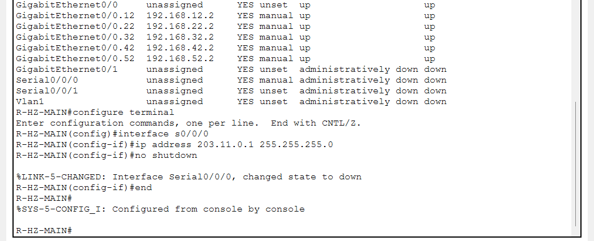

**R-HZ-BKP:**
```
configure terminal
interface s0/0/0
ip address 203.12.0.1 255.255.255.0
no shutdown
end
```

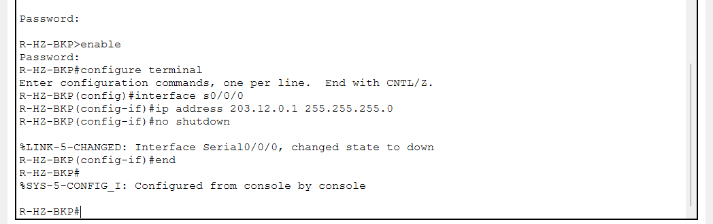

**R-HZ-EXT:**
```
configure terminal
interface s0/0/0
ip address 203.11.0.2 255.255.255.0
clock rate 2000000
no shutdown
exit
interface s0/1/0
ip address 203.12.0.2 255.255.255.0
clock rate 2000000
no shutdown
exit
interface s0/0/1
ip address 203.10.0.1 255.255.255.0
no shutdown
end
```

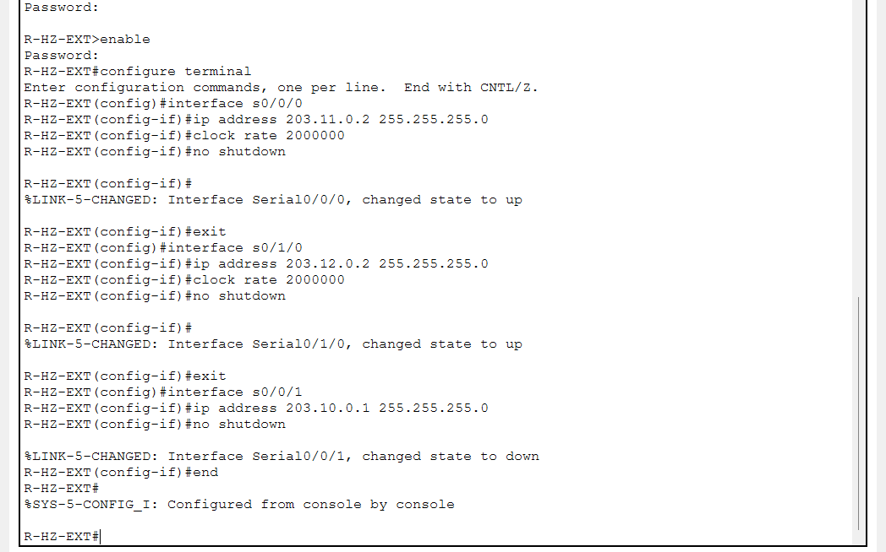

**ISP:**
```
configure terminal
interface s0/0/0
ip address 203.10.0.2 255.255.255.0
clock rate 2000000
no shutdown
exit
interface s0/0/1
ip address 203.20.0.2 255.255.255.0
clock rate 2000000
no shutdown
exit
interface s0/1/0
ip address 203.30.0.2 255.255.255.0
clock rate 2000000
no shutdown
end
```

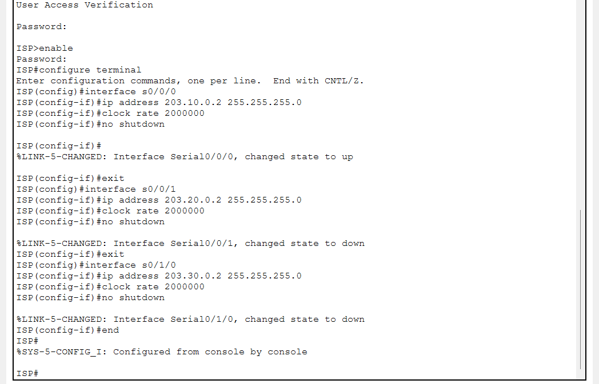

❓ Which side gets `clock rate`? Only the **DCE**. On a DTE side the command is not needed.

**Be'er Sheva and Haifa:** each group pastes one router. These blocks contain **everything** for the
branch: WAN, HSRP track, EIGRP, BGP and NAT. Read them while going through missions 2–5.

<details><summary>R-BS-MAIN, R-BS-BKP, R-BS-EXT</summary>

**R-BS-MAIN**
```
configure terminal
interface s0/0/0
ip address 203.21.0.1 255.255.255.0
no shutdown
exit
interface g0/0.64
standby 64 track s0/0/0
exit
interface g0/0.65
standby 65 track s0/0/0
exit
interface g0/0.66
standby 66 track s0/0/0
exit
interface g0/0.67
standby 67 track s0/0/0
exit
router eigrp 20
network 192.168.64.0
network 192.168.65.0
network 192.168.66.0
network 192.168.67.0
network 203.21.0.0
no auto-summary
passive-interface g0/0.64
passive-interface g0/0.65
passive-interface g0/0.66
passive-interface g0/0.67
exit
ip route 0.0.0.0 0.0.0.0 203.21.0.2
end
```


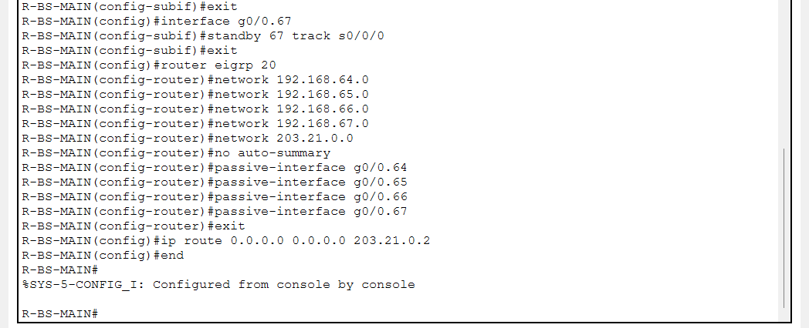

**R-BS-BKP**
```
configure terminal
interface s0/0/0
ip address 203.22.0.1 255.255.255.0
no shutdown
exit
router eigrp 20
network 192.168.64.0
network 192.168.65.0
network 192.168.66.0
network 192.168.67.0
network 203.22.0.0
no auto-summary
passive-interface g0/0.64
passive-interface g0/0.65
passive-interface g0/0.66
passive-interface g0/0.67
exit
ip route 0.0.0.0 0.0.0.0 203.22.0.2
end
```

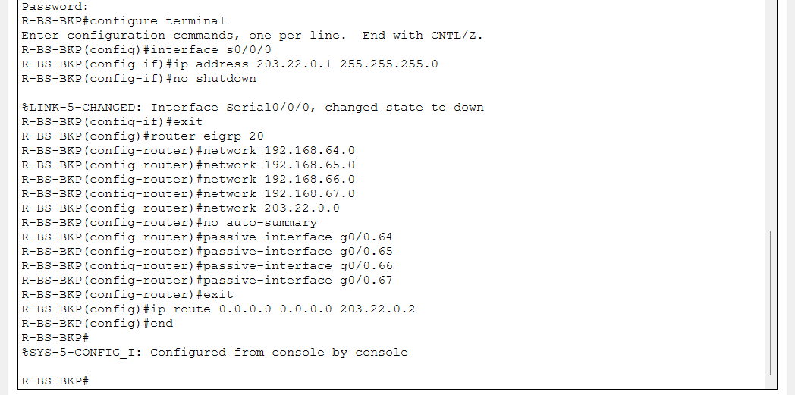

**R-BS-EXT**
```
configure terminal
interface s0/0/1
ip address 203.21.0.2 255.255.255.0
clock rate 2000000
no shutdown
exit
interface s0/1/0
ip address 203.22.0.2 255.255.255.0
clock rate 2000000
no shutdown
exit
interface s0/0/0
ip address 203.20.0.1 255.255.255.0
no shutdown
exit
router eigrp 20
network 203.21.0.0
network 203.22.0.0
no auto-summary
exit
ip route 0.0.0.0 0.0.0.0 203.20.0.2
router bgp 65020
neighbor 203.20.0.2 remote-as 65000
network 203.20.0.0 mask 255.255.255.0
exit
ip nat inside source static 192.168.67.10 203.20.0.10
access-list 1 permit 192.168.64.0 0.0.3.255
ip nat inside source list 1 interface s0/0/0 overload
interface s0/0/1
ip nat inside
interface s0/1/0
ip nat inside
interface s0/0/0
ip nat outside
exit
end
```

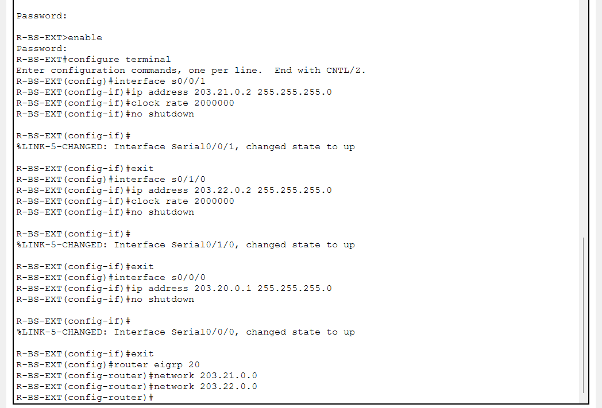

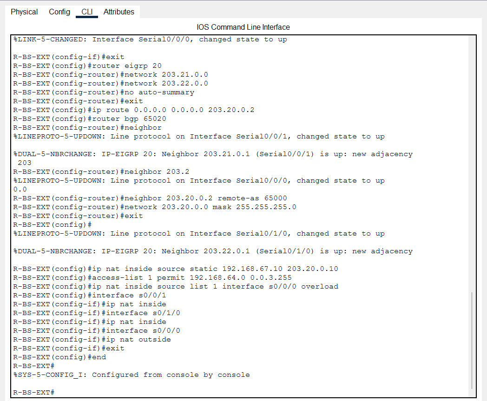

</details>

<details><summary>R-HF-MAIN, R-HF-BKP, R-HF-EXT</summary>

**R-HF-MAIN**
```
configure terminal
interface s0/0/0
ip address 203.31.0.1 255.255.255.0
no shutdown
exit
interface g0/0.96
standby 96 track s0/0/0
exit
interface g0/0.97
standby 97 track s0/0/0
exit
interface g0/0.98
standby 98 track s0/0/0
exit
interface g0/0.99
standby 99 track s0/0/0
exit
router eigrp 30
network 192.168.96.0
network 192.168.97.0
network 192.168.98.0
network 192.168.99.0
network 203.31.0.0
no auto-summary
passive-interface g0/0.96
passive-interface g0/0.97
passive-interface g0/0.98
passive-interface g0/0.99
exit
ip route 0.0.0.0 0.0.0.0 203.31.0.2
end
```

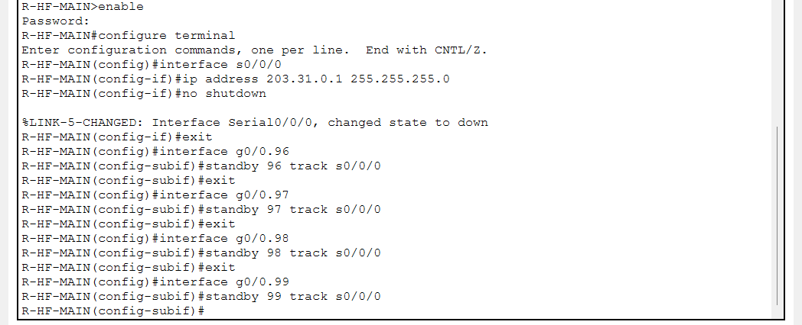


**R-HF-BKP**
```
configure terminal
interface s0/0/0
ip address 203.32.0.1 255.255.255.0
no shutdown
exit
router eigrp 30
network 192.168.96.0
network 192.168.97.0
network 192.168.98.0
network 192.168.99.0
network 203.32.0.0
no auto-summary
passive-interface g0/0.96
passive-interface g0/0.97
passive-interface g0/0.98
passive-interface g0/0.99
exit
ip route 0.0.0.0 0.0.0.0 203.32.0.2
end
```

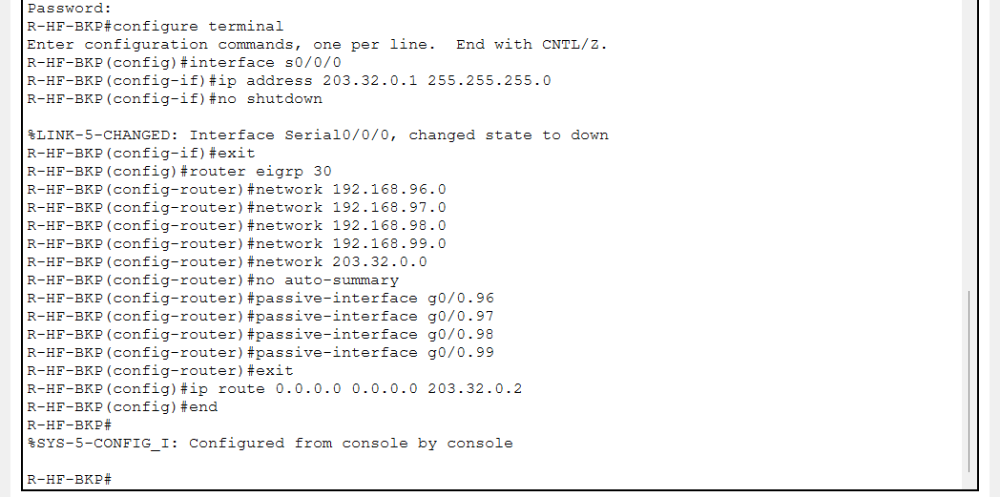

**R-HF-EXT**
```
configure terminal
interface s0/0/1
ip address 203.31.0.2 255.255.255.0
clock rate 2000000
no shutdown
exit
interface s0/1/0
ip address 203.32.0.2 255.255.255.0
clock rate 2000000
no shutdown
exit
interface s0/0/0
ip address 203.30.0.1 255.255.255.0
no shutdown
exit
router eigrp 30
network 203.31.0.0
network 203.32.0.0
no auto-summary
exit
ip route 0.0.0.0 0.0.0.0 203.30.0.2
router bgp 65030
neighbor 203.30.0.2 remote-as 65000
network 203.30.0.0 mask 255.255.255.0
exit
ip nat pool HAIFA-POOL 203.30.0.20 203.30.0.30 netmask 255.255.255.0
ip access-list extended NAT-HF
permit ip 192.168.96.0 0.0.3.255 any
exit
ip nat inside source list NAT-HF pool HAIFA-POOL
interface s0/0/1
ip nat inside
interface s0/1/0
ip nat inside
interface s0/0/0
ip nat outside
exit
end
```

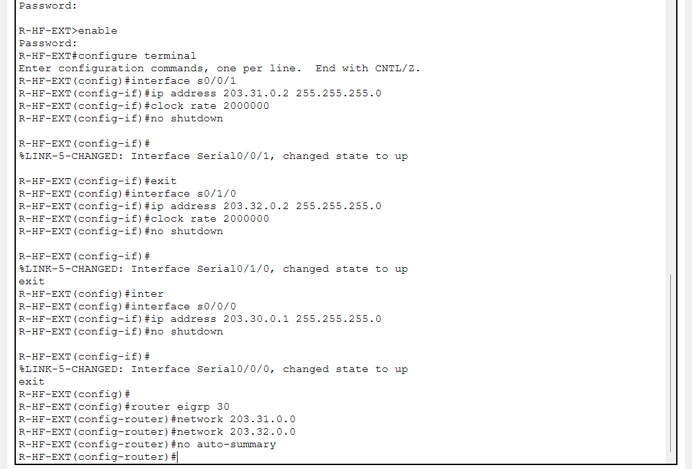

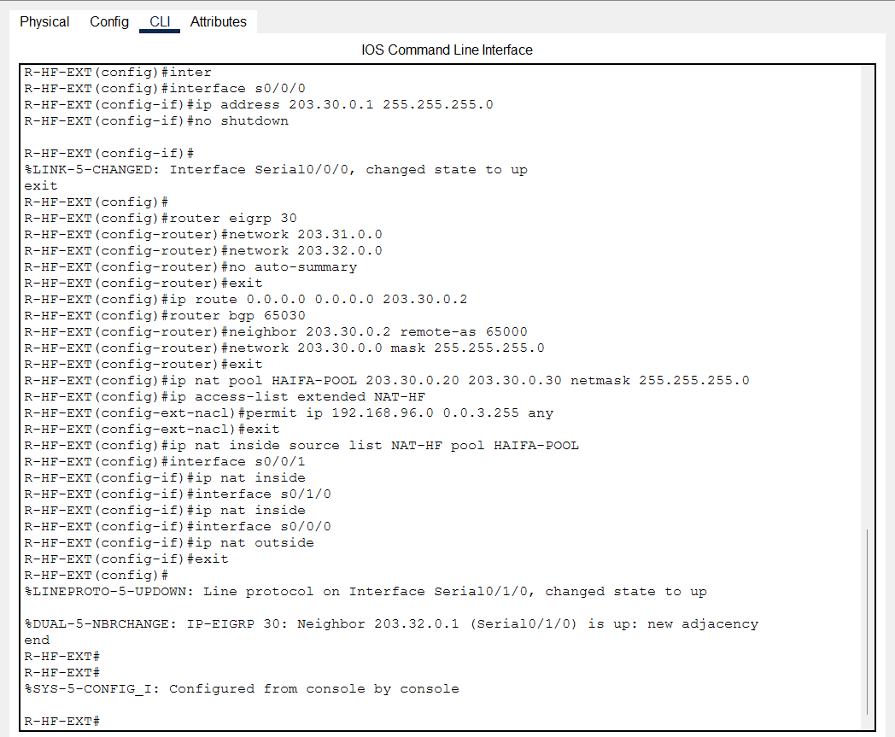

</details>

✅ All serial links are green.

<details open><summary><b>📘 The commands of this mission, explained</b></summary>

| Command | What it does, and why it is here |
|---|---|
| `show ip interface brief` | All the ports, the addresses, and whether they are up. |
| `no shutdown` | Turns the port on. Router ports are off by default. |
| `interface s0/0/0` | Chooses the port. Everything below applies to it, until `exit`. |
| `ip address 203.11.0.1 255.255.255.0` | The address and the mask of this interface. In a LAN it is the address of the gateway. |
| `clock rate 2000000` | The DCE side sets the speed of the serial line (bits per second), and the other side follows. |
| `interface g0/0.64` | A **sub-interface**: a virtual door on the same physical port, one for each VLAN. |
| `standby 64 track s0/0/0` | Watch this line: if it falls, lower my priority by 10 (110 → 100 < 105), and the backup takes over. |
| `router eigrp 20` | Starts EIGRP. The number (AS) must be **the same** on all the routers of the branch. |
| `network 192.168.64.0` | EIGRP works on the interface of this network, and announces it. |
| `no auto-summary` | Announces the exact networks, and not one rounded big network. |
| `passive-interface g0/0.64` | The network is announced, but no routing messages are sent to the PCs: nobody there can pretend to be a router. |
| `ip route 0.0.0.0 0.0.0.0 203.21.0.2` | The default route: "everything I don't know, send there". |
| `router bgp 65020` | Starts BGP with **our** AS number. |
| `neighbor 203.20.0.2 remote-as 65000` | The address of the BGP neighbor and **its** AS number. Both sides must write it. |
| `network 203.20.0.0 mask 255.255.255.0` | Announces our public network to the provider. The mask must be exactly as in the routing table. |
| `ip nat inside source static 192.168.67.10 203.20.0.10` | Static NAT: one inside address ↔ one public address, forever. That's how the world reaches the server. |
| `access-list 1 permit 192.168.64.0 0.0.3.255` | A standard list: the addresses that will be translated (`0.0.3.255` = four networks together). |
| `ip nat inside source list 1 interface s0/0/0 overload` | PAT: everyone in the list goes out with the **one** address of this port; `overload` tells them apart by port numbers. |
| `ip nat inside` | This port is on the **home** side. |
| `ip nat outside` | This port is on the **internet** side. |
| `ip nat pool HAIFA-POOL 203.30.0.20 203.30.0.30 netmask 255.255.255.0` | The pool: from the first to the last public address. |
| `ip access-list extended NAT-HF` | Opens a list by name or number, so lines can be added or inserted. |
| `permit ip 192.168.96.0 0.0.3.255 any` | Who is translated: from these networks to anywhere. |
| `ip nat inside source list NAT-HF pool HAIFA-POOL` | Dynamic NAT: everyone in the list gets a free address from the pool. |

</details>

**⏭ What comes next.** The lines live. But now something new can break: a line, and not only a router.

## Mission 2 — HSRP watches the internet line
**📖 How we got here.** Each main router has its own line to the edge. HSRP watches only the inside.

**🌐 The network now.** R-HZ-MAIN (1) and R-HZ-BKP (2) each have their own line to R-HZ-EXT.

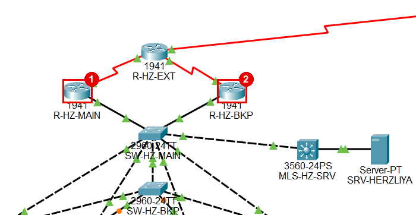

**❗ The problem.** Turn off the **internet** line of the main (`interface s0/0/0`, `shutdown`), wait 15 seconds, and write `show standby brief`:

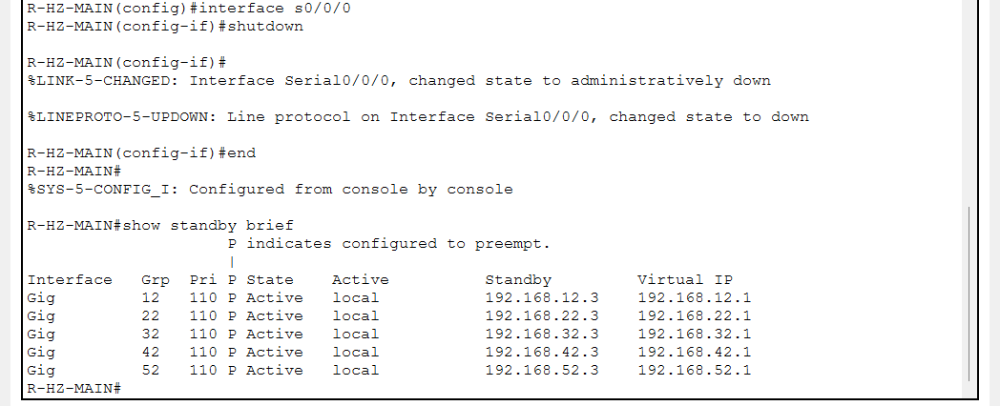

It is **still Active**! Its LAN side is fine, so HSRP sees no problem. All the PCs keep sending to a router that has no way out. (Bring it back: `no shutdown`.)

**🎯 What we want now.** Make HSRP watch the line too, so a router without internet gives up its role.

**💡 The solution.** `track`: HSRP watches the serial line. If it falls, the priority drops by 10.

**📋 Do it in the project.** Add track to the five groups of R-HZ-MAIN. Calculate first: what will the priority be, and who will be Active?

### 🖱 The solution: what to click and what to write
In lesson 3 the backup took over only if the LAN failed. Now the main router also loses priority
when its **serial line** fails. On **R-HZ-MAIN**:
```
configure terminal
interface g0/0.12
standby 12 track s0/0/0
interface g0/0.22
standby 22 track s0/0/0
interface g0/0.32
standby 32 track s0/0/0
interface g0/0.42
standby 42 track s0/0/0
interface g0/0.52
standby 52 track s0/0/0
end
```

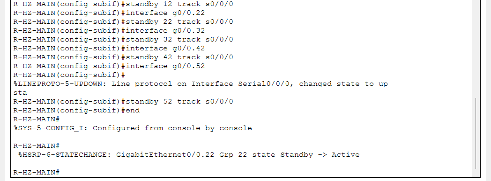

🧠 The line falls → 110 − 10 = **100**, which is less than 105 → the backup takes over.

| Serial line | Main | Backup | Active |
|---|---|---|---|
| up | 110 | 105 | R-HZ-MAIN |
| down | 110 − 10 = **100** | 105 | R-HZ-BKP |

❓ **Ask yourself:** what would happen if the backup's priority were 99?

<details><summary>Answer</summary>

100 is still higher than 99: the main router would stay Active without internet. The difference must be **smaller than 10**.

</details>

<details open><summary><b>📘 The commands of this mission, explained</b></summary>

| Command | What it does, and why it is here |
|---|---|
| `interface s0/0/0` | Chooses the port. Everything below applies to it, until `exit`. |
| `shutdown` | Turns the port off. |
| `show standby brief` | Who is Active and who is Standby in each group, and the priority. |
| `no shutdown` | Turns the port on. Router ports are off by default. |
| `interface g0/0.12` | A **sub-interface**: a virtual door on the same physical port, one for each VLAN. |
| `standby 12 track s0/0/0` | Watch this line: if it falls, lower my priority by 10 (110 → 100 < 105), and the backup takes over. |

</details>

**⏭ What comes next.** The lines are up and watched, and still no one knows the road to anyone.

## Mission 3 — OSPF in Herzliya
**📖 How we got here.** Each router knows only the networks it touches.

**🌐 The network now.** The lines are up. Each router knows only its neighbors:

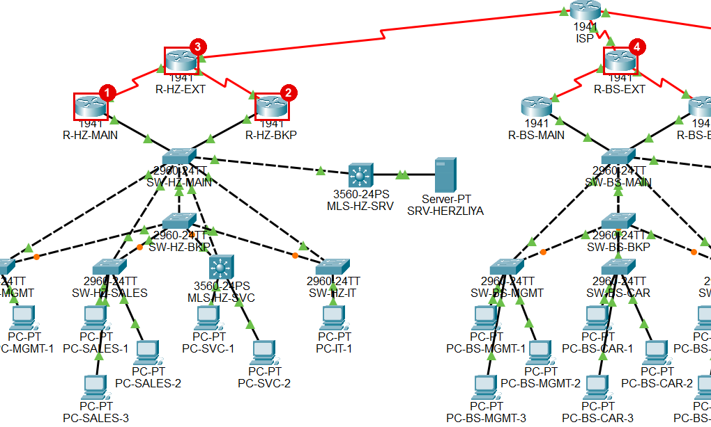

**❗ The problem.** R-HZ-EXT, `show ip route`:

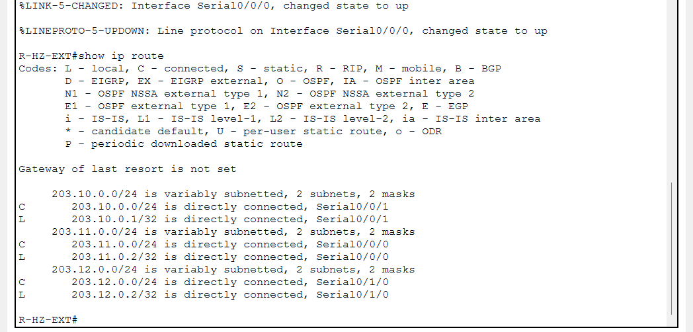

Not one 192.168 network. When an answer comes from the internet for a PC, R-HZ-EXT doesn't know where to send it and throws it away.

**🎯 What we want now.** OSPF: the routers of Herzliya tell each other about all their networks.

**💡 The solution.** A routing protocol: the routers **tell** each other what they know. OSPF in Herzliya, EIGRP in Be'er Sheva and Haifa (1.2). Writing five static routes in three routers would work too, until a line falls: static routes don't react.

**📋 Do it in the project.** OSPF 10, area 0, router-id 1.1.1.1 / 1.1.1.2 / 1.1.1.3, passive on every LAN sub-interface, and a default route to the next router towards the internet.

### 🖱 The solution: what to click and what to write
**R-HZ-MAIN:**
```
configure terminal
router ospf 10
router-id 1.1.1.1
network 192.168.12.0 0.0.0.255 area 0
network 192.168.22.0 0.0.0.255 area 0
network 192.168.32.0 0.0.0.255 area 0
network 192.168.42.0 0.0.0.255 area 0
network 192.168.52.0 0.0.0.255 area 0
network 203.11.0.0 0.0.0.255 area 0
passive-interface g0/0.12
passive-interface g0/0.22
passive-interface g0/0.32
passive-interface g0/0.42
passive-interface g0/0.52
exit
ip route 0.0.0.0 0.0.0.0 203.11.0.2
end
```

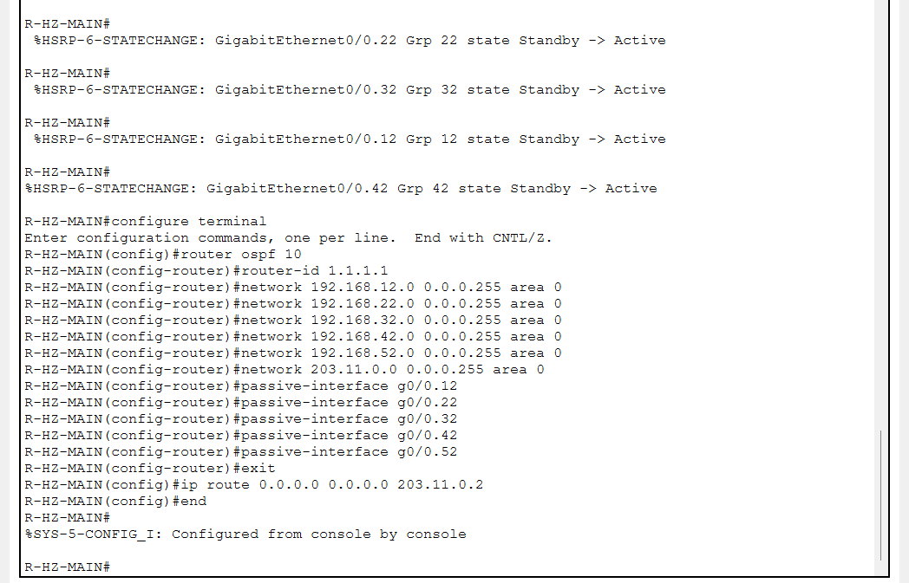

**R-HZ-BKP:** the same, with `router-id 1.1.1.2`, `network 203.12.0.0 0.0.0.255 area 0` instead of 203.11, and
`ip route 0.0.0.0 0.0.0.0 203.12.0.2`.

The full block of R-HZ-BKP:
```
configure terminal
router ospf 10
router-id 1.1.1.2
network 192.168.12.0 0.0.0.255 area 0
network 192.168.22.0 0.0.0.255 area 0
network 192.168.32.0 0.0.0.255 area 0
network 192.168.42.0 0.0.0.255 area 0
network 192.168.52.0 0.0.0.255 area 0
network 203.12.0.0 0.0.0.255 area 0
passive-interface g0/0.12
passive-interface g0/0.22
passive-interface g0/0.32
passive-interface g0/0.42
passive-interface g0/0.52
exit
ip route 0.0.0.0 0.0.0.0 203.12.0.2
end
```

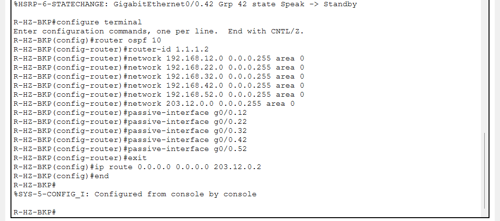

**R-HZ-EXT:**
```
configure terminal
router ospf 10
router-id 1.1.1.3
network 203.11.0.0 0.0.0.255 area 0
network 203.12.0.0 0.0.0.255 area 0
exit
ip route 0.0.0.0 0.0.0.0 203.10.0.2
end
```

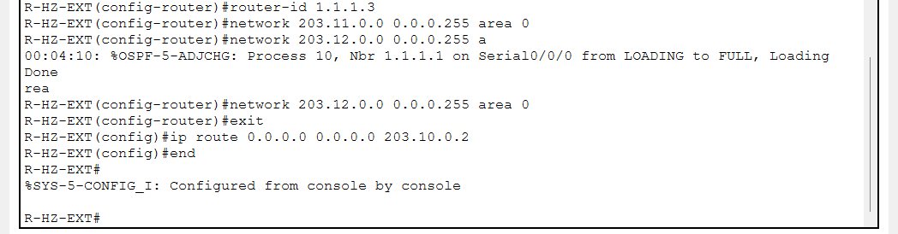

| Command | What it does | Why |
|---|---|---|
| `router-id` | the router's name in OSPF | fixed, so it doesn't change with the addresses |
| `network ... 0.0.0.255 area 0` | announces the network | wildcard mask: the opposite of a subnet mask |
| `passive-interface` | no OSPF messages to the PCs | security: nobody in the LAN can become a "neighbor" |
| `ip route 0.0.0.0 0.0.0.0` | default route | "everything I don't know → to the internet" |

✅ R-HZ-EXT: `show ip ospf neighbor` → two neighbors **FULL**. `show ip route` → the five networks with `O`, through **both** routers.

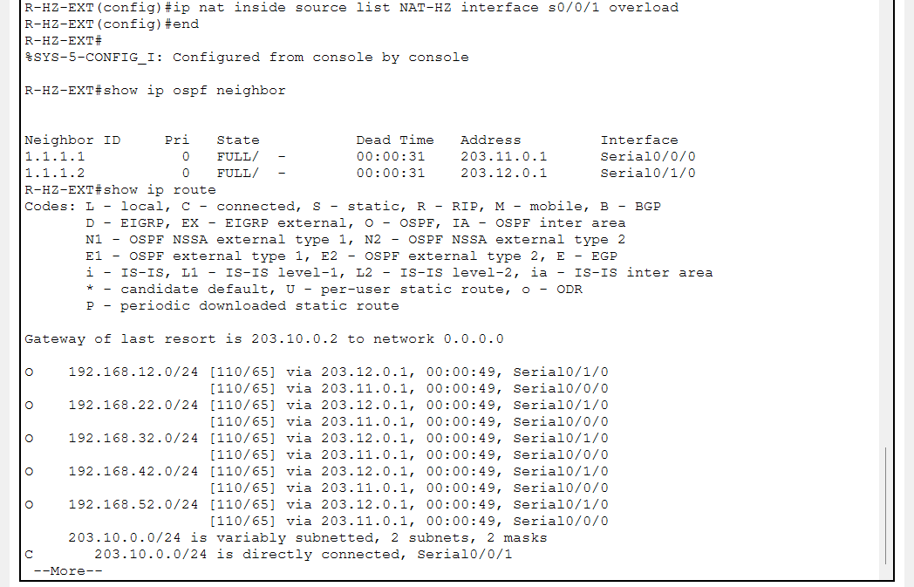

✅ R-HZ-MAIN: `show ip route` → gateway of last resort 203.11.0.2.

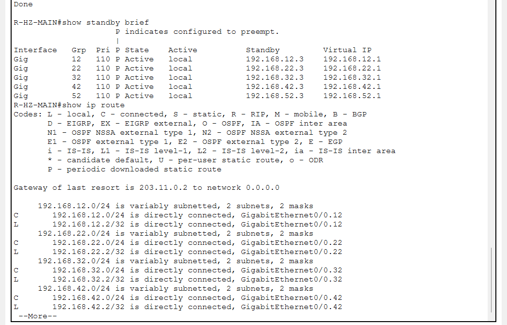

**Be'er Sheva (EIGRP 20):** look at the R-BS block. `show ip eigrp neighbors` in R-BS-EXT shows two neighbors:

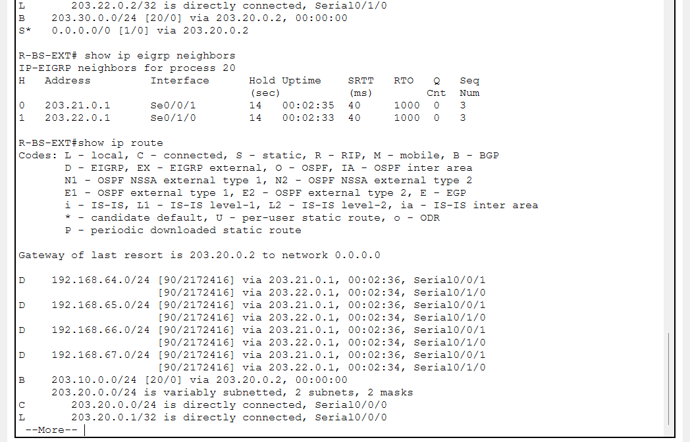

❓ Why is there `no auto-summary`? So that EIGRP announces the exact networks and not a whole class.

<details open><summary><b>📘 The other commands of this mission, explained</b></summary>

| Command | What it does, and why it is here |
|---|---|
| `show ip route` | The routing table. The letter shows who taught it: `C` connected, `O` OSPF, `D` EIGRP, `B` BGP, `S` static. |
| `router ospf 10` | Starts OSPF. The number is local to this router. |
| `show ip ospf neighbor` | The OSPF neighbors. FULL = they exchanged everything. |
| `show ip eigrp neighbors` | The EIGRP neighbors. An empty list = a wrong AS number or network. |

</details>

**⏭ What comes next.** Inside the company everyone knows the way. Outside there is another company.

## Mission 4 — BGP to the provider
**📖 How we got here.** Every branch knows itself. The provider knows none of us.

**🌐 The network now.** Every branch knows itself. Between the branches stands the provider:

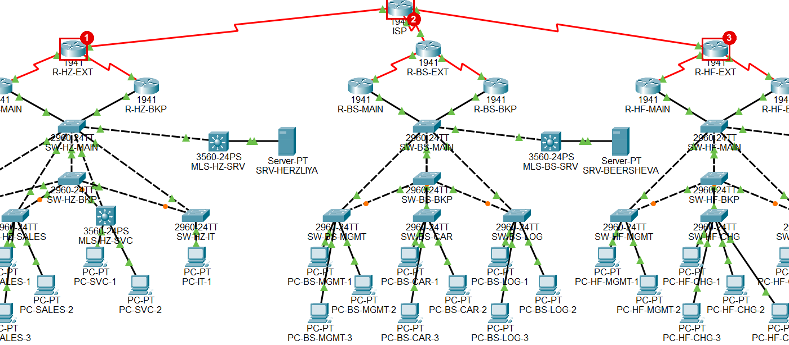

**❗ The problem.** The provider is **another company**: you can't run OSPF together, because then it would see your whole inside network and could change your routes. On the ISP, `show ip bgp summary` returns nothing: no neighbor, so it passes nobody's networks on.

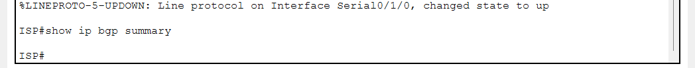

🧠 To be honest: in our small model the three branches touch the **same** provider router, so the default route alone would already reach them. On the real internet there are thousands of providers, and only BGP tells them who is where.

**🎯 What we want now.** BGP: tell the provider only about our public network, and hear from it about the others.

**💡 The solution.** eBGP: each branch is an AS, and it announces **only** its public network to the provider (1.3).

**📋 Do it in the project.** Herzliya = AS 65010, ISP = AS 65000. Configure both sides. Which AS is written after `remote-as`, yours or the neighbor's?

### 🖱 The solution: what to click and what to write
**R-HZ-EXT:**
```
configure terminal
router bgp 65010
neighbor 203.10.0.2 remote-as 65000
network 203.10.0.0 mask 255.255.255.0
end
```

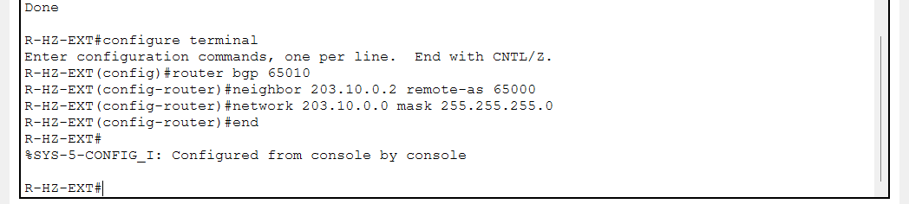

**ISP:**
```
configure terminal
router bgp 65000
neighbor 203.10.0.1 remote-as 65010
neighbor 203.20.0.1 remote-as 65020
neighbor 203.30.0.1 remote-as 65030
end
```

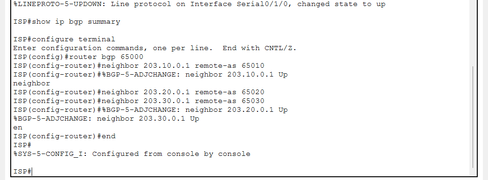

| Command | What it does |
|---|---|
| `router bgp 65010` | our AS number |
| `neighbor 203.10.0.2 remote-as 65000` | who the neighbor is and which AS it's in; both sides must agree |
| `network 203.10.0.0 mask 255.255.255.0` | announces our public network; the mask must be exactly as in the routing table |

✅ ISP: `show ip bgp summary`. Three neighbors, and **MsgRcvd** is above 0.

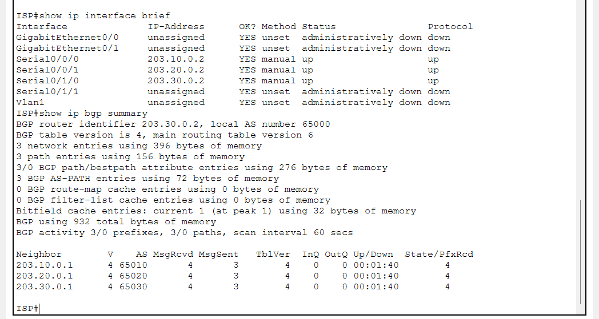

✅ The real proof — R-HF-EXT: `show ip route bgp`. The public networks of the other branches arrived with `B`:

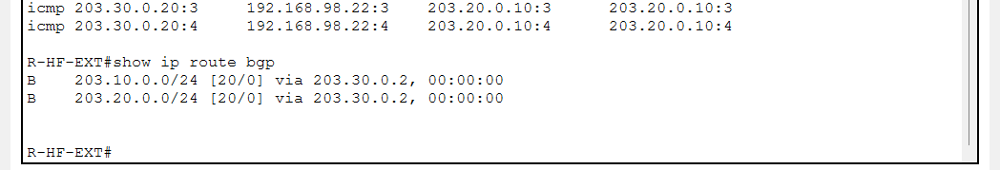

⚠️ In real equipment a word like `Idle` in the last column means "not connected". In Packet Tracer the column shows a number
**even when the AS is wrong** (we checked), so trust `show ip route bgp`.

✅ ISP: `show ip route`. It does **not** know a single 192.168 network, and that is correct: a provider must not know our inside.

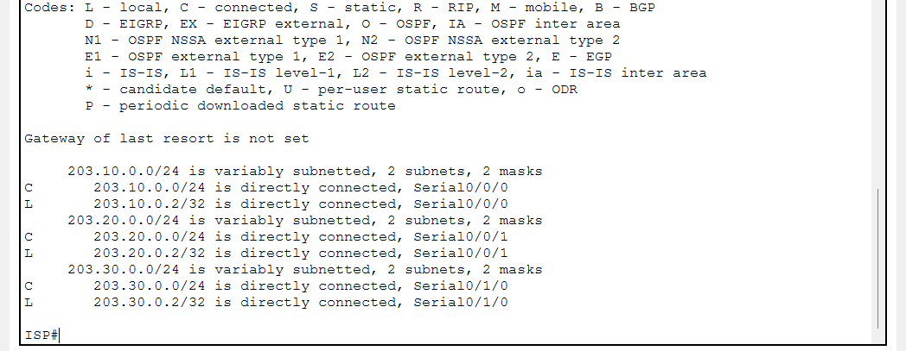

<details open><summary><b>📘 The other commands of this mission, explained</b></summary>

| Command | What it does, and why it is here |
|---|---|
| `show ip bgp summary` | The list of BGP neighbors and the messages received (MsgRcvd). In Packet Tracer a neighbor can look fine even with a wrong AS, so check the routes too. |
| `show ip route bgp` | The routing table. The letter shows who taught it: `C` connected, `O` OSPF, `D` EIGRP, `B` BGP, `S` static. |

</details>

**⏭ What comes next.** The roads exist, and a ping from a PC still fails. Why?

## Mission 5 — NAT
**📖 How we got here.** Routes are ready, but the PCs have private addresses that the internet doesn't know.

**🌐 The network now.** The routes exist. We go out to the internet from 2, and from 5 we enter Be'er Sheva's server:

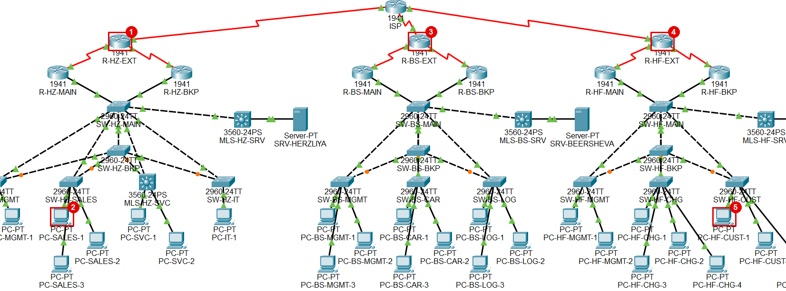

**❗ The problem.** PC-SALES-1 → `ping 203.10.0.2`:

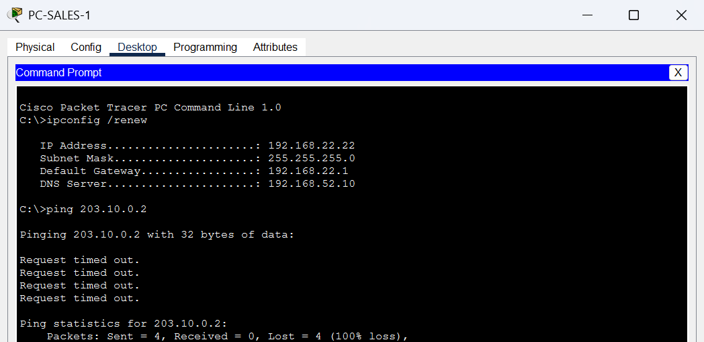

The ping **does** arrive at the provider, but the answer is for 192.168.22.x, and no provider has a route to a private address. The answer dies there.

**🎯 What we want now.** NAT: change the address at the exit, and publish Be'er Sheva's server on a public one.

**💡 The solution.** NAT on the edge router: on the way out replace the private address with a public one, and remember it for the answer (1.4).

**📋 Do it in the project.** PAT on R-HZ-EXT: who is translated, to which address, which ports are inside and which is outside? Then find the static NAT and the pool in the blocks of Be'er Sheva and Haifa.

### 🖱 The solution: what to click and what to write
**R-HZ-EXT (PAT):**
```
configure terminal
ip access-list extended NAT-HZ
permit ip 192.168.0.0 0.0.63.255 any
exit
ip nat inside source list NAT-HZ interface s0/0/1 overload
interface s0/0/0
ip nat inside
interface s0/1/0
ip nat inside
interface s0/0/1
ip nat outside
end
```

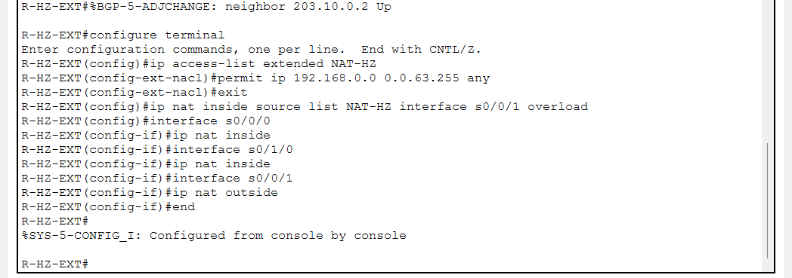

| Command | What it does |
|---|---|
| `permit ip 192.168.0.0 0.0.63.255 any` | who is translated: 192.168.0–192.168.67 |
| `overload` | PAT: many PCs, one address |
| `ip nat inside` / `outside` | which side is home and which is the internet |

✅ **PC-SALES-1**: first `ipconfig` (you need an address), then `ping 203.10.0.2` and `ping 203.20.0.2` (the provider's side of Be'er Sheva).

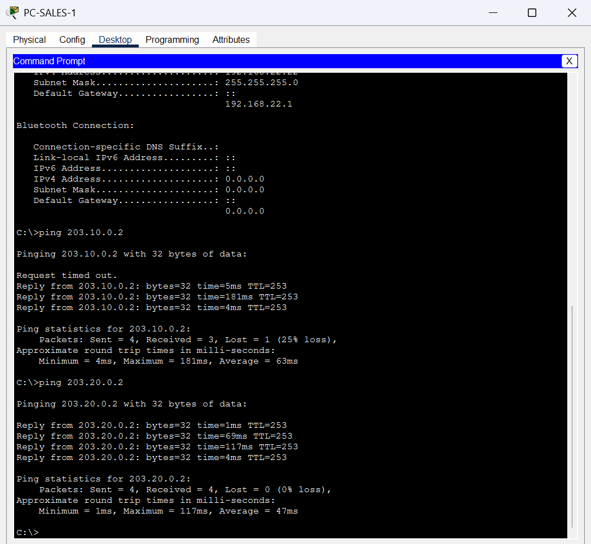

✅ Immediately on R-HZ-EXT: `show ip nat translations`. 192.168.22.20 goes out as **203.10.0.1**.

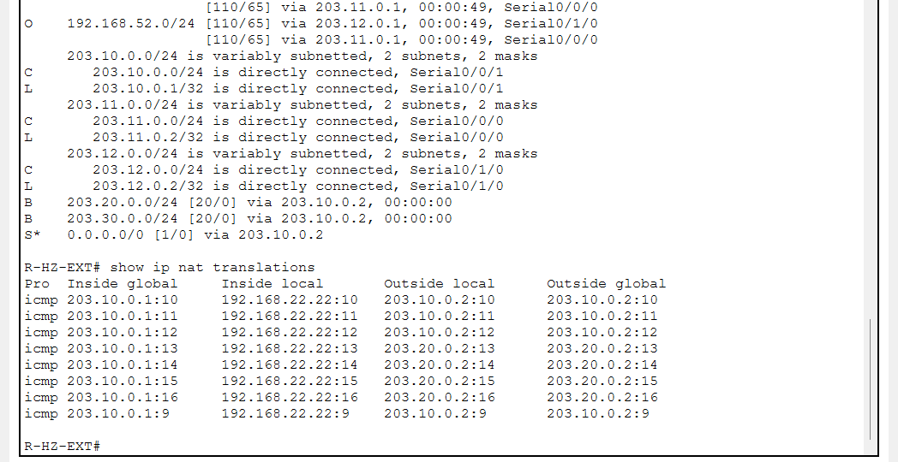

**Static NAT in Be'er Sheva** (in the pasted block): the server 192.168.67.10 is published as **203.20.0.10**.
From **PC-HF-CUST-1** in Haifa: `ping 203.20.0.10`, and in the browser `http://203.20.0.10`:

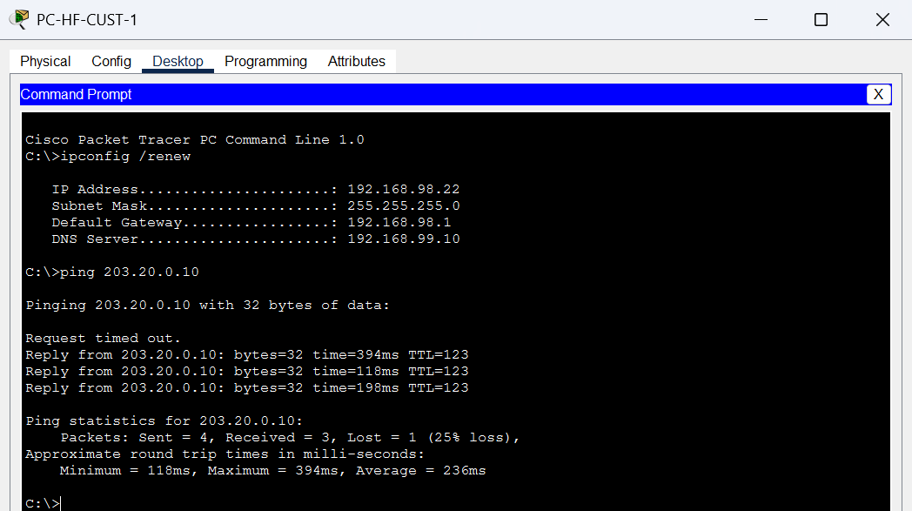

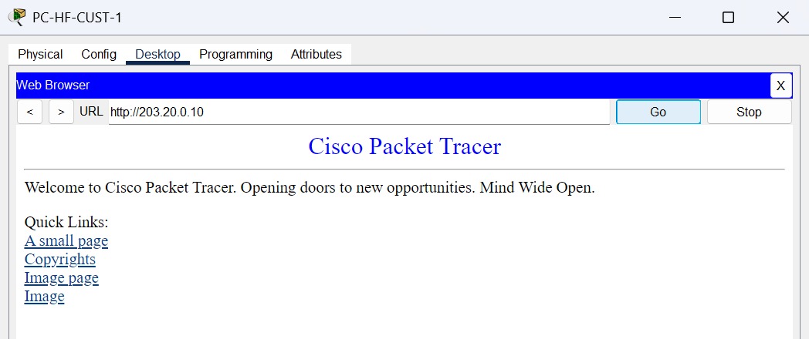

In R-BS-EXT the `---` line is permanent: that is the static translation.

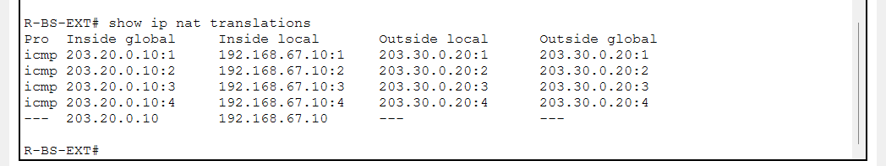

**Pool in Haifa:** the same PC went out as 203.30.0.20, the first address of the pool.

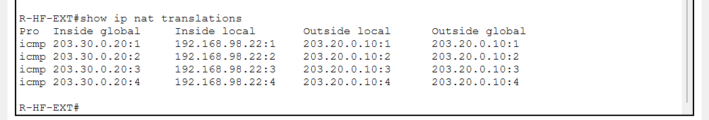

<details open><summary><b>📘 The other commands of this mission, explained</b></summary>

| Command | What it does, and why it is here |
|---|---|
| `ping 203.10.0.2` | Sends 4 test messages. Replies = the road works in **both** directions. |
| `ip access-list extended NAT-HZ` | Opens a list by name or number, so lines can be added or inserted. |
| `ip nat inside source list NAT-HZ interface s0/0/1 overload` | PAT: everyone in the list goes out with the **one** address of this port; `overload` tells them apart by port numbers. |
| `interface s0/0/0` | Chooses the port. Everything below applies to it, until `exit`. |
| `ip nat outside` | This port is on the **internet** side. |
| `ipconfig` | Shows the address, mask and gateway of the PC. |
| `show ip nat translations` | Who was translated to which address. |

</details>

**⏭ What comes next.** Everything works, with two ways out. Let's see if it's true.

## Mission 6 — Cut the line
**📖 How we got here.** Two lines, HSRP with track, OSPF and NAT all work together.

**🌐 The network now.** Everything works, with two ways out:

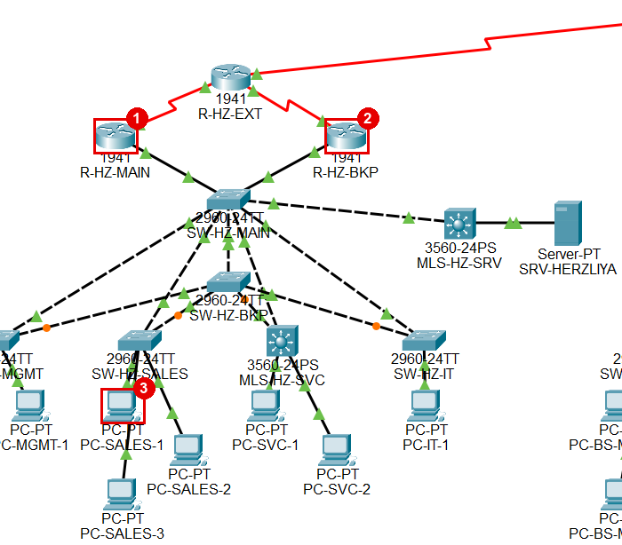

**❗ The problem.** In Mission 2 we saw the main stay Active without internet. Did `track` really solve it? We have to prove it.

**🎯 What we want now.** Cut the main line during a ping, and follow what each protocol does.

**💡 The solution.** Cut the same line again and compare: this time the priority must drop to 100 and the backup must take over.

**📋 Do it in the project.** Cut, check `show standby brief`, check `tracert` from PC-SALES-1, bring it back.

### 🖱 The solution: what to click and what to write
1. **R-HZ-MAIN**: `interface s0/0/0` → `shutdown`. Wait 15 seconds, `show standby brief`: priority **100**, and it's no longer Active (it passes through *Speak* to *Standby*).

   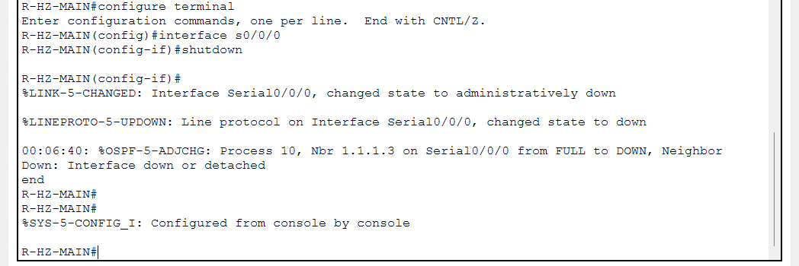

   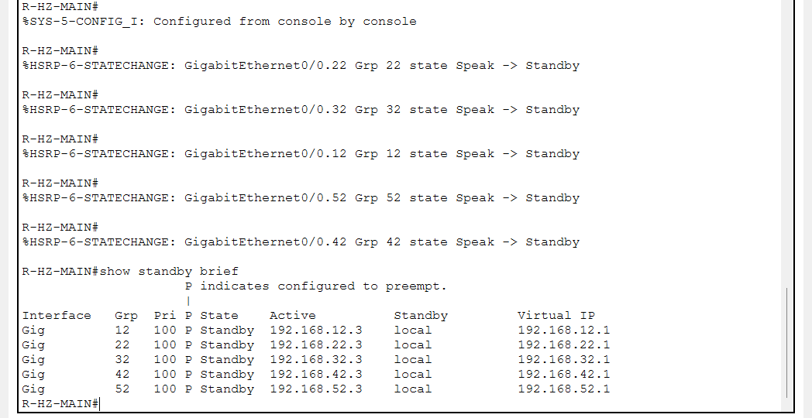
2. **PC-SALES-1**: `tracert 203.10.0.2` → .3 → 203.12.0.2: through the backup, and the internet still works.

   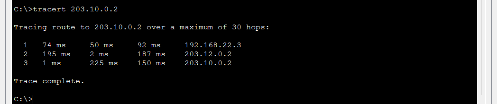
3. `no shutdown`, and after about 30 seconds R-HZ-MAIN is Active again.

   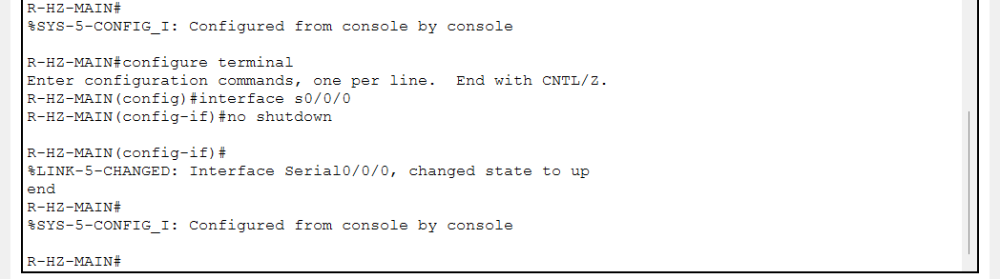

4. Save on all **ten** routers (also ISP, Be'er Sheva and Haifa): `copy running-config startup-config`. Then File → Save.

<details open><summary><b>📘 The commands of this mission, explained</b></summary>

| Command | What it does, and why it is here |
|---|---|
| `show standby brief` | Who is Active and who is Standby in each group, and the priority. |
| `tracert` | Shows every router on the way. |
| `interface s0/0/0` | Chooses the port. Everything below applies to it, until `exit`. |
| `shutdown` | Turns the port off. |
| `no shutdown` | Turns the port on. Router ports are off by default. |

</details>

**⏭ What comes next.** The company is connected, and open. Lesson 5 decides who may pass.

## 👀 See it happen — NAT changes the address
Simulation was explained in [lesson 1](../lesson-01/). First in Realtime: `ping 203.10.0.2` from PC-SALES-1 works.
**Simulation** → only **ICMP** → `ping 203.10.0.2` again, and step until the packet comes back.

**On the way out**, open the packet on **R-HZ-EXT**:

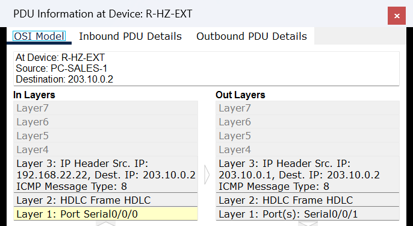

**On the way back**, on the same router:


| | In | Out |
|---|---|---|
| On the way out: the source | 192.168.22.22 | **203.10.0.1** |
| On the way back: the destination | 203.10.0.1 | **192.168.22.22** |


❓ The provider sees only 203.10.0.1. How does R-HZ-EXT know who gets the answer?

<details><summary>Answer</summary>

It wrote a line in the translation table (`show ip nat translations`) when the packet went out, and reads it in the opposite
direction.

</details>

💡 Layer 2 is now **HDLC** and not Ethernet: a serial line has only two sides, so no MACs are needed.

✏️ **Try:** open the packet on **ISP**, layer 3. Is there a 192.168 address there?

<details><summary>Answer</summary>

No. That is also why the provider needs no route to your private networks.

</details>

## 🧯 It doesn't work?
| What you see | Probably | What to do |
|---|---|---|
| a serial link is red on one side | `no shutdown` is missing on one end | `show ip interface brief` on both ends |
| `up/down` | `clock rate` is missing on the DCE | `show controllers`, then `clock rate 2000000` |
| no OSPF neighbor | wrong network/wildcard, or a different area | `show ip protocols`, `show run` |
| no EIGRP neighbor | a different AS number | 20 in Be'er Sheva, 30 in Haifa, on all three routers |
| ping to the internet fails, OSPF is fine | NAT | `ip nat inside` / `outside` on the right ports |
| `show ip nat translations` is empty | the entries expired | ping, and look immediately |
| the first ping is lost | ARP / routes are still being learned | ping again |

---

## 🔎 Find the bug — from real projects
1. Be'er Sheva used 192.168.52.0, the same network as the servers in Herzliya.
2. The ISP ran OSPF + two EIGRP + BGP with **redistribution** between all of them.
3. Only **one** BGP neighbor was configured, out of three.
4. All three branches used PAT only, although the book promised static and dynamic.

<details><summary>Answer</summary>

1. Two branches with the same network can never be connected: the router doesn't know where to send. Fix: Be'er Sheva uses 64–67, and plan the addresses for the **whole** company in advance.
2. The provider knows all the private networks of the customers: not realistic, and not safe. Fix: IGP only inside the branch, eBGP to the provider, a default route out.
3. BGP has no automatic neighbors. Each side must be written by hand.
4. Static for a server that people enter from outside, a pool for dynamic, PAT for the rest. The examiner checks that what is written in the book exists in the file.

</details>

## 🏋 Exercises
1. On R-HZ-EXT remove `ip nat inside` from s0/0/0 and ping from PC-SALES-1. What happens and why? Put it back.
2. Change the AS of the neighbor in R-HF-EXT to 312. What does `show ip bgp summary` show? Put it back.
3. Calculate the wildcard of 255.255.252.0. Which networks does `192.168.96.0 0.0.3.255` cover?

<details><summary>Answers (we tested 1 and 2)</summary>

1. `Request timed out`, and the translation table is empty. The packet goes out as 192.168.22.x; the provider doesn't know this network, so the answer cannot return. After `ip nat inside` the ping works.
2. `%BGP-3-NOTIFICATION ... (peer in wrong AS)`, and `show ip route bgp` is **empty**. To return: `no neighbor 203.30.0.2 remote-as 65001` and then `neighbor 203.30.0.2 remote-as 65000`.

   
3. 0.0.3.255. 192.168.96.0, 97.0, 98.0 and 99.0.

</details>

## 🎓 Explain it to the examiner
- What is the difference between an IGP and an EGP? Why not OSPF to the provider?
- What are DCE and DTE?
- Why is the admin distance important when there are two protocols?
- What is the difference between PAT, static and dynamic NAT? What are inside local and inside global?
- What does `standby track` do, and why on the serial and not on the LAN?

<details><summary>Model answers</summary>

1. IGP = inside one company (OSPF, EIGRP). EGP = between companies (BGP). With OSPF the provider would learn our whole inside, and our faults would reach it.
2. The two ends of a serial line. DCE gives the clock, DTE receives it.
3. If the same network is learned from two protocols, the one with the lower distance enters the table: EIGRP 90 before OSPF 110.
4. PAT: many → one, by ports. Static: one ↔ one, permanent, allows entering. Dynamic: one ↔ one, temporary, from a pool. Local = the real address inside, global = how the world sees it.
5. Lowers the priority when a port falls. HSRP already notices a LAN failure by itself, but without track it doesn't know that the internet line fell.

</details>

## ✏️ Exit quiz (3 minutes)
1. Which protocol runs between R-HZ-EXT and the ISP?
2. What is the wildcard of /24?
3. Which NAT would you choose for a web server?
4. What does `S*` mean in the routing table?
5. EIGRP 20 on one router and EIGRP 30 on its neighbor. What happens?

<details><summary>Answers</summary>

1. eBGP.
2. 0.0.0.255.
3. Static.
4. A static default route.
5. They don't become neighbors.

</details>

## ⏭ What we did, and what comes next
**What we did.** Three islands are connected to the world. Routes are learned automatically, and each branch has two lines to its edge router.

**What is still missing.** We opened the doors **to everybody**. Logistics can reach the manager's PC, traffic between branches crosses the internet unencrypted, the devices are managed with one shared password, and nobody knows what happened at night.

**What comes next.** In [lesson 5](../lesson-05/) we don't add roads. We decide **who may use them**.

## 🛠 Your project book
- [ ] The address plan of **all** the branches. Check that nothing appears twice.
- [ ] The WAN table with DCE/DTE.
- [ ] One paragraph each: OSPF, EIGRP, BGP, and the three kinds of NAT. Why is each one where it is?
- [ ] Screenshots: `show ip ospf neighbor`, `show ip eigrp neighbors`, `show ip bgp summary`, `show ip nat translations`, the failure test.
