# Lesson 05 — Security and management: ACL, VPN, SSH, AAA, NTP, Syslog and ASA

> ⏱ 90 minutes · 🧰 Packet Tracer 9.x · 📂 start: [`lesson05-start.pkt`](lesson05-start.pkt) or your own file after [Part D](../from-zero/README.md#part-d--the-firewall-and-the-servers-of-beer-sheva-and-haifa) · 💾 save as `lesson05.pkt`

## What you will have at the end
A protected company: departments that can't reach what they shouldn't, an encrypted tunnel
Herzliya ↔ Haifa, encrypted management with central users, correct time and logs, and a firewall.

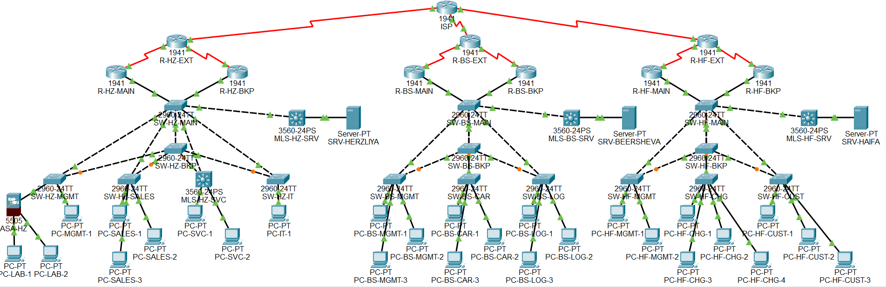

## 📖 The story — chapter 5: closing the doors that should be closed
**How we got here.** One department (1), five departments (2), a full branch (3), three branches on the internet (4). In four lessons we only **opened** things, because our goal was that everything would work.

**Where we are now.** Everything works, **for everybody**: Logistics pings the manager, Haifa and Herzliya talk in clear text, almost 30 devices share one password, each one shows a different time, and a new test lab sits without protection (the start file, or [Part D](../from-zero/)).

**What we want today.** Each person reaches only what they need, nobody can read our traffic, every login has a name and a time, and the lab can go out while nobody comes in.

**The road of today:**

| Mission | The question it answers | Why exactly now |
|---|---|---|
| 1 Server | who are the users? | the devices will ask the server, so it must be ready first |
| 2 ACL | who may reach what? | first the rules inside each branch |
| 3 VPN | who can read what travels outside? | inside is ruled, now the road between the branches |
| 4 SSH, AAA, NTP, Syslog | who logged in, from where, and when? | the last open door is the devices themselves |
| 5 ASA | how do we protect a whole area? | everything above checks packets; a firewall remembers **conversations** |

## Plan your time (90 minutes, take breaks)
| Minutes | Part |
|---|---|
| 0–15 | Part 1 — read the theory, answer every ❓ before you open the answer |
| 15–23 | Mission 1 — the server (AAA, NTP, Syslog) |
| 23–35 | Mission 2 — ACL |
| 35–58 | Mission 3 — VPN, including the planned failure |
| 58–72 | Mission 4 — SSH, AAA, NTP, Syslog (Herzliya by hand, the rest by pasting) |
| 72–83 | Mission 5 — ASA |
| 83–90 | Final test table, your project book |

This is the fullest lesson. If time runs out: the switch SSH (4.4) and the ASA can wait for another day.
The AAA and NTP services of the Be'er Sheva and Haifa servers are already configured in the start file.

---

## Part 1 — Theory: understand it first

### 1.1 ACL
A list of rules, read from **top to bottom**. The first match wins, and at the end there is an invisible **deny all**.

| | Standard | Extended |
|---|---|---|
| Checks | source only | source, destination, protocol, port |
| Numbers | 1–99 | 100–199 |
| Placed | near the **destination** | near the **source** |

💬 **In simple words:** a guard at the door with a list. The guard reads from the top, acts on the **first** line that fits, and
whoever isn't on the list doesn't enter.

**Example — read our list (Mission 2) as the router does:**

| Packet | First line that fits | Result |
|---|---|---|
| 0.0.0.0 → 255.255.255.255, UDP 67 (DHCP) | `permit udp any any eq bootps` | ✅ passes |
| 192.168.66.22 → 192.168.64.21, ping | `deny ip ...66.0 ...64.0` | ❌ blocked |
| 192.168.66.22 → 192.168.67.10, TCP 80 | `permit tcp ... eq www` | ✅ passes |
| 192.168.66.22 → 192.168.67.10, ping | `deny ip ...66.0 ...67.0` | ❌ blocked |
| 192.168.66.22 → 203.20.0.2, ping | `permit ip ...66.0 any` | ✅ passes |

❓ **Ask yourself:** what happens if the last line is written first?

<details><summary>Answer</summary>

It fits everything that VLAN 66 sends, so the deny lines are never reached and nothing is blocked.

</details>

### 1.2 VPN IPsec
| Phase | What happens | Command |
|---|---|---|
| 1 (ISAKMP) | the routers identify each other (key) and agree on encryption | `crypto isakmp policy` |
| 2 (IPsec) | the data itself is encrypted (ESP) | `transform-set` |

- **Encryption** (AES) — nobody can read. **Hash** (SHA) — nobody changed it. **Pre-shared key** — it's really you. **DH group** — creating a shared secret over an open line.
- **Interesting traffic**: an ACL that says what enters the tunnel.

💬 **In simple words:** two branches send letters by regular mail, inside a locked safe. The mail carriers see only the
addresses of the branches, not what is inside or who wrote to whom.

**Example — a ping from PC-HF-CUST-1 (192.168.98.23) to the Herzliya server:**

| Where | Source → destination | Can be read? |
|---|---|---|
| in the Haifa LAN | 192.168.98.23 → 192.168.52.10 | yes |
| on the internet | **203.30.0.1 → 203.10.0.1** (ESP) | no, encrypted |
| in the Herzliya LAN | 192.168.98.23 → 192.168.52.10 | yes |

### 1.3 AAA
| | Question |
|---|---|
| Authentication | who are you? |
| Authorization | what are you allowed to do? |
| Accounting | what did you do? |

| | TACACS+ | RADIUS |
|---|---|---|
| Port | TCP 49 | UDP 1645 / 1812 |
| Encrypts | the whole message | only the password |
| Good for | managing network devices | Wi-Fi and VPN users |

💬 **In simple words:** entering a company building. The guard checks who you are (authentication), your card opens only
some doors (authorization), and the camera records where you were (accounting).

**Example — `ssh -l teslauser 192.168.12.2`:** the router asks the TACACS+ server "is this password right?" → yes → in. If the server
**doesn't answer**, the router checks its own local users (`local`). If the server answers "no", there is **no** second chance.

### 1.4 The rest
- **SSH** — encrypted management. Telnet sends passwords as plain text.
- **NTP** — the same time everywhere, otherwise the logs are worthless. With authentication, so nobody can fake it.
- **Syslog** — all messages to one server.
- **ASA** — a firewall: from security level 100 (inside) to 0 (outside) is allowed, the other way is **blocked**. `inspect` lets the **answers** return.

**Example — the ASA decides:**

| Packet | Levels | Result |
|---|---|---|
| PC-LAB-1 → server, new connection | 100 → 0 | ✅ |
| server → PC-LAB-1, the **answer** | 0 → 100 | ✅ thanks to `inspect` |
| PC-MGMT-1 → PC-LAB-1, new connection | 0 → 100 | ❌ |

---

## 🔑 Opening a device
Click the device → **CLI** (1) → click in the text, Enter → `Tesla#Con` → `enable` → `Tesla#En1`. With pictures: [lesson 2](../lesson-02/).

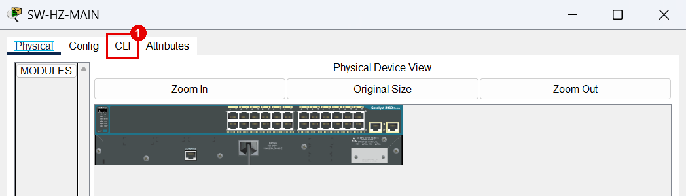

**How every mission is built:** 🌐 the network now → ❗ the problem → 💡 the solution → 📋 do it yourself → 🖱 the full solution, with what to click, what to write and what you must see.

## Mission 1 — The server
**📖 How we got here.** Three branches on the internet, and almost 30 devices with one shared password.

**🌐 The network now.** Three branches on the internet. We start from the server of Herzliya:

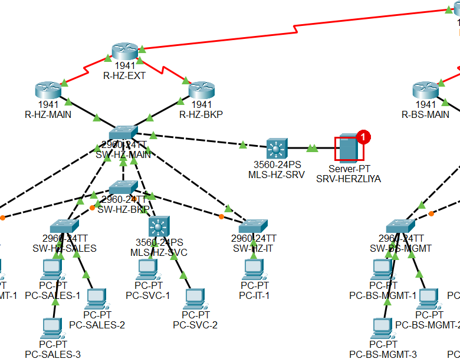

**❗ The problem.** Almost 30 devices with the same password, written on a note. An employee leaves: you change them all. Something happened at night: each device shows a different time and keeps its own log. The AAA service is empty and off:

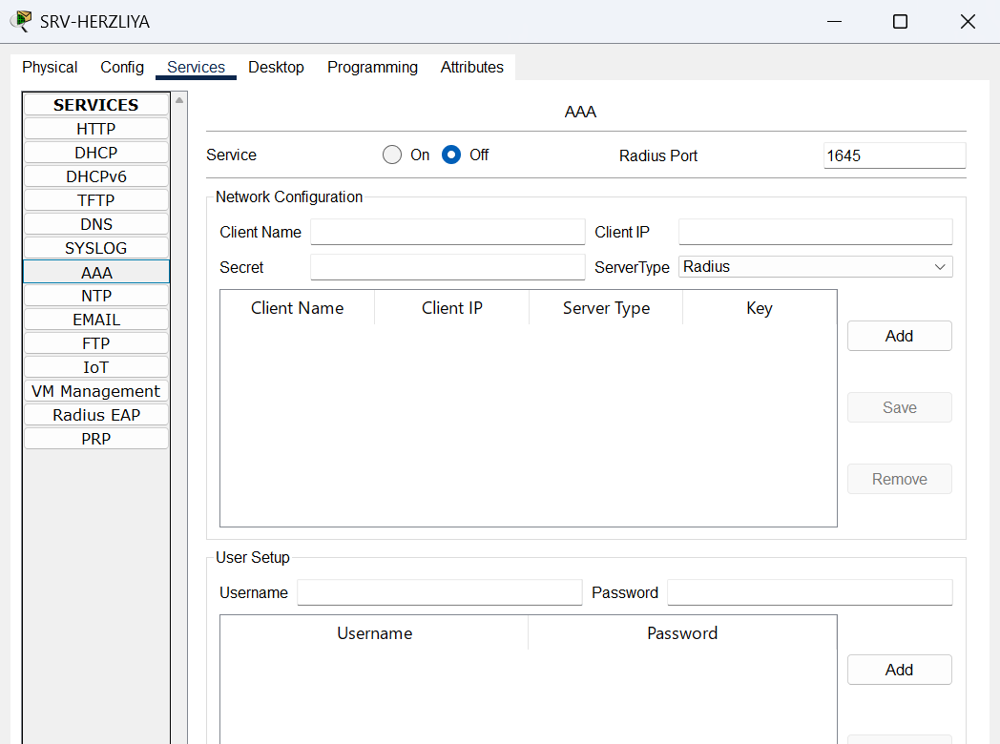

**🎯 What we want now.** One place with users (AAA), one correct clock (NTP) and one diary (Syslog). The devices will use them in Mission 4.

**💡 The solution.** One server that checks users (**AAA**), gives the time (**NTP**) and collects the messages (**Syslog**). We prepare the server now and connect the routers in Mission 4.

**📋 Do it in the project.** Two AAA clients (the two routers), one user, NTP with key 1, Syslog on.

### 🖱 The solution: what to click and what to write
Click **SRV-HERZLIYA** → **Services** (1) → AAA (2), NTP (3), SYSLOG (4):

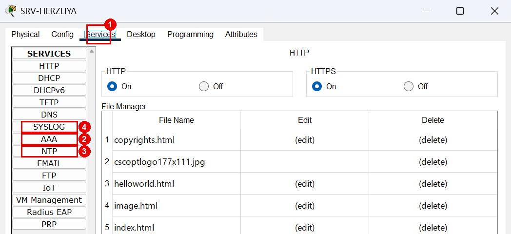

**SRV-HERZLIYA** → Services → **AAA** → On (1). Client Name (2), Client IP (3), Secret (4), ServerType → **Tacacs** → **Add** (5):

| Client Name | Client IP | Secret | Type |
|---|---|---|---|
| R-HZ-MAIN | 192.168.52.2 | Tesla#Aaa | Tacacs |
| R-HZ-BKP | 192.168.52.3 | Tesla#Aaa | Tacacs |

Below: Username (6) `teslauser`, Password `Tesla#User` → **Add** (7).

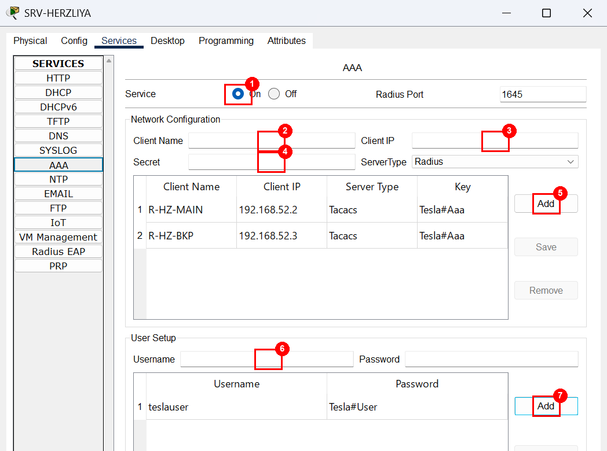

**NTP** → Authentication **Enable** (1), Key (2) `1`, Password (3) `Tesla#Ntp`. It is shown as `01`, and it works.

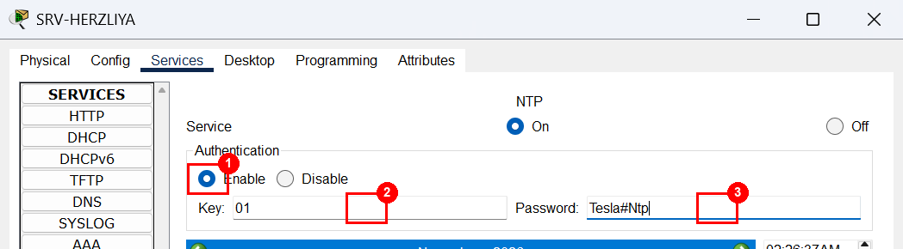

**SYSLOG** → check that it is On.

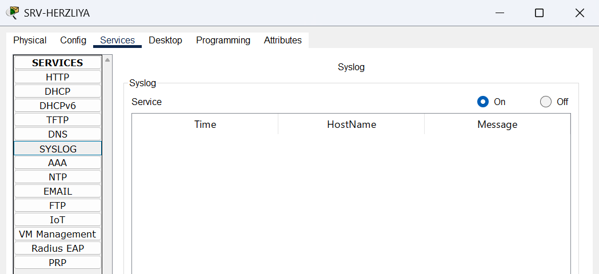

Messages from the routers appear in this list only after Mission 4.

| Field | What it is | Must match |
|---|---|---|
| Client | the router that will ask the server | its address towards the server (VLAN 52) |
| Secret | a key between router and server | `tacacs-server host ... key` |
| ServerType | the language: Tacacs / Radius | `group tacacs+` on the router |
| Username | the person who logs in | only here, not on the router |

**⏭ What comes next.** Before the devices, the departments: who may reach whom?

## Mission 2 — ACL in Be'er Sheva and Haifa
**📖 How we got here.** In lesson 3 we opened everything to everybody, because we wanted it to work.

**🌐 The network now.** Be'er Sheva: logistics is VLAN 66, management VLAN 64, the server 67. Haifa: charging 97, management 96.

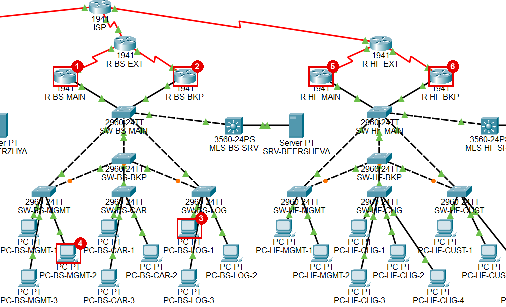

**❗ The problem.** In lesson 3 we opened everything to everybody. A logistics PC can ping the manager's PC and try to enter any service on the server. We'll see it in the first screenshot.

**🎯 What we want now.** Rules: Logistics reaches only the services it needs, and Charging in Haifa doesn't reach Management.

**💡 The solution.** An **extended ACL**, close to the source: on the sub-interface of VLAN 66, on **both** routers (1.1).

**📋 Do it in the project.** Before looking: write in words, line by line, what is allowed and what is not, in the right order. Don't forget how a PC gets its address.

### 🖱 The solution: what to click and what to write
**Goal:** logistics (VLAN 66) does not reach management (VLAN 64), and gets only web, DNS and FTP from the server.

Before: from **PC-BS-LOG-1** check the address of PC-BS-MGMT-2 and ping it. It works.

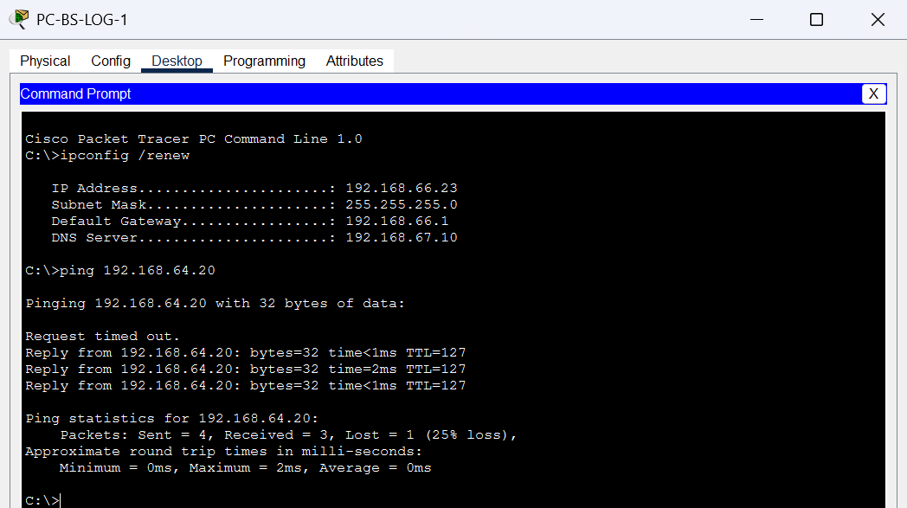

On **R-BS-MAIN and also R-BS-BKP**:
```
configure terminal
access-list 110 permit udp any any eq bootps
access-list 110 deny ip 192.168.66.0 0.0.0.255 192.168.64.0 0.0.0.255
access-list 110 permit tcp 192.168.66.0 0.0.0.255 host 192.168.67.10 eq www
access-list 110 permit udp 192.168.66.0 0.0.0.255 host 192.168.67.10 eq domain
access-list 110 permit tcp 192.168.66.0 0.0.0.255 host 192.168.67.10 eq ftp
access-list 110 deny ip 192.168.66.0 0.0.0.255 192.168.67.0 0.0.0.255
access-list 110 permit ip 192.168.66.0 0.0.0.255 any
interface g0/0.66
ip access-group 110 in
end
```

**R-BS-MAIN:**

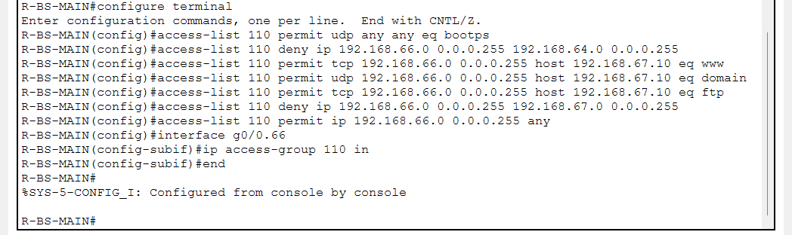

**R-BS-BKP, the same commands:**

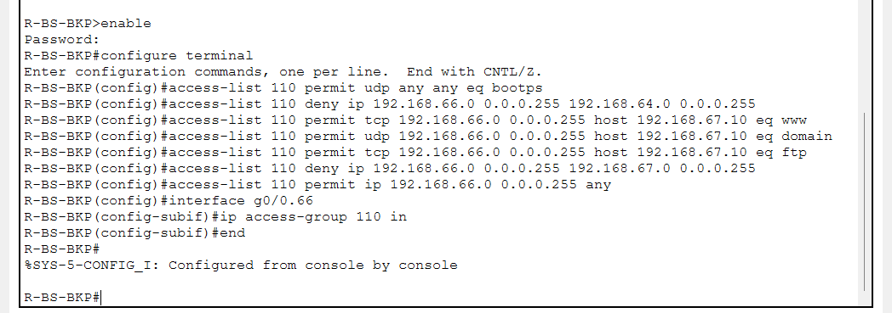

❓ **Why the first line?** A PC asking for DHCP has no address yet: it sends from 0.0.0.0, and no
other line allows that. We tested without it, on both routers: `ipconfig /renew` hangs.

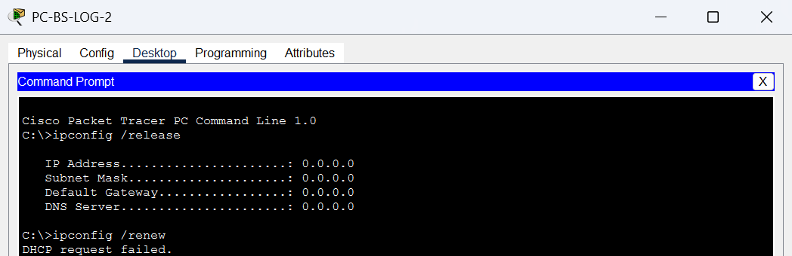

❓ **Why on both routers?** Each can be Active. We also tested on the main only, without the bootps line: DHCP still worked, because
the **backup** relayed the request. An ACL on one router is full of holes.

✅ From PC-BS-LOG-2: management — blocked, ping to the server — blocked, internet — works, web — works.


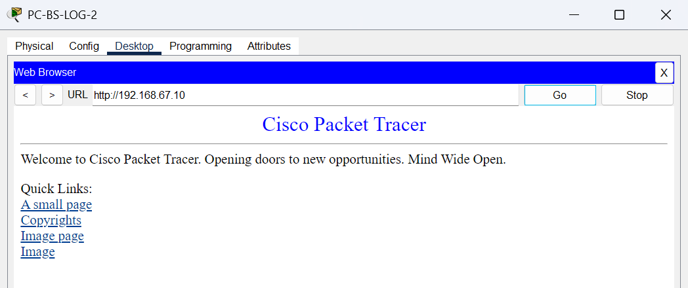

✅ R-BS-MAIN: `show access-lists` → the matches count.

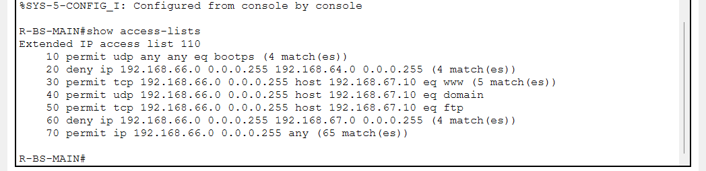

### 2.1 🔎 FTP connects, but `dir` hangs. Why?
From **PC-BS-LOG-2**: `ftp 192.168.67.10`, user `beersheva`, password `Tesla#Ftp`. Login works. Now `dir`:

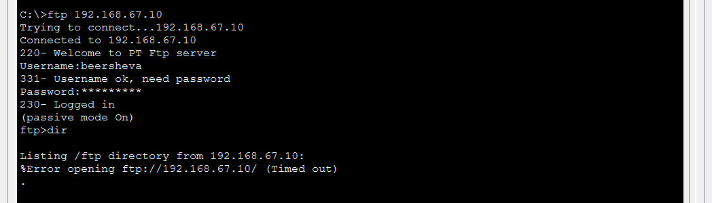

<details><summary>Answer</summary>

FTP uses **two** connections: commands on port 21, and data on another port. In *passive mode* the server chooses a high
port (above 1023) for the data. We opened only 21, so the data falls on the `deny ip ... 192.168.67.0` line.

</details>

The fix, on **R-BS-MAIN and R-BS-BKP**. Number 52 puts the line **before** the deny (60):
```
configure terminal
ip access-list extended 110
52 permit tcp 192.168.66.0 0.0.0.255 host 192.168.67.10 gt 1023
end
copy running-config startup-config
```

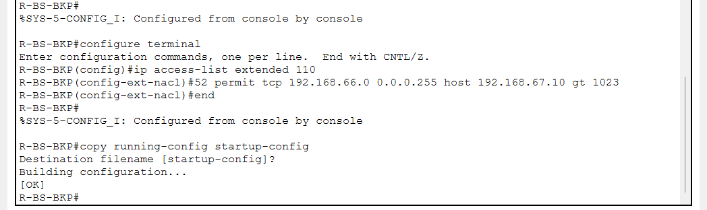

On R-BS-MAIN, check with `show access-lists`:

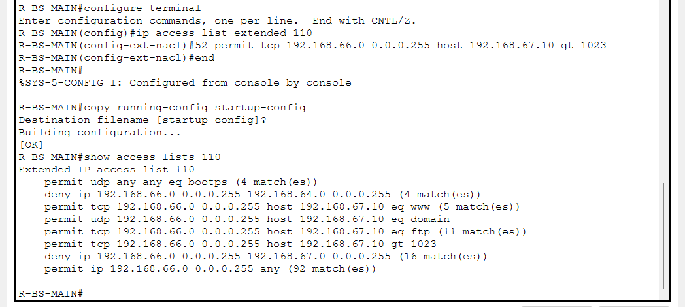

✅ From PC-BS-LOG-3 the list arrives, and a ping to the server is still blocked. (`quit` leaves FTP.)

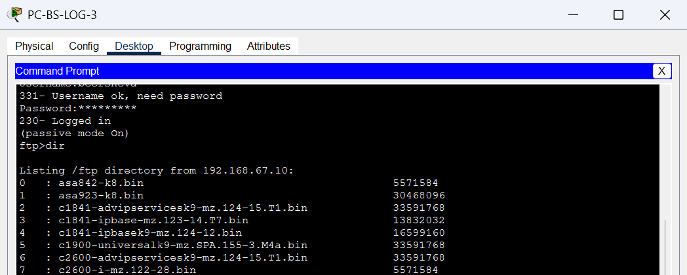

### 2.2 Haifa

❗ The same problem in Haifa: charging reaches management. 💡 The same idea, one deny line.

**Haifa** (charging 97 does not reach management 96), **R-HF-MAIN and R-HF-BKP**:
```
configure terminal
access-list 120 permit udp any any eq bootps
access-list 120 deny ip 192.168.97.0 0.0.0.255 192.168.96.0 0.0.0.255
access-list 120 permit ip 192.168.97.0 0.0.0.255 any
interface g0/0.97
ip access-group 120 in
end
copy running-config startup-config
```

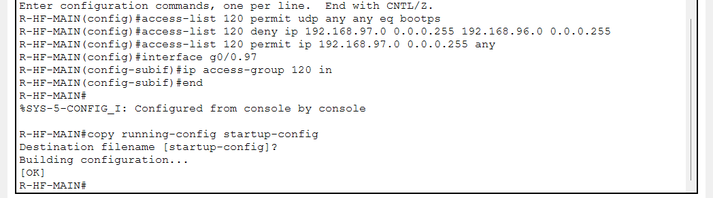


<details open><summary><b>📘 The commands of this mission, explained</b></summary>

| Command | What it does, and why it is here |
|---|---|
| `access-list 110 permit udp any any eq bootps` | First of all allow DHCP, otherwise the PCs of this VLAN lose their address. |
| `access-list 110 deny ip 192.168.66.0 0.0.0.255 192.168.64.0 0.0.0.255` | Blocks everything from the first network to the second one. |
| `access-list 110 permit tcp 192.168.66.0 0.0.0.255 host 192.168.67.10 eq www` | Allow the website of the server (TCP 80), and only from this network. |
| `access-list 110 permit udp 192.168.66.0 0.0.0.255 host 192.168.67.10 eq domain` | Allow DNS questions to the server (UDP 53). |
| `access-list 110 permit tcp 192.168.66.0 0.0.0.255 host 192.168.67.10 eq ftp` | Allow the FTP **control** connection (TCP 21). The data connection needs another line. |
| `access-list 110 permit ip 192.168.66.0 0.0.0.255 any` | Allows the rest. Without it the invisible `deny` at the end blocks everything. |
| `interface g0/0.66` | A **sub-interface**: a virtual door on the same physical port, one for each VLAN. |
| `ip access-group 110 in` | Puts the list on the port; `in` = what enters the router from this network. A list that isn't on a port does nothing. |
| `ipconfig /renew` | The PC asks DHCP for an address again. |
| `show access-lists` | The lines of the list, and how many packets met each one. |
| `ip access-list extended 110` | Opens a list by name or number, so lines can be added or inserted. |
| `52 permit tcp 192.168.66.0 0.0.0.255 host 192.168.67.10 gt 1023` | Inserts a line **between** existing ones (52 is after 50): the FTP data ports, above 1023. |
| `copy running-config startup-config` | Saves what is in memory to the startup file. Without it a power failure erases the work. |

</details>

**⏭ What comes next.** Inside the branch there is order. Between the branches our data crosses the internet, readable.

## Mission 3 — VPN Herzliya ↔ Haifa
**📖 How we got here.** Herzliya and Haifa are both on the internet, behind NAT, and can't reach each other's private networks.

**🌐 The network now.** Herzliya and Haifa, each behind NAT, with the internet in between:

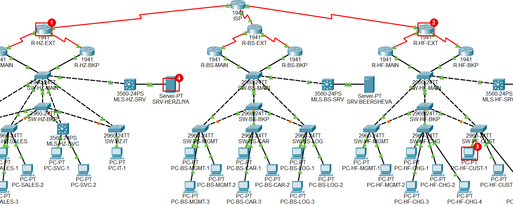

**❗ The problem.** An employee in Haifa needs the server in Herzliya. PC-HF-CUST-1 → `ping 192.168.52.10`:

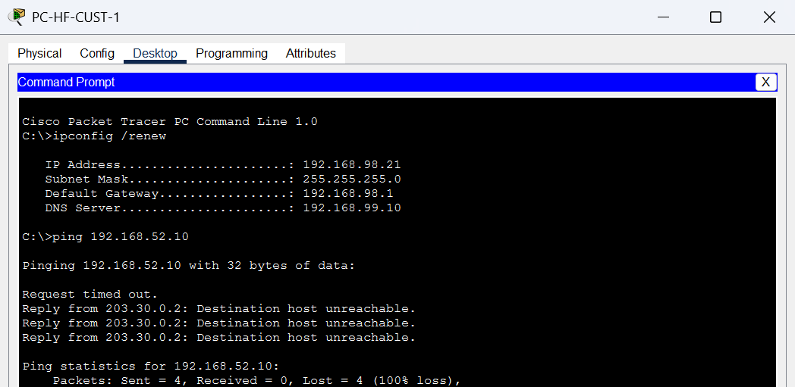

The provider doesn't know private addresses. And even if we published the server with static NAT, everything would travel **unencrypted** and everybody could try to get in.

**🎯 What we want now.** An encrypted tunnel through the internet, as if there were a private cable between them.

**💡 The solution.** A site-to-site **IPsec VPN**: the private packet travels, encrypted, inside a public packet (1.2).

**📋 Do it in the project.** License → tunnel on both sides → test → find out why it fails → fix. The two sides must be a mirror image.

### 🖱 The solution: what to click and what to write
### 3.1 The license

❗ The router doesn't know the `crypto` commands. 💡 Activate the security license, save and restart.

On R-HZ-EXT try `crypto isakmp policy 10`. The 1941 doesn't know the command:

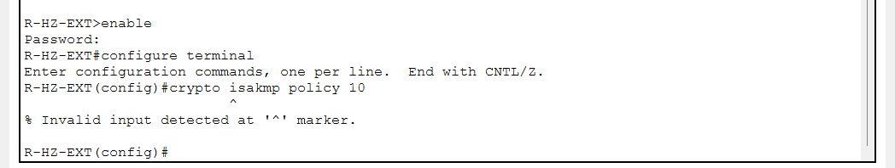

On **R-HZ-EXT and R-HF-EXT**:
```
configure terminal
license boot module c1900 technology-package securityk9
```
The license agreement appears. ⚠️ **Nothing was printed?** That can happen in Packet Tracer when the router was restarted before.
Write **the same command again**, and then it appears:

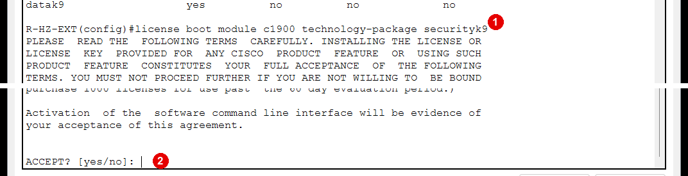

At `ACCEPT? [yes/no]:` answer `yes`. You must see `Next reboot level = securityk9`. Then:
```
end
copy running-config startup-config
reload
```

After `yes`, on R-HF-EXT:

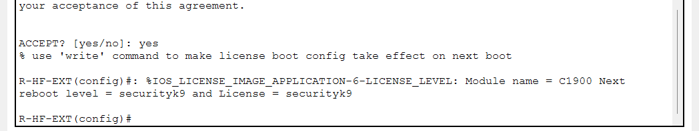

At `Proceed with reload? [confirm]` press **Enter**. The router restarts:

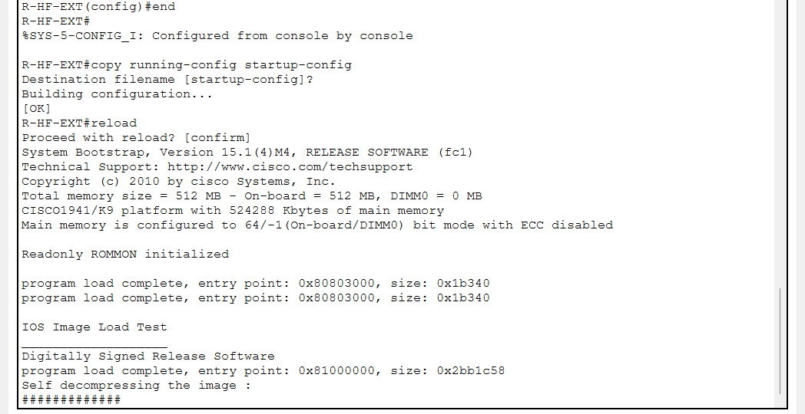

On R-HF-EXT after the restart:

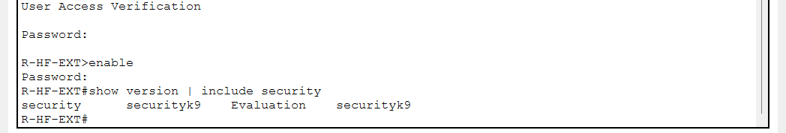

On R-HZ-EXT:


After the boot, log in again: `show version | include security` → `securityk9`

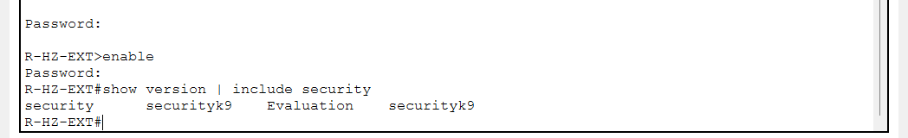

### 3.2 The tunnel

❗ The routers must agree on a language and recognise each other before they encrypt. 💡 Phase 1 (policy + key), phase 2 (transform-set), what enters the tunnel (ACL), and everything tied together in a crypto map on the outgoing port.

**R-HZ-EXT:**
```
configure terminal
crypto isakmp policy 10
encryption aes 256
hash sha
authentication pre-share
group 5
lifetime 86400
exit
crypto isakmp key TeslaVpn2026 address 203.30.0.1
crypto ipsec transform-set VPN-SET esp-aes 256 esp-sha-hmac
ip access-list extended VPN-HZ-HF
permit ip 192.168.0.0 0.0.63.255 192.168.96.0 0.0.3.255
exit
crypto map VPN-MAP 10 ipsec-isakmp
set peer 203.30.0.1
set transform-set VPN-SET
match address VPN-HZ-HF
exit
interface s0/0/1
crypto map VPN-MAP
end
```
**R-HF-EXT** (mirror image):
```
configure terminal
crypto isakmp policy 10
encryption aes 256
hash sha
authentication pre-share
group 5
lifetime 86400
exit
crypto isakmp key TeslaVpn2026 address 203.10.0.1
crypto ipsec transform-set VPN-SET esp-aes 256 esp-sha-hmac
ip access-list extended VPN-HF-HZ
permit ip 192.168.96.0 0.0.3.255 192.168.0.0 0.0.63.255
exit
crypto map VPN-MAP 10 ipsec-isakmp
set peer 203.10.0.1
set transform-set VPN-SET
match address VPN-HF-HZ
exit
interface s0/0/0
crypto map VPN-MAP
end
```

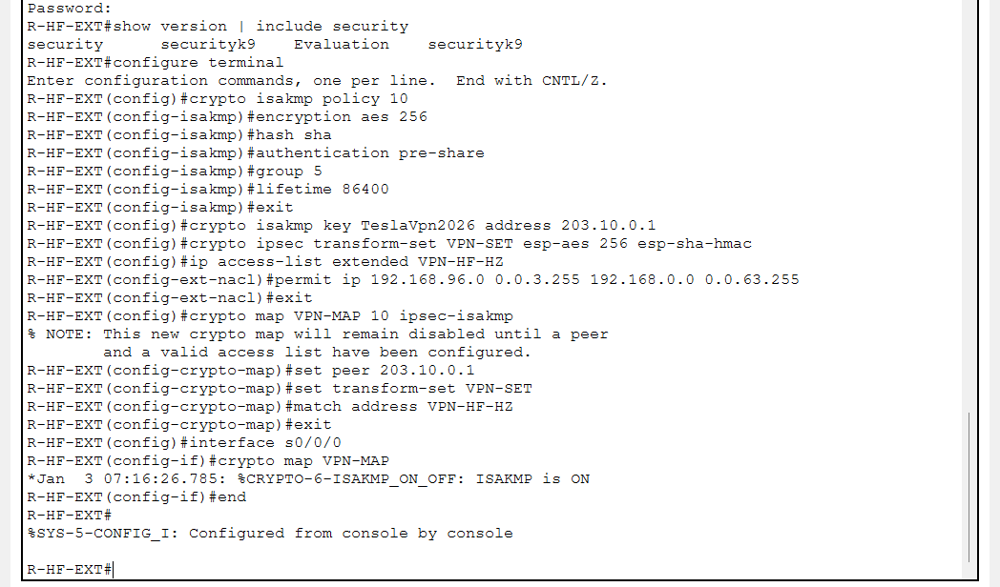

And R-HZ-EXT:

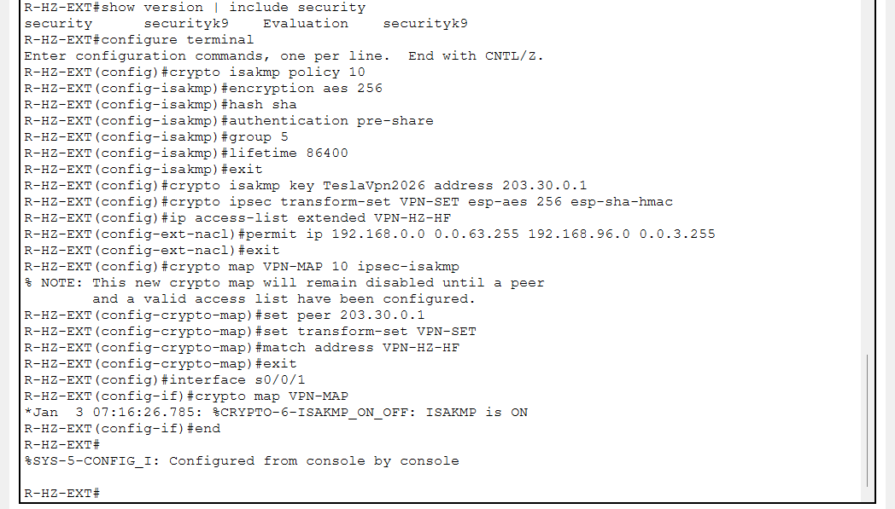

| Command | What it does |
|---|---|
| `crypto isakmp policy 10` | phase 1: must be identical on both sides |
| `crypto isakmp key` | the same key, with the **other side's** address |
| `transform-set` | how the data is encrypted in phase 2 |
| `match address` | what enters the tunnel; a mirror image on the other side |
| `crypto map` on the interface | turns it on, on the **outgoing** port |

⚠️ Use a key without `#`. In our tests a key with `#` never brought the tunnel up.

### 3.3 🔎 It doesn't work! Why?
**PC-HF-CUST-1** → `ping 192.168.52.10`. "Destination host unreachable" from the **provider**:

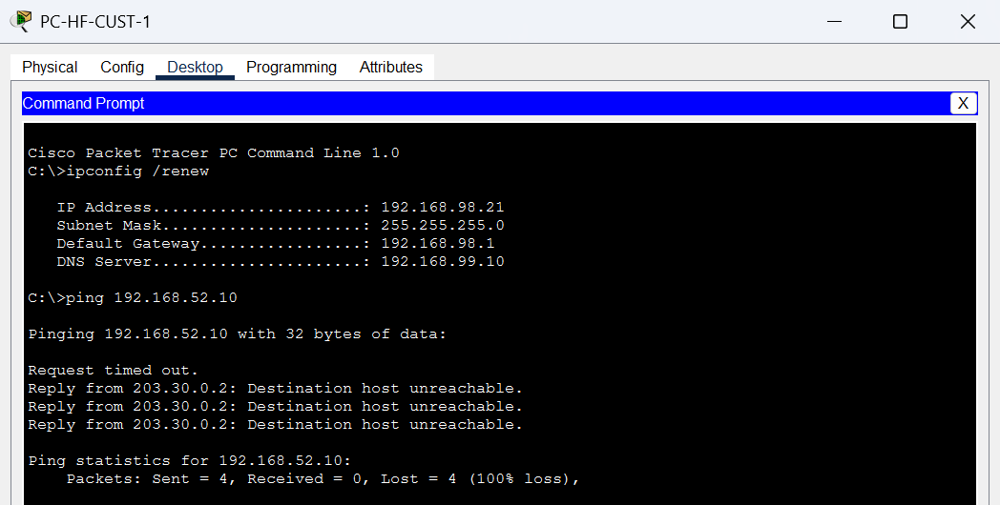

Investigate on R-HF-EXT: `show ip access-lists`, `show crypto isakmp sa`, `show ip nat translations`.

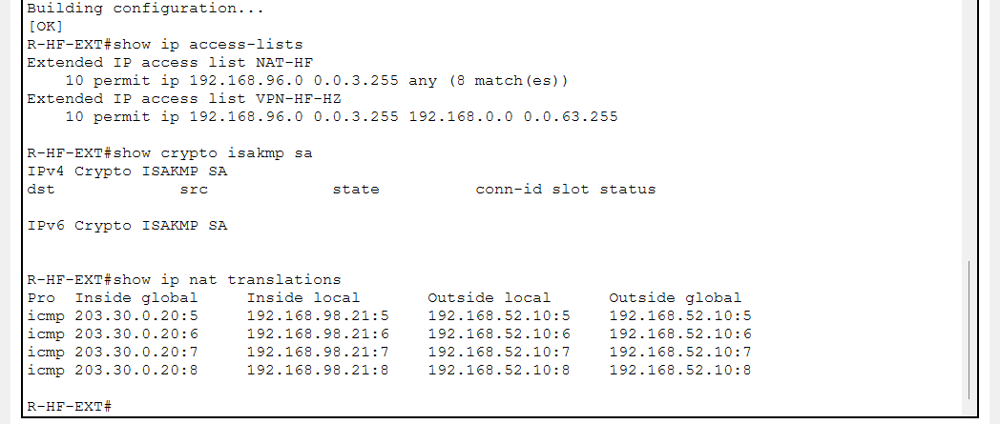

<details><summary>Answer</summary>

The VPN list has no matches, and the NAT list has 8. The router does **NAT before encryption**: the
source became 203.30.0.20, so the packet no longer fits the VPN list and went to the internet, where
nobody knows 192.168.52.10. The fix: tell the NAT **not** to translate traffic to the other branch. The
line must come **before** the permit, so we give it number 5.

</details>

### 3.4 The fix
**R-HZ-EXT:**
```
configure terminal
ip access-list extended NAT-HZ
5 deny ip 192.168.0.0 0.0.63.255 192.168.96.0 0.0.3.255
end
clear ip nat translation *
copy running-config startup-config
```
**R-HF-EXT:**
```
configure terminal
ip access-list extended NAT-HF
5 deny ip 192.168.96.0 0.0.3.255 192.168.0.0 0.0.63.255
end
clear ip nat translation *
copy running-config startup-config
```

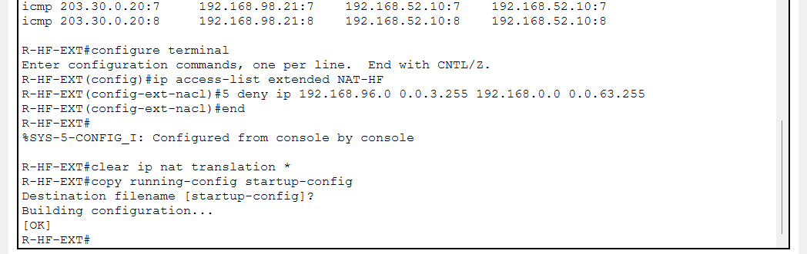

And on R-HZ-EXT:

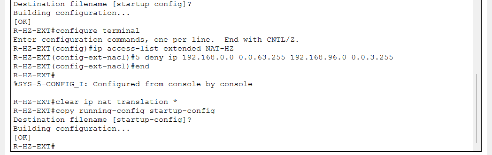

✅ Ping again, **from Haifa only**. The first reply may be lost while the tunnel goes up.

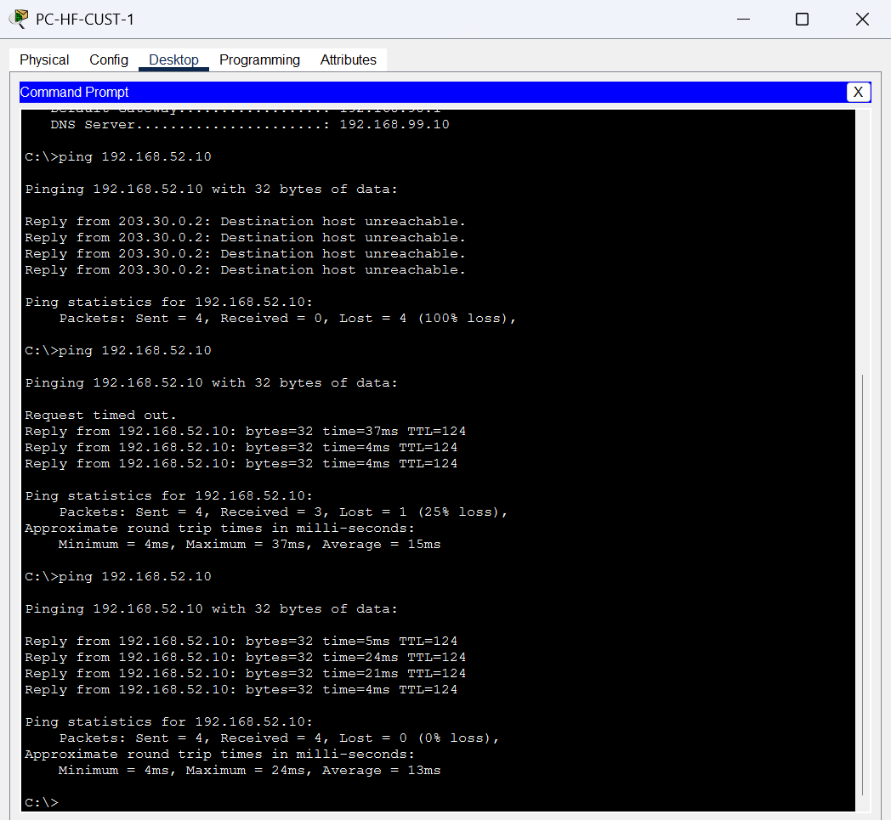

✅ R-HF-EXT: `show crypto isakmp sa` → **QM_IDLE**, and `show crypto ipsec sa` → encaps and decaps rise.

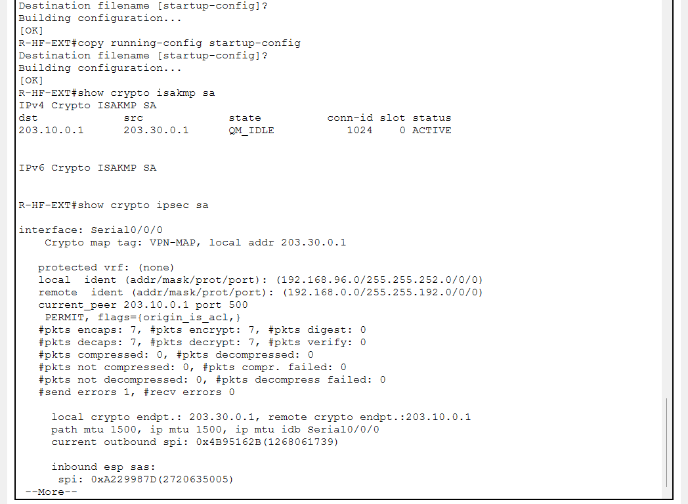

💡 Stuck? Restart the tunnel: on the outgoing port of **both** edge routers `no crypto map VPN-MAP` and then `crypto map VPN-MAP`,
and ping from one side only. (Real routers also have `clear crypto isakmp`; Packet Tracer doesn't.)

<details open><summary><b>📘 The other commands of this mission, explained</b></summary>

| Command | What it does, and why it is here |
|---|---|
| `ping 192.168.52.10` | Sends 4 test messages. Replies = the road works in **both** directions. |
| `license boot module c1900 technology-package securityk9` | Turns on the security package of the 1941. Without it there are no `crypto` commands. |
| `copy running-config startup-config` | Saves what is in memory to the startup file. Without it a power failure erases the work. |
| `reload` | Restarts the router. The licence starts to work only then. |
| `show version \| include security` | Device details. The part after the bar shows only the lines with "security". |
| `encryption aes 256` | The encryption of phase 1: AES with a 256-bit key. |
| `hash sha` | SHA checks that nobody changed the message on the way. |
| `authentication pre-share` | The routers identify themselves with a shared key (written below). |
| `group 5` | The Diffie-Hellman group: how the routers agree on a secret over an open line. |
| `lifetime 86400` | After how many seconds the keys are replaced (86400 = one day). |
| `crypto ipsec transform-set VPN-SET esp-aes 256 esp-sha-hmac` | Phase 2: how the data itself is encrypted (AES 256) and checked (SHA). |
| `ip access-list extended VPN-HZ-HF` | Opens a list by name or number, so lines can be added or inserted. |
| `permit ip 192.168.0.0 0.0.63.255 192.168.96.0 0.0.3.255` | The traffic that enters the tunnel: from our networks to theirs. The other side writes the mirror image. |
| `crypto map VPN-MAP 10 ipsec-isakmp` | Creates the map that joins everything: who, how and what. |
| `set peer 203.30.0.1` | Who: the public address of the other side. |
| `set transform-set VPN-SET` | How: with which encryption. |
| `interface s0/0/1` | Chooses the port. Everything below applies to it, until `exit`. |
| `show ip access-lists` | The lines of the list, and how many packets met each one. |
| `show crypto isakmp sa` | Phase 1. `QM_IDLE` = good. |
| `show ip nat translations` | Who was translated to which address. |
| `5 deny ip 192.168.0.0 0.0.63.255 192.168.96.0 0.0.3.255` | Inserts a line at the **beginning** (5 is before 10): traffic for the tunnel is not translated by NAT. |
| `clear ip nat translation *` | Deletes old translations, so the new rule works immediately. |
| `show crypto ipsec sa` | Phase 2. The `encaps` and `decaps` counters must grow. |
| `no crypto map VPN-MAP` | Takes the map off the port: the tunnel is turned off. |
| `clear crypto isakmp` | Deletes the old tunnel, so it will be built again. |

</details>

**⏭ What comes next.** The data is safe. The routers that carry it still can't be managed safely.

## Mission 4 — SSH, AAA, NTP and Syslog
**📖 How we got here.** The server knows the users since Mission 1, and the devices don't ask it yet.

**🌐 The network now.** The server is ready since Mission 1. Now the devices learn to use it:

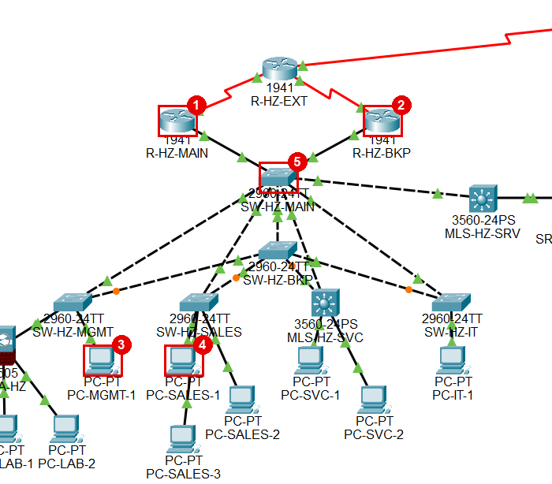

**❗ The problem.** PC-MGMT-1 → `telnet 192.168.12.2`. The router opens the line and closes it: no remote management at all. And if we only set a password, Telnet would send it **unencrypted**:

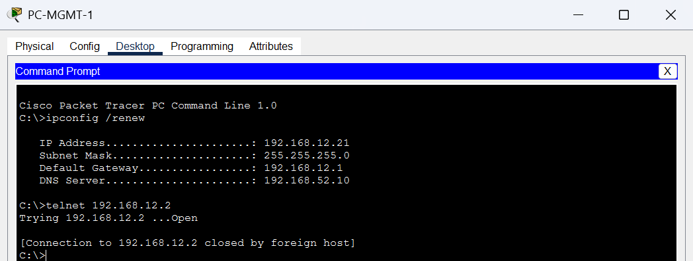

R-HZ-MAIN, `show clock`: the year is 1993, and NTP is off. Such a log proves nothing:

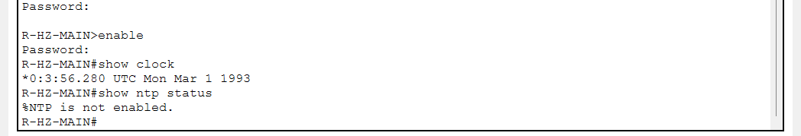

**🎯 What we want now.** Encrypted management (SSH), a personal name for each login (AAA), one time (NTP), one diary (Syslog).

**💡 The solution.** SSH (encrypted), AAA (the user is checked on the server, with a local user as backup), NTP with a key, Syslog, and an access-class so that only management enters (1.3, 1.4).

**📋 Do it in the project.** The order matters: first a local user, and only then `aaa new-model`. Why?

### 🖱 The solution: what to click and what to write
### 4.1 R-HZ-MAIN, and the same on R-HZ-BKP
```
configure terminal
ip domain-name tesla.lab
username admin privilege 15 secret Tesla#Adm1
crypto key generate rsa general-keys modulus 1024
ip ssh version 2
aaa new-model
tacacs-server host 192.168.52.10 key Tesla#Aaa
aaa authentication login default group tacacs+ local
aaa authorization exec default group tacacs+ local
aaa authentication login CONSOLE local
line console 0
login authentication CONSOLE
exit
access-list 12 permit 192.168.12.0 0.0.0.255
line vty 0 4
transport input ssh
login authentication default
access-class 12 in
exit
ntp authentication-key 1 md5 Tesla#Ntp
ntp authenticate
ntp trusted-key 1
ntp server 192.168.52.10 key 1
ntp update-calendar
logging host 192.168.52.10
service timestamps log datetime msec
end
copy running-config startup-config
```

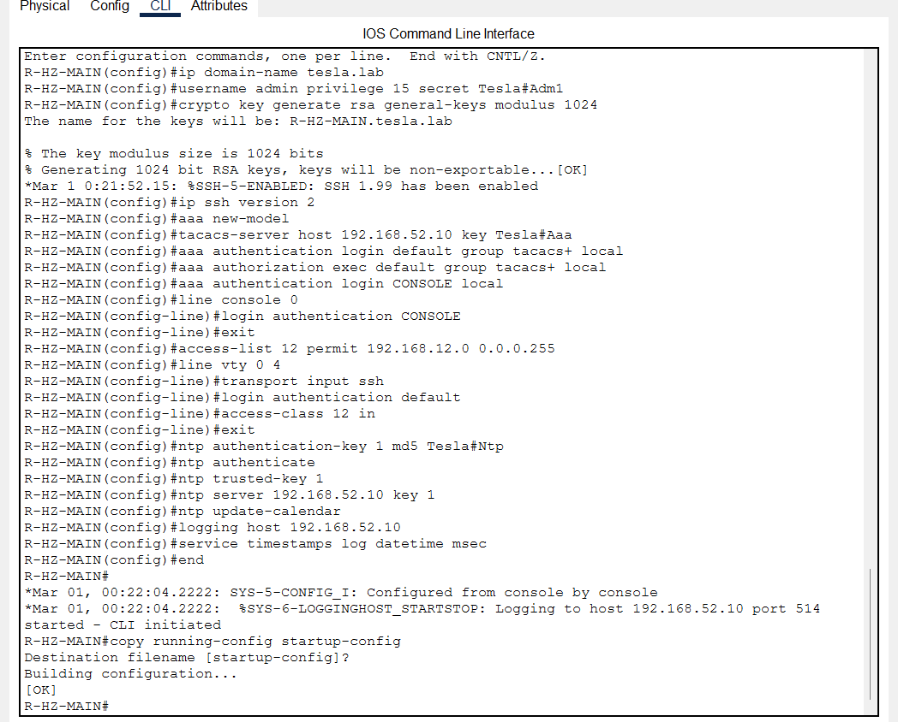

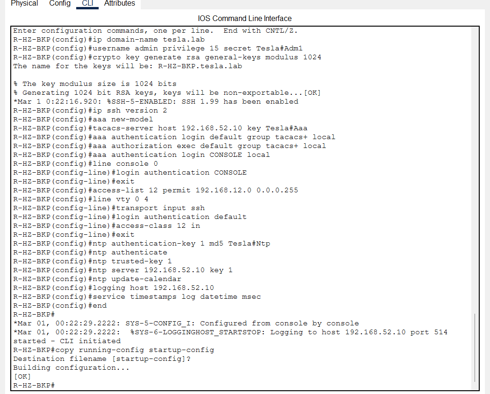

| Command | What it does | Why |
|---|---|---|
| `username admin` **before** `aaa new-model` | a local user | otherwise you lock yourself out |
| `crypto key generate rsa ... 1024` | keys for SSH | without them there is no SSH 2 |
| `group tacacs+ local` | first the server, and if it doesn't answer — the local user | so you're not stuck |
| `CONSOLE local` | the console uses the local user | you can always get in with the cable |
| `access-class 12 in` | only VLAN 12 manages | a standard ACL near the destination |
| `ntp trusted-key` + `key 1` | accepts time only from a signed server | |

⚠️ From now on the **console asks for a username**: `admin` / `Tesla#Adm1`.

### 4.2 Test
1. **PC-MGMT-1**: `ssh -l teslauser 192.168.12.2`, password `Tesla#User`, then `show users`. The user exists **only on the server**, so AAA works.

   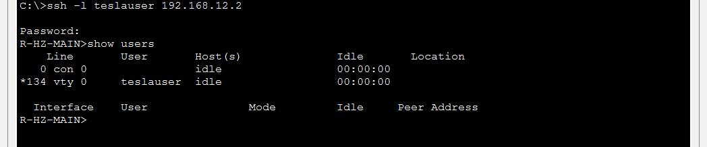
2. `exit`, and `telnet 192.168.12.2` → closed.

   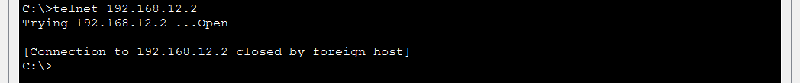
3. **PC-SALES-1**: `ssh -l teslauser 192.168.22.2` → **refused** (access-class).

   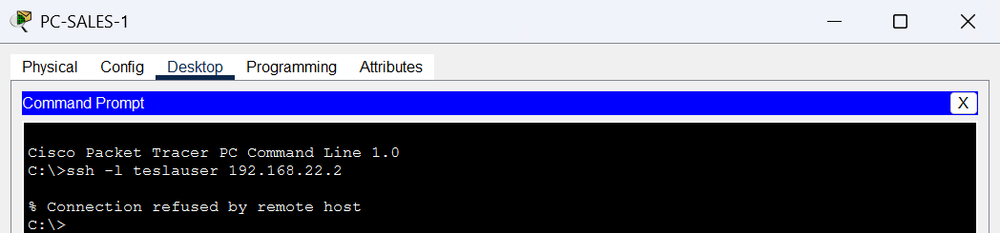
4. R-HZ-MAIN: `show ntp status` → **synchronized** (may take a few minutes).

   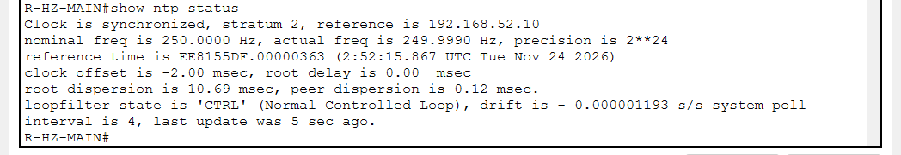
5. On R-HZ-MAIN: `interface g0/1` → `no shutdown` → `shutdown`. Server → SYSLOG: the messages arrived. Notice the jump of the date from 1993 to today: NTP!

   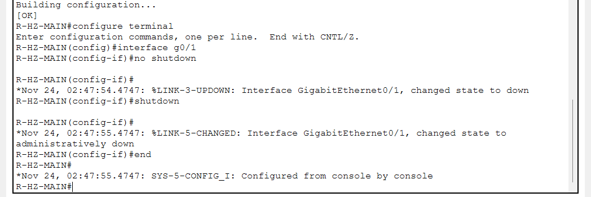

   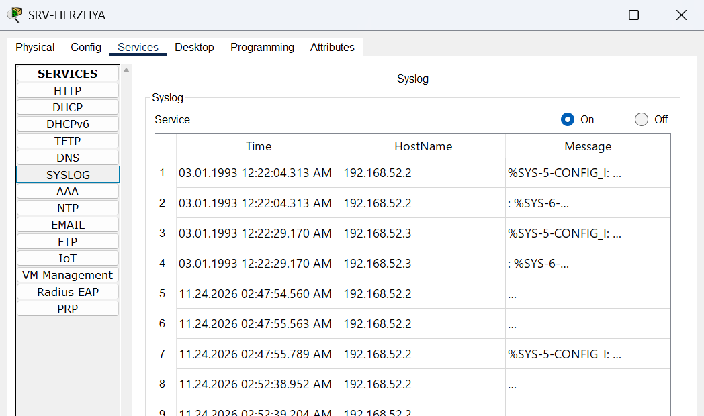

### 4.3 Be'er Sheva and Haifa

❗ The same problem in two more branches. 💡 The same commands, each branch with **its own** server.

Be'er Sheva uses **RADIUS**, Haifa **TACACS+**. The type must be the same on the router and on the server!

<details><summary>R-BS-MAIN, R-BS-BKP (paste the same on both)</summary>

```
configure terminal
ip domain-name tesla.lab
username admin privilege 15 secret Tesla#Adm1
crypto key generate rsa general-keys modulus 1024
ip ssh version 2
aaa new-model
radius-server host 192.168.67.10 key Tesla#Aaa
aaa authentication login default group radius local
aaa authorization exec default group radius local
aaa authentication login CONSOLE local
line console 0
login authentication CONSOLE
exit
line vty 0 4
transport input ssh
login authentication default
exit
ntp authentication-key 2 md5 Tesla#Ntp
ntp authenticate
ntp trusted-key 2
ntp server 192.168.67.10 key 2
ntp update-calendar
logging host 192.168.67.10
service timestamps log datetime msec
end
copy running-config startup-config
```


</details>

<details><summary>R-HF-MAIN, R-HF-BKP (paste the same on both)</summary>

```
configure terminal
ip domain-name tesla.lab
username admin privilege 15 secret Tesla#Adm1
crypto key generate rsa general-keys modulus 1024
ip ssh version 2
aaa new-model
tacacs-server host 192.168.99.10 key Tesla#Aaa
aaa authentication login default group tacacs+ local
aaa authorization exec default group tacacs+ local
aaa authentication login CONSOLE local
line console 0
login authentication CONSOLE
exit
line vty 0 4
transport input ssh
login authentication default
exit
ntp authentication-key 3 md5 Tesla#Ntp
ntp authenticate
ntp trusted-key 3
ntp server 192.168.99.10 key 3
ntp update-calendar
logging host 192.168.99.10
service timestamps log datetime msec
end
copy running-config startup-config
```

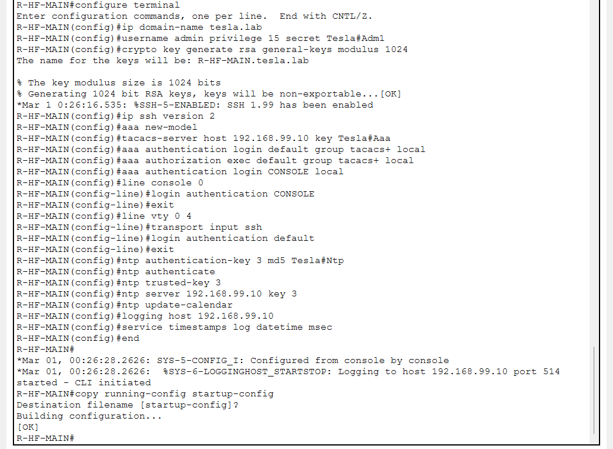


</details>

### 4.4 Switches and edge routers

❗ A layer 2 switch has no IP address, so nobody can manage it from far away. 💡 An address on a VLAN interface, a gateway, and SSH with the local user.

The devices:

| Kind | Devices | The vty line |
|---|---|---|
| routers | ISP, R-HZ-EXT, R-BS-EXT, R-HF-EXT | `line vty 0 4` |
| switches, Herzliya | SW-HZ-MAIN, SW-HZ-BKP, SW-HZ-MGMT, SW-HZ-SALES, SW-HZ-IT, MLS-HZ-SVC, MLS-HZ-SRV | `line vty 0 15` |
| switches, Be'er Sheva | SW-BS-MAIN, SW-BS-BKP, SW-BS-MGMT, SW-BS-CAR, SW-BS-LOG, MLS-BS-SRV | `line vty 0 15` |
| switches, Haifa | SW-HF-MAIN, SW-HF-BKP, SW-HF-MGMT, SW-HF-CHG, SW-HF-CUST, MLS-HF-SRV | `line vty 0 15` |

**Each of the four routers:**
```
configure terminal
ip domain-name tesla.lab
username admin privilege 15 secret Tesla#Adm1
crypto key generate rsa general-keys modulus 1024
ip ssh version 2
line vty 0 4
transport input ssh
login local
end
copy running-config startup-config
```

**Each of the 19 switches:**
```
configure terminal
ip domain-name tesla.lab
username admin privilege 15 secret Tesla#Adm1
crypto key generate rsa general-keys modulus 1024
ip ssh version 2
line vty 0 15
transport input ssh
login local
end
copy running-config startup-config
```

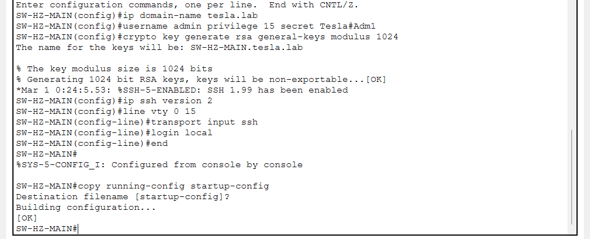

A management address for the three main switches:

**SW-HZ-MAIN:**
```
configure terminal
interface vlan 12
ip address 192.168.12.240 255.255.255.0
no shutdown
exit
ip default-gateway 192.168.12.1
end
copy running-config startup-config
```

**SW-BS-MAIN:**
```
configure terminal
interface vlan 64
ip address 192.168.64.240 255.255.255.0
no shutdown
exit
ip default-gateway 192.168.64.1
end
copy running-config startup-config
```

**SW-HF-MAIN:**
```
configure terminal
interface vlan 96
ip address 192.168.96.240 255.255.255.0
no shutdown
exit
ip default-gateway 192.168.96.1
end
copy running-config startup-config
```
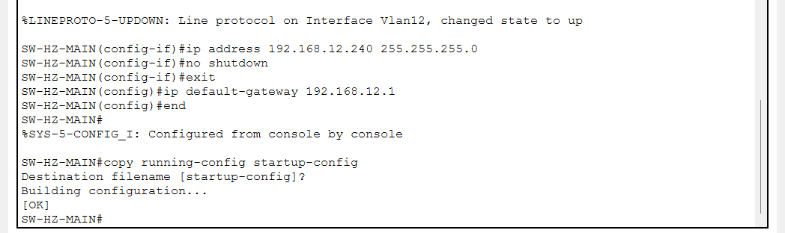

✅ `ssh -l admin 192.168.12.240`


<details open><summary><b>📘 The other commands of this mission, explained</b></summary>

| Command | What it does, and why it is here |
|---|---|
| `telnet 192.168.12.2` | Remote management **without** encryption. Here it must fail. |
| `show clock` | The time of the device. A `*` at the start = not synchronized. |
| `ip domain-name tesla.lab` | A domain name. SSH needs it to build the name of the key. |
| `ip ssh version 2` | Allows only version 2, which is the secure one. |
| `tacacs-server host 192.168.52.10 key Tesla#Aaa` | The address of the TACACS+ server, and the key we share with it. |
| `aaa authentication login default group tacacs+ local` | **Who are you?** First ask the server; if it doesn't answer, use the local user. |
| `aaa authorization exec default group tacacs+ local` | **What may you do?** The server decides the rights after login. |
| `aaa authentication login CONSOLE local` | Another list, only for the console: a local user, so you're never locked out. |
| `line console 0` | Enters the settings of the console port (the blue cable / the CLI tab). |
| `login authentication CONSOLE` | This line uses the list called CONSOLE. |
| `access-list 12 permit 192.168.12.0 0.0.0.255` | A standard list (source only): VLAN 12, the managers. |
| `line vty 0 4` | Enters the settings of the **remote** lines. `0 4` = five sessions together, `0 15` = sixteen. |
| `transport input ssh` | Only SSH enters from remote. Telnet (readable) is closed. |
| `login authentication default` | This line uses the default list: first the server, then the local user. |
| `ntp authentication-key 1 md5 Tesla#Ntp` | The key with which the time server signs (number and text). |
| `ntp authenticate` | Demand a signature: don't believe just anybody about the time. |
| `ntp server 192.168.52.10 key 1` | From whom to take the time, and with which key. |
| `ntp update-calendar` | Also updates the hardware clock, so the time survives a restart. |
| `logging host 192.168.52.10` | Sends the messages of the device to this Syslog server. |
| `service timestamps log datetime msec` | Adds date, time and milliseconds to each message. |
| `copy running-config startup-config` | Saves what is in memory to the startup file. Without it a power failure erases the work. |
| `ssh -l teslauser 192.168.12.2` | Encrypted remote management: `-l` and the user name, then the address of the device. |
| `show users` | Who is logged in now, and from where. |
| `show ntp status` | Is the clock synchronized with the server. |
| `interface g0/1` | Chooses the port. Everything below applies to it, until `exit`. |
| `no shutdown` | Turns the port on. Router ports are off by default. |
| `shutdown` | Turns the port off. |
| `radius-server host 192.168.67.10 key Tesla#Aaa` | The address of the RADIUS server, and the key we share with it. |
| `login local` | The line asks for a **user and password** from the list inside the device. |
| `interface vlan 12` | A virtual interface of the VLAN: the address **of the device itself** in that VLAN (for management, or on the ASA for a side). |
| `ip address 192.168.12.240 255.255.255.0` | The address and the mask of this interface. In a LAN it is the address of the gateway. |
| `ip default-gateway 192.168.12.1` | The gateway **of the switch itself**, so its answers can leave the VLAN. |

</details>

**⏭ What comes next.** One corner is left: the test lab, which has no protection at all.

## Mission 5 — The ASA firewall
**📖 How we got here.** ACLs check each packet alone. The lab needs something smarter.

**🌐 The network now.** A test lab (PC-LAB-1, PC-LAB-2) behind a firewall that is still not configured:


**❗ The problem.** The lab must reach the server, but nobody should reach **into** the lab. PC-LAB-1 → `ipconfig`, `ping 192.168.52.10`: no address and no network.


A router passes everything that isn't forbidden, so an ACL alone must list every danger.

**🎯 What we want now.** A firewall that remembers conversations: the lab may go out and get answers, and nobody may come in.

**💡 The solution.** A firewall works the other way: from outside **everything** is forbidden unless it's an answer to somebody inside (security levels + `inspect`, 1.4).

**📋 Do it in the project.** inside = 100, outside = 0, default route to the VIP, NAT, DHCP for the lab, inspect for icmp, http, dns. Predict who can ping whom.

### 🖱 The solution: what to click and what to write
Click **ASA-HZ** → **CLI** → `enable` → **Enter** (there is no password):

⚠️ If you opened the **Config** tab of the ASA, you may already see `ciscoasa#` or `ciscoasa(config)#`. Then don't write `enable` again. From `(config)#` write `end` first.


**ASA-HZ** → CLI. `enable`, and just **Enter** at the password:
```
configure terminal
hostname ASA-HZ
interface Ethernet0/0
switchport access vlan 2
interface Ethernet0/1
switchport access vlan 1
interface Ethernet0/2
switchport access vlan 1
interface Vlan1
nameif inside
security-level 100
ip address 192.168.1.1 255.255.255.0
interface Vlan2
nameif outside
security-level 0
no ip address
ip address 192.168.12.15 255.255.255.0
exit
route outside 0.0.0.0 0.0.0.0 192.168.12.1
object network INSIDE-NET
subnet 192.168.1.0 255.255.255.0
nat (inside,outside) dynamic interface
end
```


```
configure terminal
no dhcpd auto_config outside
dhcpd address 192.168.1.10-192.168.1.30 inside
dhcpd dns 192.168.52.10
dhcpd enable inside
class-map inspection_default
match default-inspection-traffic
exit
policy-map global_policy
class inspection_default
inspect icmp
inspect http
inspect dns
exit
service-policy global_policy global
end
write memory
```


⚠️ In Packet Tracer `exit` from `object network` jumps straight to `#`, so here we use `end` and open `configure terminal` again.

✅ `show switch vlan` and `show interface ip brief`


✅ **PC-LAB-1** → IP Configuration → **DHCP** (1): 192.168.1.10 from the ASA. (In Packet Tracer the DNS may stay 0.0.0.0, so test with addresses.) Then `ping 192.168.52.10` works:


✅ Browse from PC-LAB-1 to `http://192.168.52.10`, and within 30 seconds on the ASA: `show xlate`


✅ **From outside in.** PC-MGMT-1 → `ping 192.168.1.10` fails. At first because the router doesn't know the network
("unreachable" from the provider). So that only the ASA decides, add **for the test** on R-HZ-MAIN:
`ip route 192.168.1.0 255.255.255.0 192.168.12.15`, and ping again: **timed out**, the ASA blocked it. Then remove it with `no ip route ...`.


| Command | What it does | Why |
|---|---|---|
| `nameif inside` / `outside` | gives the port a role | the ASA works with names, not with numbers |
| `security-level 100` / `0` | how much we trust the side | high → low is allowed |
| `route outside 0.0.0.0 0.0.0.0 192.168.12.1` | default route | one only, to the HSRP VIP |
| `object network` + `nat ... dynamic interface` | PAT through the outside port | the branch doesn't know 192.168.1.0 |
| `dhcpd address ... inside` | the ASA is a DHCP server | for the lab PCs |
| `inspect icmp` | remembers outgoing pings | otherwise the answers are blocked |

<details open><summary><b>📘 The other commands of this mission, explained</b></summary>

| Command | What it does, and why it is here |
|---|---|
| `ipconfig` | Shows the address, mask and gateway of the PC. |
| `ping 192.168.52.10` | Sends 4 test messages. Replies = the road works in **both** directions. |
| `hostname ASA-HZ` | Gives the device its name, the one you see in the prompt. It prevents typing on the wrong device. |
| `interface Ethernet0/0` | Chooses the port. Everything below applies to it, until `exit`. |
| `switchport access vlan 2` | Which VLAN the port belongs to. |
| `interface Vlan1` | A virtual interface of the VLAN: the address **of the device itself** in that VLAN (for management, or on the ASA for a side). |
| `ip address 192.168.1.1 255.255.255.0` | The address and the mask of this interface. In a LAN it is the address of the gateway. |
| `no ip address` | Deletes the old address, so we can give a new one. |
| `subnet 192.168.1.0 255.255.255.0` | Which network the object is. |
| `nat (inside,outside) dynamic interface` | PAT: the lab goes out with the outside address of the ASA. |
| `no dhcpd auto_config outside` | Cancels an automatic setting that comes from the factory and disturbs us. |
| `dhcpd dns 192.168.52.10` | The DNS that the lab receives. |
| `dhcpd enable inside` | Turns on the ASA's DHCP server, on the inside. |
| `class-map inspection_default` | Chooses traffic: "what do we look at?" |
| `match default-inspection-traffic` | The common protocols, by their default ports. |
| `policy-map global_policy` | The policy: "what do we do with it?" |
| `class inspection_default` | For the traffic chosen above: |
| `service-policy global_policy global` | Turns the policy on, for all the ports. |
| `write memory` | The same save, as it is written on the ASA. |
| `show switch vlan` | On the ASA: which ports are in which VLAN. |
| `show interface ip brief` | On the ASA: the ports, addresses and state. |
| `show xlate` | On the ASA: the active translations. |

</details>

**⏭ What comes next.** The project is complete. Do the final tests, and then practise for the exam.

## 👀 See it happen — the ACL and the tunnel
Simulation was explained in [lesson 1](../lesson-01/).

### A. The ACL drops a packet
In Realtime check the address of PC-BS-MGMT-2 (here 192.168.64.20). **Simulation** → only **ICMP** → ping it from
PC-BS-LOG-1, and step until a red packet appears:


The red packet is the answer of R-BS-MAIN. Now open the packet that **entered** R-BS-MAIN → **Next Layer** twice, to layer 3:


Packet Tracer shows **the exact line** that blocked it. This is the best way to debug an ACL.

❓ All the Out Layers are empty. What does that mean?

<details><summary>Answer</summary>

The packet stopped here. It has no way out.

</details>

### B. The VPN hides the addresses
In Realtime: `ping 192.168.52.10` from PC-HF-CUST-1 until it answers, so the tunnel is up. **Simulation** → **ICMP** and also
**IPSec** (tab Misc) → ping again, and open the packet in three places:

**R-HF-EXT, the entrance to the tunnel:**


**ISP, in the middle of the internet:**


**R-HZ-EXT, the exit of the tunnel:**


| Where | Source | Destination | Do we see that it's ICMP? |
|---|---|---|---|
| Haifa | 192.168.98.25 | 192.168.52.10 | yes |
| the internet | **203.30.0.1** | **203.10.0.1** | **no** |
| Herzliya | 192.168.98.25 | 192.168.52.10 | yes |


❓ Compare with lesson 4. What is the difference between this and NAT?

<details><summary>Answer</summary>

NAT **replaces** an address, and the rest of the packet can be read. The VPN puts the **whole** packet, encrypted, inside a new
packet, and the other side gets it back exactly as it was.

</details>

✏️ **Try:** ping 203.10.0.2 from PC-HF-CUST-1. Does it go through the tunnel?

<details><summary>Answer</summary>

No. The destination isn't in the list of the tunnel, so it goes out with NAT as usual, and on the ISP we see ICMP.

</details>

## 🧯 It doesn't work?
| What you see | Probably | What to do |
|---|---|---|
| `renew` fails after an ACL | no bootps line, or only on one router | `show access-lists` on both |
| `crypto` → `Invalid input` | no licence, or no `reload` | `show version`, include security |
| the VPN doesn't come up | key, peer, or policy is different | compare the two configurations line by line |
| the tunnel is up, ping fails | NAT takes the packet | the `5 deny` line on both sides |
| SSH `Connection refused` | no RSA key, or access-class | `show ip ssh`, from VLAN 12 |
| locked out | AAA without a local user | console: `admin` / `Tesla#Adm1` |
| NTP is not synchronized | the key, or too little time | the same key number on the server, wait 5 minutes |

---

## Final tests — the whole project
| Topic | Check | Correct result |
|---|---|---|
| VLAN / VTP | `show vlan brief`, `show vtp status` | the same VLANs in the branch |
| Trunk / STP | `show interfaces trunk`, `show spanning-tree` | the main switch is root |
| HSRP | `show standby brief` | Active / Standby, replaced on failure |
| DHCP / DNS / web / FTP / mail | from the PCs | everything works |
| DHCP snooping | `show ip dhcp snooping` | trusted ports |
| Port security | a strange MAC | err-disabled |
| OSPF / EIGRP | `show ip ospf neighbor`, `show ip eigrp neighbors` | FULL / two neighbors |
| BGP | `show ip route bgp` on an EXT router | `B` routes to the other branches |
| NAT | `show ip nat translations` | static, pool, PAT |
| VPN | `show crypto isakmp sa` | QM_IDLE |
| ACL | `show access-lists` | matches |
| SSH / AAA | `ssh -l teslauser` | in. Telnet is rejected |
| NTP / Syslog | `show ntp status`, server | synchronized, messages |
| ASA | `show xlate` | inside → outside works, the reverse doesn't |

Finally: save on all devices, save the file, **close Packet Tracer, open again** and check that everything was saved.

## 🔎 Find the bug — from real projects
1. The ACL was only on the backup router.
2. The router in Be'er Sheva used RADIUS, and the server was set to TACACS.
3. `ip ssh version 1` and users with `password 0`.
4. The VPN encrypted only VLAN 12 ↔ VLAN 96, with no NAT exemption.
5. The ASA had three default routes, one of them to **inside**.

<details><summary>Answer</summary>

1. As long as the main router is Active the ACL does nothing.
2. They don't speak the same language, so login always falls back to the local user. The same type and key on both sides.
3. SSH 1 is broken, and password 0 is readable in `show run`. Create RSA keys first, then version 2 and `secret`.
4. Even if the tunnel comes up, NAT takes the packets. All the networks, plus the `deny` line in the NAT list.
5. One default route only, towards outside, to the HSRP **VIP**.

</details>

## 🏋 Exercises
1. On R-HF-EXT replace the key with `Tesla123` and restart the tunnel (`no crypto map VPN-MAP` and `crypto map VPN-MAP` on s0/0/0). Ping from Haifa. What does `show crypto isakmp sa` show now? Put it back.
2. Allow logistics (66) also `ping` to the server only. Where in the list must the line be?
3. Stop the AAA service on the server and connect by SSH with `admin`. Why does it work?

<details><summary>Answers (we tested them)</summary>

1. The ping fails, and instead of `QM_IDLE` you see `MM_KEY_EXCH ... (deleted)`: phase 1 stopped at the key. Without restarting the tunnel nothing changes, because the old tunnel keeps working! To return: `no crypto isakmp key Tesla123 address 203.10.0.1`, the original key, and restart.

   
2. Before the deny of 67.0 (line 60): `ip access-list extended 110` → `55 permit icmp 192.168.66.0 0.0.0.255 host 192.168.67.10`. Remove it with `no 55`.
3. `teslauser` gets `Login invalid`, and `admin` enters: the server doesn't answer, so `local` is used. Put the service back On.

</details>

## 🎓 Explain it to the examiner
- Why must the order of the ACL lines be right? What is the invisible line?
- What are phase 1 and phase 2? What is "interesting traffic"?
- Why must VPN traffic be exempted from NAT?
- TACACS+ against RADIUS: three differences.
- What is the difference between the ASA and a router with an ACL? What does `inspect` do?

<details><summary>Model answers</summary>

1. The first match decides. At the end there is an invisible `deny ip any any`.
2. Phase 1: the routers authenticate (key) and build a protected channel. Phase 2: encrypts the data itself. Interesting traffic: what the ACL in `match address` permits.
3. NAT happens before encryption: the source changes, the packet no longer fits the VPN list, and it goes out unencrypted.
4. TCP 49 against UDP; encrypts everything against only the password; separates authentication and authorization, so it suits device management.
5. A firewall remembers connections (stateful) and has security levels. A regular ACL checks every packet by itself. `inspect` follows a protocol so that its answers may return.

</details>

## ✏️ Exit quiz (3 minutes)
1. An ACL has only one line: `deny ip host 1.1.1.1 any`. What passes?
2. Which state shows that phase 1 is OK?
3. Why must the local user exist before `aaa new-model`?
4. From inside (100) to outside (0): allowed or blocked?
5. Why does a log need NTP?

<details><summary>Answers</summary>

1. Nothing, because of the invisible deny.
2. QM_IDLE.
3. So you don't get locked out.
4. Allowed.
5. So that the times of all the devices can be compared.

</details>

## ⏭ What we did, and what comes next
**What we did.** The four wishes of the manager came true: organized (1–3), survives failures (2–4), connects the branches (4), doesn't let strangers in (2–5).

**Look back.** Every step answered a problem that the step before it created. If somebody asks *"why did you do this?"*, the answer always begins with *"because before that…"*. This is exactly what an examiner wants to hear.

**What comes next.** Your [project book](#-your-project-book), and then the [exam practice](../exam/): questions, missions and faults like the examiner gives.

## 🛠 Your project book
- [ ] Every ACL, line by line: who, to where, why.
- [ ] The VPN: phase 1, phase 2, interesting traffic, and why it needs the NAT exemption.
- [ ] SSH 2, AAA, NTP with a key, Syslog, the ASA: one paragraph each.
- [ ] The final test table with a screenshot for every row.
- [ ] Only what you **really built** goes into the book.

➡ Finished? Do the [final check](../from-zero/README.md#final-check): 14 tests that prove the project is complete.
